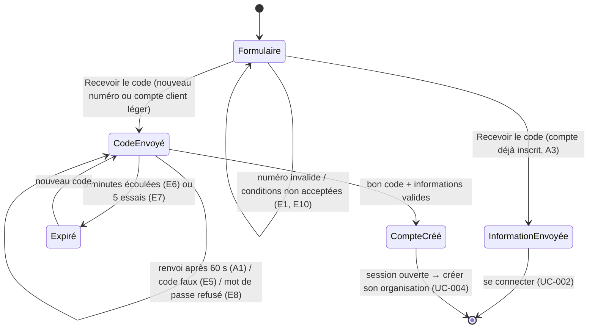

# UC-001 — Créer son compte propriétaire

| Champ | Valeur |
|---|---|
| Statut | Prêt pour dev |
| Priorité | Must |
| Module | `identity` |
| Auteur | use-case-writer (rédigé avec la session principale) |
| Date | 2026-11-18 |
| Use cases liés | UC-004 (suit : créer son organisation), UC-002 (se connecter), UC-003 (réinitialiser son mot de passe), UC-009 (compte client léger) |
| Exigences couvertes | EX-001, EX-011, EX-012, EX-018, EX-019, EX-020, EX-023, EX-025, D-017, D-018 |

## 0. Traçabilité

| Exigence | Source | Où elle est traitée dans ce UC |
|---|---|---|
| EX-001 | prd.md §3 Hiérarchie | RG-001-01, RG-001-10, scénarios « compte client léger complété », « deux confirmations simultanées » |
| EX-011, EX-012 | prd.md §2, §4 | RG-001-13, scénario « aucun rôle à la création » |
| EX-018 | prd.md §7 Étape 1 | Flux nominal 1-2, RG-001-07 à RG-001-09, §14 Données |
| EX-019 | prd.md §7 Étape 1 | Postconditions, flux nominal 10, RG-001-13 |
| EX-020 | prd.md §7 | §15 (guidage, mesure), messages des flux d'exception |
| EX-023 | prd.md §11 | RG-001-14 |
| EX-025 | prd.md §12 Données | §14 Données (collecte minimale), RG-001-16, Q5 |
| D-017 | DECISIONS.md | RG-001-03, RG-001-07, flux nominal 3-8 |
| D-018 | DECISIONS.md | RG-001-01, RG-001-10, A2 |

## 1. Objectif

Permettre à un responsable de salon de créer, seul et depuis son téléphone, une identité de connexion sûre :
son numéro est prouvé par un code SMS et il choisit un mot de passe. C'est la porte d'entrée de l'onboarding
(UC-004).

## 2. User story

> En tant que **responsable d'un salon**,
> je veux **créer mon compte GoMeCoiffer avec mon numéro de téléphone**,
> afin de **configurer ensuite mon salon et gérer mes rendez-vous**.

## 3. Acteurs

- **Acteur principal** : le futur propriétaire (personne non technique, sur smartphone, réseau parfois lent).
- **Acteurs secondaires** : le fournisseur SMS (envoi du code) ; le système (limitation des envois, expiration des codes).

## 4. Déclencheur

Le visiteur choisit « Créer mon compte salon » depuis la marketplace ou la page d'accueil professionnelle.

## 5. Préconditions

- Le visiteur n'est pas connecté.
- Il dispose d'un téléphone capable de recevoir un SMS au numéro qu'il saisit.

## 6. Postconditions

- **En cas de succès** :
  - un utilisateur existe pour ce numéro, avec un nom, un mot de passe et éventuellement un e-mail ;
  - le numéro est marqué vérifié à la date de la vérification ;
  - le code utilisé ne peut plus servir ;
  - une session est ouverte ; l'utilisateur n'a encore **aucune organisation, aucun salon, aucun rôle** ;
  - il est dirigé vers « Créer votre organisation » (UC-004) ;
  - la création (ou la complétion d'un compte client léger) est tracée dans le journal d'audit.
- **En cas d'échec** : aucun utilisateur n'est créé ni modifié ; aucune session n'est ouverte ; un code non
  utilisé expire seul au bout de 5 minutes.

## 7. Règles métier

| ID | Règle | Exemple | Source |
|---|---|---|---|
| RG-001-01 | Un numéro de téléphone ne porte qu'**une seule identité**. | Si Mireille Ndongo a déjà réservé avec 6 77 12 34 56, son compte propriétaire est **ce même** utilisateur. | EX-001, D-018 |
| RG-001-02 | Le numéro doit être camerounais : +237 suivi de 9 chiffres commençant par 6 (mobile) ou 2 (fixe). | « 6 77 12 34 56 » → +237677123456 accepté ; « 6 77 12 34 5 » (8 chiffres) refusé ; « +33 6 12 34 56 78 » refusé. | EX-018, [HYPOTHÈSE] Q7 |
| RG-001-03 | Le compte n'est créé qu'**après** la saisie du bon code SMS envoyé au numéro. | Sans code, rien n'est créé, même si le formulaire est complet. | D-017 |
| RG-001-04 | Un code d'inscription compte **6 chiffres**, est valable **5 minutes**, accepte **5 essais** et ne sert **qu'une fois**. | Code envoyé à 10 h 00 → refusé à 10 h 05 et 1 seconde ; 6e essai refusé même avec le bon code. | skill security |
| RG-001-05 | Un nouveau code ne peut être demandé **qu'après 60 secondes**, et au plus **5 codes par numéro et par heure**. | Demande à 10 h 00 puis à 10 h 00 min 40 s → refusée (« patientez 20 secondes ») ; 6e demande dans l'heure → refusée. | skill security, D-021 |
| RG-001-06 | Un seul code est actif par numéro pour l'inscription : un nouveau code **annule** le précédent. | Codes 482913 puis 105377 : seul 105377 est accepté. | skill security |
| RG-001-07 | Le mot de passe compte **10 à 128 caractères**, ne figure pas dans la liste des mots de passe courants et ne reprend pas le numéro. | « salon2026 » (9) refusé ; « 677123456ab » refusé (contient le numéro) ; « motdepasse123 » refusé (courant) ; « Akwa-Tresses-27 » accepté. | D-017, D-020 |
| RG-001-08 | Le nom du responsable est obligatoire, de 2 à 80 caractères. | « Mireille Ndongo » accepté ; « M » refusé. | EX-018 |
| RG-001-09 | L'e-mail est facultatif ; s'il est saisi, il doit être bien formé. Il n'est ni un identifiant de connexion ni vérifié au MVP. | « mireille@gobeauty.cm » accepté ; « mireille@ » refusé ; vide accepté. | EX-018, [HYPOTHÈSE] Q4 |
| RG-001-10 | Si le numéro porte un **compte client léger** (sans mot de passe), la confirmation **complète** ce compte (nom, mot de passe, e-mail) au lieu d'en créer un autre ; ses réservations restent les siennes. | Mireille avait 2 réservations comme cliente : après inscription, même utilisateur, 2 réservations toujours visibles dans « Mes réservations ». | D-018 |
| RG-001-11 | Si le numéro porte déjà un compte **avec mot de passe**, aucune inscription n'est possible : le SMS envoyé n'a **pas de code** et invite à se connecter ou à réinitialiser le mot de passe. | Paul, coiffeur déjà inscrit, tente de s'inscrire : il reçoit « Un compte GoMeCoiffer existe déjà pour ce numéro… ». | EX-001, D-019 |
| RG-001-12 | L'écran affiché après « Recevoir le code » est **le même** quel que soit l'état du numéro (nouveau, client léger, déjà inscrit). | Un tiers qui saisit le numéro de Paul ne peut pas savoir si Paul a un compte. | skill security, D-019 |
| RG-001-13 | Le compte créé n'a **aucun rôle** : ni rôle salon (il n'appartient encore à aucun salon), ni rôle système (attribués seulement par GoMeCoiffer). | Après inscription, accéder à l'administration GoMeCoiffer est refusé. | EX-011, EX-012 |
| RG-001-14 | La création, ou la complétion d'un compte client léger, est **tracée** dans le journal d'audit (qui, quand, quoi), sans le mot de passe ni le code. | Ligne « compte propriétaire créé » datée de 10 h 02. | EX-023 |
| RG-001-15 | Si le SMS ne peut pas partir (fournisseur indisponible), aucun code n'est actif et la tentative **ne compte pas** dans la limite d'envois. | Panne à 10 h 00 → message « réessayez dans quelques minutes » ; la demande de 10 h 03 est acceptée. | D-021 |
| RG-001-16 | L'inscription exige l'acceptation des conditions d'utilisation et de la politique de confidentialité ; la date d'acceptation est conservée. | Case non cochée → « Recevoir le code » reste refusé avec l'explication. | EX-025, D-022 |

## 8. Flux nominal

1. Le visiteur ouvre « Créer mon compte salon ».
2. Il saisit son nom, son numéro, éventuellement son e-mail, choisit un mot de passe et accepte les conditions.
3. Il demande « Recevoir le code ».
4. Le système vérifie le format du numéro et les limites d'envoi, puis envoie un code à 6 chiffres par SMS.
5. Le système affiche « Saisissez le code reçu par SMS au 6 77 •• •• 56 », avec le temps restant et le délai avant renvoi.
6. Le visiteur saisit le code.
7. Le système vérifie le code (bon, non expiré, essais restants) et le désactive.
8. Le système vérifie le nom, le mot de passe et l'e-mail, puis crée l'utilisateur avec son numéro vérifié.
9. Le système trace la création et ouvre une session.
10. Le système affiche « Votre compte est prêt. Créez maintenant votre organisation », puis enchaîne sur UC-004.

## 9. Flux alternatifs

- **A1 — Renvoi du code** (étape 5) : après 60 secondes, le visiteur demande un nouveau code ; l'ancien est
  annulé (RG-001-06) ; retour à l'étape 5.
- **A2 — Numéro d'un compte client léger** (étape 8) : le système complète l'utilisateur existant (nom, mot de
  passe, e-mail) au lieu d'en créer un (RG-001-10) ; la trace indique « compte client complété » ; suite à
  l'étape 9.
- **A3 — Numéro d'un compte déjà inscrit** (étape 4) : le système envoie un SMS d'information sans code
  (RG-001-11) et affiche le **même écran** qu'à l'étape 5 (RG-001-12) ; le visiteur, qui ne reçoit pas de code,
  suit le lien « Vous avez déjà un compte ? Se connecter » ; fin du use case.
- **A4 — Correction du numéro** (étape 5) : le visiteur choisit « Modifier mon numéro » ; retour à l'étape 2 ;
  le code envoyé à l'ancien numéro expirera seul.

## 10. Flux d'exception

- **E1 — Numéro invalide** (étape 3) : refus ; message « Saisissez un numéro camerounais de 9 chiffres, par
  exemple 6 77 12 34 56. » ; aucun SMS.
- **E2 — Renvoi trop tôt** (étape 3 ou A1) : refus ; « Un code vient d'être envoyé. Vous pourrez en demander un
  autre dans 20 secondes. »
- **E3 — Trop de codes demandés** (étape 3) : refus ; « Trop de codes demandés pour ce numéro. Réessayez dans une
  heure ou contactez l'assistance. »
- **E4 — Fournisseur SMS indisponible** (étape 4) : « L'envoi du SMS est impossible pour le moment. Réessayez dans
  quelques minutes. » ; la tentative n'est pas comptée (RG-001-15).
- **E5 — Code faux** (étape 7) : refus ; « Code incorrect. Il vous reste 3 essais. » ; aucun compte créé.
- **E6 — Code expiré** (étape 7) : refus ; « Ce code a expiré. Demandez-en un nouveau. » ; aucun compte créé.
- **E7 — Essais épuisés** (étape 7) : refus, même avec le bon code ; « Trop d'essais. Demandez un nouveau code. »
- **E8 — Mot de passe refusé** (étape 8) : refus ; message qui dit **pourquoi** (« au moins 10 caractères »,
  « trop courant, choisissez une phrase propre à vous », « ne doit pas contenir votre numéro ») ; le code
  n'est **pas** consommé pour permettre la correction sans nouveau SMS.
- **E9 — Nom ou e-mail invalide** (étape 8) : refus champ par champ ; le code n'est pas consommé.
- **E10 — Conditions non acceptées** (étape 3) : refus ; « Acceptez les conditions d'utilisation pour continuer. »
- **E11 — Deux confirmations simultanées pour le même numéro** (étape 8) : une seule réussit ; l'autre reçoit
  « Ce code a déjà été utilisé. Connectez-vous. » ; un seul utilisateur existe (RG-001-01).
- **E12 — Inscription demandée alors qu'une session est ouverte** (étape 1) : le visiteur est dirigé vers son
  espace ; aucune inscription.

> Les messages ne citent jamais le nom ni l'existence d'un autre compte (RG-001-12).

## 11. Workflow



## 12. Scénarios d'acceptation (BDD)

Identiques à `features/identity/creer-son-compte-proprietaire.feature`.

```gherkin
# language: fr
@UC-001
Fonctionnalité: Créer son compte propriétaire
  Pour configurer son salon puis gérer ses rendez-vous,
  un responsable de salon crée son compte avec son numéro de téléphone,
  prouvé par un code SMS, et un mot de passe.

  Contexte:
    Étant donné que nous sommes le 18/11/2026 à 10 h 00, heure de Douala
    Et que les SMS sont envoyés normalement

  @nominal @RG-001-03 @EX-018 @EX-019
  Scénario: Un nouveau responsable crée son compte avec le code reçu par SMS
    Étant donné que Mireille Ndongo a demandé un code d'inscription pour le 6 77 12 34 56
    Et qu'elle a reçu le code "482913" par SMS
    Quand elle confirme son inscription avec le code "482913", le nom "Mireille Ndongo" et le mot de passe "Akwa-Tresses-27"
    Alors son compte est créé pour le +237677123456
    Et elle est connectée
    Et on l'invite à créer son organisation

  @nominal @RG-001-13 @EX-011 @EX-012 @securite
  Scénario: Un compte tout juste créé n'a aucun rôle
    Étant donné que Mireille Ndongo vient de créer son compte
    Quand elle ouvre l'administration GoMeCoiffer
    Alors l'accès est refusé
    Et elle n'appartient à aucun salon

  @alternatif @RG-001-10 @D-018
  Scénario: Le compte client léger d'une future propriétaire est complété, pas dupliqué
    Étant donné que le 6 77 12 34 56 est le compte client de Mireille, avec 2 réservations
    Et que Mireille a reçu le code "482913" pour s'inscrire avec ce numéro
    Quand elle confirme son inscription avec le code "482913", le nom "Mireille Ndongo" et le mot de passe "Akwa-Tresses-27"
    Alors il existe un seul compte pour le +237677123456
    Et ce compte retrouve ses 2 réservations

  @alternatif @RG-001-11 @RG-001-12 @securite
  Scénario: Un numéro déjà inscrit reçoit une information, pas un code
    Étant donné que Paul Ebode a déjà un compte avec mot de passe pour le 6 99 00 11 22
    Quand quelqu'un demande un code d'inscription pour le 6 99 00 11 22
    Alors l'écran affiché est le même que pour un nouveau numéro
    Et le 6 99 00 11 22 reçoit un SMS qui l'invite à se connecter, sans code

  @alternatif @RG-001-06
  Scénario: Un nouveau code annule le précédent
    Étant donné que Mireille a reçu le code "482913" à 10 h 00
    Et qu'elle a reçu le code "105377" à 10 h 01
    Quand elle confirme son inscription avec le code "482913"
    Alors l'inscription est refusée
    Et le motif indiqué est "Code incorrect. Il vous reste 4 essais."

  @erreur @RG-001-02
  Plan du scénario: Seuls les numéros camerounais valides reçoivent un code
    Quand Mireille demande un code d'inscription pour le "<numéro saisi>"
    Alors la demande est <résultat>

    Exemples:
      | numéro saisi       | résultat  |
      | 6 77 12 34 56      | acceptée  |
      | +237 6 77 12 34 56 | acceptée  |
      | 2 22 23 45 67      | acceptée  |
      | 6 77 12 34 5       | refusée   |
      | 6 77 12 34 567     | refusée   |
      | +33 6 12 34 56 78  | refusée   |
      | 5 77 12 34 56      | refusée   |

  @erreur @RG-001-05
  Plan du scénario: Un nouveau code ne peut être demandé qu'après 60 secondes
    Étant donné que Mireille a reçu un code à 10 h 00 min 00 s
    Quand elle demande un nouveau code à <heure>
    Alors la demande est <résultat>

    Exemples:
      | heure          | résultat |
      | 10 h 00 min 59 s | refusée  |
      | 10 h 01 min 00 s | acceptée |

  @erreur @RG-001-05
  Scénario: Plus de 5 codes en une heure pour le même numéro sont refusés
    Étant donné que 5 codes ont été envoyés au 6 77 12 34 56 depuis 9 h 10
    Quand Mireille demande un nouveau code à 10 h 00
    Alors la demande est refusée
    Et le motif indiqué est "Trop de codes demandés pour ce numéro. Réessayez dans une heure ou contactez l'assistance."

  @erreur @RG-001-04
  Plan du scénario: Un code n'est valable que 5 minutes
    Étant donné que Mireille a reçu le code "482913" à 10 h 00 min 00 s
    Quand elle confirme son inscription avec le code "482913" à <heure>
    Alors l'inscription est <résultat>

    Exemples:
      | heure            | résultat |
      | 10 h 04 min 59 s | acceptée |
      | 10 h 05 min 01 s | refusée  |

  @erreur @RG-001-04 @securite
  Scénario: Après 5 essais faux, même le bon code est refusé
    Étant donné que Mireille a reçu le code "482913"
    Et qu'elle a saisi 5 codes faux
    Quand elle confirme son inscription avec le code "482913"
    Alors l'inscription est refusée
    Et le motif indiqué est "Trop d'essais. Demandez un nouveau code."
    Et aucun compte n'existe pour le +237677123456

  @erreur @RG-001-07
  Plan du scénario: Le mot de passe doit être difficile à deviner
    Étant donné que Mireille a reçu le code "482913" pour le 6 77 12 34 56
    Quand elle confirme son inscription avec le code "482913" et le mot de passe "<mot de passe>"
    Alors l'inscription est <résultat>

    Exemples:
      | mot de passe      | résultat                                         |
      | salon2026         | refusée : au moins 10 caractères                 |
      | motdepasse123     | refusée : mot de passe trop courant              |
      | 677123456ab       | refusée : ne doit pas contenir votre numéro      |
      | Akwa-Tresses-27   | acceptée                                         |

  @erreur @RG-001-08 @RG-001-09 @EX-018
  Plan du scénario: Le nom est obligatoire et l'e-mail, facultatif, doit être bien formé
    Étant donné que Mireille a reçu le code "482913" pour le 6 77 12 34 56
    Quand elle confirme son inscription avec le code "482913", le nom "<nom>" et l'e-mail "<e-mail>"
    Alors l'inscription est <résultat>

    Exemples:
      | nom              | e-mail               | résultat                         |
      | Mireille Ndongo  |                      | acceptée                         |
      | Mireille Ndongo  | mireille@gobeauty.cm | acceptée                         |
      | Mi               |                      | acceptée                         |
      | M                |                      | refusée : nom trop court         |
      |                  |                      | refusée : nom obligatoire        |
      | Mireille Ndongo  | mireille@            | refusée : e-mail mal formé       |

  @erreur @RG-001-07 @RG-001-03
  Scénario: Un mot de passe refusé ne fait pas perdre le code
    Étant donné que Mireille a reçu le code "482913"
    Et que son inscription a été refusée pour le mot de passe "salon2026"
    Quand elle confirme son inscription avec le code "482913" et le mot de passe "Akwa-Tresses-27"
    Alors son compte est créé pour le +237677123456

  @erreur @RG-001-15
  Scénario: Une panne du fournisseur SMS ne bloque pas les demandes suivantes
    Étant donné que le fournisseur SMS est indisponible
    Et que Mireille a demandé un code à 10 h 00 sans le recevoir
    Et que le fournisseur SMS fonctionne de nouveau
    Quand elle demande un code à 10 h 00 min 30 s
    Alors la demande est acceptée

  @erreur @RG-001-01 @securite
  Scénario: Deux confirmations simultanées ne créent qu'un seul compte
    Étant donné que Mireille a reçu le code "482913"
    Quand deux confirmations avec le code "482913" arrivent en même temps
    Alors une seule réussit
    Et il existe un seul compte pour le +237677123456

  @erreur @RG-001-16
  Scénario: L'inscription demande l'acceptation des conditions
    Quand Mireille demande un code d'inscription sans accepter les conditions d'utilisation
    Alors la demande est refusée
    Et le motif indiqué est "Acceptez les conditions d'utilisation pour continuer."

  @securite @RG-001-14
  Scénario: La création du compte est tracée sans secret
    Étant donné que Mireille a reçu le code "482913"
    Quand elle confirme son inscription avec le code "482913", le nom "Mireille Ndongo" et le mot de passe "Akwa-Tresses-27"
    Alors le journal d'audit contient "compte propriétaire créé" à 10 h 00
    Et ni le code ni le mot de passe n'y figurent
```

## 13. Plan de tests TDD

Ordre : refus d'abord, du plus simple au plus complexe. Niveaux du projet : unitaire = règles sur fakes
in-memory ; intégration = vraie base (Testcontainers) ; E2E = parcours HTTP.

| # | Niveau | Comportement testé | Étant donné | Quand | Alors | Règle |
|---|---|---|---|---|---|---|
| T1 | Unitaire | Numéro mal formé refusé | — | demande de code pour « 6 77 12 34 5 » | refus, aucun SMS | RG-001-02 |
| T2 | Unitaire | Conditions non acceptées | — | demande sans acceptation | refus | RG-001-16 |
| T3 | Unitaire | Renvoi trop tôt | code envoyé à 10:00:00 | demande à 10:00:59 | refus, délai restant 1 s | RG-001-05 |
| T4 | Unitaire | Quota horaire | 5 codes depuis 9:10 | demande à 10:00 | refus | RG-001-05 |
| T5 | Unitaire | Code faux | code 482913 | confirmation 000000 | refus, 4 essais restants, aucun compte | RG-001-04 |
| T6 | Unitaire | Code expiré | code à 10:00:00 | confirmation à 10:05:01 | refus | RG-001-04 |
| T7 | Unitaire | Essais épuisés | 5 essais faux | bon code | refus | RG-001-04 |
| T8 | Unitaire | Ancien code annulé | codes 482913 puis 105377 | confirmation 482913 | refus | RG-001-06 |
| T9 | Unitaire | Mot de passe refusé sans consommer le code | — | « salon2026 » puis « Akwa-Tresses-27 » | refus puis création | RG-001-07 |
| T10 | Unitaire | Numéro déjà inscrit : SMS d'information, pas de code | compte avec mot de passe | demande | SMS sans code, réponse identique | RG-001-11, RG-001-12 |
| T11 | Unitaire | Création nominale | code reçu | confirmation valide | utilisateur créé, numéro vérifié, aucun rôle, audit | RG-001-03, -13, -14 |
| T12 | Unitaire | Complétion d'un compte client léger | client léger existant | confirmation valide | même utilisateur complété | RG-001-10 |
| T13 | Unitaire | Panne SMS non comptée | fournisseur en panne | demande puis nouvelle demande | 2e acceptée | RG-001-15 |
| T14 | Intégration | Unicité du numéro garantie en base | — | deux insertions du même numéro | une seule réussit | RG-001-01 |
| T15 | Intégration | Code stocké haché, jamais en clair | code envoyé | lecture de la ligne en base | aucune colonne ne contient « 482913 » | sécurité |
| T16 | Intégration | Mot de passe haché (argon2id) | compte créé | lecture en base | pas de mot de passe en clair | sécurité |
| T17 | E2E | Parcours complet : demande → SMS (fake) → confirmation → session → 401 levé | — | parcours HTTP | session ouverte, id de session régénéré, accès admin refusé | parcours |
| T18 | E2E | Non-énumération | numéro inscrit et numéro neuf | deux demandes | réponses HTTP identiques (statut, corps) | RG-001-12 |
| T19 | E2E | Deux confirmations simultanées | code reçu | 2 requêtes parallèles | une 200, une refus, un seul compte | RG-001-01 |
| T20 | Mutation | Règles des codes (expiration, essais, délai) | — | Stryker | aucun mutant survivant | RG-001-04, -05 |

Doubles de test : horloge fixe, fournisseur SMS en mémoire qui **enregistre** les messages (pour lire le code et
vérifier qu'un SMS d'information ne contient pas de code), générateur de codes déterministe, hacheur de mot de
passe rapide en unitaire (l'intégration utilise le vrai argon2id).

## 14. Données

- **Entrées** :
  - nom du responsable : texte, obligatoire, 2 à 80 caractères ;
  - numéro de téléphone : obligatoire, camerounais, normalisé en +237XXXXXXXXX ;
  - e-mail : facultatif, bien formé ;
  - mot de passe : obligatoire, 10 à 128 caractères (RG-001-07) ;
  - acceptation des conditions : obligatoire (RG-001-16) ;
  - code : 6 chiffres.
- **Sorties** : compte créé ou complété ; session ouverte ; redirection vers la création d'organisation ;
  SMS de code ou d'information ; ligne d'audit.
- **Stocké** : nom, numéro normalisé, date de vérification du numéro, e-mail éventuel, empreinte du mot de passe
  (jamais le mot de passe), date d'acceptation des conditions ; pour le code : empreinte, échéance, nombre
  d'essais, date d'envoi. Rien d'autre (collecte minimale, EX-025).
- **Jeux de données** :
  - Mireille Ndongo, 6 77 12 34 56, mireille@gobeauty.cm, « Akwa-Tresses-27 » (nouvelle) ;
  - Mireille Ndongo cliente légère avec 2 réservations (cas A2) ;
  - Paul Ebode, 6 99 00 11 22, déjà inscrit (cas A3).

## 15. Exigences non fonctionnelles

- **Sécurité** : code et mot de passe stockés hachés ; comparaison du code à temps constant ; réponses
  identiques quel que soit l'état du numéro ; limitation par numéro **et** par adresse IP ; identifiant de
  session régénéré à l'ouverture ; aucun code, mot de passe ni numéro complet dans les logs.
- **Performance** : « Recevoir le code » répond en moins de 2 s hors délai du fournisseur SMS ; l'envoi du SMS
  ne bloque pas la réponse plus de 5 s.
- **Accessibilité / guidage** : chaque refus dit quoi faire ; le champ code annonce le temps restant et le délai
  avant renvoi ; le numéro est masqué à l'écran (6 77 •• •• 56) ; formulaire utilisable à 390 px.
- **Mesure** : 9 propriétaires sur 10 du pilote créent leur compte sans assistance (EX-020, PRD §15).

## 16. Hors périmètre

- Création de l'organisation et du premier salon (UC-004).
- Connexion ultérieure (UC-002), mot de passe oublié (UC-003).
- Vérification de l'e-mail, connexion par e-mail.
- Changement de numéro, suppression du compte.
- Validation de l'établissement par l'équipe Opérations (lot 7).

## 17. Questions ouvertes

| # | Question | Hypothèse retenue en attendant | Impact si différent |
|---|---|---|---|
| Q1 | Faut-il dire à l'écran « ce numéro a déjà un compte » (plus simple pour l'utilisateur) ou ne jamais le révéler (protège contre la recherche de comptes) ? **Validée (D-019).** | **Ne jamais le révéler à l'écran** ; l'information part par SMS au titulaire du numéro (RG-001-11, -12). Coût : un SMS. | Si on l'affiche : flux plus simple, mais n'importe qui peut tester si un numéro est inscrit. |
| Q2 | Politique de mot de passe **Validée (D-020).** | 10 à 128 caractères, refus des mots de passe courants et du numéro, sans règle de composition imposée. | Une règle « majuscule + chiffre + symbole » gêne les utilisateurs sans gain réel. |
| Q3 | Limites d'envoi de codes **Validée (D-021).** | 60 s entre deux codes, 5 codes par numéro et par heure, limite par IP ; une panne SMS ne compte pas. | Plus strict : utilisateurs bloqués sur réseau lent ; plus large : coût SMS et abus. |
| Q4 | Rôle de l'e-mail | Contact facultatif, ni identifiant ni vérifié, pas d'unicité imposée. | S'il devient identifiant : unicité, vérification et non-énumération à concevoir. |
| Q5 | Conditions d'utilisation et confidentialité **Validée (D-022).** | Acceptation explicite obligatoire, date conservée. Textes juridiques à fournir. | Sans acceptation : conformité à la loi camerounaise sur les données personnelles à vérifier. |
| Q6 | Inscription libre ou sur invitation de GoMeCoiffer ? | Libre ; la publication du salon dans la marketplace sera contrôlée plus tard (lot 7). | Sur invitation : UC-001 devient une activation d'invitation. |
| Q7 | Les numéros fixes (2…) sont-ils acceptés ? Un fixe ne reçoit pas de SMS. | Acceptés par le format, mais l'écran précise « un numéro qui reçoit les SMS ». | Les refuser : règle de format plus stricte (6 uniquement). |
| Q8 | Texte exact des SMS | Code : « GoMeCoiffer : votre code est 482913. Il expire dans 5 minutes. Ne le communiquez à personne. » Information : « GoMeCoiffer : un compte existe déjà pour ce numéro. Connectez-vous ou utilisez “Mot de passe oublié”. » | Aucun nom ni lien cliquable dans le SMS (hameçonnage). |

Aucune question n'est bloquante. **Q1, Q2, Q3 et Q5 validées par le user le 18/11/2026** (D-019 à D-022). Q4, Q6, Q7 et Q8 gardent leur hypothèse.

## 18. Notes pour le tech lead

### Découpage en commandes (une intention = une commande = une raison de changer)

Le parcours contient **deux intentions** distinctes, donc deux commandes. Les mélanger dans un seul traitement
« inscrire » lui donnerait plusieurs raisons de changer (règles d'envoi des codes, règles du compte).

| Commande | Entrées | Effet observable | Refus |
|---|---|---|---|
| **Demander un code d'inscription** | numéro, acceptation des conditions | un code actif pour ce numéro et ce motif, SMS de code envoyé ; ou SMS d'information si compte déjà inscrit ; réponse identique dans tous les cas | numéro invalide, conditions non acceptées, renvoi trop tôt, quota horaire, fournisseur indisponible |
| **Confirmer l'inscription** | numéro, code, nom, mot de passe, e-mail facultatif | utilisateur créé ou client léger complété, numéro vérifié, code consommé, trace d'audit | code faux / expiré / épuisé / déjà utilisé, mot de passe, nom ou e-mail invalides |

L'**ouverture de session** n'est pas dans la commande : elle appartient à la couche HTTP, qui l'ouvre si la
commande réussit. La commande décide qui est inscrit ; la couche HTTP décide comment on est connecté. Ce sont deux
raisons de changer.

### Réutilisable par les autres use cases

Le **défi SMS** (code, échéance, essais, renvoi, un seul actif par numéro et par motif) est le même objet pour
UC-001 (inscription), UC-003 (mot de passe oublié), UC-007 (activation d'invitation) et UC-009 (vérification
client). Seul le **motif** change. Il se conçoit une fois, dans UC-001, et chaque use case suivant le réutilise.

### Règle du domaine ou infrastructure ?

| Relève du **domaine** (testable sans base ni réseau) | Relève de l'**infrastructure / sécurité** |
|---|---|
| un code expire à 5 min, 5 essais, usage unique, un seul actif, renvoi après 60 s, 5 par heure | génération aléatoire du code, hachage du code et comparaison à temps constant |
| un numéro = une identité ; client léger complété plutôt que dupliqué | contrainte d'unicité du numéro en base (garantie contre deux requêtes simultanées) |
| longueur du mot de passe, interdiction du numéro dans le mot de passe | hachage argon2id ; liste des mots de passe courants (fichier de données) |
| aucun rôle à la création | session, cookie, régénération de l'identifiant |
| la panne d'envoi ne compte pas dans le quota | appel au fournisseur SMS, envoi **après** l'enregistrement du code (sinon un code peut arriver sans exister) |
| | limitation par adresse IP |

### Incréments livrables, dans l'ordre

1. Défi SMS seul (règles des codes) avec fournisseur SMS en mémoire.
2. Demander un code d'inscription (y compris non-énumération).
3. Confirmer l'inscription : création, puis complétion d'un client léger.
4. Couche HTTP : routes publiques, session ouverte et régénérée, guidage à l'écran.

### Points de vigilance

- Concurrence : unicité du numéro en base, un seul code actif par numéro et par motif.
- Non-énumération : même statut HTTP, même corps, temps de réponse proche, que le numéro soit inscrit ou non.
- Coût SMS : la non-énumération coûte un SMS par tentative sur un numéro déjà inscrit ; le quota le borne.

### Definition of Ready

- [x] Chaque exigence de la section 0 est couverte par au moins un scénario
- [x] Toutes les règles métier ont au moins un exemple
- [x] Tous les flux d'exception ont un scénario Gherkin, sauf E12 (redirection d'interface, vérifiée en test front)
- [x] Aucune question ouverte bloquante (Q1, Q2, Q3, Q5 validées : D-019 à D-022)
- [x] Le plan TDD couvre chaque règle
- [x] Le `.feature` est synchronisé avec la section 12
