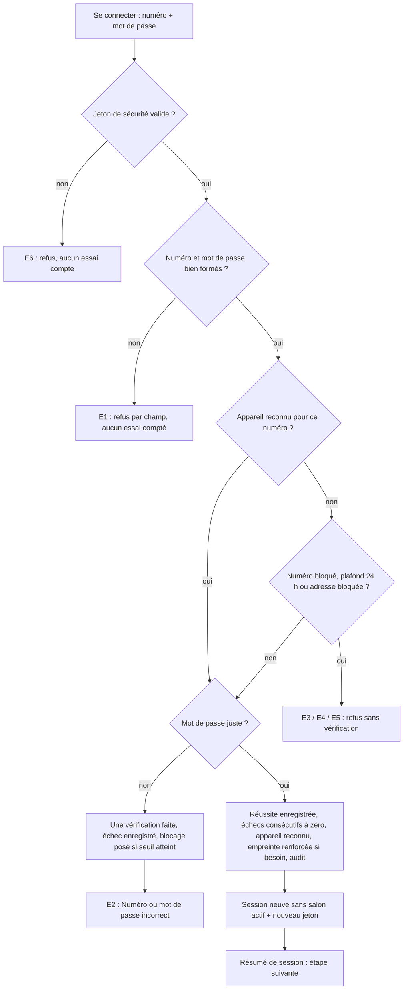

# UC-002 — Se connecter et se déconnecter

| Champ | Valeur |
|---|---|
| Statut | Prêt pour dev |
| Priorité | Must |
| Module | `identity` |
| Auteur | use-case-writer |
| Date | 2026-11-18 |
| Use cases liés | UC-001 (précède : le compte existe), UC-003 (mot de passe oublié : lève les blocages), UC-004 (suit : créer son organisation), UC-005 (suit : ouvrir / changer de salon actif), UC-007 (invitation : le collaborateur choisit son mot de passe), UC-009 (connexion client par code SMS) |
| Exigences couvertes | EX-001, EX-006, EX-009, EX-011, EX-018, EX-020, EX-024, EX-025, EX-029, D-004, D-017, D-018, D-019, D-020 |

## 0. Traçabilité

| Exigence | Source | Où elle est traitée dans ce UC |
|---|---|---|
| EX-029 | prd.md §2.B, §11 (User : identité et authentification) | Flux nominal 1-9, RG-002-01, RG-002-10, scénario « Un membre du personnel se connecte… » |
| EX-018 | prd.md §7 Étape 1 « Moyen de connexion sécurisé » | RG-002-01 à RG-002-09, §15 Sécurité |
| D-017 | DECISIONS.md | RG-002-01 (téléphone + mot de passe, aucun SMS à la connexion) |
| D-018 | DECISIONS.md | RG-002-02 (un compte client léger ne se connecte pas par mot de passe), §16 (UC-009) |
| D-019 | DECISIONS.md | RG-002-02, RG-002-03, RG-002-04 (non-énumération étendue à la connexion) |
| D-020 | DECISIONS.md | RG-002-01 (128 caractères au plus), RG-002-17 (argon2id) |
| D-004 | DECISIONS.md | RG-002-10, RG-002-11, RG-002-15 (session serveur, CSRF) |
| EX-001 | prd.md §3 Hiérarchie | RG-002-01 (le numéro désigne une seule identité) |
| EX-006 | prd.md §3 Multi-tenancy | RG-002-13, scénario « Être connecté ne donne aucun droit dans un salon » |
| EX-009 | prd.md §3 Multi-tenancy | RG-002-10 (aucun salon actif à la connexion) |
| EX-011 | prd.md §2, §4 | RG-002-14 (rôles système présentés à part des salons) |
| EX-020 | prd.md §7 | §10 messages qui disent quoi faire, RG-002-14 (étape suivante) |
| EX-024 | prd.md §12 Sécurité | RG-002-04 à RG-002-13, RG-002-18 |
| EX-025 | prd.md §12 Données | RG-002-16 (ni numéro ni adresse réseau dans l'audit), §14 (historique purgé) |

## 1. Objectif

Permettre à un membre du personnel (propriétaire ou collaborateur) d'ouvrir une session sûre avec son numéro et son
mot de passe, de savoir aussitôt où continuer (créer son organisation, ouvrir son salon, administration), puis de
fermer sa session, notamment sur une tablette partagée du salon. Sans que personne puisse deviner un mot de passe,
savoir si un numéro est inscrit, ni empêcher un autre de se connecter.

## 2. User story

> En tant que **membre du personnel d'un salon** (propriétaire ou collaborateur),
> je veux **me connecter avec mon numéro et mon mot de passe, puis me déconnecter**,
> afin de **retrouver mon salon et mes rendez-vous sans que d'autres puissent y accéder**.

## 3. Acteurs

- **Acteur principal** : le membre du personnel (propriétaire, administrateur de salon, coiffeur, responsable
  financier, praticien) ou un administrateur GoMeCoiffer ; sur smartphone ou sur une tablette partagée du salon.
- **Acteurs secondaires** : un tiers malveillant (essais de mots de passe, recherche de comptes, blocage du compte
  d'autrui) ; le système (limites d'essais, expiration des sessions).

## 4. Déclencheur

- Connexion : la personne choisit « Se connecter » (ou est renvoyée vers cet écran parce que sa session a expiré).
- Reprise : l'application est rouverte et demande « qui est connecté ».
- Déconnexion : la personne choisit « Se déconnecter ».

## 5. Préconditions

- Connexion : le navigateur a obtenu un jeton de sécurité (CSRF) de visiteur.
- Le compte, s'il existe, a été créé par UC-001 (propriétaire) ou UC-007 (collaborateur invité) et porte un mot de
  passe. Aucune autre précondition : le use case doit se comporter pareil pour un numéro sans compte.

## 6. Postconditions

- **En cas de succès (connexion)** :
  - une session **neuve** est ouverte (nouvel identifiant), avec l'instant de connexion et **aucun salon actif** ;
  - un nouveau jeton de sécurité est remis ; l'ancien et l'ancien identifiant de session ne valent plus rien ;
  - l'essai réussi est enregistré, les échecs consécutifs du numéro sont remis à zéro, l'appareil est reconnu ;
  - l'empreinte du mot de passe est renforcée si ses réglages sont dépassés ;
  - la connexion est tracée dans le journal d'audit ;
  - la réponse indique l'étape suivante.
- **En cas d'échec (connexion)** : aucune session n'est ouverte ni modifiée ; l'échec est enregistré dans
  l'historique des essais (sauf saisie mal formée ou jeton de sécurité invalide) ; un éventuel blocage est posé.
- **Déconnexion** : la session est détruite côté serveur, les cookies de session et de jeton de sécurité sont
  effacés, la déconnexion est tracée si une session existait ; la reconnaissance de l'appareil est conservée.

## 7. Règles métier

| ID | Règle | Exemple | Source |
|---|---|---|---|
| RG-002-01 | On se connecte avec un **numéro de téléphone** (mêmes formats que l'inscription, RG-001-02) et un **mot de passe de 1 à 128 caractères**. Une saisie mal formée est refusée champ par champ, **sans vérification ni essai compté**. Aucun SMS n'est envoyé à la connexion. | « +237 6 99 00 11 22 » et « 6 99 00 11 22 » désignent Paul ; « 6 99 00 11 2 » refusé ; mot de passe vide ou de 129 caractères refusé sans calcul d'empreinte. | EX-029, D-017, D-020 |
| RG-002-02 | Le refus est **identique** (message, code, statut) pour un numéro sans compte, un **compte client léger** (sans mot de passe) et un mot de passe faux : « Numéro ou mot de passe incorrect. » | Aïcha, cliente légère, saisit un mot de passe : même réponse qu'un numéro inconnu. | D-018, D-019 |
| RG-002-03 | Tout refus « identifiants incorrects » coûte **exactement une vérification argon2id** (contre une empreinte factice s'il n'y a pas de compte ou pas de mot de passe), pour un temps de réponse comparable. | Numéro 6 70 00 00 01 inconnu : une vérification est faite quand même. | D-019, §15 |
| RG-002-04 | Au **5e échec en moins de 15 minutes** pour un numéro, depuis des appareils non reconnus, la connexion à ce numéro depuis un appareil non reconnu est **bloquée 15 minutes** à compter de ce 5e échec. Le compteur porte sur le **numéro saisi, qu'un compte existe ou non**. | Échecs de 10 h 00 à 10 h 04 → bloqué jusqu'à 10 h 19 ; essai à 10 h 18 min 59 s refusé, à 10 h 19 min 00 s vérifié. 4 échecs seulement : pas de blocage. | D-025 |
| RG-002-05 | Au **20e échec en 24 heures glissantes** pour un numéro (appareils non reconnus), la connexion depuis un appareil non reconnu reste bloquée tant que les 24 dernières heures comptent 20 échecs. | 19 échecs depuis hier 11 h 00, jamais 5 en 15 min → Paul se connecte ; 20 échecs → refusé jusqu'à ce que le plus ancien sorte de la fenêtre. | D-025 |
| RG-002-06 | Un **appareil reconnu** (appareil sur lequel le titulaire s'est connecté avec succès dans les **90 derniers jours**) n'est **pas concerné** par RG-002-04, -05 et -07. Ses échecs comptent pour lui seul : au **5e échec**, il cesse d'être reconnu. | Un inconnu bloque le numéro de Paul ; Paul se connecte quand même depuis son téléphone habituel. Un voleur du téléphone : 5 essais puis régime des appareils non reconnus. | D-025 |
| RG-002-07 | Au **30e échec en une heure glissante** depuis une même adresse réseau (tous numéros confondus), la connexion depuis cette adresse et un appareil non reconnu est bloquée tant que la dernière heure compte 30 échecs. | 29 échecs depuis 9 h 10 sur des numéros variés → Mireille se connecte ; 30 → refusée. | D-025 |
| RG-002-08 | Une connexion réussie remet à zéro les **échecs consécutifs** du numéro (RG-002-04). Le plafond de 24 h (RG-002-05) ne se lève qu'avec le temps ou par une réinitialisation du mot de passe (UC-003), qui lève aussi le blocage de 15 min. Les essais refusés pendant un blocage ne prolongent pas le blocage. | 4 échecs à 9 h 50-9 h 53, connexion réussie à 9 h 54, nouvel échec à 10 h 00 → pas de blocage. | D-025 |
| RG-002-09 | Pendant un blocage, l'essai est refusé **sans vérifier le mot de passe** (même le bon), avec un message qui dit combien de temps attendre et propose « Mot de passe oublié ». Le message est le même que le numéro ait un compte ou non. | Bloqué jusqu'à 10 h 15, essai à 10 h 00 : « Trop d'essais pour ce numéro. Réessayez dans 15 minutes ou utilisez « Mot de passe oublié ». » | D-025, D-019 |
| RG-002-10 | La connexion ouvre une session **neuve** : nouvel identifiant (contre la fixation de session), instant de connexion conservé, **aucun salon actif**, **nouveau jeton de sécurité** remis dans la réponse. L'identifiant et le jeton d'avant la connexion sont refusés ensuite. | Le jeton obtenu sur l'écran de connexion ne permet plus aucune modification après la connexion. | D-004, EX-009, BACKLOG lot 1 |
| RG-002-11 | Se connecter sur un navigateur où une session est déjà ouverte **remplace** cette session (même utilisateur ou un autre). | Mireille connectée sur la tablette du salon ; Paul s'y connecte : la session de Mireille n'existe plus. | D-004 |
| RG-002-12 | Une session du personnel expire après **24 h sans activité** et **7 jours après la connexion** quoi qu'il arrive. Dès que l'utilisateur porte un **rôle système**, ses sessions expirent après **2 h sans activité** et **12 h après la connexion**. Ensuite tout accès renvoie vers « Se connecter » avec « Session absente ou expirée : reconnectez-vous. » | Paul connecté lundi 16/11 à 10 h 00, inactif : accès mardi 17/11 à 09 h 59 accordé, à 10 h 01 refusé ; actif sans arrêt : refusé lundi 23/11 à 10 h 01. Henri (administrateur) connecté à 08 h 00 : refusé à 10 h 01 sans activité depuis 08 h 00, refusé à 20 h 01 même actif. | D-026 |
| RG-002-13 | La session ne porte **aucun droit** : appartenances, permissions du salon actif et rôles système sont relus à chaque requête. Juste après la connexion, aucune action de salon n'est permise. | Paul connecté ouvre un planning : « Choisissez d’abord le salon sur lequel vous travaillez. » | EX-006, EX-011 |
| RG-002-14 | Le **résumé de session** (renvoyé à la connexion et à la réouverture de l'application) donne le nom de l'utilisateur, ses salons, ses rôles système séparément, et l'**étape suivante** : rôle système → administration ; sinon une seule appartenance active → ouvrir ce salon ; plusieurs → choisir son salon ; aucune → créer son organisation. | Paul sans salon → « créer son organisation » ; Mireille avec Akwa et Bastos → « choisir son salon ». | EX-019, EX-002, EX-011, D-027 |
| RG-002-15 | La déconnexion **détruit la session** côté serveur et **efface** les cookies de session et de jeton de sécurité ; un cookie de session recopié avant la déconnexion ne donne plus accès. Elle est **idempotente** : sans session ouverte, la réponse est la même confirmation. La reconnaissance de l'appareil est conservée. | Paul se déconnecte de la tablette ; rejouer son ancien cookie → « Session absente ou expirée ». Se déconnecter avec une session déjà expirée → confirmé. | D-004, BACKLOG lot 1 |
| RG-002-16 | Sont tracés dans le journal d'audit : la **connexion réussie** (utilisateur, instant, appareil reconnu ou nouveau), le **blocage** du numéro d'un compte existant, la **déconnexion**. Jamais le mot de passe, le numéro, l'adresse réseau ni le jeton. Les échecs ne vont pas dans l'audit : ils vivent dans l'historique des essais, purgé après **48 h**. | Ligne « connexion » de Paul à 10 h 00, « déconnexion » à 10 h 30. | EX-025, D-028 |
| RG-002-17 | Si l'empreinte du mot de passe a été calculée avec des réglages argon2id plus faibles que les réglages en vigueur, elle est **recalculée** à la connexion réussie, sans changer le mot de passe ni demander quoi que ce soit. | Empreinte à 19 Mio ; réglage porté à 46 Mio → nouvelle empreinte à la prochaine connexion de Paul. | D-020, D-028 |
| RG-002-18 | Les essais simultanés sur un même numéro sont **comptés un à un** : on ne peut pas contourner une limite en envoyant des essais en rafale. | Après 4 échecs, 10 essais faux simultanés → un seul est vérifié, les 9 autres refusés pour trop d'essais. | EX-024, D-023 (même principe) |

## 8. Flux nominal (connexion)

1. La personne ouvre « Se connecter ».
2. Elle saisit son numéro et son mot de passe, puis valide.
3. Le système vérifie le jeton de sécurité, le format du numéro et la longueur du mot de passe (RG-002-01).
4. Le système vérifie qu'aucun blocage ne s'applique au numéro, à l'adresse réseau ni à l'appareil
   (RG-002-04 à RG-002-07, RG-002-09).
5. Le système vérifie le mot de passe contre l'empreinte du compte (RG-002-02, RG-002-03).
6. Le système enregistre la réussite, remet à zéro les échecs consécutifs (RG-002-08), reconnaît l'appareil
   (RG-002-06) et trace la connexion (RG-002-16).
7. Le système ouvre une session neuve, sans salon actif, et remet un nouveau jeton de sécurité (RG-002-10).
8. Le système renvoie le résumé de session avec l'étape suivante (RG-002-14).
9. L'interface conduit à l'étape suivante : « Créez votre organisation » (UC-004), ouverture ou choix du salon
   (UC-005), ou l'administration GoMeCoiffer.

## 9. Flux alternatifs

- **A1 — Appareil reconnu pendant un blocage** (étape 4) : le blocage du numéro ou de l'adresse ne s'applique pas
  (RG-002-06) ; suite à l'étape 5.
- **A2 — Session déjà ouverte sur ce navigateur** (étape 7) : elle est remplacée (RG-002-11).
- **A3 — Empreinte à réglages dépassés** (étape 6) : elle est recalculée (RG-002-17) ; suite à l'étape 7.
- **A4 — Réouverture de l'application** (déclencheur « reprise ») : si la session est valide, le système renvoie le
  résumé de session sans demander le mot de passe et prolonge la durée sans activité ; sinon, l'interface affiche
  « Se connecter ».
- **A5 — Déconnexion** (depuis tout écran connecté) : le système trace la déconnexion, détruit la session, efface
  les cookies ; l'interface oublie son jeton et affiche « Vous êtes déconnecté. » puis « Se connecter » (RG-002-15).
- **A6 — Déconnexion sans session ouverte** (A5) : même confirmation ; rien n'est tracé (RG-002-15).

## 10. Flux d'exception

- **E1 — Saisie mal formée** (étape 3) : refus champ par champ (« Saisissez un numéro camerounais de 9 chiffres,
  par exemple 6 77 12 34 56. », « Saisissez votre mot de passe. », « 128 caractères au plus. ») ; aucun essai
  compté.
- **E2 — Identifiants incorrects** (étape 5) : « Numéro ou mot de passe incorrect. », avec le lien « Mot de passe
  oublié » et, pour les clients, « Vous avez réservé comme client ? Retrouvez vos réservations par SMS. » ; échec
  compté (RG-002-02).
- **E3 — Numéro bloqué 15 minutes** (étape 4) : « Trop d'essais pour ce numéro. Réessayez dans 12 minutes ou
  utilisez « Mot de passe oublié ». » (durée restante arrondie à la minute supérieure) ; pas de vérification.
- **E4 — Plafond de 24 h atteint** (étape 4) : « Trop d'essais pour ce numéro aujourd'hui. Utilisez « Mot de passe
  oublié » ou réessayez demain. »
- **E5 — Adresse réseau bloquée** (étape 4) : « Trop d'essais depuis ce réseau. Réessayez dans une heure ou
  connectez-vous depuis votre appareil habituel. »
- **E6 — Jeton de sécurité absent ou périmé** (étape 3) : « Jeton de sécurité absent ou expiré : rechargez la page
  puis recommencez. » ; aucun essai compté ; l'interface redemande un jeton.
- **E7 — Session expirée** (après la connexion, RG-002-12) : « Session absente ou expirée : reconnectez-vous. » ;
  retour à « Se connecter ».
- **E8 — Service indisponible** (étapes 4 à 7) : « Connexion impossible pour le moment. Réessayez dans quelques
  minutes. » ; aucune session ouverte, rien n'est enregistré.
- **E9 — Essais en rafale sur un même numéro** (étape 4) : comptés un à un (RG-002-18).
- **E10 — Action de salon sans salon actif** (après la connexion) : « Choisissez d’abord le salon sur lequel vous
  travaillez. » (RG-002-13).

> Aucun message ne dit si un compte existe pour le numéro saisi (D-019).

## 11. Workflow

Ordre des contrôles à la connexion (il conditionne la non-énumération et le coût des refus) :



Cycle de vie de la session vu par l'utilisateur :

```mermaid
stateDiagram-v2
    [*] --> NonConnecté
    NonConnecté --> NonConnecté : saisie mal formée / jeton périmé (E1, E6)
    NonConnecté --> NonConnecté : identifiants incorrects, échec compté (E2)
    NonConnecté --> Bloqué : 5e échec en 15 min / 20e en 24 h / 30e par adresse en 1 h
    Bloqué --> Bloqué : essai depuis un appareil non reconnu (E3-E5)
    Bloqué --> NonConnecté : délai écoulé ou mot de passe réinitialisé (UC-003)
    Bloqué --> Connecté : appareil reconnu + bon mot de passe (A1)
    NonConnecté --> Connecté : bon mot de passe, aucun blocage
    Connecté --> Connecté : activité / réouverture de l'application (A4) / nouvelle connexion (A2)
    Connecté --> NonConnecté : déconnexion (A5) / 24 h sans activité / 7 jours après la connexion ; rôle système : 2 h / 12 h (E7)
    NonConnecté --> NonConnecté : déconnexion sans session (A6)
```



## 12. Scénarios d'acceptation (BDD)

Identiques à `features/identity/se-connecter.feature`.

```gherkin
# language: fr
@UC-002
Fonctionnalité: Se connecter et se déconnecter
  Pour retrouver son salon et ses rendez-vous sans que d'autres y accèdent,
  un membre du personnel se connecte avec son numéro de téléphone et son mot de passe,
  puis se déconnecte quand il a terminé.

  Contexte:
    Étant donné que nous sommes le 18/11/2026 à 10 h 00, heure de Douala
    Et que Paul Ebode, coiffeur, a un compte avec le mot de passe "Bastos-Fade-2026" pour le 6 99 00 11 22
    Et qu'Aïcha Mbarga a un compte client léger, sans mot de passe, pour le 6 55 44 33 22
    Et qu'aucun compte n'existe pour le 6 70 00 00 01

  @nominal @RG-002-01 @RG-002-10 @EX-029 @D-017
  Scénario: Un membre du personnel se connecte avec son numéro et son mot de passe
    Quand on se connecte avec le "6 99 00 11 22" et le mot de passe "Bastos-Fade-2026"
    Alors Paul est connecté
    Et aucun salon n'est ouvert dans sa session

  @nominal @RG-002-14 @EX-019 @EX-002 @EX-011
  Plan du scénario: Après la connexion, on indique où continuer
    Étant donné que Paul a <situation>
    Quand Paul se connecte avec son mot de passe
    Alors on l'invite à <étape suivante>

    Exemples:
      | situation                                                  | étape suivante                      |
      | aucune appartenance à un salon                             | créer son organisation              |
      | une appartenance au salon "Go Beauty Akwa"                 | ouvrir le salon "Go Beauty Akwa"    |
      | des appartenances à "Go Beauty Akwa" et "Go Beauty Bastos" | choisir son salon                   |
      | le rôle système "Administrateur Opérations"                | ouvrir l'administration GoMeCoiffer |

  @securite @RG-002-02 @D-018 @D-019
  Plan du scénario: Le refus est le même pour un numéro inconnu, un compte client ou un mot de passe faux
    Quand on se connecte avec le "<numéro>" et le mot de passe "<mot de passe>"
    Alors la connexion est refusée
    Et le motif indiqué est "Numéro ou mot de passe incorrect."
    Et la réponse est la même que pour un numéro sans compte

    Exemples:
      | numéro        | mot de passe     | situation                              |
      | 6 70 00 00 01 | Bastos-Fade-2026 | numéro sans compte                     |
      | 6 55 44 33 22 | Bastos-Fade-2026 | compte client léger, sans mot de passe |
      | 6 99 00 11 22 | Akwa-Fade-2026   | mot de passe faux de Paul              |

  @securite @RG-002-03 @D-019
  Scénario: Un numéro sans compte est refusé après une vérification aussi coûteuse qu'un mot de passe faux
    Quand on se connecte avec le "6 70 00 00 01" et le mot de passe "Bastos-Fade-2026"
    Alors la connexion est refusée
    Et une vérification de mot de passe complète a été faite, comme pour un compte existant

  @erreur @RG-002-01
  Plan du scénario: Le numéro et le mot de passe doivent être bien saisis
    Quand on se connecte avec le "<numéro>" et le mot de passe "<mot de passe>"
    Alors la connexion est <résultat>

    Exemples:
      | numéro             | mot de passe     | résultat                            |
      | 6 99 00 11 22      | Bastos-Fade-2026 | acceptée                            |
      | +237 6 99 00 11 22 | Bastos-Fade-2026 | acceptée                            |
      | 6 99 00 11 2       | Bastos-Fade-2026 | refusée : numéro mal formé          |
      | 6 99 00 11 22      |                  | refusée : mot de passe obligatoire  |

  @erreur @RG-002-01 @D-020
  Scénario: Un mot de passe de plus de 128 caractères est refusé sans être vérifié
    Quand on se connecte avec le "6 99 00 11 22" et un mot de passe de 129 caractères
    Alors la connexion est refusée
    Et le motif indiqué est "128 caractères au plus."
    Et aucun essai n'est compté pour le 6 99 00 11 22

  @erreur @RG-002-04
  Plan du scénario: Le numéro est bloqué à partir du 5e échec en moins de 15 minutes
    Étant donné que <échecs> mots de passe faux ont été saisis pour le 6 99 00 11 22 depuis un nouvel appareil entre 9 h 50 et 9 h 54
    Quand Paul se connecte avec son mot de passe depuis un nouvel appareil
    Alors la connexion est <résultat>

    Exemples:
      | échecs | résultat                 |
      | 4      | acceptée                 |
      | 5      | refusée : trop d'essais  |

  @erreur @RG-002-04
  Plan du scénario: Le blocage dure 15 minutes après le 5e échec
    Étant donné que 5 mots de passe faux ont été saisis pour le 6 99 00 11 22 depuis un nouvel appareil entre 10 h 00 et 10 h 04
    Quand Paul se connecte avec son mot de passe depuis un nouvel appareil à <heure>
    Alors la connexion est <résultat>

    Exemples:
      | heure            | résultat                |
      | 10 h 18 min 59 s | refusée : trop d'essais |
      | 10 h 19 min 00 s | acceptée                |

  @securite @RG-002-09
  Scénario: Pendant un blocage, même le bon mot de passe est refusé
    Étant donné que le 6 99 00 11 22 est bloqué jusqu'à 10 h 15 après 5 mots de passe faux
    Quand Paul se connecte avec son mot de passe depuis un nouvel appareil
    Alors la connexion est refusée
    Et le motif indiqué est "Trop d'essais pour ce numéro. Réessayez dans 15 minutes ou utilisez « Mot de passe oublié »."

  @securite @RG-002-04 @RG-002-09 @D-019
  Scénario: Un numéro sans compte se bloque comme un numéro inscrit
    Étant donné que 5 mots de passe faux ont été saisis pour le 6 70 00 00 01 entre 9 h 55 et 9 h 59
    Quand on se connecte avec le "6 70 00 00 01" et le mot de passe "Bastos-Fade-2026"
    Alors la connexion est refusée
    Et le motif indiqué est "Trop d'essais pour ce numéro. Réessayez dans 14 minutes ou utilisez « Mot de passe oublié »."

  @alternatif @RG-002-06
  Scénario: Un inconnu qui bloque le numéro ne gêne pas Paul sur son téléphone habituel
    Étant donné que Paul s'est connecté depuis son téléphone habituel le 10/11/2026
    Et que le 6 99 00 11 22 est bloqué jusqu'à 10 h 15 après 5 mots de passe faux saisis par un inconnu
    Quand Paul se connecte avec son mot de passe depuis son téléphone habituel
    Alors Paul est connecté

  @securite @RG-002-06
  Scénario: Un appareil habituel qui accumule 5 échecs n'est plus reconnu
    Étant donné que Paul s'est connecté depuis son téléphone habituel le 10/11/2026
    Et que 4 mots de passe faux ont été saisis depuis ce téléphone entre 9 h 55 et 9 h 58
    Quand un 5e mot de passe faux est saisi depuis ce téléphone
    Alors ce téléphone n'est plus reconnu comme un appareil habituel de Paul

  @erreur @RG-002-05
  Plan du scénario: Au 20e échec en 24 heures, le numéro reste bloqué sur les nouveaux appareils
    Étant donné que <échecs> mots de passe faux ont été saisis pour le 6 99 00 11 22 depuis hier 11 h 00, jamais 5 en moins de 15 minutes
    Quand Paul se connecte avec son mot de passe depuis un nouvel appareil
    Alors la connexion est <résultat>

    Exemples:
      | échecs | résultat                            |
      | 19     | acceptée                            |
      | 20     | refusée : trop d'essais aujourd'hui |

  @erreur @RG-002-07
  Plan du scénario: Au 30e échec en une heure depuis une même adresse réseau, cette adresse est bloquée
    Étant donné que <échecs> connexions ont échoué depuis la même adresse réseau depuis 9 h 10, sur des numéros différents
    Quand Paul se connecte avec son mot de passe depuis cette adresse, sur un nouvel appareil
    Alors la connexion est <résultat>

    Exemples:
      | échecs | résultat                                |
      | 29     | acceptée                                |
      | 30     | refusée : trop d'essais depuis ce réseau |

  @alternatif @RG-002-08
  Scénario: Une connexion réussie efface les échecs consécutifs
    Étant donné que 4 mots de passe faux ont été saisis pour le 6 99 00 11 22 depuis un nouvel appareil entre 9 h 50 et 9 h 53
    Et que Paul s'est connecté avec son mot de passe à 9 h 54
    Quand un mot de passe faux est saisi pour le 6 99 00 11 22 depuis un nouvel appareil
    Alors le 6 99 00 11 22 n'est pas bloqué

  @securite @RG-002-18
  Scénario: Des essais simultanés sur un même numéro sont comptés un à un
    Étant donné que 4 mots de passe faux ont été saisis pour le 6 99 00 11 22 depuis un nouvel appareil entre 9 h 55 et 9 h 58
    Quand 10 essais avec des mots de passe faux arrivent en même temps pour le 6 99 00 11 22
    Alors un seul de ces essais est vérifié
    Et les 9 autres sont refusés pour trop d'essais

  @securite @RG-002-10
  Scénario: La connexion attribue un nouvel identifiant de session
    Étant donné que le navigateur de Paul a une session de visiteur
    Quand Paul se connecte avec son mot de passe
    Alors l'identifiant de session de son navigateur a changé
    Et l'ancien identifiant de session ne donne accès à rien

  @securite @RG-002-10 @D-004
  Scénario: Un jeton de sécurité obtenu avant la connexion est refusé après
    Étant donné que le navigateur de Paul a reçu un jeton de sécurité avant de se connecter
    Et que Paul s'est connecté avec son mot de passe
    Quand Paul se déconnecte en présentant le jeton d'avant la connexion
    Alors la demande est refusée
    Et le motif indiqué est "Jeton de sécurité absent ou expiré : rechargez la page puis recommencez."

  @erreur @RG-002-10
  Scénario: Une connexion sans jeton de sécurité est refusée sans compter d'essai
    Quand Paul se connecte avec son mot de passe sans jeton de sécurité
    Alors la connexion est refusée
    Et le motif indiqué est "Jeton de sécurité absent ou expiré : rechargez la page puis recommencez."
    Et aucun essai n'est compté pour le 6 99 00 11 22

  @alternatif @RG-002-11
  Scénario: Se connecter sur la tablette du salon remplace la session déjà ouverte
    Étant donné que Mireille Ndongo est connectée sur la tablette du salon
    Quand Paul se connecte avec son mot de passe sur cette tablette
    Alors la tablette est connectée au compte de Paul
    Et l'ancienne session de Mireille ne donne plus accès à rien

  @erreur @RG-002-12
  Plan du scénario: Une session du personnel expire après 24 heures sans activité
    Étant donné que Paul s'est connecté le 16/11/2026 à 10 h 00 et n'a rien fait depuis
    Quand Paul ouvre son espace le 17/11/2026 à <heure>
    Alors l'accès est <résultat>

    Exemples:
      | heure   | résultat                  |
      | 09 h 59 | accordé                   |
      | 10 h 01 | refusé : session expirée  |

  @erreur @RG-002-12
  Plan du scénario: Une session du personnel expire 7 jours après la connexion, même utilisée sans interruption
    Étant donné que Paul s'est connecté le 16/11/2026 à 10 h 00 et utilise GoMeCoiffer toutes les heures depuis
    Quand Paul ouvre son espace le 23/11/2026 à <heure>
    Alors l'accès est <résultat>

  @erreur @RG-002-12 @apres-UC-008
  Plan du scénario: La session d'un administrateur GoMeCoiffer est plus courte
    Étant donné qu'Henri, administrateur GoMeCoiffer, s'est connecté le 16/11/2026 à 08 h 00
    Quand Henri ouvre l'administration le 16/11/2026 à <heure> après <inactivité> sans activité
    Alors l'accès est <résultat>

    Exemples:
      | heure   | inactivité    | résultat                 |
      | 09 h 59 | 1 h 59        | accordé                  |
      | 10 h 01 | 2 h 01        | refusé : session expirée |
      | 20 h 01 | 0 h 30        | refusé : session expirée |

    Exemples:
      | heure   | résultat                 |
      | 09 h 59 | accordé                  |
      | 10 h 01 | refusé : session expirée |

  @securite @RG-002-13 @EX-006
  Scénario: Être connecté ne donne aucun droit dans un salon
    Étant donné que Paul s'est connecté avec son mot de passe
    Quand Paul consulte le planning d'un salon
    Alors l'accès est refusé
    Et le motif indiqué est "Choisissez d’abord le salon sur lequel vous travaillez."

  @alternatif @RG-002-14
  Scénario: À la réouverture de l'application, une session valide est reprise sans mot de passe
    Étant donné que Paul s'est connecté à 8 h 00 depuis son téléphone
    Quand Paul rouvre l'application à 10 h 00
    Alors Paul est toujours connecté
    Et on l'invite à créer son organisation

  @alternatif @RG-002-14
  Scénario: Sans session ouverte, l'application demande de se connecter
    Quand un visiteur rouvre l'application sans être connecté
    Alors on lui demande de se connecter

  @nominal @RG-002-15
  Scénario: Se déconnecter ferme la session
    Étant donné que Paul est connecté sur la tablette du salon
    Quand Paul se déconnecte
    Alors la tablette n'a plus ni session ni jeton de sécurité
    Et l'ancienne session de Paul ne donne plus accès à rien

  @alternatif @RG-002-15
  Scénario: Se déconnecter sans session ouverte est confirmé quand même
    Étant donné que la session de Paul a expiré
    Quand Paul se déconnecte
    Alors la déconnexion est confirmée

  @securite @RG-002-16 @EX-025
  Scénario: La connexion et la déconnexion sont tracées sans secret
    Étant donné que Paul s'est connecté avec son mot de passe à 10 h 00
    Quand Paul se déconnecte à 10 h 30
    Alors le journal d'audit contient "connexion" à 10 h 00 et "déconnexion" à 10 h 30 pour Paul
    Et ni le mot de passe, ni le numéro, ni l'adresse réseau n'y figurent

  @securite @RG-002-16
  Scénario: Le blocage du numéro d'un compte est tracé
    Étant donné que 4 mots de passe faux ont été saisis pour le 6 99 00 11 22 depuis un nouvel appareil entre 9 h 55 et 9 h 58
    Quand un 5e mot de passe faux est saisi pour le 6 99 00 11 22 depuis un nouvel appareil
    Alors le journal d'audit contient "connexion bloquée" à 10 h 00 pour Paul

  @alternatif @RG-002-17
  Scénario: L'empreinte d'un mot de passe calculée avec d'anciens réglages est renforcée à la connexion
    Étant donné que l'empreinte du mot de passe de Paul a été calculée avec des réglages plus faibles que ceux en vigueur
    Quand Paul se connecte avec son mot de passe
    Alors Paul est connecté
    Et l'empreinte de son mot de passe utilise les réglages en vigueur
    Et Paul se connecte toujours avec "Bastos-Fade-2026"

  @erreur
  Scénario: Une panne du service n'ouvre aucune session
    Étant donné que le service GoMeCoiffer est momentanément indisponible
    Quand Paul se connecte avec son mot de passe
    Alors la connexion est refusée
    Et le motif indiqué est "Connexion impossible pour le moment. Réessayez dans quelques minutes."
    Et aucune session n'est ouverte
```

## 13. Plan de tests TDD

Ordre : refus d'abord, du plus simple au plus complexe. Unitaire = règles sur fakes in-memory ; intégration = vraie
base (Testcontainers) ; E2E = parcours HTTP. Le résumé de session est une **query** : E2E uniquement.

| # | Niveau | Comportement testé | Étant donné | Quand | Alors | Règle |
|---|---|---|---|---|---|---|
| T1 | Unitaire | Numéro sans compte refusé, une vérification faite | aucun compte | connexion | `INVALID_CREDENTIALS`, vérificateur appelé 1 fois (empreinte factice), échec enregistré | RG-002-02, -03 |
| T2 | Unitaire | Compte client léger refusé à l'identique | client léger | connexion | même refus, 1 vérification | RG-002-02, -03 |
| T3 | Unitaire | Mot de passe faux | Paul | mauvais mot de passe | même refus, échec enregistré | RG-002-02 |
| T4 | Unitaire | Connexion réussie | Paul | bon mot de passe | réussite, userId, essai enregistré, audit « connexion » | RG-002-01, -16 |
| T5 | Unitaire | Politique : 4 échecs → autorisé ; 5 → bloqué | historique | contrôle à 10:00 | autorisé / bloqué | RG-002-04 |
| T6 | Unitaire | Politique : fin du blocage à la seconde | 5e échec à 10:04:00 | 10:18:59 / 10:19:00 | bloqué (reste 1 min) / autorisé | RG-002-04, -09 |
| T7 | Unitaire | Blocage d'un numéro sans compte | 5 échecs sur 6 70 00 00 01 | connexion | refus « trop d'essais », aucune vérification | RG-002-04, -09 |
| T8 | Unitaire | Pendant un blocage, bon mot de passe refusé sans vérification | numéro bloqué | bon mot de passe | refus, vérificateur non appelé, essai non compté | RG-002-08, -09 |
| T9 | Unitaire | Plafond 24 h : 19 / 20 | échecs étalés | contrôle | autorisé / bloqué | RG-002-05 |
| T10 | Unitaire | Limite par adresse : 29 / 30 | échecs d'une même adresse | contrôle | autorisé / bloqué | RG-002-07 |
| T11 | Unitaire | Appareil reconnu exempté | numéro et adresse bloqués, appareil reconnu | bon mot de passe | réussite | RG-002-06 |
| T12 | Unitaire | Appareil reconnu : 5e échec → plus reconnu | 4 échecs depuis l'appareil | 5e échec | appareil révoqué | RG-002-06 |
| T13 | Unitaire | Appareil reconnu expiré après 90 jours | reconnu le 19/08/2026 | connexion le 18/11/2026 | traité comme non reconnu | RG-002-06 |
| T14 | Unitaire | Réussite remet à zéro les échecs consécutifs, pas le plafond 24 h | 4 échecs puis réussite | 1 échec | pas de blocage ; compteur 24 h inchangé | RG-002-08 |
| T15 | Unitaire | Blocage tracé pour un compte existant, pas pour un numéro sans compte | 4 échecs | 5e échec | audit « connexion bloquée » pour Paul ; rien pour 6 70 00 00 01 | RG-002-16 |
| T16 | Unitaire | Empreinte renforcée si réglages dépassés | empreinte « ancienne » (fake) | bon mot de passe | nouvelle empreinte enregistrée | RG-002-17 |
| T17 | Unitaire | Déconnexion tracée | Paul | `SignOut` | audit « déconnexion » sans numéro | RG-002-16 |
| T18 | Intégration | Vérificateur argon2id réel : bon / faux / factice / réglages dépassés | empreintes réelles | vérification | vrai / faux / faux / `needsRehash` | RG-002-03, -17 |
| T19 | Intégration | Historique des essais : lecture filtrée par numéro, adresse et fenêtre ; purge > 48 h | lignes en base | lecture / purge | seulement la fenêtre utile | RG-002-04, -05, -07, -16 |
| T20 | Intégration | Jeton d'appareil stocké haché, jamais en clair | appareil reconnu | lecture en base | aucune colonne ne contient le jeton | RG-002-06 |
| T21 | Intégration | Essais sérialisés par numéro | 4 échecs | 10 essais en parallèle | 1 vérifié, 9 refusés | RG-002-18 |
| T22 | E2E | Parcours : jeton visiteur → connexion → id de session changé → nouveau jeton accepté, ancien refusé | Paul | parcours HTTP | comme décrit | RG-002-10 |
| T23 | E2E | Non-énumération : 3 situations, statut et corps identiques | inconnu, client léger, faux | 3 connexions | réponses identiques | RG-002-02 |
| T24 | E2E | Connexion sans jeton CSRF | — | POST sans en-tête | 403, aucun essai compté | RG-002-10 |
| T25 | E2E | Résumé de session : 401 sans session ; « créer son organisation » avec session | — | `GET` session | comme décrit | RG-002-14 |
| T26 | E2E | Aucun droit de salon après connexion | Paul connecté | route à permission | 403 « Choisissez d’abord… » | RG-002-13 |
| T27 | E2E | Session remplacée par une autre connexion | Mireille connectée | Paul se connecte | ancien cookie → 401 | RG-002-11 |
| T28 | E2E | Déconnexion : session détruite, cookies effacés (`Set-Cookie` expiré), ancien cookie rejoué → 401 | Paul connecté | déconnexion | comme décrit | RG-002-15 |
| T29 | E2E | Déconnexion idempotente | aucune session | déconnexion | même confirmation | RG-002-15 |
| T30 | E2E | Durées glissante (24 h) et absolue (7 j) du personnel (horloge fixe) ; durées des rôles système (2 h / 12 h) en unitaire sur le garde tant que UC-008 n'existe pas | Paul connecté | requêtes aux bornes | accordé / 401 | RG-002-12 |
| T31 | E2E | Appareil reconnu : cookie posé à la réussite, conservé à la déconnexion, exempte du blocage | Paul | parcours | comme décrit | RG-002-06, -15 |
| T32 | Mutation | Politique d'essais (seuils, fenêtres, bornes) | — | Stryker | aucun mutant survivant | RG-002-04 à -08 |

Doubles de test : horloge fixe ; vérificateur de mot de passe en mémoire qui **compte** ses appels et simule
« réglages dépassés » ; générateur de jetons d'appareil déterministe ; historique des essais et appareils reconnus
en mémoire. L'intégration utilise le vrai argon2id.

## 14. Données

- **Entrées** :
  - connexion : numéro (obligatoire, normalisé en +237XXXXXXXXX comme RG-001-02), mot de passe (obligatoire,
    1 à 128 caractères) ; lus par la couche HTTP, pas dans le corps : jeton d'appareil (cookie), adresse réseau ;
  - déconnexion : aucune donnée ; l'utilisateur est lu dans la session.
- **Sorties** :
  - connexion réussie : nouveau jeton de sécurité, résumé de session ; cookie de session neuf ; cookie d'appareil
    reconnu (posé ou prolongé) ;
  - résumé de session : identifiant et nom de l'utilisateur, salon actif (vide à la connexion), salons (identifiant,
    nom, rôle), rôles système, étape suivante (`CREATE_ORGANIZATION`, `OPEN_SALON`, `CHOOSE_SALON`,
    `PLATFORM_ADMIN` — D-027). Ni téléphone ni e-mail (inutiles à l'écran) ;
  - refus : code stable (`INVALID_CREDENTIALS`, `SIGN_IN_TEMPORARILY_BLOCKED`) et message lisible.
- **Stocké** :
  - historique des essais : numéro normalisé, instant, issue (échec, réussite), appareil reconnu ou non, adresse
    réseau ; purgé après 48 h (D-028) ;
  - appareils reconnus : empreinte du jeton, utilisateur, date de reconnaissance, dernière utilisation, échéance
    (90 jours), compteur d'échecs, révocation ;
  - audit : action, utilisateur, instant, « appareil reconnu : oui/non ».
- **Jeux de données** :
  - Paul Ebode, coiffeur, 6 99 00 11 22, « Bastos-Fade-2026 », sans salon (avant UC-004/UC-007) ;
  - Mireille Ndongo, propriétaire, 6 77 12 34 56, « Akwa-Tresses-27 » (UC-001) ;
  - Aïcha Mbarga, compte client léger, 6 55 44 33 22 ;
  - numéro sans compte : 6 70 00 00 01.

## 15. Exigences non fonctionnelles

- **Sécurité** : vérification argon2id ; empreinte factice calculée au démarrage avec les réglages en vigueur ;
  cookies de session, de jeton et d'appareil `HttpOnly`, `SameSite=Lax`, `Secure` et préfixe `__Host-` hors local ;
  la connexion exige le jeton de sécurité (contre la connexion forcée par un site tiers) ; aucun mot de passe, jeton,
  numéro complet ni adresse réseau dans les logs ; identité et salon actif lus dans la session, jamais dans la
  requête.
- **Temps de réponse comparable** : sur 30 refus mesurés de chaque type, limites désactivées, la médiane d'un
  numéro sans compte et celle d'un mot de passe faux diffèrent de moins de 20 %.
- **Performance** : connexion < 1 s côté serveur (dont une vérification argon2id) ; résumé de session < 300 ms ;
  déconnexion < 300 ms.
- **Guidage** (CLAUDE.md, tous modes) : chaque refus dit quoi faire (attendre combien de temps, « Mot de passe
  oublié », recharger la page) ; l'écran rappelle « Vous avez réservé comme client ? Retrouvez vos réservations par
  SMS » ; l'écran de connexion accepte le remplissage par le gestionnaire de mots de passe du téléphone et permet
  d'afficher le mot de passe saisi ; utilisable à 390 px.
- **Disponibilité** : une panne de la base n'ouvre jamais de session partielle (E8).

## 16. Hors périmètre

- Mot de passe oublié et levée des blocages par code SMS (UC-003).
- Connexion d'un client de la marketplace par code SMS (UC-009).
- Ouverture et changement du salon actif, résolution réelle des droits (`ActorRights`) (UC-005, UC-008) : ce use case
  ne fait qu'indiquer l'étape suivante.
- Création de l'organisation (UC-004), activation d'une invitation (UC-007).
- « Rester connecté », « Déconnecter mes autres appareils », liste des sessions ouvertes (D-028).
- Double facteur pour les rôles système, défi anti-robot.
- Suspension d'un compte utilisateur par GoMeCoiffer.
- Changement de numéro ou de mot de passe depuis le profil.

## 17. Questions ouvertes

| # | Question | Hypothèse retenue en attendant (recommandation) | Impact si différent |
|---|---|---|---|
| Q1 | Comment freiner la recherche du mot de passe sans permettre à un tiers de **bloquer** le compte d'autrui ? **Validée (D-025).** | **Recommandé : appareil reconnu + blocages qui ne visent que les appareils non reconnus.** Par numéro : blocage 15 min au 5e échec en 15 min, et au 20e en 24 h ; par adresse réseau : 30 échecs par heure. L'appareil habituel n'est jamais bloqué (5 échecs → il perd sa reconnaissance). « Mot de passe oublié » lève tout. Un attaquant tente ainsi au plus 20 mots de passe par jour et par numéro, contre des mots de passe de 10 caractères non courants (D-020). | **Blocage simple du numéro** (sans appareil reconnu) : plus simple, mais un inconnu qui connaît le numéro d'un propriétaire peut l'empêcher de se connecter chaque matin et le forcer à payer un SMS de réinitialisation. **Délai croissant sans blocage** : même déni de service, plus lent. **Code SMS exigé après N échecs** : coût SMS déclenché par l'attaquant, codes non sollicités reçus par la victime. |
| Q2 | Combien de temps un appareil reste-t-il reconnu ? Une tablette partagée ? **Validée (D-025).** | 90 jours après la dernière connexion réussie ; conservé à la déconnexion (il ne donne aucun accès seul) ; sur une tablette partagée, chaque compte est reconnu séparément. | Plus court : plus d'utilisateurs soumis aux blocages pendant une attaque. Effacé à la déconnexion : la protection de Q1 disparaît pour les tablettes du salon. |
| Q3 | Durées de session du personnel et des rôles système ? **Validée (D-026).** | En place : 12 h sans activité, 72 h absolue pour tous. **Recommandé : personnel 24 h sans activité et 7 jours absolue ; rôles système 2 h sans activité et 12 h absolue.** | Garder 12 h : un coiffeur qui ferme à 19 h et rouvre à 8 h (13 h) retape son mot de passe chaque matin. Plus long pour les rôles système : un poste oublié ouvert expose l'administration de toute la plateforme. |
| Q4 | Étape suivante après connexion, et ordre de priorité ? **Validée (D-027).** | Rôle système → administration (avec accès à ses salons s'il en a) ; une appartenance → ouvrir ce salon d'office (UC-005) ; plusieurs → choisir ; aucune → « Créez votre organisation, ou demandez une invitation à votre salon ». **Tant que UC-004/UC-005 ne sont pas livrés, il n'existe ni appartenance ni rôle système : la query renvoie toujours `CREATE_ORGANIZATION`** et sera étendue par ces use cases. | Un collaborateur retiré de son seul salon verrait « créez votre organisation » : texte à valider. Si un administrateur GoMeCoiffer ne doit jamais être membre d'un salon, la règle de priorité devient une interdiction (UC-008). |
| Q5 | Que tracer, et combien de temps garder l'historique des essais ? **Validée (D-028).** | Audit : connexion réussie, blocage d'un compte existant, déconnexion — sans numéro ni adresse réseau. Historique des essais (avec adresse réseau, nécessaire aux limites) purgé après 48 h. | Garder l'adresse réseau dans l'audit aide l'enquête après un vol de compte, mais c'est une donnée personnelle conservée longtemps (PRD §12, politique de conservation à trancher). |
| Q6 | Recalculer l'empreinte quand les réglages argon2id augmentent ? **Validée (D-028).** | **Oui**, à la connexion réussie, invisible pour l'utilisateur (seul moment où le mot de passe est connu). | Sans recalcul : les anciens comptes restent sur des réglages plus faibles jusqu'à un changement de mot de passe. |
| Q7 | Sessions simultanées par utilisateur ? **Validée (D-028).** | Illimitées (téléphone + tablette du salon) ; pas de « déconnecter mes autres appareils » au MVP ; la réinitialisation du mot de passe (UC-003) ferme toutes les sessions de l'utilisateur. | Une seule session : le propriétaire serait déconnecté de son téléphone en ouvrant la tablette. |

Toutes les questions sont tranchées par le user le 18/11 (recommandations retenues, D-025 à D-028).

## 18. Notes pour le tech lead

### Découpage (une intention = une commande ou une query)

| Élément | Type | Route | Protection | Effet / contenu |
|---|---|---|---|---|
| **`SignIn`** — se connecter | commande | `POST /api/public/auth/sign-in` | `@Public()`, CSRF, `@Throttle` large par IP en filet (ex. 100/h) | applique la politique d'essais, vérifie le mot de passe, enregistre l'essai, reconnaît l'appareil, renforce l'empreinte, trace. Réponse `SIGNED_IN { userId, deviceToken? }` ou `REFUSED { refusal }`, levé **après le commit** pour que l'échec reste compté (même modèle que `ConfirmSignUp`). |
| **`SignOut`** — tracer la déconnexion | commande | `POST /api/public/auth/sign-out` | `@Public()` (doit répondre sans session), CSRF | écrit l'audit si une session existe. |
| **`GetMySession`** — résumé de session | query (SQL pur) | `GET /api/salon/session` | `@AuthenticatedOnly()` | nom, salons, rôles système, salon actif, étape suivante. |

- **La couche HTTP, pas la commande**, ouvre la session (`openAuthenticatedSession` existe déjà : `regenerate`,
  `authenticatedAt`, salon actif à `null`), remet le jeton (`generateCsrfToken(req, res, { overwrite: true })`),
  pose le cookie d'appareil, puis exécute `GetMySession` : réponse `{ csrfToken, session }` (un seul aller-retour
  sur réseau lent). À la déconnexion : `session.destroy`, `clearCookie` de la session et du jeton CSRF, réponse
  identique avec ou sans session.
- **Déconnexion d'une session expirée** : le jeton CSRF est lié à l'identifiant de session ; après expiration il est
  refusé. La route ne contourne pas le CSRF : le front redemande un jeton (`GET /api/public/session/csrf`) et
  rejoue une fois, puis considère l'utilisateur déconnecté. Côté front, remettre le jeton de `HttpClient` à zéro à
  la connexion et à la déconnexion (BACKLOG lot 1).
- `/api/salon/session` est déjà réservé dans `docs/domains.md` ; `/api/public/auth` aussi.

### Domaine (D-024)

| Relève du **domaine** (testable sans base) | Relève de l'**infrastructure / sécurité** |
|---|---|
| politique d'essais `sign-in-attempt-policy.ts` (service pur, comme `otp-sending-policy.ts`) : seuils, fenêtres, appareil reconnu, durée restante | vérification argon2id, empreinte factice, détection « réglages dépassés » : port `PasswordVerifier { verify(password, hash \| null), needsRehash(hash) }` — `hash = null` vérifie contre l'empreinte factice (un seul chemin, coût constant) |
| `User.canSignInWithPassword`, `User.upgradePasswordHash()` | jeton d'appareil aléatoire, haché par `HmacSecretHasher` |
| agrégat `KnownDevice` : reconnaissance 90 j, 5 échecs → révoqué | cookie d'appareil, adresse réseau (`TRUST_PROXY`) |
| erreurs `InvalidCredentialsError`, `SignInTemporarilyBlockedError` (422, `BusinessRuleViolation`) | session, CSRF, destruction et effacement des cookies |
| | verrou PostgreSQL par numéro (`pg_advisory_xact_lock`, comme D-023) pour RG-002-18 ; lecture de l'historique en READ COMMITTED après le verrou |
| | purge de l'historique > 48 h : tâche planifiée idempotente |

Repositories : `SignInAttemptRepository` (write, ajout d'un essai), `SignInAttemptHistory` (read, SQL pur dans
`application/read-repositories/`, filtré par numéro, adresse et fenêtre de 24 h), `KnownDeviceRepository` (write).

### Incréments livrables, dans l'ordre

1. Politique d'essais seule (règles RG-002-04 à -08) en unitaire, puis mutation.
2. `SignIn` nominal + non-énumération (vérificateur, empreinte factice, historique) ; HTTP : session neuve, jeton.
3. Appareils reconnus (cookie, exemption, révocation).
4. `SignOut` + déconnexion HTTP idempotente.
5. `GetMySession` (renvoie `CREATE_ORGANIZATION` tant que UC-004/UC-005 n'existent pas) + rapport d'index.
6. Renforcement de l'empreinte, purge de l'historique, durées de session selon D-026 (config + `AuthGuard` pour les rôles système).
7. Front : route `/connexion`, déconnexion, redirection selon l'étape suivante, aides et messages.

### Points de vigilance

- **Périmètre critique** (authentification, session, CSRF, mot de passe) : `security-reviewer` obligatoire.
- Concurrence : sans verrou par numéro, une rafale contourne le 5e échec (RG-002-18).
- Non-énumération : même statut, même corps, même coût (une vérification argon2id) ; le blocage s'applique aussi
  aux numéros sans compte, sinon il révèle les comptes existants.
- CGNAT des opérateurs : la limite par adresse ne compte que les **échecs** et épargne les appareils reconnus.
- Les compteurs d'échecs sont enregistrés **avant** de lever le refus (commit puis levée), sinon un échec n'est
  jamais compté.
- Le pool de connexions : la vérification argon2id (≈ 50-100 ms) se fait dans la transaction verrouillée ; borner
  le nombre de connexions simultanées par la limite par IP.

### Definition of Ready

- [x] Chaque exigence de la section 0 est couverte par au moins un scénario
- [x] Toutes les règles métier ont au moins un exemple
- [x] Tous les flux d'exception ont un scénario Gherkin, sauf E1 côté numéro (couvert par le plan « bien saisis ») et E5 message exact (couvert par le plan RG-002-07)
- [x] Aucune question ouverte bloquante (D-025 à D-028)
- [x] Le plan TDD couvre chaque règle
- [x] Le `.feature` est synchronisé avec la section 12
- [ ] Le scénario « étape suivante » (lignes avec salons et rôle système) ne s'exécute qu'après UC-004/UC-005/UC-008
