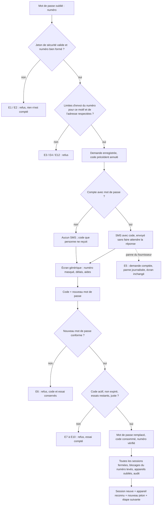

# UC-003 — Réinitialiser son mot de passe

| Champ | Valeur |
|---|---|
| Statut | Prêt pour dev |
| Priorité | Must |
| Module | `identity` |
| Auteur | use-case-writer |
| Date | 2026-11-19 |
| Use cases liés | UC-001 (défi SMS réutilisé ; inscription vers laquelle on oriente un client léger), UC-002 (connexion : blocages levés, sessions fermées, appareils reconnus), UC-004 / UC-005 (étape suivante après la connexion automatique), UC-009 (vérification client par SMS, motif distinct) |
| Exigences couvertes | EX-001, EX-018, EX-020, EX-024, EX-025, EX-029, D-004, D-017, D-018, D-019, D-020, D-021, D-023, D-025, D-028, D-033 |

## 0. Traçabilité

| Exigence | Source | Où elle est traitée dans ce UC |
|---|---|---|
| D-017 | DECISIONS.md | Objectif, flux nominal 2-8, RG-003-03, RG-003-07, scénario « Un membre du personnel choisit un nouveau mot de passe… » |
| D-019 | DECISIONS.md | RG-003-01, RG-003-02, RG-003-05, RG-003-14, scénarios « même réponse quel que soit le numéro », « Sans compte du personnel… », « numéro sans compte limité comme les autres » |
| D-018 | DECISIONS.md | RG-003-02, RG-003-14 (un compte client léger n'obtient pas de mot de passe par ce parcours) |
| D-020 | DECISIONS.md | RG-003-06, plan « Le nouveau mot de passe doit être difficile à deviner » |
| D-033 | DECISIONS.md (remplace le point de D-030 sur la panne du fournisseur SMS) | RG-003-05, postconditions d'échec, E5, scénarios « Une demande dont le SMS n'est pas parti compte dans les limites », « Pendant une panne du fournisseur SMS, les codes faux restent comptés » |
| D-021, D-023 | DECISIONS.md | RG-003-04, RG-003-05, RG-003-13, plans « 60 secondes », « 5 par heure et 10 par 24 heures », scénarios « 10 codes faux », « codes d'inscription ne comptent pas », « demandes simultanées » |
| D-025 | DECISIONS.md (« Mot de passe oublié lève les blocages ») | RG-003-09, RG-003-10, plan « lève les blocages », scénarios « échecs après la réinitialisation », « adresse réseau », « anciens appareils reconnus » |
| D-028 | DECISIONS.md (« la réinitialisation ferme toutes les sessions ») | RG-003-08, RG-003-12, scénarios « ferme toutes les sessions », « connexion terminée pendant la réinitialisation », « tracée sans secret » |
| D-004 | DECISIONS.md | RG-003-01 (jeton de sécurité exigé), RG-003-11 (session neuve, nouveau jeton) |
| EX-001 | prd.md §3 Hiérarchie | RG-003-07 (le numéro désigne une seule identité : c'est elle dont le mot de passe change) |
| EX-018 | prd.md §7 Étape 1 « Moyen de connexion sécurisé » | Tout le use case : le moyen de connexion se récupère sans affaiblir la sécurité |
| EX-020 | prd.md §7 | §10 (chaque refus dit quoi faire), §15 Guidage, RG-003-14 (orientation sans révéler) |
| EX-024 | prd.md §12 Sécurité | RG-003-01 à RG-003-13, §15 Sécurité |
| EX-025 | prd.md §12 Données | RG-003-12 (audit sans numéro ni adresse réseau), §14 (collecte minimale) |
| EX-029 | prd.md §2.B, §11 (User : « Identité et authentification ») | RG-003-11 (le membre du personnel retrouve l'accès au back-office) |

## 1. Objectif

Permettre à un membre du personnel qui a oublié son mot de passe d'en choisir un nouveau, seul et depuis son
téléphone, en prouvant qu'il possède son numéro par un code SMS. La réinitialisation sert aussi de **sortie de
secours** : elle ferme les sessions qu'un tiers aurait pu ouvrir et lève les blocages de connexion posés sur le
numéro (D-025, D-028). Sans que personne puisse savoir si un numéro est inscrit ni s'approprier un compte.

## 2. User story

> En tant que **membre du personnel d'un salon** (propriétaire ou collaborateur) qui a oublié son mot de passe,
> je veux **choisir un nouveau mot de passe grâce à un code reçu par SMS**,
> afin de **retrouver mon salon et mes rendez-vous sans appeler l'assistance**.

## 3. Acteurs

- **Acteur principal** : le membre du personnel (propriétaire, administrateur de salon, coiffeur, responsable
  financier, praticien), non connecté, sur smartphone ou sur une tablette du salon, réseau parfois lent.
- **Acteurs secondaires** : le fournisseur SMS (envoi du code) ; un tiers malveillant (recherche de comptes, envoi
  de codes en masse, tentative de prise de compte, blocage de la réinitialisation d'autrui) ; le système (limites
  d'envoi, expiration des codes).

## 4. Déclencheur

La personne choisit « Mot de passe oublié » sur l'écran « Se connecter » (lien présent aussi dans les messages de
blocage de UC-002, E3 et E4), ou ouvre directement la page « Mot de passe oublié ».

## 5. Préconditions

- Le navigateur a obtenu un jeton de sécurité (CSRF) de visiteur.
- Aucune autre précondition : le use case se comporte de la même façon pour un numéro sans compte, un compte client
  léger ou un compte du personnel (D-019). Être connecté ou non sur ce navigateur ne change rien (RG-003-15).
- Le numéro est bloqué ou non à la connexion : cela ne change rien (RG-003-09).

## 6. Postconditions

- **En cas de succès** :
  - le mot de passe du compte est remplacé (nouvelle empreinte argon2id) ; l'ancien ne permet plus de se connecter ;
  - le code utilisé ne peut plus servir ; la date de vérification du numéro est celle de la réinitialisation ;
  - **toutes** les sessions de l'utilisateur ouvertes avant la réinitialisation ne donnent plus accès à rien, sur
    tous les appareils (D-028) ;
  - les blocages de connexion du **numéro** sont levés (15 minutes et plafond de 24 h) ; celui d'une adresse réseau
    reste en place (D-025, RG-003-09) ;
  - les appareils reconnus de l'utilisateur ne le sont plus, sauf celui de la réinitialisation, reconnu à nouveau ;
  - une session neuve est ouverte sur ce navigateur, sans salon actif, avec un nouveau jeton de sécurité, et
    l'étape suivante est indiquée ;
  - « mot de passe réinitialisé » et « connexion » sont tracés dans le journal d'audit, sans secret.
- **En cas d'échec** :
  - le mot de passe, les sessions, les blocages et les appareils reconnus sont inchangés ;
  - un code faux est compté (essai du code et quota « 10 codes faux en 24 h ») ;
  - une demande de code acceptée est comptée dans les limites d'envoi, même si aucun SMS n'est parti faute de
    compte (RG-003-02), et aussi quand le SMS n'a pas pu partir chez le fournisseur (RG-003-05, D-033).

## 7. Règles métier

| ID | Règle | Exemple | Source |
|---|---|---|---|
| RG-003-01 | La demande de code ne prend qu'un **numéro camerounais** (mêmes formats que RG-001-02) et exige le jeton de sécurité. La réponse (statut, contenu, durée du code, délai de renvoi, écran) est **identique** pour un compte du personnel, un compte client léger et un numéro sans compte. Une saisie mal formée ou sans jeton est refusée **sans rien compter**. | « 6 99 00 11 22 », « +237 6 99 00 11 22 » acceptés ; « 6 99 00 11 2 » refusé. Écran : « Si un compte du personnel existe pour le 6 99 •• •• 22, un code vient de lui être envoyé par SMS. Il expire dans 5 minutes. » | D-019, EX-018, D-004 |
| RG-003-02 | Le code n'est envoyé **qu'au numéro d'un compte avec mot de passe**. Pour un numéro sans compte ou un compte client léger, **aucun SMS** ne part, mais la demande est **enregistrée et comptée** dans les limites exactement comme un envoi (avec un code que personne ne reçoit et qui ne peut jamais être accepté). | Demande pour 6 70 00 00 01 (sans compte) à 10 h 00 : rien n'est envoyé ; une 2e demande à 10 h 00 min 30 s reçoit « Vous pourrez en demander un autre dans 30 secondes », comme pour Paul. | D-019, D-018, D-030 |
| RG-003-03 | Un code de réinitialisation compte **6 chiffres**, est valable **5 minutes**, accepte **5 essais**, ne sert **qu'une fois** ; un seul code est actif par numéro pour le motif « mot de passe oublié », un nouveau code **annule** le précédent. Les codes des autres motifs (inscription, invitation…) ne sont jamais acceptés ici. | Code envoyé à 10 h 00 min 00 s : accepté à 10 h 04 min 59 s, refusé à 10 h 05 min 00 s ; codes 482913 puis 105377 : seul 105377 est accepté ; 6e essai refusé même avec le bon code. | D-017, UC-001 RG-001-04 / RG-001-06 |
| RG-003-04 | Pour un même numéro, et pour le seul motif « mot de passe oublié » : un nouveau code **après 60 secondes**, au plus **5 codes par heure** et **10 par 24 heures**, et **plus aucun code après 10 codes faux en 24 heures**. Les codes d'inscription (ou d'autres motifs) ne comptent pas. S'y ajoute une limite par adresse réseau (30 demandes par heure, comme l'inscription). | 5 codes envoyés depuis 9 h 10 → demande de 10 h 00 refusée ; 5 codes d'inscription depuis 9 h 10 → demande de réinitialisation acceptée. | D-021 (limite par adresse IP, valeur alignée sur la demande de code d'inscription), D-023 |
| RG-003-05 | La réponse à la demande **n'attend pas** le fournisseur SMS : elle a la même durée qu'un SMS parte ou non. Une panne du fournisseur n'est **pas annoncée** à l'écran (elle révélerait que le numéro a un compte). La demande dont le SMS n'a pas pu partir **compte quand même** dans les limites (60 s, 5 par heure, 10 par 24 h), exactement comme une demande pour un numéro sans compte ; son code expire normalement et les codes faux saisis pour lui restent comptés. La panne est seulement journalisée (type et code d'erreur, sans numéro ni texte du SMS). | Panne à 10 h 00 : l'écran habituel s'affiche, aucun SMS n'arrive ; la demande de 10 h 00 min 30 s est refusée (« Vous pourrez en demander un autre dans 30 secondes »), comme pour le 6 70 00 00 01 ; un code faux saisi à 10 h 01 compte parmi les 10 codes faux autorisés en 24 h. | D-019, D-021, D-030, D-033 |
| RG-003-06 | Le nouveau mot de passe suit D-020 : **10 à 128 caractères**, pas un mot de passe courant, sans le numéro. Il est vérifié **avant** le code : un refus ne consomme **ni le code ni un essai**. Il n'est **pas comparé** au mot de passe actuel. | « salon2026 » refusé (9 caractères) ; « 699001122ab » refusé (contient le numéro) ; « motdepasse123 » refusé (courant) ; « Wouri-Degrade-2027 » accepté. Reprendre « Bastos-Fade-2026 » est accepté. | D-020, UC-001 RG-001-07, D-031 |
| RG-003-07 | Avec le bon code, actif et non expiré, le mot de passe du compte est **remplacé**, le code est consommé et la date de vérification du numéro devient celle de la réinitialisation. Les refus (code faux, expiré, essais épuisés, plus valable) sont **les mêmes** qu'il y ait un compte ou non. | Paul confirme avec 482913 et « Wouri-Degrade-2027 » à 10 h 02 : « Bastos-Fade-2026 » est refusé ensuite, « Wouri-Degrade-2027 » accepté ; numéro vérifié le 19/11/2026 à 10 h 02. | D-017, EX-001, glossaire « Numéro vérifié » |
| RG-003-08 | La réinitialisation **ferme toutes les sessions** de l'utilisateur ouvertes avant elle, sur tous les appareils, y compris une session ouverte avec l'ancien mot de passe par une connexion qui se termine **pendant** la réinitialisation. Les sessions des autres utilisateurs ne sont pas touchées. | Paul connecté sur son téléphone et sur la tablette ; réinitialisation depuis un autre navigateur à 10 h 02 → téléphone et tablette renvoyés vers « Se connecter » à leur prochaine action. | D-028 |
| RG-003-09 | La réinitialisation **lève les blocages de connexion du numéro** : les échecs saisis pour ce numéro **avant** elle ne comptent plus, ni pour le blocage de 15 minutes (RG-002-04) ni pour le plafond de 24 h (RG-002-05). Les échecs saisis **après** comptent normalement. Le blocage d'une **adresse réseau** (RG-002-07) n'est **pas** levé. Les blocages de connexion n'empêchent ni de demander un code ni de réinitialiser. | Numéro bloqué jusqu'à 10 h 15 ; réinitialisation à 10 h 00 → connexion depuis un nouvel appareil à 10 h 05 acceptée. Adresse bloquée (30 échecs depuis 9 h 10) → toujours refusée depuis cette adresse sur un nouvel appareil. | D-025, D-031 |
| RG-003-10 | Les **appareils reconnus** de l'utilisateur **ne le sont plus** après la réinitialisation ; l'appareil où elle a été faite devient reconnu (comme après une connexion réussie). | Téléphone de Paul reconnu depuis le 10/11 ; réinitialisation sur la tablette → la tablette est reconnue, le téléphone ne l'est plus jusqu'à sa prochaine connexion réussie. | D-025, D-031 |
| RG-003-11 | Après la réinitialisation, l'utilisateur est **connecté automatiquement** sur ce navigateur : session **neuve** (nouvel identifiant), sans salon actif, **nouveau jeton** de sécurité, résumé de session avec l'**étape suivante** (D-027). | Paul, sans salon, voit « Votre mot de passe est changé » puis « Créez votre organisation ». | RG-002-10, RG-002-14, D-027, D-031 |
| RG-003-12 | Sont tracés dans le journal d'audit : « **mot de passe réinitialisé** » (utilisateur, instant, nombre de sessions fermées) et la « **connexion** » qui suit. Jamais le code, le mot de passe, le numéro ni l'adresse réseau. Les demandes de code ne vont pas dans l'audit (elles vivent dans l'historique des envois). | Lignes « mot de passe réinitialisé » et « connexion » de Paul à 10 h 02. | EX-025, D-028 |
| RG-003-13 | Les demandes de code d'un même numéro sont traitées **une à une** : une rafale n'envoie qu'un SMS. Les confirmations d'un même numéro aussi : un code ne réussit **qu'une fois**, la seconde confirmation est refusée. | 5 demandes simultanées → 1 SMS, 4 refus « renvoi trop tôt » ; 2 confirmations simultanées → 1 réussite, 1 refus « Ce code n'est plus valable. Demandez un nouveau code. » | D-023, EX-024 |
| RG-003-14 | Un **compte client léger** n'obtient **jamais** de mot de passe par ce parcours (aucun code ne lui est envoyé) : pour devenir membre du personnel, il passe par l'inscription (UC-001), qui exige l'acceptation des conditions. L'écran **oriente sans révéler** : il rappelle, pour tout numéro, « Pas encore de compte salon ? Créez-le » et « Vous avez réservé comme client ? Retrouvez vos réservations par SMS ». | Aïcha, cliente légère, demande un code : écran habituel, aucun SMS ; elle suit « Retrouvez vos réservations par SMS ». | D-018, D-019, D-022, D-030 |
| RG-003-15 | Le parcours ne demande pas d'être connecté. Si une session est déjà ouverte sur ce navigateur (même utilisateur ou un autre), elle est **remplacée** à la réussite. | Mireille connectée sur la tablette ; Paul y réinitialise son mot de passe → la tablette est connectée au compte de Paul, la session de Mireille n'existe plus. | RG-002-11 |

## 8. Flux nominal

1. La personne choisit « Mot de passe oublié » ; le numéro déjà saisi sur « Se connecter » est repris.
2. Elle saisit ou confirme son numéro et demande « Recevoir un code ».
3. Le système vérifie le jeton de sécurité, le format du numéro et les limites d'envoi (RG-003-01, RG-003-04).
4. Le système enregistre la demande, annule le code précédent et envoie un code par SMS au compte du personnel,
   sans faire attendre la réponse (RG-003-02, RG-003-03, RG-003-05).
5. Le système affiche l'écran générique : numéro masqué, temps restant, délai avant renvoi, aides (RG-003-14).
6. La personne saisit le code et choisit son nouveau mot de passe.
7. Le système vérifie le nouveau mot de passe (RG-003-06), puis le code (RG-003-03, RG-003-07).
8. Le système remplace le mot de passe, consomme le code et met à jour la date de vérification du numéro (RG-003-07).
9. Le système ferme toutes les sessions de l'utilisateur, lève les blocages du numéro, retire la reconnaissance des
   appareils et trace la réinitialisation (RG-003-08 à RG-003-10, RG-003-12).
10. Le système ouvre une session neuve sur ce navigateur, reconnaît l'appareil, remet un nouveau jeton et le résumé
    de session (RG-003-10, RG-003-11).
11. L'interface affiche « Votre mot de passe est changé. Vos autres appareils ont été déconnectés. » puis conduit à
    l'étape suivante (UC-004, UC-005 ou l'administration).

## 9. Flux alternatifs

- **A1 — Renvoi du code** (étape 5) : après 60 secondes, la personne demande un nouveau code ; l'ancien est annulé
  (RG-003-03) ; retour à l'étape 3.
- **A2 — Numéro sans compte ou compte client léger** (étape 4) : aucun SMS ne part ; la demande est enregistrée et
  comptée (RG-003-02) ; l'écran est le même qu'à l'étape 5. La personne qui ne reçoit rien suit l'une des aides
  (« Vérifiez le numéro », « Créez votre compte salon », « Retrouvez vos réservations par SMS ») ; fin du use case.
- **A3 — Numéro bloqué à la connexion** (déclencheur) : les blocages de UC-002 ne s'appliquent pas ici ; suite à
  l'étape 2 ; ils sont levés à l'étape 9 (RG-003-09).
- **A4 — Session déjà ouverte sur ce navigateur** (étape 10) : elle est remplacée (RG-003-15).
- **A5 — Correction du numéro** (étape 5) : « Modifier mon numéro » ramène à l'étape 2 ; le code envoyé à l'ancien
  numéro expirera seul.
- **A6 — Mot de passe refusé puis corrigé** (étape 7) : voir E6 ; la personne corrige sans nouveau code ; retour à
  l'étape 7.

## 10. Flux d'exception

- **E1 — Numéro mal formé** (étape 3) : « Saisissez un numéro camerounais de 9 chiffres, par exemple
  6 77 12 34 56. » ; rien n'est compté.
- **E2 — Jeton de sécurité absent ou périmé** (étapes 3 et 7) : « Jeton de sécurité absent ou expiré : rechargez
  la page puis recommencez. » ; rien n'est compté, aucun SMS.
- **E3 — Renvoi trop tôt** (étape 3 ou A1) : « Un code vient d'être envoyé. Vous pourrez en demander un autre dans
  20 secondes. »
- **E4 — Trop de codes demandés** (étape 3) : « Trop de codes demandés pour ce numéro. Réessayez dans une heure ou
  contactez l'assistance. » (quota horaire, quota de 24 h ou 10 codes faux en 24 h).
- **E5 — Fournisseur SMS indisponible** (étape 4) : l'écran habituel s'affiche (RG-003-05) ; aucun code n'arrive ;
  la demande compte dans les limites et la panne est journalisée sans numéro (D-033) ; après 60 secondes, la
  personne redemande un code (l'écran rappelle « Pas de SMS au bout d'une minute ? Demandez un nouveau code. »).
- **E6 — Mot de passe refusé** (étape 7) : message qui dit pourquoi (« Le mot de passe doit compter au moins
  10 caractères. », « Ce mot de passe est trop courant : choisissez une phrase propre à vous. », « Le mot de passe
  ne doit pas contenir votre numéro de téléphone. ») ; ni le code ni un essai ne sont consommés.
- **E7 — Code faux** (étape 7) : « Code incorrect. Il vous reste 3 essais. » ; essai compté ; rien d'autre ne change.
- **E8 — Code expiré** (étape 7) : « Ce code a expiré. Demandez-en un nouveau. »
- **E9 — Essais épuisés** (étape 7) : « Trop d'essais. Demandez un nouveau code. », même avec le bon code.
- **E10 — Code plus valable** (étape 7 : aucun code demandé, code déjà utilisé ou remplacé) : « Ce code n'est plus
  valable. Demandez un nouveau code. »
- **E11 — Deux confirmations simultanées** (étape 8) : une seule réussit ; l'autre reçoit E10 (RG-003-13).
- **E12 — Trop de demandes depuis une même adresse réseau** (étape 3) : refus du limiteur par adresse, « Trop de
  demandes depuis ce réseau. Réessayez dans une heure. » ; aucun SMS.
- **E13 — Service indisponible** (étapes 8 à 10) : « Réinitialisation impossible pour le moment. Réessayez dans
  quelques minutes. » ; mot de passe, sessions, blocages et appareils inchangés ; le code reste utilisable s'il
  n'a pas expiré.

> Aucun message ne dit si un compte existe pour le numéro saisi (D-019). Pour un numéro sans compte, les refus de
> code (E7 à E10) sont exactement ceux d'un compte.

## 11. Workflow

Demande puis confirmation (l'ordre des contrôles conditionne la non-énumération) :



Cycle de vie du code de réinitialisation :

```mermaid
stateDiagram-v2
    [*] --> Actif : demande acceptée et comptée (SMS envoyé ; aucun SMS si pas de compte du personnel ou panne du fournisseur, E5)
    Actif --> Actif : code faux, essais restants (E7) / mot de passe refusé (E6)
    Actif --> Remplacé : nouveau code demandé (A1)
    Actif --> Expiré : 5 minutes écoulées (E8)
    Actif --> Épuisé : 5e code faux (E9)
    Actif --> Consommé : bon code + mot de passe conforme
    Consommé --> [*] : mot de passe remplacé, sessions fermées, blocages levés, connexion
    Remplacé --> [*]
    Expiré --> [*]
    Épuisé --> [*]
```



## 12. Scénarios d'acceptation (BDD)

Identiques à `features/identity/reinitialiser-son-mot-de-passe.feature`.

```gherkin
# language: fr
@UC-003
Fonctionnalité: Réinitialiser son mot de passe
  Pour retrouver l'accès à son salon après avoir oublié son mot de passe,
  un membre du personnel prouve qu'il possède son numéro par un code SMS
  et choisit un nouveau mot de passe, qui ferme ses anciennes sessions et lève les blocages de connexion.

  Contexte:
    Étant donné que nous sommes le 19/11/2026 à 10 h 00, heure de Douala
    Et que les SMS sont envoyés normalement
    Et que Paul Ebode, coiffeur, a un compte avec le mot de passe "Bastos-Fade-2026" pour le 6 99 00 11 22
    Et qu'Aïcha Mbarga a un compte client léger, sans mot de passe, pour le 6 55 44 33 22
    Et qu'aucun compte n'existe pour le 6 70 00 00 01

  @nominal @RG-003-07 @RG-003-11 @D-017 @EX-018
  Scénario: Un membre du personnel choisit un nouveau mot de passe avec le code reçu par SMS
    Étant donné que Paul a demandé un code de réinitialisation et a reçu le code "482913"
    Quand on confirme la réinitialisation pour le "6 99 00 11 22" avec le code "482913" et le nouveau mot de passe "Wouri-Degrade-2027"
    Alors Paul est connecté
    Et on l'invite à créer son organisation
    Et Paul se connecte désormais avec "Wouri-Degrade-2027"
    Et le mot de passe "Bastos-Fade-2026" est refusé

  @securite @RG-003-01 @RG-003-02 @D-019 @D-018
  Plan du scénario: La demande de code reçoit la même réponse quel que soit le numéro
    Quand on demande un code de réinitialisation pour le "<numéro>"
    Alors la demande est acceptée
    Et l'écran affiché est le même que pour le numéro de Paul
    Et ce qui est envoyé au <numéro> est <envoi>

    Exemples:
      | numéro        | situation                              | envoi               |
      | 6 99 00 11 22 | compte du personnel                    | un SMS avec un code |
      | 6 55 44 33 22 | compte client léger, sans mot de passe | rien                |
      | 6 70 00 00 01 | numéro sans compte                     | rien                |

  @securite @RG-003-02 @RG-003-14 @D-018 @D-019
  Plan du scénario: Sans compte du personnel, aucun code saisi ne permet de choisir un mot de passe
    Étant donné qu'un code de réinitialisation a été demandé pour le <numéro>
    Quand on confirme la réinitialisation pour le "<numéro>" avec le code "482913" et le nouveau mot de passe "Wouri-Degrade-2027"
    Alors la réinitialisation est refusée
    Et le motif indiqué est "Code incorrect. Il vous reste 4 essais."
    Et aucun mot de passe n'existe pour le <numéro>

    Exemples:
      | numéro        | situation                              |
      | 6 55 44 33 22 | compte client léger, sans mot de passe |
      | 6 70 00 00 01 | numéro sans compte                     |

  @erreur @RG-003-01
  Plan du scénario: Seuls les numéros camerounais valides sont acceptés
    Quand on demande un code de réinitialisation pour le "<numéro saisi>"
    Alors la demande est <résultat>

    Exemples:
      | numéro saisi       | résultat                    |
      | 6 99 00 11 22      | acceptée                    |
      | +237 6 99 00 11 22 | acceptée                    |
      | 6 99 00 11 2       | refusée : numéro mal formé  |
      | +33 6 12 34 56 78  | refusée : numéro mal formé  |

  @erreur @RG-003-04 @D-021
  Plan du scénario: Un nouveau code ne peut être demandé qu'après 60 secondes
    Étant donné que Paul a reçu un code de réinitialisation à 10 h 00 min 00 s
    Quand Paul demande un nouveau code de réinitialisation à <heure>
    Alors la demande est <résultat>

    Exemples:
      | heure            | résultat                                  |
      | 10 h 00 min 59 s | refusée : nouveau code possible dans 1 s  |
      | 10 h 01 min 00 s | acceptée                                  |

  @erreur @RG-003-04 @D-021 @D-023
  Plan du scénario: Au plus 5 codes par heure et 10 codes par 24 heures pour un même numéro
    Étant donné que <envois> ont été envoyés au 6 99 00 11 22 pour réinitialiser le mot de passe
    Quand Paul demande un code de réinitialisation à 10 h 00
    Alors la demande est <résultat>

    Exemples:
      | envois                                             | résultat                   |
      | 4 codes depuis 9 h 10                              | acceptée                   |
      | 5 codes depuis 9 h 10                              | refusée : trop de codes    |
      | 9 codes depuis hier 11 h 00, le dernier à 8 h 00   | acceptée                   |
      | 10 codes depuis hier 11 h 00, le dernier à 8 h 00  | refusée : trop de codes    |

  @securite @RG-003-04 @D-023
  Scénario: Après 10 codes faux en 24 heures, plus aucun code de réinitialisation n'est envoyé
    Étant donné que 10 codes de réinitialisation faux ont été saisis pour le 6 99 00 11 22 depuis hier 11 h 00
    Quand Paul demande un code de réinitialisation à 10 h 00
    Alors la demande est refusée
    Et le motif indiqué est "Trop de codes demandés pour ce numéro. Réessayez dans une heure ou contactez l'assistance."

  @securite @RG-003-04 @D-023
  Scénario: Les codes d'inscription ne comptent pas dans les limites de la réinitialisation
    Étant donné que 5 codes d'inscription ont été demandés pour le 6 99 00 11 22 depuis 9 h 10
    Quand Paul demande un code de réinitialisation à 10 h 00
    Alors la demande est acceptée
    Et le 6 99 00 11 22 reçoit un SMS avec un code

  @securite @RG-003-02 @RG-003-04 @D-019
  Scénario: Les demandes pour un numéro sans compte sont limitées comme les autres
    Étant donné que 5 codes de réinitialisation ont été demandés pour le 6 70 00 00 01 depuis 9 h 10
    Quand on demande un code de réinitialisation pour le "6 70 00 00 01" à 10 h 00
    Alors la demande est refusée
    Et le motif indiqué est "Trop de codes demandés pour ce numéro. Réessayez dans une heure ou contactez l'assistance."

  @erreur @RG-003-03
  Plan du scénario: Un code de réinitialisation n'est valable que 5 minutes
    Étant donné que Paul a reçu le code de réinitialisation "482913" à 10 h 00 min 00 s
    Quand on confirme la réinitialisation pour le "6 99 00 11 22" avec le code "482913" et le nouveau mot de passe "Wouri-Degrade-2027" à <heure>
    Alors la réinitialisation est <résultat>

    Exemples:
      | heure            | résultat                    |
      | 10 h 04 min 59 s | acceptée                    |
      | 10 h 05 min 00 s | refusée : code expiré       |

  @erreur @RG-003-03 @securite
  Scénario: Après 5 codes faux, même le bon code est refusé
    Étant donné que Paul a reçu le code de réinitialisation "482913"
    Et que 5 codes faux ont été saisis pour ce code
    Quand on confirme la réinitialisation pour le "6 99 00 11 22" avec le code "482913" et le nouveau mot de passe "Wouri-Degrade-2027"
    Alors la réinitialisation est refusée
    Et le motif indiqué est "Trop d'essais. Demandez un nouveau code."
    Et Paul se connecte toujours avec "Bastos-Fade-2026"

  @alternatif @RG-003-03
  Scénario: Un nouveau code de réinitialisation annule le précédent
    Étant donné que Paul a reçu le code de réinitialisation "482913" à 10 h 00
    Et qu'il a reçu le code de réinitialisation "105377" à 10 h 01
    Quand on confirme la réinitialisation pour le "6 99 00 11 22" avec le code "482913" et le nouveau mot de passe "Wouri-Degrade-2027"
    Alors la réinitialisation est refusée
    Et le motif indiqué est "Code incorrect. Il vous reste 4 essais."

  @erreur @RG-003-06 @D-020
  Plan du scénario: Le nouveau mot de passe doit être difficile à deviner
    Étant donné que Paul a reçu le code de réinitialisation "482913"
    Quand on confirme la réinitialisation pour le "6 99 00 11 22" avec le code "482913" et le nouveau mot de passe "<mot de passe>"
    Alors la réinitialisation est <résultat>

    Exemples:
      | mot de passe        | résultat                                    |
      | salon2026           | refusée : au moins 10 caractères            |
      | motdepasse123       | refusée : mot de passe trop courant         |
      | 699001122ab         | refusée : ne doit pas contenir votre numéro |
      | Wouri-Degrade-2027  | acceptée                                    |

  @erreur @RG-003-06
  Scénario: Un mot de passe refusé ne fait perdre ni le code ni un essai
    Étant donné que Paul a reçu le code de réinitialisation "482913"
    Et que sa réinitialisation a été refusée pour le mot de passe "salon2026"
    Quand on confirme la réinitialisation pour le "6 99 00 11 22" avec le code "482913" et le nouveau mot de passe "Wouri-Degrade-2027"
    Alors Paul est connecté
    Et Paul se connecte désormais avec "Wouri-Degrade-2027"

  @securite @RG-003-08 @D-028
  Scénario: La réinitialisation ferme toutes les sessions ouvertes de l'utilisateur
    Étant donné que Paul est connecté sur son téléphone et sur la tablette du salon
    Et que Paul a reçu le code de réinitialisation "482913" sur son téléphone
    Quand on confirme la réinitialisation depuis un autre navigateur pour le "6 99 00 11 22" avec le code "482913" et le nouveau mot de passe "Wouri-Degrade-2027"
    Alors les sessions de Paul sur son téléphone et sur la tablette ne donnent plus accès à rien
    Et Paul n'est connecté que sur le navigateur de la réinitialisation

  @securite @RG-003-08
  Scénario: Une connexion avec l'ancien mot de passe terminée pendant la réinitialisation ne donne pas accès
    Étant donné que Paul a reçu le code de réinitialisation "482913"
    Et qu'une connexion avec le mot de passe "Bastos-Fade-2026" se termine pendant la réinitialisation
    Quand la réinitialisation pour le "6 99 00 11 22" avec le code "482913" et le nouveau mot de passe "Wouri-Degrade-2027" est confirmée
    Alors la session ouverte par cette connexion ne donne plus accès à rien

  @alternatif @RG-003-09 @D-025
  Plan du scénario: La réinitialisation lève les blocages de connexion du numéro
    Étant donné que le 6 99 00 11 22 est <blocage>
    Et que Paul a réinitialisé son mot de passe avec "Wouri-Degrade-2027" à 10 h 00
    Quand Paul se connecte avec "Wouri-Degrade-2027" depuis un nouvel appareil à 10 h 05
    Alors Paul est connecté

    Exemples:
      | blocage                                                                  |
      | bloqué jusqu'à 10 h 15 après 5 mots de passe faux entre 9 h 55 et 9 h 59 |
      | bloqué pour la journée après 20 mots de passe faux depuis hier 11 h 00   |

  @securite @RG-003-09 @D-025
  Scénario: Les échecs saisis après la réinitialisation comptent normalement
    Étant donné que Paul a réinitialisé son mot de passe à 9 h 56
    Et que 5 mots de passe faux ont été saisis pour le 6 99 00 11 22 depuis un nouvel appareil entre 9 h 57 et 9 h 59
    Quand Paul se connecte avec son nouveau mot de passe depuis un nouvel appareil à 10 h 00
    Alors la connexion est refusée
    Et le motif indiqué est "Trop d'essais pour ce numéro. Réessayez dans 14 minutes ou utilisez « Mot de passe oublié »."

  @securite @RG-003-09
  Scénario: La réinitialisation ne lève pas le blocage d'une adresse réseau
    Étant donné que 30 connexions ont échoué depuis la même adresse réseau depuis 9 h 10, sur des numéros différents
    Et que Paul a réinitialisé son mot de passe depuis cette adresse à 10 h 00
    Quand Paul se connecte avec son nouveau mot de passe depuis cette adresse, sur un nouvel appareil
    Alors la connexion est refusée
    Et le motif indiqué est "Trop d'essais depuis ce réseau. Réessayez dans une heure ou connectez-vous depuis votre appareil habituel."

  @securite @RG-003-10
  Scénario: Les anciens appareils reconnus ne le sont plus après la réinitialisation
    Étant donné que Paul s'est connecté depuis son téléphone habituel le 10/11/2026
    Et que Paul a reçu le code de réinitialisation "482913"
    Quand on confirme la réinitialisation depuis la tablette du salon pour le "6 99 00 11 22" avec le code "482913" et le nouveau mot de passe "Wouri-Degrade-2027"
    Alors son téléphone habituel n'est plus reconnu comme un appareil habituel de Paul
    Et la tablette du salon est reconnue comme un appareil habituel de Paul

  @alternatif @RG-003-15 @RG-002-11
  Scénario: Une réinitialisation sur la tablette du salon remplace la session déjà ouverte
    Étant donné que Mireille Ndongo est connectée sur la tablette du salon
    Et que Paul a reçu le code de réinitialisation "482913"
    Quand on confirme la réinitialisation depuis cette tablette pour le "6 99 00 11 22" avec le code "482913" et le nouveau mot de passe "Wouri-Degrade-2027"
    Alors la tablette est connectée au compte de Paul
    Et l'ancienne session de Mireille sur la tablette ne donne plus accès à rien

  @securite @RG-003-13
  Scénario: Deux confirmations simultanées du même code ne réussissent qu'une fois
    Étant donné que Paul a reçu le code de réinitialisation "482913"
    Quand deux confirmations avec le code "482913" et le nouveau mot de passe "Wouri-Degrade-2027" arrivent en même temps
    Alors une seule réussit
    Et l'autre est refusée avec le motif "Ce code n'est plus valable. Demandez un nouveau code."

  @securite @RG-003-13 @D-023
  Scénario: Des demandes de code simultanées n'envoient qu'un seul SMS
    Quand 5 demandes de code de réinitialisation pour le "6 99 00 11 22" arrivent en même temps
    Alors un seul SMS est envoyé au 6 99 00 11 22
    Et les 4 autres demandes sont refusées pour renvoi trop tôt

  @securite @RG-003-12 @EX-025
  Scénario: La réinitialisation est tracée sans secret
    Étant donné que Paul a reçu le code de réinitialisation "482913"
    Quand on confirme la réinitialisation pour le "6 99 00 11 22" avec le code "482913" et le nouveau mot de passe "Wouri-Degrade-2027"
    Alors le journal d'audit contient "mot de passe réinitialisé" et "connexion" à 10 h 00 pour Paul
    Et ni le code, ni le mot de passe, ni le numéro, ni l'adresse réseau n'y figurent

  @erreur @securite @RG-003-05 @D-033 @D-019
  Scénario: Une demande dont le SMS n'est pas parti compte dans les limites
    Étant donné que le fournisseur SMS est indisponible
    Et que Paul a demandé un code de réinitialisation à 10 h 00 sans le recevoir
    Quand Paul demande un nouveau code de réinitialisation à 10 h 00 min 30 s
    Alors la demande est refusée
    Et le motif indiqué est "Un code vient d'être envoyé. Vous pourrez en demander un autre dans 30 secondes."
    Et la réponse est la même que pour le 6 70 00 00 01 dans la même situation

  @securite @RG-003-05 @D-033
  Scénario: Pendant une panne du fournisseur SMS, les codes faux restent comptés
    Étant donné que le fournisseur SMS est indisponible
    Et que Paul a demandé un code de réinitialisation à 10 h 00 sans le recevoir
    Quand on confirme la réinitialisation pour le "6 99 00 11 22" avec le code "000000" et le nouveau mot de passe "Wouri-Degrade-2027"
    Alors la réinitialisation est refusée
    Et le motif indiqué est "Code incorrect. Il vous reste 4 essais."
    Et 1 code faux compte pour le 6 99 00 11 22 dans la limite de 10 par 24 heures

  @erreur @RG-003-01
  Scénario: Une demande sans jeton de sécurité est refusée sans rien compter
    Quand on demande un code de réinitialisation pour le "6 99 00 11 22" sans jeton de sécurité
    Alors la demande est refusée
    Et le motif indiqué est "Jeton de sécurité absent ou expiré : rechargez la page puis recommencez."
    Et aucun SMS n'est envoyé au 6 99 00 11 22

  @erreur
  Scénario: Une panne du service ne change ni le mot de passe ni les sessions
    Étant donné que Paul est connecté sur la tablette du salon
    Et que Paul a reçu le code de réinitialisation "482913"
    Et que le service GoMeCoiffer est momentanément indisponible
    Quand on confirme la réinitialisation pour le "6 99 00 11 22" avec le code "482913" et le nouveau mot de passe "Wouri-Degrade-2027"
    Alors la réinitialisation est refusée
    Et le motif indiqué est "Réinitialisation impossible pour le moment. Réessayez dans quelques minutes."
    Et Paul se connecte toujours avec "Bastos-Fade-2026"
    Et Paul est toujours connecté sur la tablette du salon
```

## 13. Plan de tests TDD

Ordre : refus d'abord, du plus simple au plus complexe. Unitaire = règles sur fakes in-memory ; intégration = vraie
base (Testcontainers) ; E2E = parcours HTTP. Aucune query nouvelle : le résumé de session réutilise `GetMySession`.

| # | Niveau | Comportement testé | Étant donné | Quand | Alors | Règle |
|---|---|---|---|---|---|---|
| T1 | Unitaire | Numéro mal formé refusé | — | demande pour « 6 99 00 11 2 » | refus, aucun SMS, aucun défi | RG-003-01 |
| T2 | Unitaire | Numéro sans compte : aucun SMS, défi enregistré au motif `PASSWORD_RESET`, réponse identique | aucun compte | demande | 0 SMS, 1 défi, réponse = celle de Paul | RG-003-01, -02 |
| T3 | Unitaire | Compte client léger : idem | Aïcha | demande | 0 SMS, 1 défi, même réponse | RG-003-02, -14 |
| T4 | Unitaire | Compte du personnel : SMS de code | Paul | demande | 1 SMS « …code… », défi actif | RG-003-02, -03 |
| T5 | Unitaire | Renvoi trop tôt, borne à la seconde | code à 10:00:00 | demandes à 10:00:59 / 10:01:00 | refus (1 s) / accepté | RG-003-04 |
| T6 | Unitaire | Limites lues pour le seul motif `PASSWORD_RESET` | 5 codes d'inscription depuis 9:10 | demande à 10:00 | acceptée | RG-003-04 |
| T7 | Unitaire | Numéro sans compte limité comme un compte | 5 demandes pour 6 70 00 00 01 | 6e | refus « trop de codes » | RG-003-02, -04 |
| T8 | Unitaire | Panne SMS comptée comme un numéro sans compte, codes faux comptés, panne journalisée sans numéro | fournisseur en panne | demande, puis demande à +30 s, puis code faux | 2e refusée (30 s), même réponse que pour 6 70 00 00 01 ; code faux compté ; journal : type et code d'erreur seulement | RG-003-05 |
| T9 | Unitaire | Nouveau code annule le précédent | 482913 puis 105377 | confirmation 482913 | refus « 4 essais » | RG-003-03 |
| T10 | Unitaire | Mot de passe refusé avant le code, rien consommé | code reçu | « salon2026 » puis « Wouri-Degrade-2027 » | refus puis réussite ; essais = 0 après le refus | RG-003-06 |
| T11 | Unitaire | Aucun défi actif | — | confirmation | `OTP_NO_LONGER_VALID` | RG-003-07 |
| T12 | Unitaire | Code faux / expiré (10:05:00) / épuisé : mot de passe inchangé | code reçu | confirmation | refus attendu, empreinte inchangée, essai sauvegardé | RG-003-03, -07 |
| T13 | Unitaire | Défi d'un numéro sans compte ou client léger jamais accepté | défi « fantôme » | n'importe quel code à 6 chiffres | `OTP_INCORRECT`, aucun mot de passe créé | RG-003-02, -14 |
| T14 | Unitaire | Réussite : empreinte remplacée, version des identifiants +1, numéro vérifié, défi consommé | Paul, code reçu | confirmation | comme décrit | RG-003-07 |
| T15 | Unitaire | Sessions fermées : port de sessions appelé pour Paul seulement | Paul | réussite | `closeAllOf(paul)` appelé 1 fois | RG-003-08 |
| T16 | Unitaire | Politique d'essais : échecs du numéro antérieurs à la réinitialisation ignorés (15 min et 24 h), échecs postérieurs comptés, adresse réseau inchangée | historiques construits | `assessSignIn` | non bloqué / bloqué 14 min / bloqué réseau | RG-003-09 |
| T17 | Unitaire | Appareils reconnus révoqués | 2 appareils de Paul, 1 de Mireille | réussite | appareils de Paul révoqués, celui de Mireille intact | RG-003-10 |
| T18 | Unitaire | Audit sans secret | Paul | réussite | « mot de passe réinitialisé » (sessions fermées : n) ; aucune valeur de code, mot de passe, numéro | RG-003-12 |
| T19 | Intégration | Sessions supprimées en base dans la transaction ; annulées si la transaction échoue | sessions de Paul et de Mireille | fermeture puis commit / rollback | Paul : 0 ligne ; Mireille intacte / tout intact | RG-003-08 |
| T20 | Intégration | Révocation des appareils et marque de réinitialisation dans l'historique des essais | lignes en base | réinitialisation | lecture filtrée correcte | RG-003-09, -10 |
| T21 | Intégration | Confirmations sérialisées par numéro | code reçu | 2 confirmations en parallèle | 1 réussite, 1 `OTP_NO_LONGER_VALID` | RG-003-13 |
| T22 | E2E | Parcours : demande → SMS (fake) → confirmation → id de session changé, nouveau jeton, résumé ; ancien mot de passe refusé, nouveau accepté | Paul | parcours HTTP | comme décrit | RG-003-07, -11 |
| T23 | E2E | Non-énumération : 3 numéros, statut et corps identiques (demande) ; refus de code identiques (confirmation) | inconnu, client léger, Paul | 3 + 3 requêtes | réponses identiques | RG-003-01, -02 |
| T24 | E2E | Sessions fermées : cookie du téléphone et de la tablette → 401 après réinitialisation | Paul connecté 2 fois | réinitialisation depuis un 3e navigateur | 401 / 401 / 200 | RG-003-08 |
| T25 | E2E | Connexion à l'ancien mot de passe terminée pendant la réinitialisation : session refusée ensuite (version des identifiants) | connexion ouverte avant la fermeture mais après la lecture du compte (horloge et ordre forcés) | requête avec cette session | 401 | RG-003-08 |
| T26 | E2E | Blocage du numéro levé ; blocage d'adresse maintenu | 5 échecs ; 30 échecs d'adresse | réinitialisation puis connexion | 200 ; refus réseau | RG-003-09 |
| T27 | E2E | Rafale de demandes : un seul SMS | — | 5 requêtes parallèles | 1 SMS, 4 refus | RG-003-13 |
| T28 | E2E | Sans jeton CSRF | — | POST sans en-tête | 403, aucun SMS, rien compté | RG-003-01 |
| T29 | E2E | Session déjà ouverte (Mireille) remplacée | Mireille connectée | réinitialisation de Paul | ancien cookie → 401, nouveau = Paul | RG-003-15 |
| T30 | Mutation | Marque de réinitialisation dans la politique d'essais (bornes : échec à la même seconde que la réinitialisation) | — | Stryker | aucun mutant survivant | RG-003-09 |

Doubles de test : horloge fixe ; fournisseur SMS en mémoire qui **enregistre** les messages (lire le code, vérifier
qu'aucun SMS ne part pour un numéro sans compte) et qui sait tomber en panne ; générateur de codes déterministe ;
hacheur de mot de passe rapide en unitaire ; port de fermeture des sessions en mémoire ; l'intégration utilise le
vrai argon2id et la vraie table `sessions`.

## 14. Données

- **Entrées** :
  - demande : numéro (obligatoire, normalisé en +237XXXXXXXXX comme RG-001-02) ;
  - confirmation : numéro, code (6 chiffres), nouveau mot de passe (10 à 128 caractères) ;
  - lus par la couche HTTP, pas dans le corps : jeton de sécurité, cookie d'appareil, adresse réseau.
- **Sorties** :
  - demande acceptée : numéro masqué (6 99 •• •• 22), durée de validité (300 s), délai avant renvoi (60 s) —
    identique quel que soit l'état du numéro ;
  - confirmation réussie : nouveau jeton de sécurité, résumé de session (même contenu qu'après une connexion,
    UC-002) ; cookie de session neuf ; cookie d'appareil reconnu ;
  - refus : code stable (`OTP_INCORRECT`, `OTP_EXPIRED`, `OTP_ATTEMPTS_EXHAUSTED`, `OTP_NO_LONGER_VALID`,
    `OTP_RESEND_TOO_SOON`, `OTP_TOO_MANY_REQUESTS`, `PASSWORD_TOO_SHORT`, `PASSWORD_TOO_LONG`,
    `PASSWORD_TOO_COMMON`, `PASSWORD_CONTAINS_PHONE`) et message lisible ;
  - SMS (compte du personnel seulement) : « GoMeCoiffer : votre code pour changer de mot de passe est 482913. Il
    expire dans 5 minutes. Ne le communiquez à personne. » (D-030).
- **Stocké** :
  - compte : nouvelle empreinte du mot de passe, date de vérification du numéro, version des identifiants
    (augmentée à chaque réinitialisation) ;
  - défi : motif « mot de passe oublié », empreinte du code, échéance, essais, date d'envoi ;
  - historique des essais de connexion : une marque « réinitialisation » pour le numéro (purgée après 48 h comme le
    reste, D-028) ;
  - appareils reconnus : révocation des anciens, reconnaissance de l'appareil de la réinitialisation ;
  - audit : action, utilisateur, instant, nombre de sessions fermées.
- **Jeux de données** :
  - Paul Ebode, coiffeur, 6 99 00 11 22, « Bastos-Fade-2026 » → « Wouri-Degrade-2027 » ;
  - Mireille Ndongo, propriétaire, 6 77 12 34 56, connectée sur la tablette du salon ;
  - Aïcha Mbarga, compte client léger, 6 55 44 33 22 ;
  - numéro sans compte : 6 70 00 00 01 ;
  - codes : 482913, 105377.

## 15. Exigences non fonctionnelles

- **Sécurité** : code et mot de passe stockés hachés, comparaison du code à temps constant ; jeton de sécurité exigé
  sur les deux étapes ; identifiant de session régénéré à la connexion automatique ; cookies `HttpOnly`,
  `SameSite=Lax`, `Secure` et préfixe `__Host-` hors local ; aucun code, mot de passe, numéro complet ni adresse
  réseau dans les logs ni dans l'audit ; identité lue dans la session ou prouvée par le code, jamais dans un champ
  « utilisateur » de la requête.
- **Non-énumération mesurable** : sur 30 demandes de chaque type (compte du personnel, client léger, sans compte),
  limites désactivées, statut et corps identiques et médianes des temps de réponse à moins de 20 % l'une de
  l'autre.
- **Performance** : demande < 1 s côté serveur, sans attendre le fournisseur SMS ; confirmation < 1,5 s (un calcul
  argon2id, fermeture des sessions comprise) pour un utilisateur qui a jusqu'à 10 sessions ouvertes.
- **Effet immédiat** : une session fermée est refusée dès sa requête suivante (aucun délai de propagation).
- **Guidage** (CLAUDE.md, tous modes) : l'écran de demande dit ce qui va se passer sans révéler l'existence du
  compte et propose les sorties (« Vérifiez le numéro », « Créez votre compte salon », « Retrouvez vos réservations
  par SMS ») ; le champ code annonce le temps restant et le délai avant renvoi ; l'aide sous le nouveau mot de passe
  rappelle la règle (« au moins 10 caractères, une phrase propre à vous ») ; après la réussite, « Vos autres
  appareils ont été déconnectés » ; utilisable à 390 px, remplissage du code par le téléphone accepté.
- **Disponibilité** : une panne pendant la confirmation ne laisse aucun état partiel (mot de passe changé sans
  sessions fermées, ou l'inverse) : tout est dans une seule transaction.

## 16. Hors périmètre

- Changement du mot de passe depuis le profil, en étant connecté (en connaissant l'ancien).
- Changement de numéro de téléphone (code SMS, D-017) et récupération d'un compte dont le numéro est perdu
  (assistance GoMeCoiffer).
- Écrans (front) : livrés dans un incrément séparé, avec les textes du §10 et du §15.
- Récupération par e-mail (l'e-mail n'est ni identifiant ni vérifié, UC-001 Q4).
- SMS d'alerte « votre mot de passe a été changé » (il arriverait au numéro qui vient de faire la réinitialisation),
  « déconnecter mes autres appareils » sans réinitialiser (D-028).
- Connexion d'un client par code SMS (UC-009) ; inscription d'un client léger comme propriétaire (UC-001).

## 17. Questions ouvertes

| # | Question | Hypothèse retenue en attendant (recommandation) | Impact si différent |
|---|---|---|---|
| Q1 | Que reçoit par SMS un **numéro sans compte** ou un **compte client léger** qui demande un code ? **Validée (D-030).** | **Recommandé : rien.** La demande est enregistrée et comptée comme un envoi (code que personne ne reçoit), la réponse est identique, l'écran oriente (« Créez votre compte salon », « Retrouvez vos réservations par SMS »). Coût SMS nul, et personne ne peut faire envoyer des SMS GoMeCoiffer à des inconnus. | **SMS d'information** (comme D-019 à l'inscription) : plus clair pour un client léger égaré, mais jusqu'à 10 SMS payants par jour vers n'importe quel numéro camerounais, utilisables pour harceler. **SMS seulement au client léger** : coût moindre, utile au client, mais les numéros sans compte restent muets. |
| Q2 | Le SMS part-il **sans faire attendre la réponse** (après l'enregistrement de la demande) ? **Validée (D-030).** (point de la panne remplacé par D-033) | **Recommandé : oui.** Sinon la durée de la réponse révèle qu'un SMS est parti, donc qu'un compte existe ; et une panne du fournisseur, annoncée seulement aux comptes, le révélerait aussi. Une panne n'est donc pas annoncée ; la demande compte quand même dans les limites, son code expire normalement et ses codes faux restent comptés (D-033 : retirer la demande ne profitait qu'aux vrais comptes et effaçait les essais ratés). Prérequis déjà au backlog (« envoi après commit » avant le vrai fournisseur). Le code en clair ne doit jamais être stocké pour cet envoi différé (pas d'outbox avec le code). | **Envoi pendant la requête** (comme l'inscription aujourd'hui) : plus simple, et une panne s'affiche ; mais l'existence d'un compte se lit au temps de réponse dès qu'un vrai fournisseur répond en 300 ms à 3 s. |
| Q3 | Après la réinitialisation : **connexion automatique** ou retour à « Se connecter » ? **Validée (D-031).** | **Recommandé : connexion automatique** sur ce navigateur (session neuve, nouveau jeton, appareil reconnu), comme après l'inscription (UC-001). La personne vient de prouver son numéro et de choisir le mot de passe : lui faire retaper les deux sur un réseau lent n'ajoute pas de sécurité. | **Retour à « Se connecter »** (conseil fréquent des guides de sécurité, moins de code de session) : un écran de plus pour un public non technique ; la connexion qui suit reste soumise au blocage d'adresse (RG-003-09). |
| Q4 | Le nouveau mot de passe doit-il être **différent de l'actuel** ? **Validée (D-031).** | **Recommandé : non contrôlé.** La comparaison coûte un calcul argon2id et, faite avant le code, transformerait la page en moyen de tester des mots de passe sans limite ; faite après, elle n'apporte presque rien (la personne l'avait oublié). | **Contrôlé après le code** : refuse la réutilisation d'un mot de passe peut-être volé ; un calcul de plus ; message à ajouter. |
| Q5 | Quels **blocages** la réinitialisation lève-t-elle (D-025 dit « les blocages ») ? **Validée (D-031).** | **Recommandé : ceux du numéro** (15 min et plafond 24 h : les échecs antérieurs ne comptent plus). **Pas celui d'une adresse réseau**, qui concerne des essais sur d'autres numéros. Les compteurs d'échecs des appareils reconnus disparaissent avec eux (Q6). | **Lever aussi l'adresse** : un attaquant qui possède un compte lèverait le blocage de son adresse à chaque réinitialisation (10 codes par jour). |
| Q6 | Les **appareils reconnus** sont-ils conservés ou révoqués ? **Validée (D-031).** | **Recommandé : tous révoqués**, l'appareil de la réinitialisation reconnu à nouveau. Si le mot de passe a fui avec un téléphone volé, ce téléphone ne doit plus échapper aux blocages ; un appareil légitime redevient reconnu à sa prochaine connexion réussie. Cohérent avec la fermeture de toutes les sessions (D-028). | **Conservés** : rien à faire, mais un appareil volé garde 5 essais hors blocage (D-025) contre le nouveau mot de passe. |
| Q7 | **Numéro recyclé** par l'opérateur (backlog C3) ou carte SIM dupliquée : le nouveau titulaire du numéro d'un membre du personnel peut réinitialiser le mot de passe et entrer dans le salon (et, pour un propriétaire, dans toute l'organisation). Quelle mesure ? **Validée (D-032).** | **Recommandé pour le MVP : accepter le risque**, tracer la réinitialisation (RG-003-12) et la date de vérification du numéro ; **avant la production**, décider d'une mesure parmi : prévenir le propriétaire du salon quand un collaborateur réinitialise (après UC-005) ; ou exiger l'assistance si le compte ne s'est pas connecté depuis plus de N mois. Non bloquant pour le développement. | Sans mesure : prise de compte possible d'un ancien salarié ou d'un propriétaire inactif ; avec contrôle par l'assistance : parcours plus lent pour les comptes inactifs. |
| Q8 | Un tiers peut faire envoyer **10 codes par jour** à un membre du personnel et, en saisissant 10 codes faux, **bloquer sa réinitialisation 24 h** (D-023 par motif). Acceptable ? **Validée (D-032).** | **Recommandé : oui**, conforme à D-023 : la victime garde sa connexion habituelle (mot de passe, appareil reconnu non bloqué) ; alerte d'exploitation sur le volume de codes faux (déjà au backlog). | Seuils plus hauts : plus de SMS payants et de force brute possible ; plus bas : blocage plus facile. |
| Q9 | Texte du SMS de réinitialisation **Validée (D-030).** | « GoMeCoiffer : votre code pour changer de mot de passe est 482913. Il expire dans 5 minutes. Ne le communiquez à personne. » Sans nom ni lien (UC-001 Q8). | Mention du motif utile : une personne qui n'a rien demandé comprend que quelqu'un tente de changer son mot de passe. |

Toutes les questions sont tranchées par le user le 19/11 (D-030 à D-032).

## 18. Notes pour le tech lead

### Découpage (une intention = une commande)

Deux intentions, comme UC-001 : demander un code, puis réinitialiser. Aucune query nouvelle.

| Élément | Type | Route | Protection | Effet / contenu |
|---|---|---|---|---|
| **`RequestPasswordResetCode`** — demander un code de réinitialisation | commande | `POST /api/public/auth/password-reset/code` (202) | `@Public()`, CSRF, 30/h par adresse | verrou par numéro (`lockSendingFor`), politique d'envoi lue pour `OtpPurpose.PASSWORD_RESET`, défi émis **dans tous les cas** (code réel pour un compte avec mot de passe, code inaccessible sinon), SMS de code au compte seulement. Réponse `{ maskedPhone, expiresInSeconds, resendInSeconds }` (même forme que `SignUpCodeSent`). |
| **`ResetPassword`** — réinitialiser le mot de passe | commande | `POST /api/public/auth/password-reset` (200) | `@Public()`, CSRF, 60/h par adresse | `NewPassword` d'abord ; verrous par numéro ; défi vérifié et sauvegardé ; `User.resetPassword` ; fermeture des sessions ; marque dans l'historique des essais ; révocation des appareils ; reconnaissance de l'appareil ; audit. Réponse `PASSWORD_RESET { userId, deviceTokens }` ou `REFUSED { refusal }`, **levé après le commit** (l'essai de code reste compté, comme `ConfirmSignUp`). |

- **La couche HTTP** fait ensuite comme `AuthController.signIn` : `openAuthenticatedSession`, cookie d'appareil,
  `generateCsrfToken(..., { overwrite: true })`, `GetMySession` → réponse `{ csrfToken, session }` (réutiliser
  `SignedInSchema`). Contrats : `RequestPasswordResetCodeSchema { phone }`, `ResetPasswordSchema { phone, code,
  newPassword }` (mode strict).
- Message SMS : `SmsMessages.passwordResetCode(code)`.

### Domaine (D-024)

| Relève du **domaine** (testable sans base) | Relève de l'**infrastructure / sécurité** |
|---|---|
| `User.resetPassword(newHash, now)` : remplace l'empreinte, augmente la **version des identifiants**, met à jour la date de vérification ; refuse un compte sans mot de passe (défense en profondeur, inatteignable via le défi inaccessible) | hachage argon2id, liste des mots de passe courants (existants) |
| `OtpChallenge` réutilisé tel quel (motif `PASSWORD_RESET`) ; défi « inaccessible » = empreinte d'un secret aléatoire qui n'est pas un code à 6 chiffres (jamais accepté, mêmes quotas) | génération du secret aléatoire, hachage |
| `assessSignIn` : ignorer les échecs du numéro antérieurs à la dernière marque « réinitialisation » (15 min **et** 24 h) ; l'adresse réseau n'en tient pas compte | marque stockée dans `sign_in_attempts` (nouvelle colonne de type d'essai) ou table dédiée, lue par `SqlSignInAttemptHistory` |
| `KnownDevice.revoke(now)` | `KnownDeviceRepository.revokeAllOf(userId, now)` |
| erreurs existantes (`Otp*Error`, `PasswordRejectedError`) | port `UserSessions.closeAllOf(userId): Promise<number>` : `DELETE FROM sessions WHERE sess->>'userId' = $1` **dans la transaction** de la commande ; index d'expression `sessions ((sess->>'userId'))` par migration écrite à la main |

### Points de vigilance

- **Périmètre critique** (mot de passe, réinitialisation, session, OTP) : `security-reviewer` obligatoire.
- **Suppression des sessions insuffisante seule** : `connect-pg-simple` réécrit la session en fin de requête
  (`rolling: true`, `INSERT … ON CONFLICT DO UPDATE`) ; une requête en cours au moment de la réinitialisation
  ressusciterait sa session, et une connexion à l'ancien mot de passe qui se termine pendant la réinitialisation en
  ouvrirait une neuve. Garantie proposée : **version des identifiants** recopiée dans la session à la connexion
  (`SignIn` la renvoie) et comparée par `AuthGuard` à celle du compte à chaque requête (lecture par clé primaire,
  à joindre à `ActorRights.resolve`) ; session sans version = version initiale. La suppression des lignes reste le
  nettoyage.
- **Verrous** : `ResetPassword` prend le verrou d'envoi du numéro puis celui des connexions (`lockSignInsFor`) ;
  `SignIn` ne prend que le second : pas de cycle, donc pas d'interblocage. READ COMMITTED supposé (backlog).
- **Non-énumération** : même statut, même corps, même durée ; le défi est créé pour tout numéro ; les quotas sont
  donc les mêmes. Le faux fournisseur SMS répond instantanément : le test de temps de réponse n'a de sens qu'avec
  l'envoi différé (Q2).
- **Rien après le commit qui puisse échouer à moitié** : mot de passe, sessions, marque, appareils et audit dans la
  même transaction (`TransactionalCommandBus`) ; seule l'ouverture de la session neuve suit le commit.
- Le code en clair n'est jamais persisté, même pour l'envoi différé (Q2).
- **Panne du fournisseur SMS (D-033)** : la demande reste enregistrée et comptée, le défi reste actif jusqu'à son
  échéance ; seul un journal (type et code d'erreur, sans numéro ni texte) garde la trace de la panne. Ne pas
  reprendre ici le statut « en échec, exclu des quotas » envisagé au backlog pour l'inscription.

### Incréments livrables, dans l'ordre

1. Domaine : `User.resetPassword` + version des identifiants ; marque « réinitialisation » dans `assessSignIn`
   (unitaires puis mutation).
2. `RequestPasswordResetCode` (défi pour tout numéro, quotas par motif) + route + E2E de non-énumération.
3. `ResetPassword` cœur (mot de passe, code, audit) + route avec connexion automatique.
4. Fermeture des sessions : port, migration (colonne `credentials_version`, index sur `sessions`), contrôle dans
   `AuthGuard`, E2E des sessions.
5. Appareils reconnus révoqués + blocages levés (E2E UC-002 rejoués après réinitialisation).
6. Envoi du SMS hors du temps de réponse (D-030 ; prérequis avant le vrai fournisseur).
7. Front : « Mot de passe oublié » depuis `/connexion`, écran du code, aides et messages (§10, §15).

### Definition of Ready

- [x] Chaque exigence de la section 0 est couverte par au moins un scénario
- [x] Toutes les règles métier ont au moins un exemple
- [x] Tous les flux d'exception ont un scénario Gherkin, sauf E12 (limiteur par adresse, vérifié en E2E comme à l'inscription) ; E10 est couvert par « Deux confirmations simultanées »
- [x] Aucune question ouverte bloquante (D-030 à D-032)
- [x] Le plan TDD couvre chaque règle
- [x] Le `.feature` est synchronisé avec la section 12
