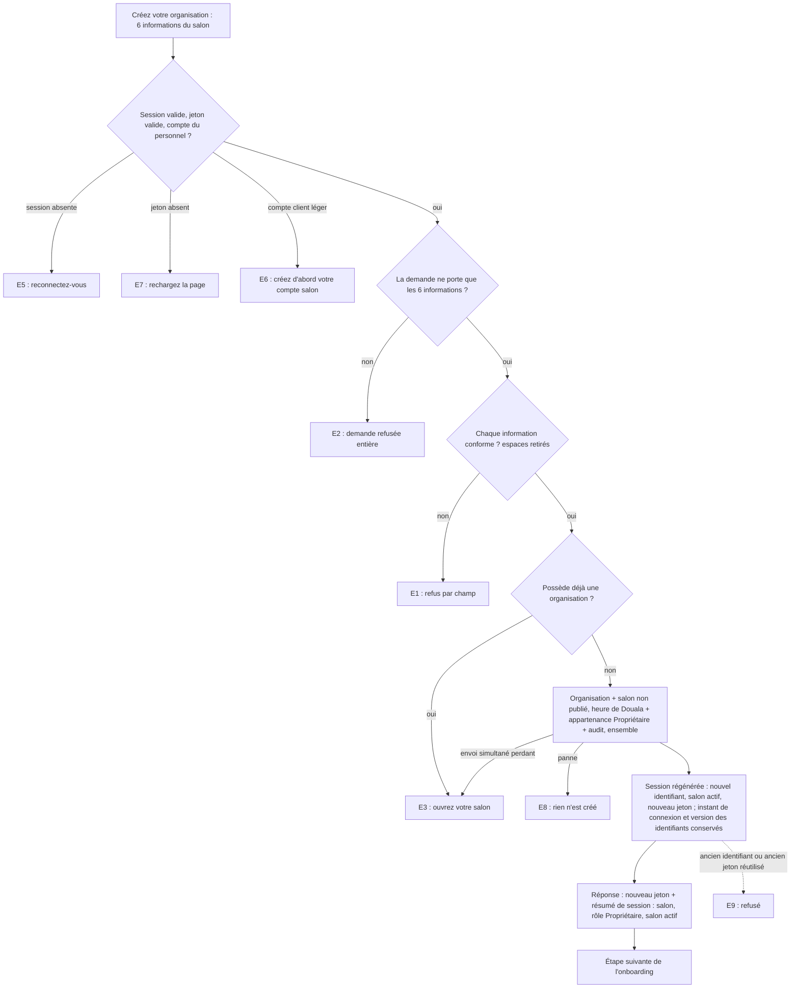
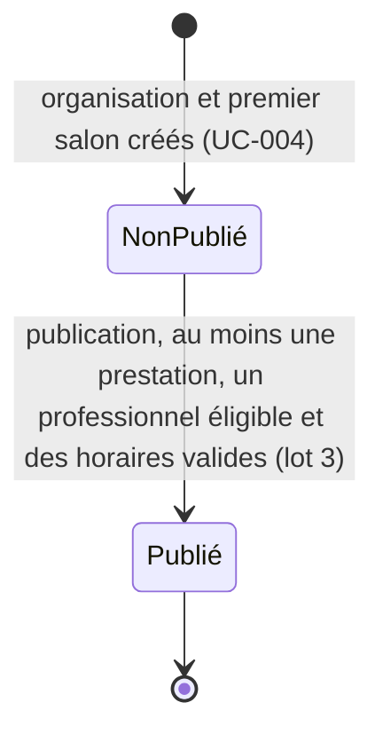

# UC-004 — Créer son organisation et son premier salon

| Champ | Valeur |
|---|---|
| Statut | Prêt pour dev |
| Priorité | Must |
| Module | `organizations` (impacts : `identity` pour `GetMySession`, `shared` pour `ActorRights`) |
| Auteur | use-case-writer |
| Date | 2026-11-19 |
| Use cases liés | UC-001 / UC-002 / UC-003 (précèdent : session ouverte, étape suivante `CREATE_ORGANIZATION`), UC-005 (suit : ouvrir et changer de salon actif, ajouter un salon), UC-008 (rôles salon, permissions ajustables, droits protégés du propriétaire, rôles système), UC-009 (compte client léger, refusé ici) |
| Exigences couvertes | EX-002, EX-003, EX-005, EX-006, EX-008, EX-009, EX-011, EX-012, EX-014 (en partie), EX-019, EX-020, EX-021, EX-023, EX-024, EX-025, EX-026, EX-030, EX-033, EX-034, D-003, D-004, D-007, D-027, D-035, D-036, D-037, D-038 |

## 0. Traçabilité

| Exigence | Source | Où elle est traitée dans ce UC |
|---|---|---|
| EX-019 | prd.md §7 Étape 1 « L'utilisateur crée ensuite son organisation » | Déclencheur, flux nominal 1-7, RG-004-03, scénario « Une propriétaire crée son organisation et son premier salon en une seule fois » |
| EX-030 | prd.md §7 Étape 2 | RG-004-04 à RG-004-08, §14, plan « Les informations du salon sont contrôlées » |
| EX-003 | prd.md §3 Hiérarchie | RG-004-03 (l'organisation porte ses salons ; le premier est créé avec elle, les suivants par UC-005) |
| EX-005 | prd.md §3 Exemple | RG-004-09 (salon créé vide, sans rien d'un autre salon), scénario « Le propriétaire du salon où travaille un coiffeur n'obtient aucun droit… » |
| EX-033 | prd.md §5.1 | RG-004-10, scénarios « …en une seule fois », « La propriétaire peut agir dans son salon dès sa création » |
| EX-008 | prd.md §3 Multi-tenancy | RG-004-10 (appartenance de propriétaire sur chaque salon de l'organisation), scénario « …agir dans son salon dès sa création » |
| EX-014 | prd.md §5.1 | RG-004-10 (le rôle de propriétaire n'est pas un rôle modifiable) ; détail dans UC-008 |
| EX-034 | prd.md F01 critères, §7 Étape 7 | RG-004-09, scénario « …en une seule fois » (salon non publié) |
| EX-006, EX-024 | prd.md §3 Multi-tenancy, §12 Sécurité | RG-004-01, RG-004-10, RG-004-13, scénarios « Sans session… », « Sans jeton… », « informations fixées par GoMeCoiffer », « …n'obtient aucun droit… » |
| EX-009, D-003 | prd.md §3 Multi-tenancy ; DECISIONS.md | RG-004-11, scénario « Le salon créé est ouvert dans la session, sans nouvelle connexion » |
| EX-002 | prd.md §3 Hiérarchie, Exemple | RG-004-10, scénario « Un coiffeur qui travaille dans un autre salon crée sa propre organisation », plan « L'étape proposée à la connexion suivante… » |
| EX-011, EX-012 | prd.md §2 Règle d'architecture, §4 | RG-004-14, scénarios « …aucun accès à l'administration GoMeCoiffer », « Un administrateur GoMeCoiffer peut créer sa propre organisation… » |
| EX-021 | prd.md §7 fin | RG-004-03 (étape 2 enregistrée dès sa validation), RG-004-12, plan « L'étape proposée à la connexion suivante… » (reprise) |
| D-027 | DECISIONS.md | RG-004-12 |
| EX-026, D-007 | prd.md §12 Dates ; DECISIONS.md | RG-004-09 (fuseau `Africa/Douala`) |
| EX-023 | prd.md §11 | RG-004-15, scénario « La création est tracée sans donnée personnelle » |
| EX-025 | prd.md §12 Données | RG-004-08 (téléphone commercial public après publication, aide affichée), RG-004-15, §14 |
| EX-020 | prd.md §7 introduction | §10 (chaque refus dit quoi faire), §15 Guidage |
| D-035 | DECISIONS.md | RG-004-02, RG-004-03, §16 (unicité du nom dans l'organisation, UC-005) |
| D-036 | DECISIONS.md | RG-004-04 à RG-004-09 |
| D-037, D-004 | DECISIONS.md | RG-004-11 (session régénérée, nouveau jeton), RG-004-10 (`ActorRights` réel), scénario « Devenir propriétaire régénère la session » |
| D-038 | DECISIONS.md | RG-004-01, RG-004-10, RG-004-14, scénarios « Un coiffeur… », « Un administrateur GoMeCoiffer… », « Un compte client léger… » |

## 1. Objectif

Permettre à un propriétaire qui vient de créer son compte de mettre en place, seul et depuis son téléphone, son
**organisation** et son **premier salon** en un seul écran court. Il en devient **propriétaire**, le salon s'ouvre
aussitôt dans sa session et il peut poursuivre l'onboarding (prestations, équipe, horaires), maintenant ou plus tard.
Le salon reste **invisible des clients** tant qu'il n'est pas publié.

## 2. User story

> En tant que **responsable de salon qui vient de créer son compte**,
> je veux **enregistrer mon salon (nom, type, ville, quartier, repère, téléphone)**,
> afin de **commencer à le configurer et d'en être reconnu comme propriétaire**.

## 3. Acteurs

- **Acteur principal** : l'utilisateur connecté avec un compte du personnel (mot de passe), sans organisation :
  propriétaire qui vient de s'inscrire, ou collaborateur d'un autre salon qui ouvre le sien. Smartphone, réseau
  parfois lent.
- **Acteurs secondaires** : un administrateur GoMeCoiffer qui crée sa propre organisation (A3) ; un tiers qui tente
  de créer une organisation au nom d'autrui ou d'imposer des valeurs réservées (RG-004-13) ; le système (fuseau,
  statut de publication, audit).
- Aucun service tiers (ni SMS, ni paiement) n'intervient.

## 4. Déclencheur

L'utilisateur choisit « Créer mon salon » sur l'écran « Créez votre organisation », proposé par l'étape suivante
`CREATE_ORGANIZATION` après l'inscription (UC-001), la connexion (UC-002) ou la réinitialisation (UC-003), ou depuis
le menu de son compte s'il est déjà collaborateur d'un autre salon (A2).

## 5. Préconditions

- Une session authentifiée est ouverte sur ce navigateur, avec un jeton de sécurité (CSRF) valide.
- Le compte a un mot de passe (compte du personnel, UC-001 ou UC-007) ; un compte client léger est refusé (E6).
- L'utilisateur ne possède encore aucune organisation (sinon E3).
- Appartenir déjà à un autre salon comme collaborateur, ou porter un rôle système, ne change rien (A2, A3).

## 6. Postconditions

- **En cas de succès** :
  - une organisation existe, nommée comme le salon, avec l'utilisateur pour propriétaire ;
  - un salon lui est rattaché : nom commercial, type, ville, quartier, point de repère, téléphone commercial, fuseau
    `Africa/Douala`, **non publié** ; sans photo, description, horaires, prestation, intervenant ni abonnement ;
  - l'utilisateur a une **appartenance active** à ce salon avec le rôle **Propriétaire** ; ses autres appartenances
    et ses rôles système éventuels sont inchangés ;
  - la session est **régénérée** sans nouvelle connexion : nouvel identifiant, **nouveau jeton de sécurité** remis
    dans la réponse, même utilisateur, même instant de connexion et même version des identifiants ; l'ancien
    identifiant et l'ancien jeton ne donnent plus rien ;
  - ce salon est le **salon actif** de la session ; les droits de propriétaire s'appliquent dès la requête suivante ;
  - « organisation créée » et « appartenance de propriétaire accordée » sont tracées dans le journal d'audit ;
  - la réponse contient le nouveau jeton et le résumé de session à jour.
- **En cas d'échec** : aucune organisation, aucun salon, aucune appartenance, aucune ligne d'audit ; la session
  n'est pas régénérée, son salon actif et son jeton sont inchangés ; les informations saisies restent à l'écran
  pour correction.

## 7. Règles métier

| ID | Règle | Exemple | Source |
|---|---|---|---|
| RG-004-01 | Seul un utilisateur **connecté** dont le compte a un **mot de passe** (compte du personnel) crée une organisation. Son identité est lue dans la session, jamais dans la demande. Un compte client léger est refusé et orienté vers l'inscription (UC-001). | Mireille, connectée → acceptée. Session expirée → refus 401. Aïcha, cliente légère connectée par SMS → refus « Créez d'abord votre compte salon… ». | EX-024, D-004, D-018, D-038 |
| RG-004-02 | Un utilisateur ne **possède qu'une seule organisation**. Une seconde création est refusée, y compris quand deux demandes arrivent en même temps (clic double, deux appareils) : une seule réussit. La garantie est **en base**. | Mireille a créé « Go Beauty Akwa » ; elle soumet « Go Beauty Bastos » → refus « Vous avez déjà une organisation. Ouvrez votre salon pour continuer. » ; 2 envois simultanés → 1 organisation, 1 salon, 1 appartenance. | D-035 |
| RG-004-03 | L'organisation et le premier salon sont créés **ensemble, en une seule action** : il n'existe jamais d'organisation sans salon. Le nom de l'organisation est le **nom commercial** du premier salon. L'étape 2 de l'onboarding est **enregistrée dès sa validation** ; les étapes suivantes s'enregistrent chacune à part. | Mireille valide « Go Beauty Akwa » → organisation « Go Beauty Akwa » + salon « Go Beauty Akwa ». Elle ferme l'application juste après : le salon existe, elle le retrouve à sa connexion suivante. | EX-019, EX-021, EX-003, D-035, D-036 |
| RG-004-04 | **Nom commercial** obligatoire, **2 à 60 caractères** après retrait des espaces au début, à la fin et en double. | « GB » accepté ; « G » refusé ; 60 caractères acceptés, 61 refusés ; «   Go   Beauty  Akwa  » enregistré « Go Beauty Akwa ». | EX-030, D-036 |
| RG-004-05 | **Type** obligatoire, un seul parmi : **salon de coiffure**, **barber shop**, **esthétique**, **mixte**. | « barber shop » accepté ; « institut de manucure » refusé. | EX-030 (prd.md §7 Étape 2) |
| RG-004-06 | **Ville** obligatoire, choisie dans la **liste fermée des villes** tenue par GoMeCoiffer, au départ : **Douala, Yaoundé, Bafoussam, Bamenda, Buea, Limbé, Kribi, Garoua, Maroua, Ngaoundéré, Bertoua, Ebolowa** (12 villes, orthographe exacte). **Quartier** obligatoire, texte libre de **2 à 60 caractères** (mêmes nettoyages que RG-004-04). | « Douala » / « Akwa » acceptés ; ville « Paris » refusée ; quartier « A » refusé. | EX-030, D-036 |
| RG-004-07 | **Adresse descriptive / point de repère** obligatoire, **5 à 160 caractères**. | « Rue Joffre, face à la pharmacie du Centre » acceptée ; 4 caractères refusés, 5 acceptés, 161 refusés. | EX-030, D-036 |
| RG-004-08 | **Téléphone commercial** obligatoire, numéro camerounais (mêmes formats que RG-001-02). Il peut être celui du propriétaire. Il **n'est pas vérifié par SMS** et ne sert pas à se connecter ; il sera **affiché aux clients** une fois le salon publié. | « 6 99 88 77 66 », « 6 77 12 34 56 » (numéro de Mireille), « +237 2 33 42 10 10 » acceptés ; « 6 99 88 77 6 » et « +33 6 12 34 56 78 » refusés. | EX-030, EX-025, RG-001-02, D-036 |
| RG-004-09 | Le salon est créé **non publié** (invisible dans la marketplace), au fuseau **`Africa/Douala`**, montants en FCFA. Il ne contient **rien** : ni photo, ni description, ni horaires, ni prestation, ni intervenant, ni abonnement, et rien n'est repris d'un autre salon. Aucune adresse publique (lien) n'est attribuée ici. | « Go Beauty Akwa » : non publié, heure de Douala, 0 prestation, 0 intervenant. | EX-034, EX-005, EX-026, D-007, D-036 |
| RG-004-10 | Le créateur devient **propriétaire** : propriétaire de l'organisation et **appartenance active** au salon avec le rôle **Propriétaire**. Ce rôle n'est pas un rôle configurable : il donne **toutes les permissions du salon** et les **droits protégés** (UC-008). Les appartenances qu'il a ailleurs ne changent pas, et personne d'autre n'obtient de droit sur le nouveau salon. | Paul, coiffeur chez « Élégance Bonamoussadi », crée « Paul Barber Deïdo » : propriétaire de son salon, toujours coiffeur chez Clarisse ; Clarisse ne voit pas « Paul Barber Deïdo ». | EX-033, EX-008, EX-014, EX-002, EX-006, D-037, D-038 |
| RG-004-11 | Devenir propriétaire est un **changement de privilèges** : après l'enregistrement, la session est **régénérée** (nouvel identifiant) sans nouvelle connexion, un **nouveau jeton de sécurité** est remis dans la réponse, et le salon créé devient le **salon actif**. La session garde l'utilisateur, l'**instant de connexion** (la durée absolue de 7 jours n'est pas prolongée) et la **version des identifiants**. L'ancien identifiant et l'ancien jeton sont **refusés** ensuite. Un refus ou une panne ne régénère rien. Les droits restent relus à chaque requête : la propriétaire agit dans son salon dès la requête suivante. | Mireille, connectée à 9 h 00, crée « Go Beauty Akwa » à 10 h 00 : nouvel identifiant et nouveau jeton ; une modification envoyée avec l'ancien jeton est refusée ; à 10 h 01 une action exigeant « gérer les réservations » est permise ; la session expire toujours le 26/11/2026 à 9 h 00. | EX-009, D-003, D-004, D-026, D-037, RG-002-10, RG-002-13 |
| RG-004-12 | Le **résumé de session** liste les salons où l'utilisateur a une appartenance active (nom, rôle) et le salon actif. L'**étape suivante** à la connexion suit D-027 : une appartenance → ouvrir ce salon ; plusieurs → choisir ; rôle système → administration. Un propriétaire qui a interrompu l'onboarding retrouve donc son salon, sans qu'on lui redemande de créer une organisation. | Mireille se reconnecte le lendemain → « ouvrir le salon Go Beauty Akwa » ; Paul (2 salons) → « choisir son salon ». | D-027, EX-021, EX-002 |
| RG-004-13 | La demande ne contient **que** les six informations du salon. Toute information fixée par GoMeCoiffer (propriétaire, organisation, fuseau, statut de publication, rôle, rôle système) **fait refuser la demande entière**. | Demande avec « propriétaire : Paul Ebode » ou « statut : publié » → refus, rien n'est créé. | EX-024, EX-012, CLAUDE.md §I.4 (mode strict) |
| RG-004-14 | Créer une organisation **n'accorde aucun rôle système**, et un rôle système n'accorde **aucun droit** dans un salon. Un administrateur GoMeCoiffer peut créer **sa propre** organisation comme tout utilisateur ; ses deux rôles restent évalués chacun dans son périmètre. | Mireille propriétaire → administration GoMeCoiffer refusée. Serge Kamga, Administrateur Opérations, crée « Salon Kamga Essos » : propriétaire de ce salon, toujours Administrateur Opérations, conduit à l'administration à la connexion. | EX-011, EX-012, D-027, D-038 |
| RG-004-15 | Sont tracés dans le journal d'audit : « **organisation créée** » (organisation, salon, utilisateur, instant) et « **appartenance de propriétaire accordée** » (salon, utilisateur, rôle). Jamais le téléphone commercial, le point de repère ni le numéro de l'utilisateur. | Deux lignes à 10 h 00 pour Mireille et « Go Beauty Akwa ». | EX-023, EX-025, D-028 |
| RG-004-16 | La création est **tout ou rien** : organisation, salon, appartenance et audit sont enregistrés ensemble ou pas du tout ; un refus ou une panne ne laisse aucun état partiel et ne change pas le salon actif. | Panne pendant l'enregistrement → Mireille n'a ni organisation ni salon ; elle renvoie le même formulaire et réussit. | EX-024, PRD §12 Fiabilité |

## 8. Flux nominal

1. Mireille, connectée et sans organisation, arrive sur « Créez votre organisation » (étape suivante
   `CREATE_ORGANIZATION`).
2. Elle saisit son premier salon : nom commercial, type, ville, quartier, point de repère, téléphone commercial.
3. Elle valide « Créer mon salon ».
4. Le système vérifie la session, le jeton de sécurité, le type de compte et que la demande ne porte que ces six
   informations (RG-004-01, RG-004-13).
5. Le système contrôle chaque information (RG-004-04 à RG-004-08).
6. Le système vérifie que Mireille ne possède pas déjà d'organisation (RG-004-02).
7. Le système crée ensemble l'organisation, le salon non publié à l'heure de Douala et l'appartenance de
   propriétaire, et trace la création (RG-004-03, RG-004-09, RG-004-10, RG-004-15, RG-004-16).
8. Le système régénère la session de Mireille (nouvel identifiant, même instant de connexion et même version des
   identifiants), y ouvre ce salon et émet un nouveau jeton de sécurité (RG-004-11).
9. Le système renvoie le nouveau jeton et le résumé de session : « Go Beauty Akwa », Propriétaire, salon actif
   (RG-004-12).
10. L'interface affiche « Votre salon « Go Beauty Akwa » est créé. Il n'est pas encore visible des clients :
    ajoutez vos prestations, votre équipe et vos horaires pour le publier. » et propose l'étape suivante de
    l'onboarding.

## 9. Flux alternatifs

- **A1 — Espaces en trop** (étape 5) : les espaces en début, en fin et en double du nom commercial, du quartier et du
  point de repère sont retirés avant contrôle (RG-004-04) ; suite à l'étape 6.
- **A2 — Collaborateur d'un autre salon** (étape 6) : Paul, coiffeur chez « Élégance Bonamoussadi », crée « Paul
  Barber Deïdo » ; son appartenance de coiffeur est conservée ; le nouveau salon devient son salon actif ; à la
  connexion suivante on l'invite à choisir son salon (RG-004-10, RG-004-12) ; suite à l'étape 7.
- **A3 — Administrateur GoMeCoiffer** (étape 6) : Serge Kamga crée sa propre organisation ; son rôle système est
  inchangé et ne lui donne aucun droit dans le salon ; à la connexion suivante il est conduit à l'administration
  (RG-004-14) ; suite à l'étape 7.
- **A4 — Reprise de l'onboarding** (après l'étape 10) : Mireille ferme l'application ; à sa connexion suivante, elle
  est conduite à « Go Beauty Akwa » et non à « Créez votre organisation » (RG-004-12).
- **A5 — Téléphone commercial = numéro du propriétaire** (étape 5) : accepté (RG-004-08) ; l'aide rappelle qu'il
  sera affiché aux clients après publication.

## 10. Flux d'exception

- **E1 — Information invalide** (étape 5) : refus par champ, rien n'est créé. Messages : « Le nom du salon doit
  compter de 2 à 60 caractères. » ; « Choisissez le type de votre salon : salon de coiffure, barber shop, esthétique
  ou mixte. » ; « Choisissez votre ville dans la liste. Elle n'y est pas ? Contactez l'assistance GoMeCoiffer. » ;
  « Indiquez le quartier (2 à 60 caractères), par exemple Akwa. » ; « Décrivez comment trouver le salon (5 à 160
  caractères), par exemple : face à la pharmacie du Centre. » ; « Saisissez un numéro camerounais de 9 chiffres, par
  exemple 6 77 12 34 56. »
- **E2 — Information réservée à GoMeCoiffer dans la demande** (étape 4) : refus de la demande entière, « Certaines
  informations sont invalides : corrigez les champs signalés. » ; rien n'est créé (RG-004-13).
- **E3 — Organisation déjà possédée** (étape 6) : refus, « Vous avez déjà une organisation. Ouvrez votre salon pour
  continuer. » ; rien ne change, ni le salon actif ni la session (RG-004-02).
- **E4 — Deux créations simultanées** (étape 7) : une seule réussit ; l'autre reçoit E3 (RG-004-02).
- **E5 — Session absente ou expirée** (étape 4) : « Session absente ou expirée : reconnectez-vous. » ; après la
  connexion, l'étape suivante ramène à « Créez votre organisation ».
- **E6 — Compte client léger** (étape 4, après UC-009) : « Créez d'abord votre compte salon avec un mot de passe,
  puis votre organisation. » avec le lien vers l'inscription (UC-001) (RG-004-01).
- **E7 — Jeton de sécurité absent ou périmé** (étape 4) : « Jeton de sécurité absent ou expiré : rechargez la page
  puis recommencez. » ; rien n'est créé.
- **E8 — Service indisponible** (étapes 7 à 9) : « Création impossible pour le moment. Réessayez dans quelques
  minutes. » ; rien n'est créé, la session n'est pas régénérée, le salon actif est inchangé, la saisie reste à
  l'écran (RG-004-16).
- **E9 — Ancien identifiant de session ou ancien jeton réutilisé** (après l'étape 9) : une requête avec l'ancien
  identifiant reçoit « Session absente ou expirée : reconnectez-vous. » ; une modification avec l'ancien jeton reçoit
  « Jeton de sécurité absent ou expiré : rechargez la page puis recommencez. » (RG-004-11).

> Aucun service tiers n'intervient : pas de cas « fournisseur indisponible ».

## 11. Workflow



État du salon couvert par ce use case :



## 12. Scénarios d'acceptation (BDD)

Identiques à `features/organizations/creer-son-organisation.feature`.

```gherkin
# language: fr
@UC-004
Fonctionnalité: Créer son organisation et son premier salon
  Pour commencer à configurer son établissement,
  un utilisateur connecté sans organisation enregistre son premier salon :
  il devient propriétaire, le salon s'ouvre dans sa session et reste invisible des clients jusqu'à sa publication.

  Contexte:
    Étant donné que nous sommes le 19/11/2026 à 10 h 00, heure de Douala
    Et que Mireille Ndongo a un compte propriétaire pour le 6 77 12 34 56, sans organisation
    Et que Mireille est connectée
    Et que le salon à créer est décrit ainsi :
      | nom commercial  | Go Beauty Akwa                            |
      | type            | mixte                                     |
      | ville           | Douala                                    |
      | quartier        | Akwa                                      |
      | point de repère | Rue Joffre, face à la pharmacie du Centre |
      | téléphone       | 6 99 88 77 66                             |

  @nominal @RG-004-03 @RG-004-09 @RG-004-10 @EX-019 @EX-030 @EX-033 @EX-034
  Scénario: Une propriétaire crée son organisation et son premier salon en une seule fois
    Quand Mireille crée son organisation avec ce salon
    Alors l'organisation "Go Beauty Akwa" existe, avec Mireille pour propriétaire
    Et le salon "Go Beauty Akwa" lui est rattaché, à l'heure de Douala
    Et le salon "Go Beauty Akwa" n'est pas publié
    Et Mireille est "Propriétaire" du salon "Go Beauty Akwa"

  @nominal @RG-004-11 @RG-004-12 @EX-009 @D-003
  Scénario: Le salon créé est ouvert dans la session, sans nouvelle connexion
    Quand Mireille crée son organisation avec ce salon
    Alors le salon ouvert dans la session de Mireille est "Go Beauty Akwa"
    Et son résumé de session liste le salon "Go Beauty Akwa" avec le rôle "Propriétaire"

  @securite @RG-004-11 @D-037 @D-004
  Scénario: Devenir propriétaire régénère la session
    Étant donné que Mireille s'est connectée à 9 h 00
    Quand Mireille crée son organisation avec ce salon
    Alors sa session reçoit un nouvel identifiant et un nouveau jeton de sécurité
    Et l'ancien identifiant de session et l'ancien jeton de sécurité sont refusés ensuite
    Et sa session expire toujours le 26/11/2026 à 9 h 00, 7 jours après sa connexion

  @nominal @RG-004-10 @RG-004-11 @EX-008
  Scénario: La propriétaire peut agir dans son salon dès sa création
    Étant donné que Mireille a créé son organisation avec ce salon
    Quand Mireille fait, dans le salon "Go Beauty Akwa", une action qui exige la permission "gérer les réservations"
    Alors l'action est permise

  @erreur @RG-004-04 @RG-004-05 @RG-004-06 @RG-004-07 @RG-004-08 @EX-030
  Plan du scénario: Les informations du salon sont contrôlées
    Quand Mireille crée son organisation avec ce salon, mais dont le <champ> est <valeur>
    Alors la création est <résultat>

    Exemples:
      | champ           | valeur                      | résultat                                         |
      | nom commercial  | "G"                         | refusée : nom de 2 à 60 caractères               |
      | nom commercial  | "GB"                        | acceptée                                         |
      | nom commercial  | un texte de 60 caractères   | acceptée                                         |
      | nom commercial  | un texte de 61 caractères   | refusée : nom de 2 à 60 caractères               |
      | type            | "institut de manucure"      | refusée : type de salon à choisir dans la liste  |
      | type            | "barber shop"               | acceptée                                         |
      | ville           | "Paris"                     | refusée : ville à choisir dans la liste          |
      | quartier        | "A"                         | refusée : quartier de 2 à 60 caractères          |
      | point de repère | un texte de 4 caractères    | refusée : point de repère de 5 à 160 caractères  |
      | point de repère | un texte de 5 caractères    | acceptée                                         |
      | point de repère | un texte de 161 caractères  | refusée : point de repère de 5 à 160 caractères  |
      | téléphone       | "6 99 88 77 6"              | refusée : numéro camerounais de 9 chiffres       |
      | téléphone       | "+33 6 12 34 56 78"         | refusée : numéro camerounais de 9 chiffres       |
      | téléphone       | "6 77 12 34 56"             | acceptée                                         |
      | téléphone       | "+237 2 33 42 10 10"        | acceptée                                         |

  @erreur @RG-004-16
  Scénario: Une création refusée ne crée rien
    Quand Mireille crée son organisation avec ce salon, mais dont le nom commercial est "G"
    Alors la création est refusée
    Et Mireille n'a toujours ni organisation ni salon
    Et aucun salon n'est ouvert dans sa session

  @alternatif @RG-004-04
  Scénario: Les espaces en trop du nom commercial sont retirés
    Quand Mireille crée son organisation avec ce salon, mais dont le nom commercial est "  Go   Beauty  Akwa  "
    Alors Mireille est "Propriétaire" du salon "Go Beauty Akwa"

  @erreur @RG-004-02
  Scénario: Un utilisateur ne possède qu'une seule organisation
    Étant donné que Mireille a créé son organisation avec ce salon
    Quand Mireille crée son organisation avec ce salon, mais dont le nom commercial est "Go Beauty Bastos"
    Alors la création est refusée
    Et le motif indiqué est "Vous avez déjà une organisation. Ouvrez votre salon pour continuer."
    Et Mireille n'a toujours qu'une organisation, avec le seul salon "Go Beauty Akwa"

  @securite @RG-004-02
  Scénario: Deux envois simultanés ne créent qu'une organisation
    Quand deux créations d'organisation de Mireille avec ce salon arrivent en même temps
    Alors une seule réussit
    Et l'autre est refusée avec le motif "Vous avez déjà une organisation. Ouvrez votre salon pour continuer."
    Et Mireille a une seule organisation, un seul salon et une seule appartenance

  @securite @RG-004-13 @EX-024 @EX-012
  Plan du scénario: Les informations fixées par GoMeCoiffer ne peuvent pas être imposées dans la demande
    Quand Mireille crée son organisation avec ce salon en indiquant aussi <information>
    Alors la création est refusée
    Et Mireille n'a toujours ni organisation ni salon

    Exemples:
      | information                                 |
      | Paul Ebode comme propriétaire               |
      | l'organisation d'un autre propriétaire      |
      | le statut « publié »                        |
      | le fuseau « Europe/Paris »                  |
      | le rôle système « Super Administrateur »    |

  @securite @RG-004-14 @EX-011 @EX-012
  Scénario: Créer une organisation ne donne aucun accès à l'administration GoMeCoiffer
    Étant donné que Mireille a créé son organisation avec ce salon
    Quand Mireille ouvre l'administration GoMeCoiffer
    Alors l'accès est refusé avec le motif "Action réservée à l’équipe GoMeCoiffer."
    Et Mireille n'a aucun rôle système

  @alternatif @RG-004-10 @RG-004-11 @EX-002
  Scénario: Un coiffeur qui travaille dans un autre salon crée sa propre organisation
    Étant donné que Paul Ebode est "Coiffeur" du salon "Élégance Bonamoussadi" de Clarisse Fotso
    Et que Paul est connecté, sans organisation
    Quand Paul crée son organisation avec ce salon, mais dont le nom commercial est "Paul Barber Deïdo"
    Alors Paul est "Propriétaire" du salon "Paul Barber Deïdo"
    Et Paul est toujours "Coiffeur" du salon "Élégance Bonamoussadi"
    Et le salon ouvert dans la session de Paul est "Paul Barber Deïdo"

  @securite @RG-004-10 @EX-005 @EX-006
  Scénario: Le propriétaire du salon où travaille un coiffeur n'obtient aucun droit sur le salon que ce coiffeur crée
    Étant donné que Paul Ebode est "Coiffeur" du salon "Élégance Bonamoussadi" de Clarisse Fotso
    Et que Paul a créé son organisation avec le salon "Paul Barber Deïdo"
    Quand Clarisse consulte son résumé de session
    Alors seul le salon "Élégance Bonamoussadi" y figure

  @alternatif @RG-004-12 @EX-021 @D-027
  Plan du scénario: L'étape proposée à la connexion suivante dépend des salons de l'utilisateur
    Étant donné que <personne> a créé son organisation avec le salon "<salon>" puis s'est déconnecté
    Et que <autres salons>
    Quand <personne> se connecte le lendemain avec son mot de passe
    Alors on l'invite à <étape suivante>

    Exemples:
      | personne | salon             | autres salons                                          | étape suivante                      |
      | Mireille | Go Beauty Akwa    | Mireille n'appartient à aucun autre salon              | ouvrir le salon "Go Beauty Akwa"    |
      | Paul     | Paul Barber Deïdo | Paul est "Coiffeur" du salon "Élégance Bonamoussadi"   | choisir son salon                   |

  @alternatif @securite @RG-004-14 @EX-011 @apres-UC-008
  Scénario: Un administrateur GoMeCoiffer peut créer sa propre organisation sans mélanger les rôles
    Étant donné que Serge Kamga a le rôle système "Administrateur Opérations" et aucune organisation
    Et que Serge est connecté
    Quand Serge crée son organisation avec ce salon, mais dont le nom commercial est "Salon Kamga Essos"
    Alors Serge est "Propriétaire" du salon "Salon Kamga Essos"
    Et Serge a toujours le seul rôle système "Administrateur Opérations"
    Et à sa prochaine connexion, on l'invite à ouvrir l'administration GoMeCoiffer

  @erreur @RG-004-01
  Scénario: Sans session, aucune organisation n'est créée
    Étant donné que la session de Mireille a expiré
    Quand Mireille crée son organisation avec ce salon
    Alors la création est refusée
    Et le motif indiqué est "Session absente ou expirée : reconnectez-vous."
    Et Mireille n'a toujours ni organisation ni salon

  @erreur @RG-004-01 @EX-024
  Scénario: Une création sans jeton de sécurité est refusée
    Quand Mireille crée son organisation avec ce salon sans jeton de sécurité
    Alors la création est refusée
    Et le motif indiqué est "Jeton de sécurité absent ou expiré : rechargez la page puis recommencez."
    Et Mireille n'a toujours ni organisation ni salon

  @erreur @RG-004-01 @D-018 @apres-UC-009
  Scénario: Un compte client léger ne crée pas d'organisation
    Étant donné qu'Aïcha Mbarga a un compte client léger pour le 6 55 44 33 22 et une session client ouverte
    Quand Aïcha crée son organisation avec ce salon
    Alors la création est refusée
    Et le motif indiqué est "Créez d'abord votre compte salon avec un mot de passe, puis votre organisation."
    Et Aïcha n'a ni organisation ni salon

  @securite @RG-004-15 @EX-023 @EX-025
  Scénario: La création est tracée sans donnée personnelle
    Quand Mireille crée son organisation avec ce salon
    Alors le journal d'audit contient "organisation créée" et "appartenance de propriétaire accordée" à 10 h 00 pour Mireille et le salon "Go Beauty Akwa"
    Et ni le téléphone commercial, ni le point de repère, ni le numéro de Mireille n'y figurent

  @erreur @RG-004-16
  Scénario: Une panne pendant la création ne laisse rien à moitié
    Étant donné que le service GoMeCoiffer tombe en panne pendant l'enregistrement
    Quand Mireille crée son organisation avec ce salon
    Alors la création est refusée
    Et le motif indiqué est "Création impossible pour le moment. Réessayez dans quelques minutes."
    Et Mireille n'a ni organisation, ni salon, ni appartenance
    Et aucun salon n'est ouvert dans sa session
```

## 13. Plan de tests TDD

Ordre : refus d'abord, du plus simple au plus complexe. Unitaire = règles sur fakes in-memory ; intégration = vraie
base (Testcontainers) ; E2E = parcours HTTP. `GetMySession` est une query : elle ne se teste qu'en E2E.

| # | Niveau | Comportement testé | Étant donné | Quand | Alors | Règle |
|---|---|---|---|---|---|---|
| T1 | Unitaire | Nom commercial : bornes et nettoyage | — | « G », « GB », 60, 61 caractères, «   Go   Beauty  Akwa  » | refus / accepté / accepté / refus / « Go Beauty Akwa » | RG-004-04 |
| T2 | Unitaire | Type de salon : 4 valeurs seulement | — | « mixte », « barber shop », « institut de manucure » | accepté, accepté, refus | RG-004-05 |
| T3 | Unitaire | Ville dans la liste ; quartier 2 à 60 | — | « Douala »/« Paris » ; « A »/« Akwa » | accepté/refus ; refus/accepté | RG-004-06 |
| T4 | Unitaire | Point de repère : 4 / 5 / 160 / 161 caractères | — | création de la valeur | refus / accepté / accepté / refus | RG-004-07 |
| T5 | Unitaire | Téléphone commercial : formats de RG-001-02 (réutilise le VO `PhoneNumber`) | — | 4 numéros de l'exemple | 2 acceptés, 2 refusés ; fixe accepté | RG-004-08 |
| T6 | Unitaire | Fondation : organisation nommée comme le salon ; salon non publié, `Africa/Douala`, vide ; appartenance `OWNER` active | Mireille, horloge fixe | `Organization.found(...)` | état décrit ; événements `OrganizationFounded`, `SalonRegistered` enregistrés | RG-004-03, -09, -10 |
| T7 | Unitaire | Compte client léger refusé, rien enregistré | compte sans mot de passe | `CreateOrganization` | `OWNER_ACCOUNT_REQUIRED`, 0 organisation | RG-004-01 |
| T8 | Unitaire | Organisation déjà possédée refusée, rien enregistré | Mireille propriétaire de « Go Beauty Akwa » | `CreateOrganization` « Go Beauty Bastos » | `ORGANIZATION_ALREADY_EXISTS`, toujours 1 organisation et 1 salon | RG-004-02 |
| T9 | Unitaire | Réussite : 1 organisation, 1 salon, 1 appartenance ; réponse `{ organizationId, salonId }` | Mireille | `CreateOrganization` | comme décrit | RG-004-03, -10 |
| T10 | Unitaire | Appartenance d'un collaborateur ailleurs inchangée | Paul coiffeur chez Clarisse | `CreateOrganization` | 2 appartenances de Paul ; aucune pour Clarisse sur le nouveau salon | RG-004-10 |
| T11 | Unitaire | Audit : 2 lignes, ni téléphone, ni repère, ni numéro | Mireille | réussite | `ORGANIZATION_FOUNDED`, `SALON_MEMBERSHIP_GRANTED` (`role: OWNER`) | RG-004-15 |
| T12 | Intégration | Unicité du propriétaire en base : 2e insertion → `OrganizationAlreadyExistsError` (traduction de `23505`) | organisation de Mireille en base | insertion d'une 2e | erreur métier, pas d'erreur SQL brute | RG-004-02 |
| T13 | Intégration | Tout ou rien : échec forcé à l'écriture de l'appartenance ou de l'audit → transaction annulée | base vide | `CreateOrganization` dans le bus transactionnel | 0 organisation, 0 salon, 0 appartenance, 0 audit | RG-004-16 |
| T14 | Intégration | `ActorRights` réel : membre du salon actif → `isMember`, permissions du propriétaire ; non-membre → `false`, aucune permission ; `credentialsVersion` conservée ; compte inconnu → `null` | Mireille propriétaire, Paul non-membre | `resolve(userId, salonId)` | comme décrit | RG-004-10, -11 |
| T15 | E2E | Parcours : connexion → création (201) → résumé : salon, rôle `OWNER`, salon actif ; `csrfToken` présent dans la réponse | Mireille connectée | `POST` puis `GET /api/salon/session` avec le nouveau cookie | comme décrit | RG-004-03, -11, -12 |
| T16 | E2E | Droits immédiats : route de test `@RequiresPermission('bookings:manage')` → 200 sans reconnexion ; avant création → 403 « Choisissez d'abord le salon… » | Mireille | requêtes | 403 puis 200 | RG-004-10, -11 |
| T17 | E2E | 2e création → 409 ; 2 créations parallèles → 1 × 201 + 1 × 409, 1 seule ligne par table | Mireille | requêtes | comme décrit | RG-004-02 |
| T18 | E2E | Mode strict : clé `ownerUserId`, `organizationId`, `publicationStatus`, `timezone`, `systemRole` → 400 ; rien créé | Mireille | `POST` | 400 + `errors`, 0 ligne | RG-004-13 |
| T19 | E2E | Bornes et formats invalides → 400 par champ (un cas par champ ; les bornes fines sont en T1-T5) | Mireille | `POST` | 400 + `errors` | RG-004-04 à -08 |
| T20 | E2E | Sans session → 401 ; sans jeton CSRF → 403 ; rien créé | — | `POST` | 401 / 403 | RG-004-01 |
| T21 | E2E | Isolation : résumé de Clarisse sans « Paul Barber Deïdo » ; résumé de Paul avec ses 2 salons | Paul coiffeur chez Clarisse | création par Paul | comme décrit | RG-004-10, -12 |
| T22 | E2E | Reprise : nouvelle connexion → `OPEN_SALON` (Mireille), `CHOOSE_SALON` (Paul) | créations faites | `POST /api/public/auth/sign-in` | étape suivante attendue | RG-004-12 |
| T23 | E2E | Administration refusée au propriétaire (route de test `@RequiresSystemRole`) | Mireille propriétaire | requête | 403 « Action réservée à l'équipe GoMeCoiffer. » | RG-004-14 |
| T24 | E2E | Audit en base : 2 lignes, colonnes sans téléphone ni repère | Mireille | création | comme décrit | RG-004-15 |
| T25 | E2E | `@apres-UC-008` : administrateur GoMeCoiffer propriétaire → `PLATFORM_ADMIN`, aucun droit salon venu du rôle système | Serge | création puis connexion | comme décrit | RG-004-14 |
| T26 | E2E | `@apres-UC-009` : session client léger → refus `OWNER_ACCOUNT_REQUIRED` | Aïcha | `POST` | 422, rien créé | RG-004-01 |
| T27 | E2E | Régénération : identifiant du cookie changé ; ancien cookie → 401 ; écriture avec l'ancien jeton CSRF (et le nouveau cookie) → 403 ; nouveau jeton accepté | Mireille connectée | création puis requêtes | comme décrit | RG-004-11 |
| T28 | E2E | Régénération sans prolonger ni affaiblir : durée absolue comptée depuis la connexion (horloge à 7 j + 1 s → 401) ; une réinitialisation du mot de passe (UC-003) faite après la création ferme bien cette session (version des identifiants conservée) | Mireille connectée à 9 h 00 | création, puis horloge avancée / réinitialisation | 401 / 401 | RG-004-11, D-031 |
| T29 | E2E | Pas de régénération sur refus : 400, 409 et 500 forcé → identifiant de session et jeton inchangés | Mireille | créations refusées | cookie et jeton d'avant toujours acceptés | RG-004-11, -16 |

Doubles de test : horloge fixe ; générateur d'identifiants déterministe ; repositories en mémoire (organisations,
salons, appartenances) dont le fake d'organisations refuse un 2e propriétaire identique ; fake de lecture du type de
compte ; journal d'audit en mémoire. L'intégration utilise la vraie table et ses contraintes d'unicité.

## 14. Données

- **Entrées** (corps de la demande, mode strict) :
  - `name` — nom commercial, texte, obligatoire, 2 à 60 caractères après nettoyage ;
  - `type` — `HAIR_SALON` (salon de coiffure), `BARBER_SHOP` (barber shop), `BEAUTY` (esthétique), `MIXED` (mixte) ;
  - `city` — une valeur exacte de la liste fermée (D-036) : `Douala`, `Yaoundé`, `Bafoussam`, `Bamenda`, `Buea`,
    `Limbé`, `Kribi`, `Garoua`, `Maroua`, `Ngaoundéré`, `Bertoua`, `Ebolowa` ;
  - `district` — quartier, texte libre, obligatoire, 2 à 60 caractères après nettoyage ;
  - `landmark` — adresse descriptive / point de repère, texte libre, obligatoire, 5 à 160 caractères après nettoyage ;
  - `phone` — téléphone commercial, obligatoire, formats de RG-001-02 (9 chiffres commençant par 6 ou 2, avec ou
    sans +237 et espaces), normalisé en +237XXXXXXXXX ;
  - lus par la couche HTTP, pas dans le corps : utilisateur (session), jeton de sécurité.
- **Sorties** :
  - succès (201) : `{ organizationId, salonId, csrfToken, session }` où `csrfToken` est le nouveau jeton de sécurité
    (la session vient d'être régénérée) et `session` le résumé de session (`SessionSummary`) :
    `salons: [{ id, name: "Go Beauty Akwa", role: "OWNER" }]`, `activeSalonId` = salon créé, `nextStep` ;
  - refus : code stable (`VALIDATION_FAILED` 400 avec `errors` par champ, `UNAUTHENTICATED` 401, `CSRF_INVALID`
    403, `OWNER_ACCOUNT_REQUIRED` 422, `ORGANIZATION_ALREADY_EXISTS` 409) et message lisible.
- **Stocké** :
  - organisation : identifiant, nom, propriétaire (utilisateur), instant de création, version ;
  - salon : identifiant, organisation, nom commercial, type, ville, quartier, point de repère, téléphone commercial,
    fuseau `Africa/Douala`, statut de publication « non publié », instant de création, version ; photo, description
    et adresse publique vides ;
  - appartenance : identifiant, salon, utilisateur, rôle `OWNER`, statut actif, instant, version ;
  - audit : action, sujet, utilisateur, salon, instant ; détails sans donnée personnelle (`role: OWNER`, `type`).
- **Jeux de données** :
  - Mireille Ndongo, 6 77 12 34 56, propriétaire sans organisation → « Go Beauty Akwa », mixte, Douala, Akwa, « Rue
    Joffre, face à la pharmacie du Centre », 6 99 88 77 66 ;
  - Paul Ebode, 6 99 00 11 22, « Coiffeur » chez « Élégance Bonamoussadi » (Clarisse Fotso) → « Paul Barber
    Deïdo », barber shop, Douala, Deïdo ;
  - Serge Kamga, Administrateur Opérations → « Salon Kamga Essos » (après UC-008) ;
  - Aïcha Mbarga, compte client léger, 6 55 44 33 22 (après UC-009).
- **Seed de démo** (obligatoire, idempotent) :
  - `identity` : Mireille Ndongo (6 77 12 34 56) et Paul Ebode (6 99 00 11 22), mots de passe de démo locaux,
    numéros vérifiés (le backlog relève qu'aucun compte de démo n'existe) ;
  - `organizations` : organisation « Go Beauty Akwa » de Mireille avec le salon « Go Beauty Akwa » (mixte, Douala,
    Akwa, non publié) et l'appartenance `OWNER` ; Paul **sans organisation**, pour dérouler UC-004 en local ;
  - les autres salons de l'exemple du PRD (Bastos, Biyem-Assi) arrivent avec l'ajout d'un salon (UC-005).

## 15. Exigences non fonctionnelles

- **Sécurité** : `@AuthenticatedOnly()` + CSRF ; utilisateur lu dans la session ; schéma strict (toute clé inconnue
  refusée) ; aucune donnée personnelle dans les logs ni l'audit ; route dans `/api/salon/*` (vérifiée par
  `RouteProtectionCheck`). Session régénérée au gain de privilèges, nouveau jeton CSRF, ancien identifiant et ancien
  jeton refusés (D-037). Périmètre critique (session, autorisation, isolation entre salons, droits du propriétaire) :
  `security-reviewer` obligatoire.
- **Isolation** : le salon créé n'est visible, dans le résumé de session et par les droits, que de ses membres
  (le seul propriétaire à ce stade) ; vérifié par T21.
- **Performance** : création < 500 ms côté serveur (4 insertions et 2 lignes d'audit dans une transaction) ;
  `GetMySession` < 100 ms pour un utilisateur qui a jusqu'à 20 appartenances (lecture filtrée par `user_id`, index).
- **Disponibilité** : aucun état partiel (RG-004-16) ; renvoyer la même saisie après une panne réussit.
- **Guidage** (CLAUDE.md, tous modes) :
  - aide sous **Type** : « Le type aide les clients à vous trouver. Mixte : coiffure et soins de beauté. » ;
  - aide sous **Téléphone commercial** : « Le numéro que vos clients appelleront. Il sera affiché sur votre page quand
    votre salon sera publié. Vous pouvez mettre le vôtre. » ;
  - aide sous **Point de repère** : « Comment trouver le salon, par exemple : face à la pharmacie du Centre. » ;
  - aide sous **Ville** : « Votre ville n'est pas dans la liste ? Contactez l'assistance GoMeCoiffer. » ;
  - après la création : « Votre salon est créé. Il n'est pas encore visible des clients : ajoutez vos prestations,
    votre équipe et vos horaires pour le publier. » ;
  - formulaire d'un seul écran, utilisable à 390 px, saisie conservée après un refus ou une panne.
- **Mesure du guidage** (A-5) : 9 propriétaires sur 10 du pilote créent leur salon sans assistance.

## 16. Hors périmètre

- Ajouter un 2e salon à son organisation, ouvrir et changer de salon actif : UC-005.
- Rôles salon prédéfinis, permissions par défaut et ajustables, droits protégés du propriétaire, rôles système :
  UC-008.
- Photo principale et courte description (upload, périmètre critique) ; horaires d'ouverture du salon : use cases à
  créer (EX-031, EX-032).
- Prestations, intervenants, horaires de travail, invitations : lot 2. Publication et adresse publique : lot 3.
- Abonnement SaaS, essai, activation ou suspension par GoMeCoiffer : lot 7.
- Modifier les informations du salon ou renommer l'organisation (F07) ; transférer la propriété ; plusieurs
  propriétaires ; supprimer une organisation.
- Création d'une organisation par GoMeCoiffer **pour le compte** d'un salon (rien dans le PRD).
- Écrans (front) : incrément séparé, avec les textes du §10 et du §15.

## 17. Questions ouvertes

| # | Question | Décision (recommandation retenue sauf Q14) | Impact si différent |
|---|---|---|---|
| Q1 | Un utilisateur peut-il **posséder plusieurs organisations** ? **Validée (D-035).** | **Recommandé : non, une seule au MVP** (contrainte d'unicité sur le propriétaire). Un propriétaire qui a plusieurs salons les ajoute à son organisation (UC-005), conformément à l'exemple du PRD §3. | Plusieurs organisations : plus de cas (choix de l'organisation à l'ajout d'un salon, abonnement), et le refus des doublons par clic double doit passer par une clé d'idempotence au lieu de la contrainte. |
| Q2 | Organisation et premier salon : **une seule action ou deux étapes** ? Quelles informations pour l'organisation ? **Validée (D-035).** | **Recommandé : une seule action**, l'organisation prend le **nom commercial** du premier salon (renommable plus tard). Le PRD ne donne aucun champ à l'organisation (A-12) ; « organisation » est une notion abstraite pour un propriétaire non technique ; une seule écriture évite l'état « organisation sans salon » et une étape suivante de plus. | Deux étapes : un écran de plus, un état intermédiaire à gérer (reprise, `nextStep` supplémentaire), et des champs d'organisation à définir (raison sociale, NIU…). |
| Q3 | Quelles informations de l'étape 2 sont **obligatoires à la création** ? (A-14) **Validée (D-036).** | **Recommandé** : nom commercial, type, ville, quartier, point de repère, téléphone commercial obligatoires ; **photo, description et horaires d'ouverture** dans des étapes suivantes, enregistrées chacune à part (EX-021). La photo est un upload (périmètre critique) et les horaires un sujet à part entière (A-13). Longueurs retenues : nom 2-60, quartier 2-60, repère 5-160. | Tout exiger d'un coup : écran long sur téléphone, abandon plus probable, et upload dans la même requête. Repère facultatif : un salon pourrait être publié sans indication pour le trouver. |
| Q4 | **Ville** : liste fermée ou texte libre ? **Validée (D-036).** | **Recommandé : liste fermée tenue par GoMeCoiffer** (au départ : Douala, Yaoundé, Bafoussam, Bamenda, Buea, Limbé, Kribi, Garoua, Maroua, Ngaoundéré, Bertoua, Ebolowa), quartier en texte libre. La recherche par ville (F01) exige des valeurs propres (« Douala », pas « douala » ni « Dla »). | Texte libre : saisie plus souple, mais recherche marketplace dégradée et nettoyage à faire plus tard. Liste des quartiers aussi : meilleure recherche, mais référentiel lourd à tenir. |
| Q5 | Le **téléphone commercial** doit-il être vérifié par SMS ? **Validée (D-036).** | **Recommandé : non.** C'est un contact public, pas une identité ; il peut être un fixe (qui ne reçoit pas de SMS). L'aide prévient qu'il sera affiché aux clients après publication (donnée personnelle si c'est le numéro du propriétaire). | Vérification : un SMS payant par salon, fixes exclus, écran de plus. |
| Q6 | **Adresse publique (lien) du salon** : attribuée ici ou à la publication ? **Validée (D-036).** | **Recommandé : à la publication (lot 3).** Elle n'a d'usage qu'une fois le salon visible, et le nom peut encore changer pendant l'onboarding. | Attribuée ici : lien stable plus tôt (partage anticipé sur WhatsApp), mais page publique d'un salon non publié à gérer (refus ou « bientôt disponible »). |
| Q7 | **État initial** d'un salon pour GoMeCoiffer (activation, F08 ; validation par l'équipe Opérations, A-3) et **abonnement / essai** à la création ? **Validée (D-036).** | **Recommandé** : le salon est utilisable aussitôt dans le back-office, **non publié** ; aucun abonnement ni essai n'est créé ici ; l'activation, la suspension et l'essai relèvent du lot 7 (un événement `SalonRegistered` est émis pour qu'il puisse s'y brancher). | Validation préalable par GoMeCoiffer : le propriétaire attend avant de configurer (abandon). Essai démarré ici : décision commerciale (backlog) à prendre avant ce use case. |
| Q8 | **Résolution réelle des droits** (`ActorRights`) : ici ou dans UC-005 ? **Validée (D-037).** | **Recommandé : ici, en version minimale.** Sans elle, `AuthGuard` oublie le salon actif dès la requête suivante (`activeSalonId && !isMember`) : le salon ouvert par UC-004 ne servirait à rien. Contenu : appartenance active au salon actif ; permissions = catalogue complet pour `OWNER`, rien pour les autres rôles jusqu'à UC-008 ; rôles système vides jusqu'à UC-008 ; `credentialsVersion` conservée (backlog). UC-005 ajoute l'ouverture et le changement de salon, UC-008 les permissions des autres rôles et les rôles système. | Reporté à UC-005 : UC-004 doit renoncer à ouvrir le salon (l'utilisateur passerait par « choisir son salon » après chaque création) et la permission du propriétaire ne serait pas testable. |
| Q9 | Un **administrateur GoMeCoiffer** peut-il créer une organisation ? (EX-011) **Validée (D-038).** | **Recommandé : oui, la sienne, comme toute personne** ; ses rôles restent séparés (D-027 prévoit déjà un rôle système avec des salons, A-8). La création **pour le compte** d'un salon est hors périmètre. | Interdit : règle simple, mais un membre de l'équipe ne peut pas tenir un salon de démonstration ; ajouter le refus et son message. |
| Q10 | Un **collaborateur** d'un salon peut-il créer sa propre organisation ? **Validée (D-038).** | **Recommandé : oui** (PRD §3 : plusieurs salons, rôles différents). Son appartenance existante ne change pas. | Interdit : un coiffeur qui ouvre son propre salon devrait créer un 2e compte, contraire à l'identité unique (EX-001). |
| Q11 | Les **rôles prédéfinis** du salon (Administrateur, Coiffeur, Responsable financier, Praticien) et leurs permissions par défaut sont-ils **recopiés à la création** du salon, ou lus dans un catalogue commun avec seulement les ajustements par salon ? **Validée (D-038).** | **Recommandé : décidé dans UC-008.** UC-004 n'enregistre que l'appartenance `OWNER` et émet `SalonRegistered` ; si UC-008 choisit la recopie, un abonné à cet événement l'écrira dans la même transaction. Non bloquant. | Décider ici la recopie : UC-004 doit déjà connaître les permissions par défaut des 4 rôles. |
| Q12 | Un **compte client léger** (UC-009) peut-il créer une organisation ? **Validée (D-038).** | **Recommandé : non** ; il passe par l'inscription (UC-001), qui exige le mot de passe et l'acceptation des conditions (D-022). | Autorisé : un propriétaire sans mot de passe ni conditions acceptées. |
| Q13 | **Unicité du nom** d'un salon ? **Validée (D-035).** | **Recommandé** : pas d'unicité entre organisations (deux « Go Beauty » peuvent exister à Douala) ; unique dans une organisation, à appliquer à l'ajout d'un salon (UC-005). | Unicité globale : premiers inscrits favorisés, conflits de noms à arbitrer. |
| Q14 | Faut-il **régénérer l'identifiant de session** quand l'utilisateur devient propriétaire ? **Validée (D-037), à l'inverse de la recommandation initiale.** | **Décidé : oui.** Devenir propriétaire est un changement de privilèges (skill `nest-stack`) : la session reçoit un nouvel identifiant et un nouveau jeton CSRF renvoyé dans la réponse ; elle garde l'utilisateur, l'instant de connexion et la version des identifiants ; l'ancien identifiant et l'ancien jeton sont refusés (RG-004-11). Recommandation initiale écartée : « non, les droits sont relus à chaque requête ». | Sans régénération : un identifiant de session capté avant la création donnerait les droits du propriétaire. Coût retenu : le front doit prendre le nouveau jeton, et un clic double peut déconnecter (§18, vigilance). |

Toutes les questions sont tranchées par le user le 19/11 (D-035 à D-038).

## 18. Notes pour le tech lead

### Découpage (une intention = une commande ou une query)

| Élément | Type | Route | Protection | Effet / contenu |
|---|---|---|---|---|
| **`CreateOrganization`** — créer son organisation et son premier salon | commande (`organizations`) | `POST /api/salon/organizations` (201) | `@AuthenticatedOnly()`, CSRF | lit le type de compte et l'organisation possédée (port de lecture) ; `Organization.found(...)` crée l'organisation, le salon et l'appartenance `OWNER` ; 3 repositories ; audit ×2. Réponse `{ organizationId, salonId }`. |
| **`GetMySession`** (modifiée) — résumé de session | query (`identity`, SQL pur) | `GET /api/salon/session` | `@AuthenticatedOnly()` | lit les appartenances actives de l'utilisateur jointes aux salons (nom, rôle), filtrées par `user_id` dès l'entrée ; `nextStepAfterSignIn` inchangé. Rapport d'index obligatoire (`query-perf`). |

- **HTTP (D-034)** : mapper `to-create-organization.request-mapper.ts` ; répondeur `owner-session.responder.ts`
  qui, après le commit : régénère la session (`req.session.regenerate`) en y recopiant `userId`,
  `authenticatedAt` et `credentialsVersion` de l'ancienne, pose `activeSalonId = salonId`, remet le jeton
  (`generateCsrfToken(req, res, { overwrite: true })`), puis renvoie `{ organizationId, salonId, csrfToken,
  session }` (résumé par `GetMySession`). Ne **pas** réutiliser tel quel `openAuthenticatedSession` : il remet
  `authenticatedAt` à maintenant (prolongerait la durée absolue de 7 jours) et le salon actif à `null`.
- **Contrats** (`packages/contracts`, nouveau fichier `organizations.ts`) : `SalonTypeSchema`
  (`HAIR_SALON`, `BARBER_SHOP`, `BEAUTY`, `MIXED`), `CameroonCitySchema` (les 12 villes de RG-004-06),
  `CreateOrganizationSchema { name, type, city, district, landmark, phone }` en mode strict,
  `OrganizationCreatedSchema { organizationId, salonId, csrfToken, session: SessionSummarySchema }`. Libellé du
  rôle : `OWNER` dans le contrat, « Propriétaire » côté front. Le front remplace son jeton CSRF par `csrfToken`.
- **Exception « une commande, plusieurs agrégats »** (skill `ddd` §5), à inscrire dans `docs/domains.md` :
  `CreateOrganization` écrit `Organization`, `Salon` et `SalonMembership` d'un bloc, justifié par RG-004-03 et
  RG-004-16 (jamais d'organisation sans salon ni de salon sans propriétaire).

### Domaine (D-024)

| Relève du **domaine** (testable sans base) | Relève de l'**infrastructure / sécurité** |
|---|---|
| VO `SalonName`, `SalonType` (enum), `City` (liste), `District`, `Landmark` ; `PhoneNumber` réutilisé (à remonter dans `shared/domain` : 3e module utilisateur après `identity`) | tables `organizations` (unique `owner_user_id`), `salons` (FK, index `organization_id`), `salon_memberships` (unique `(salon_id, user_id)`, index `(user_id) WHERE status = 'ACTIVE'`) ; colonnes `version` ; migration écrite à la main pour les index partiels |
| `Organization.found(owner, salonDraft, ids, now)` → organisation, salon (`NOT_PUBLISHED`, `Africa/Douala`), appartenance `OWNER` `ACTIVE` ; événements `OrganizationFounded`, `SalonRegistered` (domaine, aucun abonné à ce stade) | traduction de `23505` sur `owner_user_id` en `OrganizationAlreadyExistsError` (409) par le repository |
| erreurs `OrganizationAlreadyExistsError` (`ORGANIZATION_ALREADY_EXISTS`), `OwnerAccountRequiredError` (`OWNER_ACCOUNT_REQUIRED`) | port de lecture `OwnerCandidates` (`domain/repositories/read`) : `hasPassword`, `ownsOrganization` ; implémenté en SQL pur (`users`, `organizations`) |
| enum `SalonRole` avec au moins `OWNER` ; règle « le propriétaire a toutes les permissions du catalogue » | **`SqlActorRights`** (remplace `NoRightsYet`, fourni par `organizations` sous le token `ACTOR_RIGHTS`) : une requête par clé (`users.credentials_version` + appartenance active `(user_id, salon_id)`) ; `credentialsVersion` toujours renvoyée (backlog) |

Catalogue provisoire des permissions (codes `module:action`, PRD §6), à figer dans UC-008, renvoyé en entier pour
`OWNER` : `dashboard:view`, `bookings:view-own`, `bookings:view-all`, `bookings:manage`, `availability:edit-own`,
`availability:manage-team`, `services:view`, `services:manage`, `staff:view`, `staff:invite`, `staff:manage`,
`finances:view`, `finances:record-payment`, `finances:export`, `salon-settings:view`, `salon-settings:edit`,
`roles:administer` ; droits protégés du propriétaire (PRD §5.1, §5.2) : `organization:manage-salons`,
`subscription:manage`, `payout-accounts:manage`.

### Impacts sur `identity` et `shared`

- `identity` : `GetMySession` lit `salon_memberships` + `salons` (lecture SQL entre modules assumée pour un read
  model, ou port de lecture fourni par `organizations` si `pnpm arch` l'exige) ; mise à jour de la ligne dans
  `docs/domains.md`. `nextStepAfterSignIn` inchangé. E2E `my-session` étendu (T15, T21, T22).
- `shared` : `NoRightsYet` remplacé par `SqlActorRights` (le port `ActorRights` ne change pas) ; `PhoneNumber`
  remonté dans `shared/domain` ; aucun changement de `AuthGuard` ni de `PermissionsGuard` ; une fonction de
  régénération qui conserve `authenticatedAt` et `credentialsVersion` à côté de `openAuthenticatedSession`
  (`shared/infrastructure/security/authenticated-session.ts`), réutilisable par UC-005 si ouvrir un salon devient
  aussi un changement de privilèges.

### Points de vigilance

- **Périmètre critique** (session, CSRF, autorisation, isolation entre salons, droits du propriétaire,
  `ActorRights`) : `security-reviewer` obligatoire, dans les deux modes.
- **Ancienne session qui revit** : `connect-pg-simple` réécrit une session en fin de requête (`rolling: true`) ; une
  requête encore en cours avec l'ancien identifiant pourrait, si elle modifie sa session, recréer la ligne détruite
  par la régénération. Le chemin de refus de `CreateOrganization` ne doit rien écrire dans la session ; T27 vérifie
  que l'ancien cookie reste refusé.
- **`credentialsVersion`** : le vrai `ActorRights` doit la renvoyer, sinon la fermeture des sessions après une
  réinitialisation (D-031) cesse de fonctionner ; rejouer les E2E de UC-003 (T24, T25).
- **Clic double et session** : les deux requêtes partent avec l'ancien identifiant ; la gagnante le remplace. Si la
  perdante (409) répond après elle et repose l'ancien cookie, le navigateur revient à une session détruite : la
  requête suivante reçoit 401, l'utilisateur se reconnecte et l'étape suivante `OPEN_SALON` le ramène à son salon.
  Cas accepté (rien n'est perdu) ; le front désactive « Créer mon salon » pendant l'envoi. À vérifier par T17.
- Aucune donnée personnelle dans l'audit, les événements ni les logs (téléphone commercial, repère).
- **Seed** : seeders `identity` puis `organizations`, idempotents (clé : numéro de téléphone, propriétaire).

### Incréments livrables, dans l'ordre

1. Domaine : VO et `Organization.found` (unitaires T1-T6).
2. `CreateOrganization` + fakes (T7-T11), puis persistance, migration et contraintes (T12-T13).
3. `SqlActorRights` (T14) + route, mapper, répondeur avec régénération de la session, contrat (T15-T20, T23-T24,
   T27-T29).
4. `GetMySession` avec les salons + rapport d'index (T21-T22).
5. Seed de démo (Mireille propriétaire de « Go Beauty Akwa », Paul sans organisation).
6. Front : écran « Créez votre organisation », aides et messages (§10, §15).
7. Après UC-008 / UC-009 : T25, T26.

### Definition of Ready

- [x] Chaque exigence de la section 0 est couverte par au moins un scénario (EX-014 en partie, détail UC-008)
- [x] Toutes les règles métier ont au moins un exemple
- [x] Tous les flux d'exception ont un scénario Gherkin (E2 par le plan « informations fixées par GoMeCoiffer », E4 par « Deux envois simultanés », E6 marqué `@apres-UC-009`, E9 par « Devenir propriétaire régénère la session »)
- [x] Aucune question ouverte bloquante (D-035 à D-038)
- [x] Le plan TDD couvre chaque règle
- [x] Le `.feature` est synchronisé avec la section 12
