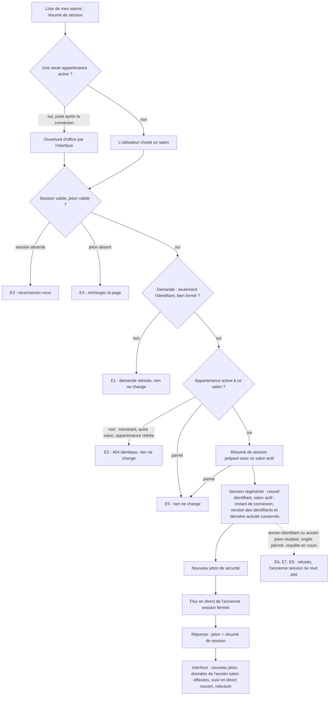
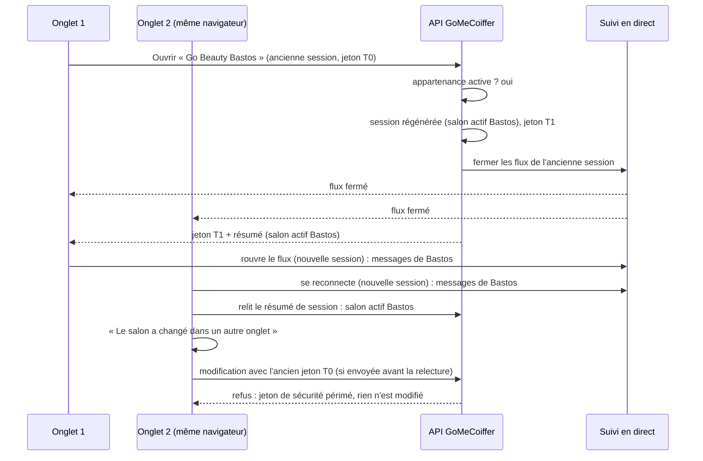

# UC-005 — Ouvrir et changer de salon

| Champ | Valeur |
|---|---|
| Statut | Prêt pour dev |
| Priorité | Must |
| Module | `organizations` (impacts : `identity` pour `GetMySession`, `shared` pour la session, le suivi en direct (SSE) et `ActorRights`) |
| Auteur | use-case-writer |
| Date | 2026-11-19 |
| Use cases liés | UC-002 (précède : session ouverte sans salon actif, étape suivante `OPEN_SALON` / `CHOOSE_SALON`), UC-004 (précède : le salon créé est déjà ouvert ; appartenance de propriétaire), UC-007 (invitation : crée l'appartenance d'un collaborateur), UC-008 (permissions des rôles, retrait d'une appartenance, rôles système), UC-010 « Ajouter un salon à son organisation » (crée le 2e salon et l'appartenance de propriétaire, D-041), lot 7 (salon suspendu, abonnement) |
| Exigences couvertes | EX-002, EX-004, EX-006, EX-007, EX-008, EX-009, EX-010 (en partie), EX-011, EX-020, EX-024, EX-033 (en partie), EX-036 (en partie), D-003, D-004, D-026, D-027, D-028, D-031, D-037, D-039, D-040, D-041 |

## 0. Traçabilité

| Exigence | Source | Où elle est traitée dans ce UC |
|---|---|---|
| EX-004 | prd.md §3 Hiérarchie « Un utilisateur peut appartenir à plusieurs salons, éventuellement avec des rôles différents » | RG-005-08, flux nominal 1-2, scénario « La liste de ses salons indique son rôle dans chacun » |
| EX-002 | prd.md §3 Exemple « Depuis son compte, il peut sélectionner chaque salon » | RG-005-04, scénario « Une propriétaire passe d'un salon à l'autre de son organisation » |
| EX-008, EX-033 | prd.md §3 Multi-tenancy, §5.1 | RG-005-04, scénario « Une propriétaire passe d'un salon à l'autre de son organisation » |
| EX-006 | prd.md §3 Multi-tenancy « Aucun collaborateur ne peut accéder à un salon sans appartenance autorisée » | RG-005-02, RG-005-03, RG-005-14, plans « Un salon sans appartenance active ne s'ouvre pas… », scénario « Une appartenance retirée… » |
| EX-007 | prd.md §3 Multi-tenancy « Les permissions sont évaluées par salon » | RG-005-02, RG-005-05, scénario « Changer de salon change les droits » |
| EX-009, D-003 | prd.md §3 Multi-tenancy « Le changement de salon change le contexte d'autorisation » ; DECISIONS.md | RG-005-05, RG-005-06, scénarios « Changer de salon change les droits », « Ouvrir un salon régénère la session » |
| EX-010 | prd.md §3 Multi-tenancy « Les données financières restent isolées par établissement » | RG-005-05 (aucune lecture ne vise un autre salon que le salon actif) ; l'isolation des données de chaque écran est prouvée par le cas de périmètre de chaque query (skill `sql-query`) |
| EX-011 | prd.md §2 Règle d'architecture, §4 | RG-005-13, scénario « Un administrateur GoMeCoiffer ouvre son salon sans mélanger les rôles » |
| EX-024 | prd.md §12 Sécurité | RG-005-01, RG-005-03, RG-005-12, scénarios `@securite` |
| EX-036 | prd.md §12 Fiabilité « Les événements manqués lors d'une déconnexion ne doivent pas entraîner un planning durablement incorrect » | RG-005-11 (relecture complète à la reconnexion du suivi en direct), scénario « Après un changement de salon, le suivi en direct ne porte plus que le nouveau salon » |
| EX-020 | prd.md §7 introduction | §10 (chaque refus dit quoi faire), §15 Guidage |
| D-027 | DECISIONS.md | RG-005-09, RG-005-10, scénarios « Un utilisateur qui n'a qu'un salon y entre sans rien choisir », « Le dernier salon utilisé n'est pas retenu… » |
| D-037, D-004, D-039 | DECISIONS.md | RG-005-06 (régénération étendue au changement de salon, D-039), RG-005-11, RG-005-12 |
| D-040 | DECISIONS.md | RG-005-07, RG-005-08, RG-005-09, RG-005-10, RG-005-15 |
| D-041 | DECISIONS.md | RG-005-04, RG-005-16 |
| D-026, D-031 | DECISIONS.md | RG-005-06 (instant de connexion et version des identifiants conservés), RG-005-13 (durées des rôles système) |
| D-028 | DECISIONS.md | RG-005-11 (les autres appareils ne sont pas touchés), RG-005-15 (audit) |

## 1. Objectif

Permettre à un membre du personnel qui appartient à un ou plusieurs salons de **choisir le salon dans lequel il
travaille** (le salon actif) et d'en **changer** sans se reconnecter. Le salon actif fixe le contexte
d'autorisation : ce que la personne voit et peut faire est celui de son rôle **dans ce salon-là**, et rien d'un autre
salon. Le propriétaire passe ainsi d'un salon à l'autre de son organisation avec un seul compte.

## 2. User story

> En tant que **membre du personnel de plusieurs salons (propriétaire, coiffeur, administrateur de salon…)**,
> je veux **choisir le salon dans lequel je travaille et en changer quand je veux**,
> afin de **voir et gérer ce salon-là avec les droits que j'y ai, sans créer plusieurs comptes**.

## 3. Acteurs

- **Acteur principal** : l'utilisateur connecté (compte du personnel) qui a au moins une appartenance active :
  propriétaire d'une organisation à un ou plusieurs salons, collaborateur d'un ou plusieurs salons, ou les deux.
  Smartphone ou tablette du salon, parfois plusieurs onglets, réseau parfois lent.
- **Acteurs secondaires** : l'interface (front) qui ouvre d'office le seul salon d'un utilisateur et relance le suivi
  en direct ; un administrateur GoMeCoiffer qui est aussi membre d'un salon (A5) ; un tiers qui tente d'ouvrir un
  salon où il n'a pas d'appartenance (E2) ; le propriétaire d'un salon qui retire une appartenance pendant qu'elle
  est utilisée (E10, retrait défini par UC-008).
- Aucun service tiers (ni SMS, ni paiement) n'intervient.

## 4. Déclencheur

- L'utilisateur choisit un salon dans la **liste de ses salons** : écran « Choisissez votre salon » (étape suivante
  `CHOOSE_SALON` après la connexion) ou sélecteur de salon du back-office.
- Ou l'interface **ouvre d'office** le seul salon de l'utilisateur, juste après la connexion (étape suivante
  `OPEN_SALON`, D-027, A1).

## 5. Préconditions

- Une session authentifiée est ouverte sur ce navigateur, avec un jeton de sécurité (CSRF) valide.
- L'utilisateur connaît l'identifiant du salon choisi par sa liste de salons (résumé de session).
- Avoir déjà un salon actif, ou aucun, ne change rien au déroulement.

## 6. Postconditions

- **En cas de succès** :
  - le salon choisi est le **salon actif** de la session ; les permissions appliquées dès la requête suivante sont
    celles du rôle de l'utilisateur **dans ce salon**, et aucune de l'ancien salon actif ;
  - la session est **régénérée** : nouvel identifiant, **nouveau jeton de sécurité** remis dans la réponse ; même
    utilisateur, même instant de connexion, même version des identifiants, même dernière activité ; l'ancien
    identifiant et l'ancien jeton ne donnent plus rien ;
  - les flux de suivi en direct ouverts avec l'ancienne session sont **fermés** ; ceux des autres appareils de
    l'utilisateur ne sont pas touchés ;
  - la réponse contient le nouveau jeton et le résumé de session à jour (salons, rôles, salon actif) ;
  - rien n'est écrit en base (ni appartenance, ni audit, voir RG-005-15).
- **En cas d'échec** : le salon actif précédent (ou l'absence de salon actif) est conservé ; la session n'est pas
  régénérée ; son identifiant et son jeton restent valides ; les flux en direct restent ouverts.

## 7. Règles métier

| ID | Règle | Exemple | Source |
|---|---|---|---|
| RG-005-01 | Seul un utilisateur **connecté** ouvre un salon. Son identité est lue dans la session ; la demande ne contient **que l'identifiant du salon**, bien formé. Toute autre information (utilisateur, rôle, permission, organisation) fait refuser la demande entière, sans rien chercher. | Paul connecté demande « Élégance Bonamoussadi » → accepté. Demande avec « rôle : Propriétaire » → refusée (400), le salon actif ne change pas. Session expirée → 401. | EX-024, D-004, CLAUDE.md §I.4 (mode strict) |
| RG-005-02 | Un salon ne s'ouvre que si l'utilisateur y a une **appartenance active**, quel que soit son rôle. Les permissions appliquées sont **celles de son rôle dans ce salon**, relues à chaque requête. | Paul, « Coiffeur » chez « Élégance Bonamoussadi », l'ouvre → permissions de Coiffeur dans ce salon. | EX-006, EX-007, D-003 |
| RG-005-03 | Un **salon inexistant**, un salon **où l'on n'a pas d'appartenance** (autre organisation, ou même organisation sans appartenance) et une **appartenance retirée** reçoivent **le même refus** : même statut (404), même code, même message, même temps de traitement (une seule lecture). Le refus ne révèle pas si le salon existe ; rien ne change (salon actif, session, jeton). | Paul demande « Go Beauty Bastos » (salon de Mireille) ou un identifiant qui n'existe pas → la même réponse « introuvable » ; il reste dans « Paul Barber Deïdo ». | EX-006, EX-024, CLAUDE.md §I.4 (404 hors périmètre) |
| RG-005-04 | Le **propriétaire** ouvre **chacun des salons de son organisation**, avec toutes les permissions du salon et ses droits protégés. C'est garanti par une **appartenance « Propriétaire » sur chaque salon de l'organisation** (créée avec le salon : UC-004 pour le premier, UC-010 pour les suivants). | Mireille passe de « Go Beauty Akwa » à « Go Beauty Bastos » : propriétaire dans les deux, « gérer les réservations » permis dans chacun. | EX-008, EX-033, EX-002, UC-004 RG-004-10, D-041 |
| RG-005-05 | **Changer de salon change le contexte d'autorisation** : dès la réponse, aucune permission de l'ancien salon ne s'applique, et toute lecture ou écriture vise le seul nouveau salon actif. | Paul, propriétaire de « Paul Barber Deïdo », passe à « Élégance Bonamoussadi » où il est Coiffeur : « gérer les réservations », permis dans son salon, est refusé chez Clarisse. | EX-009, EX-007, EX-010, BR-12 |
| RG-005-06 | Ouvrir ou changer de salon **régénère la session** : nouvel identifiant, **nouveau jeton de sécurité** remis dans la réponse ; l'utilisateur, l'**instant de connexion** (la durée absolue n'est pas prolongée), la **version des identifiants** et la **dernière activité** sont conservés. L'ancien identifiant et l'ancien jeton sont **refusés** ensuite. Un refus ou une panne ne régénère rien. | Mireille, connectée à 9 h 00, passe à « Go Beauty Bastos » à 10 h 00 : nouveau jeton ; une modification avec l'ancien jeton est refusée ; la session expire toujours le 26/11/2026 à 9 h 00. | D-039, D-037, D-004, D-026, D-031 |
| RG-005-07 | Rouvrir le salon **déjà actif** est accepté et répond comme une ouverture (session régénérée, nouveau jeton) ; rien d'autre ne change. | Paul, dans « Paul Barber Deïdo », le rechoisit → même salon actif, nouveau jeton. | D-039 (régénération à chaque ouverture : un seul chemin, pas de cas particulier) |
| RG-005-08 | La **liste de ses salons** est celle du résumé de session : les salons où l'utilisateur a une appartenance active, avec le **nom**, le **rôle**, la **ville** et le **quartier**, triés par nom, et le salon actif. Elle ne montre jamais un salon sans appartenance active, ni les membres ou données d'un salon. | Paul voit « Élégance Bonamoussadi — Coiffeur — Douala, Bonamoussadi » et « Paul Barber Deïdo — Propriétaire — Douala, Deïdo ». Clarisse ne voit pas « Paul Barber Deïdo ». | EX-004, EX-006, D-027, D-040 (ville et quartier) |
| RG-005-09 | **Ouverture d'office** (D-027) : la connexion n'ouvre aucun salon (RG-002-10) ; si l'utilisateur n'a **qu'une** appartenance active, l'étape suivante est « ouvrir ce salon » et l'interface l'ouvre **aussitôt, par cette même action**, sans rien lui demander ; s'il en a **plusieurs**, il choisit ; s'il a un **rôle système**, il va d'abord à l'administration et ouvre ensuite un de ses salons s'il le souhaite. | Mireille (1 salon) se connecte → « Go Beauty Akwa » s'ouvre sans écran de choix. Paul (2 salons) → « Choisissez votre salon ». | D-027, RG-002-10, D-040 (ouverture par un appel du front) |
| RG-005-10 | Le **dernier salon utilisé n'est pas retenu** : à chaque connexion, la session démarre sans salon actif et D-027 s'applique. | Mireille travaille dans « Go Beauty Bastos », se déconnecte, se reconnecte le lendemain → « Choisissez votre salon ». | D-027, RG-002-10, D-040 |
| RG-005-11 | **Suivi en direct** : au changement de salon, le serveur **ferme les flux en direct ouverts avec l'ancienne session** ; le flux rouvert ne porte que le **nouveau salon** (et les messages personnels de l'utilisateur). À chaque reconnexion, l'interface **relit tout** ce qu'elle affiche. Les flux des **autres appareils** de l'utilisateur (autres sessions) ne sont pas touchés. | Mireille suit « Go Beauty Akwa » en direct, passe à « Go Beauty Bastos » : elle ne reçoit plus rien d'Akwa, reçoit Bastos après la reconnexion ; la tablette du salon d'Akwa, connectée avec son compte, continue de suivre Akwa. | EX-036, EX-009, D-002, D-028, D-039 (flux de l'ancienne session seulement) |
| RG-005-12 | **Concurrence** : un navigateur (une session) n'a qu'**un** salon actif, partagé par ses onglets. (a) Deux changements simultanés : la session finit avec **un seul** salon actif, l'un des deux demandés, et les droits de **ce** salon ; jamais un mélange. (b) Un onglet resté sur l'ancien salon **ne peut rien modifier** sans se recharger (jeton périmé) : il n'écrit jamais par erreur dans le nouveau salon. (c) Un identifiant de session remplacé **ne revit jamais**, même par une requête encore en cours au moment du changement. Au pire, l'utilisateur est invité à se reconnecter ; il ne se retrouve jamais dans l'ancien salon sans l'avoir choisi. | Mireille change de salon dans un onglet ; l'autre onglet, resté sur Akwa, envoie une modification → « Jeton de sécurité absent ou expiré : rechargez la page puis recommencez. », rien n'est modifié. | EX-024, D-004, D-037, D-039 (session remplacée jamais recréée, pas de garde-fou « salon attendu »), BACKLOG « requête en vol » |
| RG-005-13 | **Rôles séparés** : ouvrir un salon n'accorde **aucun** rôle système et ne retire pas ceux de l'utilisateur ; ses durées de session de rôle système (2 h sans activité, 12 h après la connexion) continuent de s'appliquer. | Serge Kamga, Administrateur Opérations et propriétaire de « Salon Kamga Essos », ouvre son salon : toujours Administrateur Opérations, session toujours limitée à 12 h. | EX-011, D-026, D-038 |
| RG-005-14 | Une appartenance **retirée pendant que le salon est actif** cesse de compter **à la requête suivante** : le salon actif est oublié, aucune action de salon n'est permise (« Choisissez d'abord le salon sur lequel vous travaillez. »), le salon disparaît de la liste, et le suivi en direct de ce salon s'arrête au plus tard à la reconnexion. | Clarisse retire Paul d'« Élégance Bonamoussadi » pendant qu'il y travaille ; sa requête suivante n'a plus de salon actif. | EX-006 ; fermeture immédiate du flux : UC-008 (BACKLOG) |
| RG-005-15 | Ouvrir ou changer de salon **n'écrit rien au journal d'audit** : ce n'est pas une modification (PRD §11), et chaque action faite ensuite est tracée avec son salon. | Mireille change trois fois de salon dans la journée : aucune ligne d'audit pour ces changements. | prd.md §11, D-028, D-040 |
| RG-005-16 | La décision « peut agir dans ce salon » est **unique** : la même règle sert à l'ouverture et à chaque requête. Le lot 7 y ajoutera l'état du salon (suspendu, abonnement expiré) sans changer ce use case. | Aujourd'hui : appartenance active. Lot 7 : appartenance active **et** règle sur l'état du salon, appliquée au même endroit. | F08, D-041 |

## 8. Flux nominal

1. Paul, connecté, consulte la liste de ses salons : « Élégance Bonamoussadi — Coiffeur » et « Paul Barber Deïdo —
   Propriétaire » (salon actif) (RG-005-08).
2. Il choisit « Élégance Bonamoussadi ».
3. Le système vérifie la session, le jeton de sécurité et que la demande ne porte que l'identifiant du salon
   (RG-005-01).
4. Le système vérifie que Paul a une appartenance active à ce salon (RG-005-02, RG-005-03, RG-005-16).
5. Le système prépare le résumé de session avec ce salon comme salon actif (RG-005-08).
6. Le système régénère la session : nouvel identifiant, salon actif « Élégance Bonamoussadi » ; instant de connexion,
   version des identifiants et dernière activité conservés (RG-005-06).
7. Le système émet un nouveau jeton de sécurité (RG-005-06).
8. Le système ferme les flux en direct ouverts avec l'ancienne session de Paul (RG-005-11).
9. Le système renvoie le nouveau jeton et le résumé de session.
10. L'interface prend le nouveau jeton, efface les données de « Paul Barber Deïdo », rouvre le suivi en direct, relit
    les données du nouveau salon et affiche « Vous travaillez maintenant dans « Élégance Bonamoussadi » (Coiffeur). »
11. Les requêtes suivantes de Paul sont évaluées avec ses permissions de Coiffeur dans « Élégance Bonamoussadi »
    (RG-005-05).

## 9. Flux alternatifs

- **A1 — Un seul salon : ouverture d'office** (avant l'étape 2) : Mireille se connecte, l'étape suivante est
  « ouvrir le salon Go Beauty Akwa » ; l'interface demande aussitôt cette ouverture sans afficher de choix ; suite à
  l'étape 3 (RG-005-09).
- **A2 — Plusieurs salons à la connexion** (avant l'étape 2) : Paul se connecte, aucun salon n'est actif, l'écran
  « Choisissez votre salon » affiche sa liste ; suite à l'étape 2 (RG-005-09, RG-005-10).
- **A3 — Propriétaire de plusieurs salons** (étape 4) : Mireille passe de « Go Beauty Akwa » à « Go Beauty Bastos »
  grâce à son appartenance de propriétaire sur chacun ; suite à l'étape 5 (RG-005-04).
- **A4 — Salon déjà actif** (étape 4) : Paul rechoisit « Paul Barber Deïdo » ; même déroulement, même salon actif,
  nouveau jeton (RG-005-07).
- **A5 — Administrateur GoMeCoiffer membre d'un salon** (étape 4) : Serge ouvre « Salon Kamga Essos » depuis
  l'administration ; son rôle système et ses durées de session sont inchangés (RG-005-13).
- **A6 — Autre onglet du même navigateur** (après l'étape 8) : le flux en direct de l'autre onglet est fermé ; à sa
  reconnexion, l'onglet relit le résumé de session, voit le nouveau salon actif et affiche « Le salon a changé dans
  un autre onglet : vous êtes maintenant dans « Élégance Bonamoussadi ». » (RG-005-11, RG-005-12).
- **A7 — Autre appareil de l'utilisateur** (étape 8) : la tablette où Paul est connecté garde sa propre session, son
  salon actif et son flux en direct (RG-005-11, D-028).

## 10. Flux d'exception

- **E1 — Demande invalide** (étape 3) : identifiant absent ou mal formé, ou information en trop → « Certaines
  informations sont invalides : corrigez les champs signalés. » (400) ; rien ne change (RG-005-01).
- **E2 — Salon introuvable pour ce compte** (étape 4) : salon inexistant, sans appartenance ou appartenance retirée →
  refus 404 identique dans tous les cas ; l'interface affiche « Ce salon n'est pas accessible avec votre compte.
  Choisissez un salon dans votre liste, ou demandez une invitation à son propriétaire. » et relit la liste ; le salon
  actif, la session et le jeton sont inchangés (RG-005-03).
- **E3 — Session absente ou expirée** (étape 3) : « Session absente ou expirée : reconnectez-vous. » (401) ; après la
  connexion, D-027 s'applique.
- **E4 — Jeton de sécurité absent ou périmé** (étape 3) : « Jeton de sécurité absent ou expiré : rechargez la page
  puis recommencez. » (403) ; rien ne change.
- **E5 — Service indisponible** (étapes 4 à 7) : « Changement de salon impossible pour le moment. Réessayez dans
  quelques minutes. » (500) ; le salon actif et la session sont inchangés, l'ancien jeton reste valide.
- **E6 — Ancien identifiant ou ancien jeton réutilisé** (après l'étape 9) : l'ancien identifiant reçoit « Session
  absente ou expirée : reconnectez-vous. » ; une modification avec l'ancien jeton reçoit « Jeton de sécurité absent
  ou expiré : rechargez la page puis recommencez. » (RG-005-06).
- **E7 — Onglet resté sur l'ancien salon** (après l'étape 9) : sa modification est refusée (jeton périmé, E6) ;
  l'interface ne la renvoie pas d'elle-même : elle relit le résumé de session et affiche le salon désormais actif
  (RG-005-12 b).
- **E8 — Deux changements simultanés** (étapes 3 à 9) : la session finit avec un seul salon actif, l'un des deux ;
  l'autre réponse peut inviter à se reconnecter (« Session absente ou expirée : reconnectez-vous. ») (RG-005-12 a).
- **E9 — Requête en cours pendant le changement** (étape 6) : à sa fin, elle ne fait pas revivre l'ancienne session ;
  l'ancien identifiant reste refusé (RG-005-12 c).
- **E10 — Appartenance retirée alors que le salon est actif** (après l'étape 11) : à la requête suivante, plus de
  salon actif ; action de salon refusée « Choisissez d'abord le salon sur lequel vous travaillez. » (403)
  (RG-005-14).

> Aucun service tiers n'intervient : pas de cas « fournisseur indisponible ».

## 11. Workflow



Échanges avec le suivi en direct :



## 12. Scénarios d'acceptation (BDD)

Identiques à `features/organizations/ouvrir-et-changer-de-salon.feature`.

```gherkin
# language: fr
@UC-005
Fonctionnalité: Ouvrir et changer de salon
  Pour travailler dans le bon établissement avec les bons droits,
  un membre du personnel choisit son salon actif parmi les salons où il a une appartenance, et en change sans se reconnecter :
  ses droits deviennent ceux de son rôle dans ce salon, et rien d'un autre salon.

  Contexte:
    Étant donné que nous sommes le 19/11/2026 à 10 h 00, heure de Douala
    Et que l'organisation de Mireille Ndongo compte les salons "Go Beauty Akwa" et "Go Beauty Bastos"
    Et que les appartenances actives sont :
      | personne        | salon                 | rôle         |
      | Mireille Ndongo | Go Beauty Akwa        | Propriétaire |
      | Mireille Ndongo | Go Beauty Bastos      | Propriétaire |
      | Clarisse Fotso  | Élégance Bonamoussadi | Propriétaire |
      | Paul Ebode      | Élégance Bonamoussadi | Coiffeur     |
      | Paul Ebode      | Paul Barber Deïdo     | Propriétaire |
      | Awa Tchoua      | Go Beauty Akwa        | Coiffeur     |

  @nominal @RG-005-02 @RG-005-08 @EX-004 @EX-006
  Scénario: Un coiffeur ouvre le salon où il travaille
    Étant donné que Paul est connecté, sans salon ouvert
    Quand Paul ouvre le salon "Élégance Bonamoussadi"
    Alors le salon ouvert dans la session de Paul est "Élégance Bonamoussadi"
    Et son résumé de session indique le rôle "Coiffeur" pour ce salon

  @nominal @RG-005-05 @EX-009 @EX-007 @D-003
  Scénario: Changer de salon change les droits
    Étant donné que Paul est connecté et travaille dans le salon "Paul Barber Deïdo"
    Et qu'une action qui exige la permission "gérer les réservations" lui est permise dans ce salon
    Quand Paul passe au salon "Élégance Bonamoussadi"
    Alors la même action lui est refusée avec le motif "Votre rôle dans ce salon ne permet pas cette action : demandez-la au propriétaire."

  @nominal @RG-005-04 @EX-008 @EX-002 @EX-033
  Scénario: Une propriétaire passe d'un salon à l'autre de son organisation
    Étant donné que Mireille est connectée et travaille dans le salon "Go Beauty Akwa"
    Quand Mireille passe au salon "Go Beauty Bastos"
    Alors le salon ouvert dans la session de Mireille est "Go Beauty Bastos"
    Et une action qui exige la permission "gérer les réservations" lui est permise dans ce salon

  @alternatif @RG-005-08 @EX-004 @EX-006
  Scénario: La liste de ses salons indique son rôle dans chacun
    Étant donné que Paul est connecté
    Quand Paul consulte la liste de ses salons
    Alors il voit, dans cet ordre :
      | salon                 | rôle         | ville  | quartier     |
      | Élégance Bonamoussadi | Coiffeur     | Douala | Bonamoussadi |
      | Paul Barber Deïdo     | Propriétaire | Douala | Deïdo        |
    Et il n'y voit ni "Go Beauty Akwa" ni "Go Beauty Bastos"

  @alternatif @RG-005-09 @D-027
  Scénario: Un utilisateur qui n'a qu'un salon y entre sans rien choisir
    Étant donné qu'Awa vient de se connecter et qu'on l'invite à ouvrir le salon "Go Beauty Akwa"
    Quand l'application ouvre d'office ce salon pour Awa
    Alors le salon ouvert dans la session d'Awa est "Go Beauty Akwa"
    Et aucun écran de choix ne lui a été présenté

  @alternatif @RG-005-10 @D-027
  Scénario: Le dernier salon utilisé n'est pas retenu à la connexion suivante
    Étant donné que Mireille a travaillé dans le salon "Go Beauty Bastos" puis s'est déconnectée
    Quand Mireille se connecte le lendemain avec son mot de passe
    Alors aucun salon n'est ouvert dans sa session
    Et on l'invite à choisir son salon

  @alternatif @RG-005-07
  Scénario: Rouvrir le salon déjà ouvert ne change rien d'autre que le jeton
    Étant donné que Paul est connecté et travaille dans le salon "Paul Barber Deïdo"
    Quand Paul ouvre le salon "Paul Barber Deïdo"
    Alors le salon ouvert dans la session de Paul est toujours "Paul Barber Deïdo"
    Et sa session reçoit un nouveau jeton de sécurité

  @securite @RG-005-03 @EX-006 @EX-024
  Plan du scénario: Un salon sans appartenance active ne s'ouvre pas, et le refus ne dit pas pourquoi
    Étant donné que <personne> est connecté et travaille dans le salon "<salon actif>"
    Et que <situation>
    Quand <personne> ouvre <salon demandé>
    Alors l'ouverture est refusée comme pour un salon qui n'existe pas
    Et le salon ouvert dans sa session est toujours "<salon actif>"

    Exemples:
      | personne | salon actif       | situation                                               | salon demandé                        |
      | Paul     | Paul Barber Deïdo | aucun salon n'a l'identifiant demandé                   | un salon dont l'identifiant n'existe pas |
      | Paul     | Paul Barber Deïdo | Paul n'a aucune appartenance dans l'organisation de Mireille | le salon "Go Beauty Bastos"          |
      | Awa      | Go Beauty Akwa    | Awa n'a pas d'appartenance au salon "Go Beauty Bastos"  | le salon "Go Beauty Bastos"          |
      | Paul     | Paul Barber Deïdo | Clarisse a retiré l'appartenance de Paul à son salon    | le salon "Élégance Bonamoussadi"     |

  @securite @RG-005-03 @RG-005-06
  Scénario: Un refus ne régénère pas la session
    Étant donné que Paul est connecté et travaille dans le salon "Paul Barber Deïdo"
    Quand Paul ouvre le salon "Go Beauty Bastos"
    Alors l'ouverture est refusée comme pour un salon qui n'existe pas
    Et l'identifiant de session et le jeton de sécurité de Paul sont toujours acceptés

  @securite @RG-005-06 @D-037 @D-004
  Scénario: Ouvrir un salon régénère la session sans la prolonger
    Étant donné que Mireille s'est connectée à 9 h 00 et travaille dans le salon "Go Beauty Akwa"
    Quand Mireille passe au salon "Go Beauty Bastos"
    Alors sa session reçoit un nouvel identifiant et un nouveau jeton de sécurité
    Et l'ancien identifiant de session et l'ancien jeton de sécurité sont refusés ensuite
    Et sa session expire toujours le 26/11/2026 à 9 h 00, 7 jours après sa connexion

  @securite @RG-005-06 @D-031
  Scénario: Une réinitialisation du mot de passe ferme aussi la session régénérée
    Étant donné que Mireille est passée au salon "Go Beauty Bastos"
    Quand Mireille réinitialise son mot de passe depuis un autre appareil
    Alors la session où "Go Beauty Bastos" est ouvert est refusée avec le motif "Session absente ou expirée : reconnectez-vous."

  @securite @RG-005-01 @EX-024
  Plan du scénario: La demande ne porte que l'identifiant du salon
    Étant donné que Paul est connecté et travaille dans le salon "Paul Barber Deïdo"
    Quand Paul ouvre le salon "Élégance Bonamoussadi" en indiquant aussi <information>
    Alors l'ouverture est refusée avec le motif "Certaines informations sont invalides : corrigez les champs signalés."
    Et le salon ouvert dans sa session est toujours "Paul Barber Deïdo"

    Exemples:
      | information                              |
      | le rôle « Propriétaire »                 |
      | l'utilisateur Clarisse Fotso             |
      | la permission « gérer les réservations » |
      | l'organisation de Clarisse Fotso         |

  @erreur @RG-005-01
  Scénario: Un identifiant de salon mal formé est refusé
    Étant donné que Paul est connecté
    Quand Paul ouvre un salon dont l'identifiant est "salon-123"
    Alors l'ouverture est refusée avec le motif "Certaines informations sont invalides : corrigez les champs signalés."

  @erreur @RG-005-01
  Scénario: Sans session, aucun salon ne s'ouvre
    Étant donné que la session de Paul a expiré
    Quand Paul ouvre le salon "Élégance Bonamoussadi"
    Alors l'ouverture est refusée avec le motif "Session absente ou expirée : reconnectez-vous."

  @erreur @RG-005-01 @EX-024
  Scénario: Une ouverture sans jeton de sécurité est refusée
    Étant donné que Paul est connecté et travaille dans le salon "Paul Barber Deïdo"
    Quand Paul ouvre le salon "Élégance Bonamoussadi" sans jeton de sécurité
    Alors l'ouverture est refusée avec le motif "Jeton de sécurité absent ou expiré : rechargez la page puis recommencez."
    Et le salon ouvert dans sa session est toujours "Paul Barber Deïdo"

  @securite @RG-005-11 @EX-036 @EX-009
  Scénario: Après un changement de salon, le suivi en direct ne porte plus que le nouveau salon
    Étant donné que Mireille travaille dans le salon "Go Beauty Akwa" et en suit les nouvelles en direct
    Quand Mireille passe au salon "Go Beauty Bastos"
    Alors son suivi en direct de "Go Beauty Akwa" s'arrête
    Et une nouvelle de "Go Beauty Akwa" ne lui parvient plus
    Et après la reconnexion de son suivi, une nouvelle de "Go Beauty Bastos" lui parvient

  @alternatif @RG-005-11 @D-028
  Scénario: Changer de salon sur un appareil ne touche pas les autres appareils
    Étant donné que Mireille suit "Go Beauty Akwa" en direct sur la tablette du salon
    Et qu'elle travaille dans "Go Beauty Akwa" sur son téléphone
    Quand Mireille passe au salon "Go Beauty Bastos" sur son téléphone
    Alors la tablette suit toujours "Go Beauty Akwa" en direct
    Et le salon ouvert sur la tablette est toujours "Go Beauty Akwa"

  @securite @RG-005-12
  Scénario: Un onglet resté sur l'ancien salon ne peut rien y modifier
    Étant donné que Mireille a deux onglets ouverts sur le salon "Go Beauty Akwa"
    Et qu'elle passe au salon "Go Beauty Bastos" dans le premier onglet
    Quand le second onglet, sans rechargement, envoie une modification
    Alors la modification est refusée avec le motif "Jeton de sécurité absent ou expiré : rechargez la page puis recommencez."
    Et rien n'est modifié, ni dans "Go Beauty Akwa" ni dans "Go Beauty Bastos"

  @securite @RG-005-12
  Scénario: Deux changements simultanés laissent un seul salon ouvert, avec ses droits
    Étant donné que Mireille travaille dans le salon "Go Beauty Akwa" dans deux onglets
    Quand elle demande en même temps "Go Beauty Bastos" dans un onglet et "Go Beauty Akwa" dans l'autre
    Alors sa session n'a qu'un salon ouvert, "Go Beauty Bastos" ou "Go Beauty Akwa"
    Et les droits appliqués à sa requête suivante sont ceux de ce salon-là

  @securite @RG-005-12
  Scénario: Une requête encore en cours ne ramène pas l'ancienne session
    Étant donné que Mireille travaille dans le salon "Go Beauty Akwa" et qu'une consultation de ce salon est en cours
    Quand Mireille passe au salon "Go Beauty Bastos" avant la fin de cette consultation
    Alors l'ancien identifiant de session reste refusé après la fin de la consultation
    Et Mireille ne se retrouve jamais dans "Go Beauty Akwa" sans l'avoir choisi

  @securite @RG-005-14 @EX-006
  Scénario: Une appartenance retirée pendant que le salon est ouvert cesse de compter aussitôt
    Étant donné que Paul est connecté et travaille dans le salon "Élégance Bonamoussadi"
    Et que Clarisse vient de retirer l'appartenance de Paul à son salon
    Quand Paul fait, dans ce salon, une action qui exige une permission
    Alors l'action est refusée avec le motif "Choisissez d’abord le salon sur lequel vous travaillez."
    Et "Élégance Bonamoussadi" ne figure plus dans la liste de ses salons

  @alternatif @securite @RG-005-13 @EX-011 @apres-UC-008
  Scénario: Un administrateur GoMeCoiffer ouvre son salon sans mélanger les rôles
    Étant donné que Serge Kamga a le rôle système "Administrateur Opérations" et est "Propriétaire" du salon "Salon Kamga Essos"
    Et que Serge s'est connecté à 9 h 00
    Quand Serge ouvre le salon "Salon Kamga Essos"
    Alors Serge a toujours le seul rôle système "Administrateur Opérations"
    Et sa session expire toujours au plus tard à 21 h 00, 12 heures après sa connexion

  @alternatif @RG-005-15 @EX-023
  Scénario: Changer de salon n'écrit rien au journal d'audit
    Étant donné que Mireille travaille dans le salon "Go Beauty Akwa"
    Quand Mireille passe au salon "Go Beauty Bastos"
    Alors le journal d'audit ne contient aucune ligne nouvelle

  @erreur @RG-005-06
  Scénario: Une panne pendant l'ouverture ne change rien
    Étant donné que Paul est connecté et travaille dans le salon "Paul Barber Deïdo"
    Et que le service GoMeCoiffer tombe en panne pendant la vérification de son appartenance
    Quand Paul ouvre le salon "Élégance Bonamoussadi"
    Alors l'ouverture est refusée avec le motif "Changement de salon impossible pour le moment. Réessayez dans quelques minutes."
    Et le salon ouvert dans sa session est toujours "Paul Barber Deïdo"
    Et son identifiant de session et son jeton de sécurité sont toujours acceptés
```

## 13. Plan de tests TDD

Ordre : refus d'abord, du plus simple au plus complexe. Unitaire = règles sur fakes in-memory ; intégration = vraie
base (Testcontainers) ; E2E = parcours HTTP. `GetMySession` est une query : elle ne se teste qu'en E2E. Le retrait
d'une appartenance n'existe pas encore (seul le statut `ACTIVE` existe) : il est simulé par la suppression de la
ligne d'appartenance, puis rejoué avec le vrai statut après UC-008.

| # | Niveau | Comportement testé | Étant donné | Quand | Alors | Règle |
|---|---|---|---|---|---|---|
| T1 | Unitaire | Salon inexistant → refus « introuvable » | `ActorRights` en mémoire : aucune appartenance | `SelectActiveSalon` (id inconnu) | `SalonNotFoundError` (sous-classe de `NotFoundError`) | RG-005-03 |
| T2 | Unitaire | Salon existant sans appartenance → **même** erreur, même code, même message que T1 | Paul sans appartenance chez Mireille | `SelectActiveSalon` Bastos | erreur identique à T1 | RG-005-03 |
| T3 | Unitaire | Appartenance active (Coiffeur) → acceptée, réponse `{ salonId }` | Paul Coiffeur chez Clarisse | `SelectActiveSalon` Élégance | `{ salonId }` | RG-005-02 |
| T4 | Unitaire | Propriétaire → accepté pour chacun de ses salons | Mireille, 2 appartenances `OWNER` | `SelectActiveSalon` Akwa puis Bastos | 2 succès | RG-005-04 |
| T5 | Unitaire | Rien n'est écrit : 0 ligne d'audit, 0 écriture de repository | Mireille | succès et refus | journal en mémoire vide | RG-005-15 |
| T6 | Intégration | `SqlActorRights` : appartenance à A et pas à B → `isMember` vrai pour A, faux pour B ; ligne supprimée → faux ; propriétaire de 2 salons → vrai et droits protégés pour les deux ; même requête (une lecture) pour inexistant et non-membre | données en base | `resolve(userId, salonId)` | comme décrit | RG-005-02, -03, -04, -16 |
| T7 | Intégration | Magasin de sessions : une session supprimée par une régénération n'est **jamais recréée** par une sauvegarde tardive de l'ancienne (requête en cours) | session S0 régénérée en S1 | sauvegarde de S0 modifiée | S0 absente du magasin, S1 intacte | RG-005-12 c |
| T8 | E2E | Parcours : `POST /api/salon/session/active-salon` (200) → `csrfToken` + résumé (`activeSalonId`, rôle `HAIRDRESSER`) ; `GET /api/salon/session` avec le nouveau cookie : idem | Paul connecté | requêtes | comme décrit | RG-005-02, -08 |
| T9 | E2E | Contexte d'autorisation : route de test `@RequiresPermission('bookings:manage')` → 200 dans Deïdo, puis 403 « Votre rôle… » après passage à Élégance | Paul | requêtes | 200 puis 403 | RG-005-05 |
| T10 | E2E | Propriétaire multi-salons (2e salon inséré par un builder avec son appartenance `OWNER`) : ouvre Akwa puis Bastos ; `bookings:manage` et un droit protégé permis dans chacun | Mireille | requêtes | 200 | RG-005-04 |
| T11 | E2E | Table de refus (`it.each`) : id inconnu, salon d'une autre organisation, même organisation sans appartenance, appartenance supprimée → 404, **corps identique** ; salon actif, cookie et jeton inchangés | Paul, Awa | `POST` | 404 identiques | RG-005-03 |
| T12 | E2E | Mode strict et format : clé `role`, `userId`, `permissions`, `organizationId` ; id `salon-123` ; corps vide → 400 ; rien ne change | Paul | `POST` | 400 + `errors` | RG-005-01 |
| T13 | E2E | Sans session → 401 ; sans jeton CSRF → 403 ; rien ne change | — / Paul | `POST` | 401 / 403 | RG-005-01 |
| T14 | E2E | Régénération : identifiant du cookie changé ; ancien cookie → 401 ; écriture avec l'ancien jeton (et le nouveau cookie) → 403 ; nouveau jeton accepté | Mireille | passage à Bastos | comme décrit | RG-005-06 |
| T15 | E2E | Sans prolonger ni affaiblir : horloge à 7 j + 1 s après la connexion → 401 ; réinitialisation (UC-003) après le changement → la session régénérée est refusée ; dernière activité conservée | Mireille connectée à 9 h 00 | changement puis horloge / réinitialisation | 401 / 401 | RG-005-06 |
| T16 | E2E | Refus et panne ne régénèrent rien : 400, 404 et 500 forcé (lecture de l'appartenance en échec) → ancien cookie et ancien jeton toujours acceptés | Paul | requêtes refusées | acceptés | RG-005-03, -06 |
| T17 | E2E | Salon déjà actif rouvert → 200, même `activeSalonId`, nouveau jeton | Paul dans Deïdo | `POST` Deïdo | comme décrit | RG-005-07 |
| T18 | E2E | Liste : 2 salons de Paul, triés par nom, avec rôle, ville, quartier ; ni Akwa ni Bastos ; Clarisse ne voit pas Deïdo ; appartenance supprimée → absente | données du contexte | `GET /api/salon/session` | comme décrit ; **rapport d'index** (`query-perf`) | RG-005-08 |
| T19 | E2E | Étape suivante et salon par défaut : Awa → `OPEN_SALON` puis `POST` de son salon → 200 ; Mireille après usage de Bastos, nouvelle connexion → `CHOOSE_SALON`, `activeSalonId: null` | connexions | `POST /api/public/auth/sign-in` | comme décrit | RG-005-09, -10 |
| T20 | E2E | Suivi en direct : flux ouvert dans Akwa reçoit un message `salon:<Akwa>` ; après changement, ce flux se termine ; nouveau flux reçoit `salon:<Bastos>` et plus `salon:<Akwa>` ; flux d'une **autre session** de Mireille toujours ouvert | Mireille, 2 sessions | changement | comme décrit | RG-005-11 |
| T21 | E2E | Onglet périmé : changement par l'onglet 1, écriture de l'onglet 2 avec l'ancien jeton → 403 `CSRF_INVALID`, rien n'est modifié | Mireille | requêtes | 403 | RG-005-12 b |
| T22 | E2E | Changements parallèles (Bastos et Akwa) : jamais de 500 ; au final la session (cookie gardé par le client) a un seul salon actif parmi les deux et les permissions de ce salon ; l'autre réponse est 200 ou 401 | Mireille | 2 `POST` simultanés | comme décrit | RG-005-12 a |
| T23 | E2E | Appartenance supprimée pendant que le salon est actif → requête suivante : 403 « Choisissez d'abord le salon… », `activeSalonId: null` dans le résumé (BACKLOG « autre salon → 404 » rejoué ici) | Paul dans Élégance | suppression puis requête | comme décrit | RG-005-14 |
| T24 | E2E | Audit : aucune ligne nouvelle après un changement réussi ou refusé | Mireille | changement | 0 ligne | RG-005-15 |
| T25 | E2E | `@apres-UC-008` : rôle système conservé ; durée 12 h toujours appliquée après l'ouverture | Serge | ouverture puis horloge à 12 h + 1 s | 401 | RG-005-13 |

Doubles de test : horloge fixe ; `ActorRights` en mémoire (appartenances par `(userId, salonId)`, échec forçable) ;
journal d'audit en mémoire. L'intégration utilise la vraie table `sessions` et `connect-pg-simple`.

## 14. Données

- **Entrées** (corps de la demande, mode strict) :
  - `salonId` — identifiant du salon (UUID), obligatoire ;
  - lus par la couche HTTP, pas dans le corps : utilisateur et salon actif (session), jeton de sécurité.
- **Sorties** :
  - succès (200) : `{ csrfToken, session }` où `csrfToken` est le nouveau jeton (session régénérée) et `session` le
    résumé de session (`SessionSummary`) : `activeSalonId` = salon choisi, `salons: [{ id, name, role, city,
    district }]`, `systemRoles`, `nextStep` ;
  - refus : `VALIDATION_FAILED` 400 (avec `errors`), `UNAUTHENTICATED` 401, `CSRF_INVALID` 403, `NOT_FOUND` 404
    « Ressource introuvable. » (identique pour tous les cas de RG-005-03), 500 sans détail.
- **Stocké** : seule la session change (table `sessions` : nouvelle ligne, ancienne supprimée) ; aucune donnée
  métier, aucune ligne d'audit.
- **Jeux de données** :
  - Mireille Ndongo (6 77 12 34 56) : organisation « Go Beauty Akwa », salons « Go Beauty Akwa » (Douala, Akwa) et
    « Go Beauty Bastos » (Yaoundé, Bastos), Propriétaire des deux ;
  - Clarisse Fotso : Propriétaire d'« Élégance Bonamoussadi » (Douala, Bonamoussadi) ;
  - Paul Ebode (6 99 00 11 22) : Coiffeur chez Clarisse, Propriétaire de « Paul Barber Deïdo » (Douala, Deïdo) ;
  - Awa Tchoua : Coiffeur (rôle `HAIRDRESSER`) de « Go Beauty Akwa » seulement ;
  - Serge Kamga : Administrateur Opérations, Propriétaire de « Salon Kamga Essos » (après UC-008).
- **Seed de démo** (obligatoire, idempotent) : ajouter Clarisse et « Élégance Bonamoussadi », Paul Coiffeur chez
  elle, Awa Coiffeur de « Go Beauty Akwa », et un 2e salon « Go Beauty Bastos » dans l'organisation de Mireille avec
  son appartenance de propriétaire (inséré directement tant que UC-010 « Ajouter un salon à son organisation » n'existe pas). Paul
  reste **sans organisation** dans le seed pour pouvoir dérouler UC-004 en local : il n'a alors qu'un salon
  (ouverture d'office) ; Mireille montre le choix entre deux salons.

## 15. Exigences non fonctionnelles

- **Sécurité** : `@AuthenticatedOnly()` + CSRF ; route dans `/api/salon/*` (`RouteProtectionCheck`) ; utilisateur et
  salon actif lus dans la session ; schéma strict ; 404 identique hors périmètre avec une seule lecture (pas d'écart de
  temps exploitable) ; session régénérée, ancien identifiant et ancien jeton refusés, ancienne session jamais
  recréée ; aucun abonnement au suivi en direct d'un salon choisi par le client. Périmètre critique (session, CSRF,
  autorisation, isolation entre salons, SSE) : `security-reviewer` obligatoire.
- **Isolation** : après un changement, aucune lecture ni écriture ne vise l'ancien salon (T9, T20, T21) ; la liste ne
  montre que les salons de l'utilisateur (T18).
- **Performance** : ouverture < 200 ms côté serveur (une lecture des droits, une lecture du résumé, une rotation de
  session) ; `GetMySession` < 100 ms jusqu'à 20 appartenances.
- **Fiabilité** : le flux en direct de l'ancien salon est fermé dans la seconde qui suit la réponse ; l'interface relit
  tout à la reconnexion (PRD §12 Fiabilité).
- **Guidage** (CLAUDE.md, tous modes) :
  - aide sous le sélecteur de salon : « En changeant de salon, vous voyez son planning et vous agissez avec votre
    rôle dans ce salon. » ; le rôle est affiché à côté de chaque salon ;
  - écran « Choisissez votre salon » : « Vous travaillez dans plusieurs salons : choisissez celui que vous ouvrez
    maintenant. Vous pourrez en changer à tout moment. » ;
  - liste vide : « Vous n'appartenez encore à aucun salon. Créez votre organisation, ou demandez une invitation au
    propriétaire de votre salon. » ;
  - refus 404 : « Ce salon n'est pas accessible avec votre compte. Choisissez un salon dans votre liste, ou demandez
    une invitation à son propriétaire. » ;
  - autre onglet : « Le salon a changé dans un autre onglet : vous êtes maintenant dans « Go Beauty Bastos ». » ;
  - après le changement : « Vous travaillez maintenant dans « Élégance Bonamoussadi » (Coiffeur). » ;
  - sélecteur utilisable à 390 px, salon actif toujours visible dans l'en-tête.

## 16. Hors périmètre

- Ajouter un 2e salon à son organisation, avec son appartenance « Propriétaire » et l'unicité du nom dans
  l'organisation (D-035) : UC-010 « Ajouter un salon à son organisation » (D-041).
- Inviter des collaborateurs (UC-007) ; rôles, permissions ajustables, retrait d'une appartenance et fermeture
  immédiate des flux en direct à ce retrait (UC-008, BACKLOG).
- Salon suspendu, abonnement expiré, période de grâce (lot 7) : seul le point d'extension est prévu (RG-005-16).
- « Fermer » le salon actif sans en ouvrir un autre (la déconnexion suffit) ; retenir un salon préféré.
- Écrans (front) : incrément séparé, avec les textes du §10 et du §15.

## 17. Questions ouvertes

| # | Question | Décision (recommandation retenue) | Impact si différent |
|---|---|---|---|
| Q1 | Faut-il **régénérer la session à chaque ouverture ou changement de salon** (D-037 ne vise que la création) ? **Validée (D-039).** | **Recommandé : oui**, comme à la création (D-037, skill `nest-stack` « au changement de privilèges »). Nouveau jeton CSRF renvoyé ; instant de connexion, version des identifiants et dernière activité conservés (RG-005-06). Bénéfice concret : le jeton CSRF étant lié à l'identifiant de session, un **onglet resté sur l'ancien salon ne peut plus rien modifier** (RG-005-12 b). Coût : le front doit prendre le nouveau jeton, et la rotation fréquente rend obligatoire le correctif « requête en cours » (Q6). | Sans régénération : plus simple, jeton inchangé, pas de risque de reconnexion forcée ; mais un onglet périmé écrirait **sans le savoir** dans le nouveau salon (il faudrait alors Q10). La régénération ne protège pas contre un vol de session (le détenteur de l'identifiant peut déjà changer de salon). |
| Q2 | Ouverture d'office du seul salon (D-027 `OPEN_SALON`) : **par la connexion** côté serveur ou **par un appel explicite** du front ? **Validée (D-040).** | **Recommandé : appel explicite du front**, aussitôt après la connexion, avec la même action que le choix. Un seul chemin pour ouvrir un salon (mêmes contrôles, mêmes tests) ; `identity` ne dépend pas d'`organizations` ; RG-002-10 (connexion sans salon actif) reste vrai. | Par la connexion : un aller-retour réseau de moins (réseau lent), mais `SignIn` doit lire les appartenances, poser le salon actif et UC-002 change (RG-002-10, tests). |
| Q3 | Le **dernier salon utilisé** est-il retenu pour la connexion suivante ? **Validée (D-040).** | **Recommandé : non** (D-027 tel quel). La session dure 7 jours : le choix se refait rarement ; rien à stocker. | Retenu : une colonne « dernier salon » par utilisateur (ou par appareil), D-027 modifié (« plusieurs → le dernier utilisé »), cas d'un dernier salon quitté entre-temps. |
| Q4 | Le changement de salon se **trace-t-il dans l'audit** ? **Validée (D-040).** | **Recommandé : non.** Ce n'est pas une modification (PRD §11) ; chaque action est déjà tracée avec son salon ; un propriétaire multi-salons créerait des dizaines de lignes par jour. Les refus restent visibles dans les journaux techniques (sans donnée personnelle). | Tracé : ligne `ACTIVE_SALON_SELECTED` (utilisateur, salon, instant) dans la commande ; utile pour une enquête « qui était dans quel salon », au prix du volume. |
| Q5 | Au changement, quels **flux en direct** fermer : ceux de **l'ancienne session** ou **tous ceux de l'utilisateur** ? **Validée (D-039).** | **Recommandé : ceux de l'ancienne session** (identifiant retenu à l'ouverture du flux). Les autres appareils gardent leur salon actif (sessions simultanées, D-028) et ne se reconnectent pas pour rien. | Tous ceux de l'utilisateur (`closeStreamsOfUser`, déjà codé) : plus simple, mais la tablette du salon se reconnecte et relit tout à chaque changement fait sur le téléphone du propriétaire. |
| Q6 | Corriger dans UC-005 la **requête en cours qui recrée l'ancienne session** (BACKLOG) ? **Validée (D-039).** | **Recommandé : oui, dans ce use case** (les rotations deviennent fréquentes). Le magasin de sessions ne recrée jamais une session supprimée par une régénération (écriture « mise à jour seulement » pour une session authentifiée, ou marque de rotation refusée par `AuthGuard`). Au pire l'utilisateur se reconnecte ; il ne revient jamais dans l'ancien salon (RG-005-12 c). | Reporté : un utilisateur peut se retrouver dans l'ancien salon après l'avoir quitté, sans le voir ; un identifiant volé avant la rotation peut revivre. |
| Q7 | Le propriétaire administre tous les salons de son organisation (EX-008) : par **une appartenance « Propriétaire » sur chaque salon**, ou par la **propriété de l'organisation relue à chaque requête** ? **Validée (D-041).** | **Recommandé : une appartenance par salon** (déjà fait par UC-004), invariant imposé à UC-010 « Ajouter un salon à son organisation ». Une seule règle d'accès (« appartenance active ») pour tout le monde ; les droits protégés restent vérifiés sur la propriété réelle de l'organisation. | Par la propriété : aucune appartenance à créer à l'ajout d'un salon, mais deux chemins d'accès à tester partout (liste des salons, droits, flux en direct). |
| Q8 | La liste des salons affiche-t-elle la **ville et le quartier** ? **Validée (D-040).** | **Recommandé : oui.** Deux salons de même nom peuvent exister dans deux organisations (D-035) ; un collaborateur doit les distinguer. Ajout de `city` et `district` au résumé de session (données publiques, pas personnelles). | Nom et rôle seulement : contrat inchangé, ambiguïté possible entre deux « Go Beauty ». |
| Q9 | **Salon suspendu ou abonnement expiré** (lot 7) : peut-on encore l'ouvrir ? **Validée (D-041).** | **Recommandé : décider au lot 7**, en ne touchant qu'un endroit : la décision unique « peut agir dans ce salon » (`ActorRights`, RG-005-16), utilisée à l'ouverture et à chaque requête. Piste : le propriétaire l'ouvre toujours (pour régulariser), les collaborateurs y lisent sans écrire. | Une seconde règle ailleurs (dans la commande seulement) laisserait agir un collaborateur déjà dans le salon au moment de la suspension. |
| Q10 | Faut-il un **garde-fou serveur contre l'onglet périmé** (en-tête « salon attendu » comparé au salon actif, refus si différent) ? **Validée (D-039).** | **Recommandé : non au MVP.** Avec Q1, le jeton périmé suffit ; le front, sur `CSRF_INVALID`, relit le résumé de session au lieu de renvoyer la demande. Le salon actif reste lu dans la session seulement (CLAUDE.md). | Avec garde-fou : protection même si le front renvoie la demande avec un jeton neuf ; un en-tête de plus sur toutes les écritures. Indispensable si Q1 est refusée. |

Toutes les questions sont tranchées par le user le 19/11 (D-039 à D-041).

## 18. Notes pour le tech lead

### Découpage (une intention = une commande ou une query)

| Élément | Type | Route | Protection | Effet / contenu |
|---|---|---|---|---|
| **`SelectActiveSalon`** — ouvrir ou changer de salon actif | commande (`organizations`) | `POST /api/salon/session/active-salon` (200) | `@AuthenticatedOnly()`, CSRF | vérifie l'appartenance active par le port `ActorRights` (`resolve(userId, salonId).isMember`), lève `SalonNotFoundError` sinon ; n'écrit rien ; réponse `{ salonId }`. Nom choisi pour ne pas confondre avec l'ouverture du salon aux clients (horaires). |
| **`GetMySession`** (modifiée, D-040) — liste de ses salons | query (`identity`, SQL pur) | `GET /api/salon/session` | `@AuthenticatedOnly()` | ajoute `city` et `district` des salons ; tri par nom inchangé ; rapport d'index (`query-perf`). |

- **HTTP (D-034)** : mapper `to-select-active-salon.request-mapper.ts` ; répondeur `active-salon.responder.ts`, dans
  cet ordre : (1) résumé par `GetMySession(userId, salonId)` **avant** toute rotation (une panne ne change rien,
  E5) ; (2) retenir l'identifiant de l'ancienne session ; (3) `regenerateSessionOnSalon(req, salonId)` (déjà écrite,
  conserve `authenticatedAt`, `credentialsVersion`, `lastActivityAt`) ; (4) `generateCsrfToken(req, res,
  { overwrite: true })` ; (5) fermer les flux de l'ancienne session ; (6) renvoyer `{ csrfToken, session }`.
- **Contrats** (`packages/contracts`) : `SelectActiveSalonSchema { salonId: z.uuid() }` strict ;
  `ActiveSalonSelectedSchema { csrfToken, session: SessionSummarySchema }` ; `city` et `district` ajoutés aux
  salons du résumé (D-040), répercutés sur `SignedIn` et `OrganizationCreated` dans le même commit.
- **Pourquoi `ActorRights` dans la commande** : une seule règle d'accès pour l'ouverture et pour chaque requête
  (RG-005-16) ; le lot 7 l'enrichira à un seul endroit. Aucun nouveau port de lecture.

### Impacts sur `identity`, `organizations` et `shared`

- `organizations` : commande, erreur `SalonNotFoundError`, mapper, répondeur, route ; seed (Clarisse, Élégance, Paul
  Coiffeur, Awa, Go Beauty Bastos) ; aucune migration.
- `identity` : `GetMySession` (ville et quartier, D-040) ; `SignIn` inchangé (D-040) ; `nextStepAfterSignIn` inchangé.
- `shared` :
  - suivi en direct : retenir l'identifiant de session à l'ouverture du flux (`RealtimeController`) et ajouter
    `closeStreamsOfSession(sessionId)` à `SseRealtimePublisher`, appelé hors transaction par le répondeur (D-039) ;
  - session : empêcher qu'une session supprimée par une régénération soit recréée (D-039, BACKLOG « requête en
    vol ») ;
  - `AuthGuard`, `PermissionsGuard`, `ActorRights` inchangés.

### Points de vigilance

- **Périmètre critique** (session, CSRF, autorisation, isolation, SSE) : `security-reviewer` obligatoire, dans les
  deux modes.
- **Rotation et `rolling: true`** : chaque réponse pose le cookie ; une requête en cours avec l'ancien identifiant
  renvoie l'ancien cookie au navigateur. Avec D-039, ce cookie est refusé (401, reconnexion) au lieu de faire revivre
  l'ancien salon. Le front attend la fin (ou annule) des requêtes en cours avant d'envoyer le changement.
- **Front** (incrément séparé) : prendre `csrfToken` ; vider le cache RTK Query et l'état du salon ; fermer puis
  rouvrir l'`EventSource` ; relire le résumé à chaque reconnexion et sur `CSRF_INVALID` (ne jamais renvoyer la
  demande d'office, D-039) ; désactiver le sélecteur pendant l'envoi.
- **404 uniforme** : `SalonNotFoundError` hérite de `NotFoundError` ; le filtre répond toujours « Ressource
  introuvable. » ; le texte de guidage est côté front.
- `credentialsVersion` doit rester dans la session régénérée (T15), sinon la fermeture des sessions après une
  réinitialisation (D-031) cesse de fonctionner.

### Incréments livrables, dans l'ordre

1. Commande `SelectActiveSalon` + fakes (T1-T5), `SqlActorRights` étendu aux cas multi-salons (T6).
2. Contrat, mapper, répondeur, route (T8-T17).
3. Session jamais recréée après rotation (T7, T22).
4. Fermeture des flux de l'ancienne session (T20) ; onglet périmé (T21) ; appartenance supprimée (T23) ; audit (T24).
5. `GetMySession` avec ville et quartier + rapport d'index (T18, T19).
6. Seed de démo.
7. Front : sélecteur, écran « Choisissez votre salon », ouverture d'office, relance du flux, textes du §15.
8. Après UC-008 : T25, et T11/T23 rejoués avec le vrai statut d'appartenance retirée.

### Definition of Ready

- [x] Chaque exigence de la section 0 est couverte par au moins un scénario (EX-010 et EX-036 en partie)
- [x] Toutes les règles métier ont au moins un exemple
- [x] Tous les flux d'exception ont un scénario Gherkin (E5 par « Une panne pendant l'ouverture », E6 par « …régénère la session sans la prolonger », E7 par « Un onglet resté… », E8 par « Deux changements simultanés… », E9 par « Une requête encore en cours… », E10 par « Une appartenance retirée… ») ; RG-005-16 est structurelle (vérifiée par T6 et le découpage)
- [x] Aucune question ouverte bloquante (D-039 à D-041)
- [x] Le plan TDD couvre chaque règle
- [x] Le `.feature` est synchronisé avec la section 12
