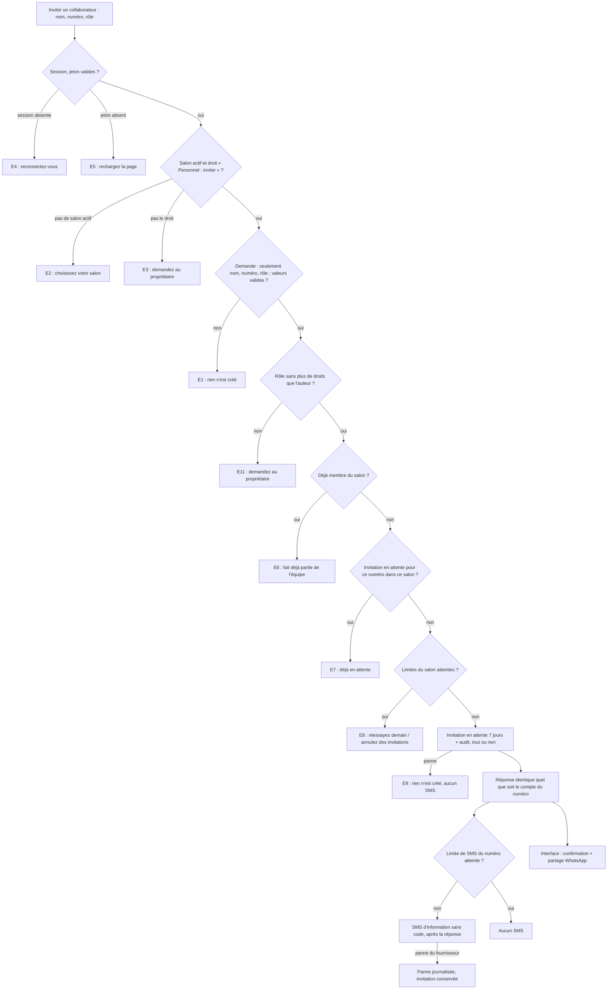
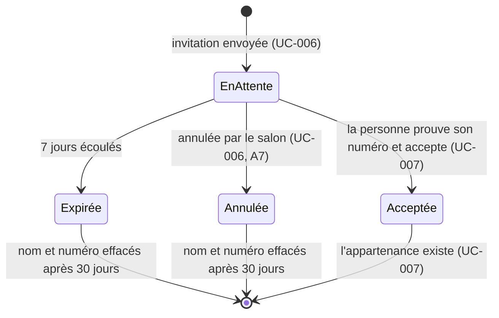

# UC-006 — Inviter un collaborateur dans son salon

| Champ | Valeur |
|---|---|
| Statut | Prêt pour dev (D-042 à D-046) |
| Priorité | Must |
| Module | `organizations` (impacts : `shared` pour `ActorRights` et l'envoi de SMS, `identity` en lecture pour reconnaître un membre par son numéro) |
| Auteur | use-case-writer |
| Date | 2026-11-19 |
| Use cases liés | UC-004 (précède : le propriétaire et son salon existent), UC-005 (précède : salon actif ; l'invitation vise le salon actif), **UC-007 « Accepter une invitation »** (suit : la personne invitée prouve son numéro par code SMS, choisit son mot de passe si besoin, et l'appartenance est créée), UC-008 (rôles salon prédéfinis et leurs permissions, droit « Personnel : inviter » donné à d'autres rôles, changement de rôle, retrait d'une appartenance), lot 2 (fiche d'intervenant : spécialités, prestations autorisées, horaires) |
| Exigences couvertes | EX-004 (en partie), EX-006, EX-007, EX-012, EX-014 (en partie), EX-015, EX-017 (en partie), EX-020, EX-022 (en partie : envoi, consultation, annulation), EX-023, EX-024, EX-025, EX-026, EX-037 (en partie), EX-038, D-003, D-019, D-027, D-034, D-041 |

## 0. Traçabilité

| Exigence | Source | Où elle est traitée dans ce UC |
|---|---|---|
| EX-022 | prd.md §7 Étape 4 « Le propriétaire peut ensuite inviter ses collaborateurs » | Flux nominal, RG-006-01, RG-006-02, scénarios « Une propriétaire invite un barbier… », plan « …chacun des quatre rôles… » ; l'acceptation est dans UC-007 |
| EX-037 | prd.md F07 « Ajouter et désactiver des collaborateurs. Affecter leurs rôles. » | RG-006-02 (rôle affecté dès l'invitation), plan « …chacun des quatre rôles… » ; désactivation et changement de rôle : UC-008 |
| EX-038 | prd.md §7 Étape 4 « Un écran explique simplement » les rôles | §15 Guidage (aide sous chaque rôle, reprise des phrases du PRD) |
| EX-015 | prd.md §5.5 « Ces spécialités sont des métiers, et non des rôles de sécurité » | RG-006-03, scénario « Une esthéticienne est invitée comme praticienne de beauté », plan « Seuls les quatre rôles… » |
| EX-004 | prd.md §3 « Un utilisateur peut appartenir à plusieurs salons, éventuellement avec des rôles différents » | RG-006-08, RG-006-09, scénarios « Une personne qui travaille déjà dans d'autres salons… », « Le même numéro peut être invité dans deux salons… » |
| EX-006 | prd.md §3 Multi-tenancy « Aucun collaborateur ne peut accéder à un salon sans appartenance autorisée » | RG-006-06, scénario « Une invitation en attente ne donne aucun accès au salon » |
| EX-007, D-003 | prd.md §3 « Les permissions sont évaluées par salon » ; DECISIONS.md | RG-006-01 (droit « Personnel : inviter » évalué dans le salon actif), scénarios « Un coiffeur ne peut pas inviter… », « L'invitation vise toujours le salon ouvert » |
| EX-012, EX-014, EX-017 | prd.md §4, §5.1, §6 Restriction | RG-006-02 (ni Propriétaire ni rôle système par invitation), RG-006-04 (pas d'élévation de droits), plans « Seuls les quatre rôles… », « Un administrateur de salon n'invite qu'à un rôle… » |
| EX-024, BR-12 | prd.md §12 Sécurité, §9 BR-12 | RG-006-01, RG-006-13, RG-006-14, scénarios `@securite` |
| EX-023 | prd.md §11 « modifications sensibles de permissions… trace d'audit » | RG-006-15, scénario « L'invitation et son annulation sont tracées… » |
| EX-025, D-019 | prd.md §12 Données ; DECISIONS.md | RG-006-10 (aucune révélation de compte), RG-006-15, RG-006-17, plan « La réponse ne révèle pas… » |
| EX-026 | prd.md §12 Dates | RG-006-07 (échéance calculée en UTC, affichée à l'heure de Douala) |
| EX-020 | prd.md §7 introduction | §10 (chaque refus dit quoi faire), §15 Guidage |
| D-027 | DECISIONS.md | RG-006-06 (la personne invitée n'a pas de salon tant qu'elle n'a pas accepté : à la connexion, « Créez votre organisation ou demandez une invitation » reste vrai jusqu'à UC-007) |
| D-041 | DECISIONS.md | RG-006-01 (la décision « peut agir dans ce salon » reste celle d'`ActorRights`) |

## 1. Objectif

Permettre au propriétaire d'un salon de **faire entrer ses collaborateurs** (coiffeurs, barbiers, praticiens de
beauté, administrateur, responsable financier) dans son salon **sans leur prêter son compte** : il les invite par leur
numéro de téléphone et leur choisit un **rôle**. L'invitation ne donne **aucun accès** tant que la personne ne l'a
pas acceptée (UC-007) ; le propriétaire voit ses invitations en attente et peut en annuler une.

## 2. User story

> En tant que **propriétaire d'un salon**,
> je veux **inviter un collaborateur par son numéro et lui choisir un rôle**,
> afin qu'**il travaille dans mon salon avec son propre compte et seulement les droits de ce rôle**.

## 3. Acteurs

- **Acteur principal** : le propriétaire, connecté, dans son salon actif. Après UC-008, tout membre dont le rôle a
  la permission « Personnel : inviter » dans ce salon (par exemple un administrateur de salon), sous RG-006-04.
- **Acteurs secondaires** :
  - la **personne invitée**, qui reçoit un SMS d'information (sans code) et acceptera dans UC-007 ;
  - le **fournisseur de SMS** (service tiers, adaptateur `fake` en local et en test) ;
  - un **coiffeur** sans le droit d'inviter (E3) ; un **tiers** qui tente d'agir sur un autre salon (E12) ;
  - le **nettoyage planifié** des invitations terminées (RG-006-17).

## 4. Déclencheur

- Le propriétaire choisit « Inviter un collaborateur » dans l'écran « Équipe » du back-office ou à l'étape 4 de
  l'onboarding (« Présentation des rôles »).
- Secondaires : il ouvre la liste « Invitations » (A8) ou choisit « Annuler l'invitation » sur l'une d'elles (A7).

## 5. Préconditions

- Une session authentifiée est ouverte, avec un jeton de sécurité (CSRF) valide.
- Un salon est actif dans la session (UC-004 ou UC-005).
- L'utilisateur a, dans ce salon, la permission « Personnel : inviter » (`staff:invite`) ; jusqu'à UC-008, seul le
  rôle Propriétaire l'a (catalogue provisoire de UC-004).

## 6. Postconditions

- **En cas de succès (inviter)** :
  - une invitation **en attente** existe dans le salon actif : nom de la personne, numéro, rôle, auteur, date
    d'envoi, échéance (7 jours) ;
  - **aucune appartenance** n'est créée ; la personne invitée n'a aucun accès au salon (UC-007 le fera) ;
  - « collaborateur invité » est tracé dans le journal d'audit, sans nom ni numéro ;
  - un SMS d'information part **après la réponse**, sauf limite atteinte pour ce numéro (RG-006-12) ;
  - la session de l'auteur n'est pas modifiée (pas de régénération : ses propres droits ne changent pas).
- **En cas de succès (annuler)** : l'invitation passe à l'état **annulée**, ne peut plus être acceptée, disparaît de
  la liste ; « invitation annulée » est tracée.
- **En cas d'échec** : aucune invitation créée ni modifiée, aucune ligne d'audit, aucun SMS ; la saisie reste à
  l'écran pour correction.

## 7. Règles métier

| ID | Règle | Exemple | Source |
|---|---|---|---|
| RG-006-01 | Seul un utilisateur **connecté**, avec un **salon actif** et la permission **« Personnel : inviter »** dans ce salon, invite ou annule une invitation. Le salon, l'auteur et ses droits sont lus dans la session et relus à chaque requête ; la demande ne contient **que** le nom, le numéro et le rôle. Toute autre information (salon, validité, permission, spécialité, état) fait refuser la demande entière. Jusqu'à UC-008, seul le Propriétaire a ce droit. | Mireille, dans « Go Beauty Akwa » → acceptée. Awa, Coiffeur → 403. Demande avec « salon : Élégance Bonamoussadi » → 400, rien n'est créé. | EX-022, EX-007, EX-024, BR-12, D-003, CLAUDE.md §I.4 (mode strict) ; [HYPOTHÈSE] qui peut inviter — Q1 |
| RG-006-02 | Le rôle est **un seul** parmi les quatre rôles de collaborateur : **Administrateur de salon**, **Coiffeur / Coiffeuse / Barbier**, **Responsable financier**, **Praticien / Praticienne de beauté**. Le rôle **Propriétaire** ne se donne jamais par invitation ; aucun **rôle système** non plus. | « Responsable financier » accepté ; « Propriétaire » et « Administrateur Opérations » refusés (400). | EX-037, EX-014, EX-012, EX-017, prd.md §5.2-5.5 |
| RG-006-03 | Les **spécialités sont des métiers**, pas des rôles : aucune spécialité n'est un rôle proposé ni n'est saisie dans l'invitation. Une esthéticienne, une manucure ou un masseur s'invitent comme **Praticien / Praticienne de beauté** ; leurs spécialités et prestations autorisées se renseignent ensuite sur la fiche d'intervenant (lot 2). | Grâce Mbarga, esthéticienne → rôle « Praticien / Praticienne de beauté », aucune spécialité attachée. Rôle « Esthéticienne » ou « Manucure » → refusé (400). | EX-015, prd.md §5.5 ; [HYPOTHÈSE] pas de spécialité dans l'invitation — Q5 |
| RG-006-04 | **Pas d'élévation de droits** : on n'invite (ni n'annule une invitation) qu'à un rôle dont **toutes les permissions** dans ce salon sont **aussi les siennes**. Le propriétaire peut donc inviter aux quatre rôles. | Après UC-008 : Rodrigue, Administrateur de salon (sans accès aux finances), invite un Coiffeur → accepté ; un Responsable financier → refusé (422). | EX-017, prd.md §5.2 « paramètres… protégés », §5.4 ; [HYPOTHÈSE] — Q1 |
| RG-006-05 | **Nom** de la personne obligatoire, **2 à 80 caractères** après retrait des espaces au début, à la fin et en double. **Numéro** obligatoire, camerounais (mêmes formats que RG-001-02), enregistré au format international. | « Bo » accepté, « B » refusé ; 80 caractères acceptés, 81 refusés ; « 6 55 44 33 22 » et « +237 655 44 33 22 » → +237655443322 ; « 6 55 44 33 2 » refusé (422 « Numéro de téléphone camerounais invalide… »). | RG-001-02, RG-001-08 (mêmes bornes que le nom du responsable) ; [HYPOTHÈSE] contenu de l'invitation — Q5 |
| RG-006-06 | Une invitation **ne donne aucun accès** : aucune appartenance n'est créée, le salon n'apparaît pas dans la liste des salons de la personne invitée et elle ne peut pas l'ouvrir, jusqu'à son acceptation (UC-007). | Paul invité dans « Go Beauty Akwa » : sa liste de salons ne change pas ; ouvrir Akwa → 404 identique à un salon inexistant. | EX-006, D-027, UC-005 RG-005-03 |
| RG-006-07 | Une invitation est **en attente pendant 7 jours** à partir de son envoi, puis **expirée** : elle ne peut plus être acceptée. L'échéance est un instant (UTC), affiché à l'heure du salon. | Envoyée le 19/11/2026 à 10 h 00 → en attente à 26/11 9 h 59 min 59 s, expirée à 26/11 10 h 00. | EX-026 ; [HYPOTHÈSE] durée — Q3 |
| RG-006-08 | **Une seule invitation en attente par numéro et par salon**, y compris quand deux demandes arrivent en même temps (garantie en base). Une invitation **expirée** n'empêche pas d'inviter de nouveau. Le même numéro peut être invité **dans plusieurs salons**, chacun avec son rôle. | Brice déjà invité à 9 h 00 → 2e invitation refusée (409) ; invitation du 10/11 expirée → nouvelle invitation acceptée ; Brice invité par Clarisse et par Mireille → deux invitations, chacune dans son salon. | EX-004 ; [HYPOTHÈSE] refus plutôt que remplacement — Q6 |
| RG-006-09 | Une personne qui a **déjà une appartenance active dans ce salon** n'est pas invitée (Propriétaire compris). Une appartenance dans **un autre salon**, de la même organisation ou d'une autre, n'empêche rien. | Awa (Coiffeur d'Akwa) → refus « Cette personne fait déjà partie de l'équipe de ce salon. » ; Paul (Propriétaire de Deïdo, Coiffeur chez Clarisse) invité comme Administrateur d'Akwa → accepté, ses autres appartenances inchangées. | EX-004, EX-006 |
| RG-006-10 | **Non-énumération** : la réponse, son délai et le SMS sont **les mêmes** que le numéro n'ait aucun compte, porte un compte client léger ou un compte du personnel. Seul le refus de RG-006-09 dépend du numéro : il ne révèle qu'un membre de l'équipe, que l'auteur voit déjà. | Brice (aucun compte), Aïcha (cliente légère), Paul (personnel) → même réponse 201, même texte de SMS. | D-019, EX-025 |
| RG-006-11 | **Prévenir la personne invitée** : un **SMS d'information** part **après la réponse**, au texte fixe **sans nom de salon**, **sans code ni lien secret** (l'acceptation exige un code envoyé au numéro, UC-007). Une panne du fournisseur est seulement journalisée (type et code d'erreur, jamais le numéro ni le texte) ; l'invitation reste en attente. L'écran propose **toujours** de prévenir aussi la personne par WhatsApp avec un message prérempli. | « GoMeCoiffer : un salon vous invite à rejoindre son équipe comme Coiffeur / Coiffeuse / Barbier. Pour accepter avant le 26/11, ouvrez gomecoiffer.cm/rejoindre avec ce numéro. Ne communiquez jamais un code reçu par SMS. » | D-017 (code à l'activation, UC-007), D-030 / D-033 (envoi après la réponse, panne journalisée), D-046 (texte sans nom de salon) ; [HYPOTHÈSE] canal — Q2 |
| RG-006-12 | **Limites contre l'abus d'envoi** (l'inscription est libre : tout propriétaire peut inviter n'importe quel numéro) : par salon, au plus **20 invitations par 24 h glissantes** et **50 invitations en attente** ; au-delà, refus (422). Par numéro, au plus **3 SMS d'invitation par 24 h glissantes**, tous salons confondus ; au-delà, l'invitation est **enregistrée sans SMS**, avec la même réponse (RG-006-10). | 20e invitation du jour acceptée, 21e refusée ; 51e en attente refusée ; Brice a reçu 3 SMS d'autres salons depuis hier 10 h → invitation de Mireille enregistrée, aucun SMS, l'écran propose WhatsApp. | D-021, D-023 (esprit des limites d'envoi) ; [HYPOTHÈSE] seuils — Q4 |
| RG-006-13 | **Annuler** une invitation : seulement si elle est **en attente** (pas expirée, annulée ni acceptée), dans le **salon actif**, par un utilisateur qui pourrait l'envoyer (RG-006-01, RG-006-04). Une invitation inexistante ou d'**un autre salon** (même de sa propre organisation) reçoit le **même refus** « introuvable » (404). | Mireille annule l'invitation de Brice → annulée, Brice ne peut plus l'accepter. Invitation expirée → 422 « Cette invitation n'est plus en attente… ». Invitation de « Go Beauty Bastos » demandée depuis Akwa → 404. | EX-024, BR-12, UC-005 RG-005-03 |
| RG-006-14 | La **liste des invitations** montre, pour le **seul salon actif**, les invitations **en attente** et **expirées** (nom, numéro, rôle, date d'envoi, échéance, état), les plus récentes d'abord. Les annulées n'y figurent pas ; les acceptées deviennent des membres de l'équipe (UC-007). Elle exige le même droit que l'envoi. | Akwa : Brice (en attente) puis Grâce (expirée) ; l'invitation annulée de Ruth n'apparaît pas ; depuis Bastos, Mireille ne voit pas Brice. | EX-022, EX-024, BR-11 |
| RG-006-15 | Sont tracés dans le journal d'audit : « **collaborateur invité** » (salon, invitation, rôle, auteur, instant) et « **invitation annulée** » (salon, invitation, auteur, instant). Jamais le nom ni le numéro de la personne invitée. | Deux lignes pour l'invitation de Brice puis son annulation, sans « Brice Nana » ni 6 55 44 33 22. | EX-023, EX-025, D-028 |
| RG-006-16 | L'invitation est **tout ou rien** : invitation et audit sont enregistrés ensemble ou pas du tout ; un refus ou une panne ne laisse rien et **n'envoie aucun SMS**. | Panne pendant l'enregistrement → aucune invitation, aucun SMS ; Mireille renvoie la même saisie et réussit. | EX-024, prd.md §12 Fiabilité |
| RG-006-17 | **Conservation** : le nom et le numéro d'une invitation **non acceptée** (expirée ou annulée) sont **effacés 30 jours** après sa fin ; l'invitation reste comptée (rôle, dates, état). | Invitation de Brice expirée le 20/10/2026 à 10 h 00 → nom et numéro effacés le 19/11/2026 à 10 h 00. | EX-025 (collecte minimale, conservation encadrée) ; [HYPOTHÈSE] durée — Q7 |

## 8. Flux nominal

1. Mireille, dans « Go Beauty Akwa », choisit « Équipe » puis « Inviter un collaborateur ».
2. Elle saisit « Brice Nana », « 6 55 44 33 22 » et choisit le rôle « Coiffeur / Coiffeuse / Barbier » ; l'aide
   sous le rôle explique ce qu'il permet (§15).
3. Elle valide « Envoyer l'invitation ».
4. Le système vérifie la session, le jeton de sécurité, le salon actif, la permission « Personnel : inviter » et que
   la demande ne porte que le nom, le numéro et le rôle (RG-006-01).
5. Le système contrôle le nom, le numéro et le rôle (RG-006-02, RG-006-03, RG-006-05) et que le rôle n'a pas plus de
   droits que ceux de Mireille dans ce salon (RG-006-04).
6. Le système vérifie que le numéro n'est pas déjà membre du salon, qu'aucune invitation n'y est en attente pour lui
   et que les limites du salon ne sont pas atteintes (RG-006-08, RG-006-09, RG-006-12).
7. Le système enregistre l'invitation, en attente jusqu'au 26/11/2026 à 10 h 00, et trace « collaborateur invité »
   (RG-006-07, RG-006-15, RG-006-16).
8. Le système répond avec l'invitation (nom, numéro, rôle, échéance), sans rien dire du compte éventuel du numéro
   (RG-006-10).
9. Après la réponse, le système envoie le SMS d'information si le numéro n'a pas atteint sa limite (RG-006-11,
   RG-006-12).
10. L'interface affiche « Invitation envoyée à Brice Nana. Elle est valable jusqu'au 26/11 à 10 h 00. Prévenez-le
    aussi par WhatsApp. » avec le bouton de partage, et l'invitation apparaît dans « Invitations ».

## 9. Flux alternatifs

- **A1 — Le numéro a déjà un compte** (étape 6) : Paul (personnel) ou Aïcha (cliente légère) ; même déroulement,
  même réponse, même SMS ; leurs autres appartenances ne changent pas (RG-006-09, RG-006-10).
- **A2 — Invitation précédente expirée** (étape 6) : l'ancienne reste expirée, la nouvelle est créée (RG-006-08).
- **A3 — Même numéro invité par un autre salon** (étape 6) : chaque salon a son invitation, invisible de l'autre
  (RG-006-08, RG-006-14).
- **A4 — Limite de SMS du numéro atteinte** (étape 9) : invitation enregistrée, aucun SMS, réponse identique ;
  l'écran propose WhatsApp comme toujours (RG-006-12).
- **A5 — Fournisseur de SMS indisponible** (étape 9) : panne journalisée, invitation en attente ; la réponse est
  déjà partie (RG-006-11).
- **A6 — Métier de beauté** (étape 2) : Grâce, esthéticienne, est invitée comme « Praticien / Praticienne de
  beauté » ; l'aide indique que ses spécialités se choisiront sur sa fiche (RG-006-03).
- **A7 — Annuler une invitation** (intention secondaire) : Mireille choisit « Annuler l'invitation » sur celle de
  Brice ; le système vérifie session, jeton, salon actif, droit et état en attente (RG-006-13), passe l'invitation à
  « annulée », trace « invitation annulée » (RG-006-15) ; l'interface affiche « Invitation de Brice Nana annulée :
  il ne pourra plus l'accepter. »
- **A8 — Consulter les invitations** (intention secondaire) : la liste du salon actif s'affiche (RG-006-14) ; une
  invitation expirée propose « Inviter de nouveau ».
- **A9 — Administrateur de salon** (étape 5, après UC-008) : Rodrigue invite un Coiffeur → accepté ; un Responsable
  financier → E11 (RG-006-04).

## 10. Flux d'exception

- **E1 — Saisie invalide** (étape 4-5) : information en trop, rôle hors des quatre rôles, nom hors bornes → « Certaines
  informations sont invalides : corrigez les champs signalés. » (400, par champ) ; numéro non camerounais →
  « Numéro de téléphone camerounais invalide (9 chiffres, ex. 6 77 12 34 56). » (422) ; rien n'est créé.
- **E2 — Aucun salon actif** (étape 4) : « Choisissez d’abord le salon sur lequel vous travaillez. » (403).
- **E3 — Droit insuffisant** (étape 4) : « Votre rôle dans ce salon ne permet pas cette action : demandez-la au
  propriétaire. » (403).
- **E4 — Session absente ou expirée** (étape 4) : « Session absente ou expirée : reconnectez-vous. » (401).
- **E5 — Jeton de sécurité absent ou périmé** (étape 4) : « Jeton de sécurité absent ou expiré : rechargez la page
  puis recommencez. » (403).
- **E6 — Déjà membre du salon** (étape 6) : « Cette personne fait déjà partie de l'équipe de ce salon. » (409) ;
  l'interface propose « Voir l'équipe ».
- **E7 — Invitation déjà en attente** (étape 6) : « Une invitation est déjà en attente pour ce numéro. Annulez-la
  pour en envoyer une nouvelle. » (409) ; deux envois simultanés : un seul réussit, l'autre reçoit ce refus.
- **E8 — Limite du salon atteinte** (étape 6) : « Vous avez envoyé beaucoup d'invitations aujourd'hui. Réessayez
  demain ou contactez l'assistance GoMeCoiffer. » ou « Vous avez déjà 50 invitations en attente. Annulez celles qui ne
  servent plus avant d'en envoyer d'autres. » (422).
- **E9 — Panne pendant l'enregistrement** (étape 7) : « Invitation impossible pour le moment. Réessayez dans quelques
  minutes. » (500) ; rien n'est créé, aucun SMS.
- **E10 — Annulation d'une invitation qui n'est plus en attente** (A7) : « Cette invitation n'est plus en attente :
  elle a été acceptée, annulée ou elle a expiré. » (422) ; l'interface relit la liste.
- **E11 — Rôle au-dessus de ses droits** (étape 5, après UC-008) : « Ce rôle donne des droits que vous n'avez pas
  dans ce salon : demandez au propriétaire d'envoyer l'invitation. » (422).
- **E12 — Invitation introuvable** (A7) : invitation inexistante ou d'un autre salon → refus 404 identique
  (« Ressource introuvable. ») ; rien ne change.

> Service tiers : le fournisseur de SMS n'intervient qu'après la réponse (A5) ; sa panne ne fait jamais échouer
> l'invitation.

## 11. Workflow



Cycle de vie d'une invitation :



## 12. Scénarios d'acceptation (BDD)

Identiques à `features/organizations/inviter-un-collaborateur.feature`.

```gherkin
# language: fr
@UC-006
Fonctionnalité: Inviter un collaborateur dans son salon
  Pour constituer son équipe sans partager son propre compte,
  la propriétaire invite un collaborateur par son numéro de téléphone et lui choisit un rôle dans le salon ouvert :
  l'invitation ne donne aucun accès tant que la personne ne l'a pas acceptée (UC-007).

  Contexte:
    Étant donné que nous sommes le 19/11/2026 à 10 h 00, heure de Douala
    Et que l'organisation de Mireille Ndongo compte les salons "Go Beauty Akwa" et "Go Beauty Bastos"
    Et que les appartenances actives sont :
      | personne        | salon                 | rôle         |
      | Mireille Ndongo | Go Beauty Akwa        | Propriétaire |
      | Mireille Ndongo | Go Beauty Bastos      | Propriétaire |
      | Clarisse Fotso  | Élégance Bonamoussadi | Propriétaire |
      | Paul Ebode      | Élégance Bonamoussadi | Coiffeur     |
      | Paul Ebode      | Paul Barber Deïdo     | Propriétaire |
      | Awa Tchoua      | Go Beauty Akwa        | Coiffeur     |
    Et que Mireille est connectée et travaille dans le salon "Go Beauty Akwa"

  @nominal @RG-006-01 @RG-006-06 @RG-006-07 @EX-022 @EX-006
  Scénario: Une propriétaire invite un barbier dans son salon
    Quand Mireille invite "Brice Nana", au 6 55 44 33 22, comme "Coiffeur / Coiffeuse / Barbier"
    Alors une invitation en attente pour "Brice Nana" apparaît dans les invitations de "Go Beauty Akwa"
    Et elle est valable jusqu'au 26/11/2026 à 10 h 00
    Et Brice Nana n'a encore aucun accès au salon "Go Beauty Akwa"

  @nominal @RG-006-02 @EX-022 @EX-037
  Plan du scénario: La propriétaire peut inviter à chacun des quatre rôles de collaborateur
    Quand Mireille invite "Esther Ngo Bilong", au 6 77 88 99 00, comme "<rôle>"
    Alors une invitation en attente pour "Esther Ngo Bilong" apparaît avec le rôle "<rôle>"

    Exemples:
      | rôle                              |
      | Administrateur de salon           |
      | Coiffeur / Coiffeuse / Barbier    |
      | Responsable financier             |
      | Praticien / Praticienne de beauté |

  @nominal @RG-006-11
  Scénario: La personne invitée est prévenue par un SMS sans code
    Quand Mireille invite "Brice Nana", au 6 55 44 33 22, comme "Coiffeur / Coiffeuse / Barbier"
    Alors le 6 55 44 33 22 reçoit, après la réponse, le SMS "GoMeCoiffer : un salon vous invite à rejoindre son équipe comme Coiffeur / Coiffeuse / Barbier. Pour accepter avant le 26/11, ouvrez gomecoiffer.cm/rejoindre avec ce numéro. Ne communiquez jamais un code reçu par SMS."
    Et ce SMS ne contient aucun code

  @alternatif @RG-006-09 @EX-004
  Scénario: Une personne qui travaille déjà dans d'autres salons peut être invitée avec un autre rôle
    Quand Mireille invite "Paul Ebode", au 6 99 00 11 22, comme "Administrateur de salon"
    Alors une invitation en attente pour "Paul Ebode" apparaît dans les invitations de "Go Beauty Akwa"
    Et Paul est toujours "Propriétaire" de "Paul Barber Deïdo" et "Coiffeur" chez "Élégance Bonamoussadi"

  @securite @RG-006-10 @D-019
  Plan du scénario: La réponse ne révèle pas si le numéro a déjà un compte GoMeCoiffer
    Étant donné que le <numéro> <état du numéro>
    Quand Mireille invite "<nom>", au <numéro>, comme "Coiffeur / Coiffeuse / Barbier"
    Alors l'invitation est enregistrée avec la même réponse que pour un numéro sans compte
    Et le <numéro> reçoit le même SMS d'invitation que pour un numéro sans compte

    Exemples:
      | nom         | numéro        | état du numéro                |
      | Brice Nana  | 6 55 44 33 22 | n'a aucun compte GoMeCoiffer  |
      | Aïcha Bello | 6 91 23 45 67 | porte un compte client léger  |
      | Paul Ebode  | 6 99 00 11 22 | porte un compte du personnel  |

  @alternatif @RG-006-03 @EX-015
  Scénario: Une esthéticienne est invitée comme praticienne de beauté
    Quand Mireille invite "Grâce Mbarga", au 6 70 11 22 33, comme "Praticien / Praticienne de beauté"
    Alors une invitation en attente pour "Grâce Mbarga" apparaît avec le rôle "Praticien / Praticienne de beauté"
    Et aucune spécialité n'est attachée à l'invitation

  @erreur @securite @RG-006-02 @RG-006-03 @EX-015 @EX-014 @EX-012 @EX-017
  Plan du scénario: Seuls les quatre rôles de collaborateur peuvent être donnés par invitation
    Quand Mireille invite "Grâce Mbarga", au 6 70 11 22 33, comme "<rôle demandé>"
    Alors l'invitation est refusée avec le motif "Certaines informations sont invalides : corrigez les champs signalés."
    Et aucune invitation n'est enregistrée

    Exemples:
      | rôle demandé              | raison                                 |
      | Propriétaire              | rôle lié à la propriété                |
      | Esthéticienne             | métier, pas un rôle                    |
      | Manucure                  | métier, pas un rôle                    |
      | Administrateur Opérations | rôle système attribué par GoMeCoiffer  |

  @erreur @RG-006-05
  Plan du scénario: Le nom de la personne invitée compte 2 à 80 caractères
    Quand Mireille invite une personne nommée <nom saisi>, au 6 55 44 33 22, comme "Coiffeur / Coiffeuse / Barbier"
    Alors l'invitation est <résultat>

    Exemples:
      | nom saisi                 | résultat                                                                                     |
      | "B"                       | refusée avec le motif "Certaines informations sont invalides : corrigez les champs signalés." |
      | "Bo"                      | enregistrée                                                                                  |
      | un nom de 80 caractères   | enregistrée                                                                                  |
      | un nom de 81 caractères   | refusée avec le motif "Certaines informations sont invalides : corrigez les champs signalés." |
      | "   Brice    Nana  "      | enregistrée au nom de "Brice Nana"                                                           |

  @erreur @RG-006-05
  Plan du scénario: Le numéro de la personne invitée est un numéro camerounais
    Quand Mireille invite "Brice Nana", au <numéro saisi>, comme "Coiffeur / Coiffeuse / Barbier"
    Alors l'invitation est <résultat>

    Exemples:
      | numéro saisi      | résultat                                                                                                       |
      | 6 55 44 33 22     | enregistrée                                                                                                    |
      | +237 655 44 33 22 | enregistrée                                                                                                    |
      | 6 55 44 33 2      | refusée avec le motif "Numéro de téléphone camerounais invalide (9 chiffres, ex. 6 77 12 34 56)."               |
      | +33 6 12 34 56 78 | refusée avec le motif "Numéro de téléphone camerounais invalide (9 chiffres, ex. 6 77 12 34 56)."               |

  @securite @RG-006-01 @EX-024
  Plan du scénario: La demande ne porte que le nom, le numéro et le rôle
    Quand Mireille invite "Brice Nana", au 6 55 44 33 22, comme "Coiffeur / Coiffeuse / Barbier" en indiquant aussi <information>
    Alors l'invitation est refusée avec le motif "Certaines informations sont invalides : corrigez les champs signalés."
    Et aucune invitation n'est enregistrée

    Exemples:
      | information                               |
      | le salon "Élégance Bonamoussadi"          |
      | une validité de 30 jours                  |
      | la permission « gérer les réservations »  |
      | la spécialité « Barbier »                 |

  @securite @RG-006-06 @EX-006
  Scénario: Une invitation en attente ne donne aucun accès au salon
    Étant donné que Mireille a invité Paul, au 6 99 00 11 22, comme "Administrateur de salon"
    Quand Paul consulte la liste de ses salons
    Alors il n'y voit pas "Go Beauty Akwa"
    Et l'ouverture du salon "Go Beauty Akwa" par Paul est refusée comme pour un salon qui n'existe pas

  @securite @RG-006-01 @EX-007 @EX-024
  Scénario: Un coiffeur ne peut pas inviter de collaborateur
    Étant donné qu'Awa est connectée et travaille dans le salon "Go Beauty Akwa"
    Quand Awa invite "Brice Nana", au 6 55 44 33 22, comme "Coiffeur / Coiffeuse / Barbier"
    Alors l'invitation est refusée avec le motif "Votre rôle dans ce salon ne permet pas cette action : demandez-la au propriétaire."
    Et aucune invitation n'est enregistrée

  @erreur @RG-006-01
  Scénario: Sans salon ouvert, personne n'est invité
    Étant donné que Paul est connecté, sans salon ouvert
    Quand Paul invite "Brice Nana", au 6 55 44 33 22, comme "Coiffeur / Coiffeuse / Barbier"
    Alors l'invitation est refusée avec le motif "Choisissez d’abord le salon sur lequel vous travaillez."

  @erreur @RG-006-01
  Scénario: Sans session, personne n'est invité
    Étant donné que la session de Mireille a expiré
    Quand Mireille invite "Brice Nana", au 6 55 44 33 22, comme "Coiffeur / Coiffeuse / Barbier"
    Alors l'invitation est refusée avec le motif "Session absente ou expirée : reconnectez-vous."

  @erreur @RG-006-01 @EX-024
  Scénario: Une invitation sans jeton de sécurité est refusée
    Quand Mireille invite "Brice Nana", au 6 55 44 33 22, comme "Coiffeur / Coiffeuse / Barbier" sans jeton de sécurité
    Alors l'invitation est refusée avec le motif "Jeton de sécurité absent ou expiré : rechargez la page puis recommencez."
    Et aucune invitation n'est enregistrée

  @securite @RG-006-01 @EX-024 @BR-12
  Scénario: L'invitation vise toujours le salon ouvert
    Étant donné que Mireille passe au salon "Go Beauty Bastos"
    Quand Mireille invite "Brice Nana", au 6 55 44 33 22, comme "Coiffeur / Coiffeuse / Barbier"
    Alors l'invitation apparaît dans les invitations de "Go Beauty Bastos"
    Et les invitations de "Go Beauty Akwa" n'ont pas changé

  @erreur @RG-006-09
  Plan du scénario: Une personne déjà dans l'équipe du salon n'est pas invitée une deuxième fois
    Quand Mireille invite "<nom>", au <numéro>, comme "Coiffeur / Coiffeuse / Barbier"
    Alors l'invitation est refusée avec le motif "Cette personne fait déjà partie de l'équipe de ce salon."
    Et aucun SMS n'est envoyé

    Exemples:
      | nom             | numéro        |
      | Awa Tchoua      | 6 66 10 20 30 |
      | Mireille Ndongo | 6 77 12 34 56 |

  @erreur @RG-006-08
  Scénario: Une seule invitation en attente par numéro dans un salon
    Étant donné que Mireille a invité "Brice Nana", au 6 55 44 33 22, le 19/11/2026 à 9 h 00
    Quand Mireille invite "Brice Nana", au 6 55 44 33 22, comme "Responsable financier"
    Alors l'invitation est refusée avec le motif "Une invitation est déjà en attente pour ce numéro. Annulez-la pour en envoyer une nouvelle."
    Et l'invitation de 9 h 00 est toujours en attente, avec son rôle d'origine

  @alternatif @RG-006-08 @RG-006-07
  Scénario: Après l'expiration d'une invitation, on peut inviter de nouveau
    Étant donné que Mireille a invité "Brice Nana", au 6 55 44 33 22, le 10/11/2026 à 10 h 00
    Quand Mireille invite "Brice Nana", au 6 55 44 33 22, comme "Coiffeur / Coiffeuse / Barbier"
    Alors une invitation en attente pour "Brice Nana" apparaît, valable jusqu'au 26/11/2026 à 10 h 00
    Et l'invitation du 10/11/2026 est indiquée comme expirée

  @alternatif @RG-006-08
  Scénario: Le même numéro peut être invité dans deux salons différents
    Étant donné que Clarisse a invité "Brice Nana", au 6 55 44 33 22, dans "Élégance Bonamoussadi"
    Quand Mireille invite "Brice Nana", au 6 55 44 33 22, comme "Coiffeur / Coiffeuse / Barbier"
    Alors une invitation en attente pour "Brice Nana" apparaît dans les invitations de "Go Beauty Akwa"
    Et Mireille ne voit pas l'invitation de Clarisse

  @securite @RG-006-08
  Scénario: Deux envois simultanés de la même invitation n'en créent qu'une
    Quand Mireille envoie deux fois en même temps l'invitation de "Brice Nana", au 6 55 44 33 22
    Alors une seule invitation en attente pour le 6 55 44 33 22 existe dans "Go Beauty Akwa"
    Et un seul SMS d'invitation est envoyé

  @alternatif @RG-006-07
  Plan du scénario: Une invitation est en attente pendant 7 jours exactement
    Étant donné que Mireille a invité "Brice Nana" le 19/11/2026 à 10 h 00
    Quand Mireille consulte ses invitations le <instant>
    Alors l'invitation de Brice Nana est indiquée comme <état>

    Exemples:
      | instant                    | état       |
      | 26/11/2026 à 9 h 59 min 59 s | en attente |
      | 26/11/2026 à 10 h 00       | expirée    |

  @securite @RG-006-12
  Plan du scénario: Un salon envoie au plus 20 invitations par 24 heures
    Étant donné que "Go Beauty Akwa" a envoyé <envoyées> invitations depuis le 18/11/2026 à 10 h 00
    Quand Mireille invite "Brice Nana", au 6 55 44 33 22, comme "Coiffeur / Coiffeuse / Barbier"
    Alors l'invitation est <résultat>

    Exemples:
      | envoyées | résultat                                                                                                                         |
      | 19       | enregistrée                                                                                                                      |
      | 20       | refusée avec le motif "Vous avez envoyé beaucoup d'invitations aujourd'hui. Réessayez demain ou contactez l'assistance GoMeCoiffer." |

  @securite @RG-006-12
  Scénario: Un salon garde au plus 50 invitations en attente
    Étant donné que "Go Beauty Akwa" a 50 invitations en attente
    Quand Mireille invite "Brice Nana", au 6 55 44 33 22, comme "Coiffeur / Coiffeuse / Barbier"
    Alors l'invitation est refusée avec le motif "Vous avez déjà 50 invitations en attente. Annulez celles qui ne servent plus avant d'en envoyer d'autres."

  @securite @RG-006-12 @RG-006-10
  Scénario: Au-delà de 3 SMS d'invitation par 24 heures, un numéro n'en reçoit plus mais l'invitation est enregistrée
    Étant donné que le 6 55 44 33 22 a reçu 3 SMS d'invitation d'autres salons depuis le 18/11/2026 à 10 h 00
    Quand Mireille invite "Brice Nana", au 6 55 44 33 22, comme "Coiffeur / Coiffeuse / Barbier"
    Alors une invitation en attente pour "Brice Nana" apparaît dans les invitations de "Go Beauty Akwa"
    Et la réponse est la même que lorsqu'un SMS est envoyé
    Et le 6 55 44 33 22 ne reçoit aucun SMS

  @erreur @RG-006-11
  Scénario: Une panne du fournisseur de SMS ne fait pas perdre l'invitation
    Étant donné que le fournisseur de SMS est indisponible
    Quand Mireille invite "Brice Nana", au 6 55 44 33 22, comme "Coiffeur / Coiffeuse / Barbier"
    Alors une invitation en attente pour "Brice Nana" apparaît dans les invitations de "Go Beauty Akwa"
    Et on lui propose de prévenir Brice Nana par WhatsApp

  @erreur @RG-006-16
  Scénario: Une panne pendant l'enregistrement ne laisse rien
    Étant donné que le service GoMeCoiffer tombe en panne pendant l'enregistrement de l'invitation
    Quand Mireille invite "Brice Nana", au 6 55 44 33 22, comme "Coiffeur / Coiffeuse / Barbier"
    Alors l'invitation est refusée avec le motif "Invitation impossible pour le moment. Réessayez dans quelques minutes."
    Et aucune invitation n'est enregistrée
    Et aucun SMS n'est envoyé

  @nominal @RG-006-14
  Scénario: La propriétaire consulte les invitations de son salon
    Étant donné que les invitations de "Go Beauty Akwa" sont :
      | personne      | numéro        | rôle                              | envoyée le          | état       |
      | Brice Nana    | 6 55 44 33 22 | Coiffeur / Coiffeuse / Barbier    | 19/11/2026 à 9 h 00 | en attente |
      | Grâce Mbarga  | 6 70 11 22 33 | Praticien / Praticienne de beauté | 10/11/2026 à 8 h 00 | en attente |
      | Ruth Abena    | 6 50 60 70 80 | Responsable financier             | 15/11/2026 à 8 h 00 | annulée    |
    Quand Mireille consulte les invitations de "Go Beauty Akwa"
    Alors elle voit, dans cet ordre :
      | personne     | numéro        | rôle                              | état       | valable jusqu'au     |
      | Brice Nana   | 6 55 44 33 22 | Coiffeur / Coiffeuse / Barbier    | en attente | 26/11/2026 à 9 h 00  |
      | Grâce Mbarga | 6 70 11 22 33 | Praticien / Praticienne de beauté | expirée    | 17/11/2026 à 8 h 00  |
    Et elle ne voit pas l'invitation annulée de Ruth Abena

  @securite @RG-006-14 @EX-024
  Scénario: Les invitations d'un salon ne se voient que depuis ce salon
    Étant donné que "Go Beauty Akwa" a une invitation en attente pour "Brice Nana"
    Et que Mireille passe au salon "Go Beauty Bastos"
    Quand Mireille consulte les invitations du salon ouvert
    Alors elle n'y voit pas "Brice Nana"

  @nominal @RG-006-13
  Scénario: La propriétaire annule une invitation en attente
    Étant donné que Mireille a invité "Brice Nana", au 6 55 44 33 22, comme "Coiffeur / Coiffeuse / Barbier"
    Quand Mireille annule l'invitation de "Brice Nana"
    Alors l'invitation de "Brice Nana" n'apparaît plus dans les invitations de "Go Beauty Akwa"
    Et Brice Nana ne pourra plus l'accepter

  @erreur @RG-006-13
  Plan du scénario: Seule une invitation en attente peut être annulée
    Étant donné que l'invitation de "Brice Nana" est <état>
    Quand Mireille annule l'invitation de "Brice Nana"
    Alors l'annulation est refusée avec le motif "Cette invitation n'est plus en attente : elle a été acceptée, annulée ou elle a expiré."

    Exemples:
      | état     |
      | expirée  |
      | annulée  |
      | acceptée |

  @securite @RG-006-13 @EX-024
  Plan du scénario: Une invitation d'un autre salon ne peut pas être annulée, et le refus ne dit pas pourquoi
    Étant donné que <situation>
    Quand Mireille annule <invitation visée>
    Alors l'annulation est refusée comme pour une invitation qui n'existe pas
    Et <conséquence>

    Exemples:
      | situation                                                           | invitation visée                       | conséquence                                          |
      | aucune invitation n'a l'identifiant demandé                         | une invitation dont l'identifiant n'existe pas | rien n'a changé                               |
      | Clarisse a invité "Brice Nana" dans "Élégance Bonamoussadi"         | l'invitation de Clarisse               | l'invitation de Clarisse est toujours en attente     |
      | "Go Beauty Bastos" a invité "Ruth Abena" et Mireille est dans Akwa  | l'invitation de "Go Beauty Bastos"     | l'invitation de "Go Beauty Bastos" est toujours en attente |

  @securite @RG-006-04 @EX-017 @apres-UC-008
  Plan du scénario: Un administrateur de salon n'invite qu'à un rôle qui n'a pas plus de droits que le sien
    Étant donné que Rodrigue Etoa est "Administrateur de salon" de "Go Beauty Akwa", avec les permissions par défaut de ce rôle
    Et que Rodrigue travaille dans le salon "Go Beauty Akwa"
    Quand Rodrigue invite "Esther Ngo Bilong", au 6 77 88 99 00, comme "<rôle>"
    Alors l'invitation est <résultat>

    Exemples:
      | rôle                           | résultat                                                                                                                          |
      | Coiffeur / Coiffeuse / Barbier | enregistrée                                                                                                                       |
      | Responsable financier          | refusée avec le motif "Ce rôle donne des droits que vous n'avez pas dans ce salon : demandez au propriétaire d'envoyer l'invitation." |

  @alternatif @RG-006-15 @EX-023 @EX-025
  Scénario: L'invitation et son annulation sont tracées sans donnée personnelle
    Étant donné que Mireille a invité "Brice Nana", au 6 55 44 33 22, comme "Coiffeur / Coiffeuse / Barbier"
    Quand Mireille annule l'invitation de "Brice Nana"
    Alors le journal d'audit contient "collaborateur invité" puis "invitation annulée" pour "Go Beauty Akwa", avec le rôle et l'auteur
    Et aucune de ces lignes ne contient le nom "Brice Nana" ni le numéro 6 55 44 33 22

  @alternatif @RG-006-17 @EX-025
  Scénario: Le nom et le numéro d'une invitation non acceptée sont effacés 30 jours après sa fin
    Étant donné qu'une invitation de "Brice Nana", au 6 55 44 33 22, a expiré le 20/10/2026 à 10 h 00
    Quand le nettoyage des invitations passe le 19/11/2026 à 10 h 00
    Alors le nom et le numéro de cette invitation sont effacés
    Et l'invitation reste comptée comme expirée, avec son rôle et ses dates
```

## 13. Plan de tests TDD

Ordre : refus d'abord, du plus simple au plus complexe. Unitaire = règles sur fakes in-memory ; intégration = vraie
base (Testcontainers) ; E2E = parcours HTTP. `ListSalonInvitations` est une query : E2E seulement.

| # | Niveau | Comportement testé | Étant donné | Quand | Alors | Règle |
|---|---|---|---|---|---|---|
| T1 | Unitaire | Nom de l'invité : vide, 1 car. refusé ; 2 et 80 acceptés ; 81 refusé ; espaces nettoyés | — | VO `InviteeName` | comme décrit | RG-006-05 |
| T2 | Unitaire | Rôle invitable : les 4 acceptés ; `OWNER` refusé dans le domaine même si le contrat est contourné (`OwnerRoleNotInvitableError`) | — | `Invitation.issue` | comme décrit | RG-006-02 |
| T3 | Unitaire | `Invitation.issue` → en attente, échéance = envoi + 7 j, événement `CollaboratorInvited` (identifiants seulement) | horloge 19/11 10 h | `issue` | `PENDING`, échéance 26/11 10 h | RG-006-07 |
| T4 | Unitaire | Bornes de l'échéance : 7 j − 1 s en attente ; 7 j expirée | invitation du 19/11 10 h | `isPendingAt` | vrai / faux | RG-006-07 |
| T5 | Unitaire | Pas d'élévation : propriétaire → 4 rôles ; auteur sans `finances:*` → `FINANCE_MANAGER` refusé (`RoleAboveInviterError`) ; rôle dont les permissions ⊆ celles de l'auteur → accepté | permissions en mémoire | service `RoleGrantPolicy` | comme décrit | RG-006-04 |
| T6 | Unitaire | Déjà membre actif du salon (Awa, la propriétaire elle-même) → `AlreadySalonMemberError` ; membre d'un autre salon → accepté | lecture en mémoire | `InviteCollaborator` | comme décrit | RG-006-09 |
| T7 | Unitaire | Invitation en attente pour (salon, numéro) → `InvitationAlreadyPendingError` ; expirée → acceptée et l'ancienne passe à expirée ; autre salon → accepté | fakes | `InviteCollaborator` | comme décrit | RG-006-08 |
| T8 | Unitaire | Même réponse et même SMS pour : aucun compte, client léger, personnel | fakes | `InviteCollaborator` ×3 | réponses de même forme, même texte | RG-006-10 |
| T9 | Unitaire | Limites du salon : 19 envoyées en 24 h → acceptée ; 20 → `InvitationQuotaReachedError` ; 50 en attente → refus ; envois de plus de 24 h ne comptent pas | fakes, horloge fixe | `InviteCollaborator` | comme décrit | RG-006-12 |
| T10 | Unitaire | Limite par numéro : 3 SMS en 24 h tous salons → invitation créée, aucun SMS programmé, réponse identique | fakes | `InviteCollaborator` | comme décrit | RG-006-12 |
| T11 | Unitaire | SMS programmé **après le commit** (`AfterCommit`), texte exact ; refus → aucun SMS ; panne du fournisseur → invitation conservée, panne journalisée sans numéro | faux fournisseur | `InviteCollaborator` | comme décrit | RG-006-11, -16 |
| T12 | Unitaire | Audit « collaborateur invité » et « invitation annulée » sans nom ni numéro | journal en mémoire | invite puis annule | 2 lignes | RG-006-15 |
| T13 | Unitaire | Annulation : en attente → annulée + `InvitationCancelled` ; expirée / annulée / acceptée → `InvitationNoLongerPendingError` ; invitation d'un autre salon → `InvitationNotFoundError` (même erreur qu'inexistante) ; rôle au-dessus de l'auteur → `RoleAboveInviterError` | fakes | `CancelInvitation` | comme décrit | RG-006-13, -04 |
| T14 | Intégration | Unicité « une en attente par (salon, numéro) » en base : 2 insertions parallèles → 1 ligne ; `23505` traduit en `InvitationAlreadyPendingError` ; verrou optimiste de l'annulation | vraie base | repository TypeORM | comme décrit | RG-006-08, -13 |
| T15 | Intégration | Lecture pour la commande (SQL pur) : membre actif du salon par numéro ; compteurs 24 h du salon et du numéro ; nombre en attente — chaque requête filtrée par salon ou numéro dès l'entrée | vraie base | `SqlInvitationChecks` | comme décrit | RG-006-09, -12 |
| T16 | E2E | `POST /api/salon/invitations` (201) : corps `{ invitationId, name, phone, role, expiresAt }` ; résumé de session de l'invité inchangé ; ouverture du salon par l'invité → 404 | Mireille dans Akwa, Paul | requêtes | comme décrit | RG-006-01, -06, -07 |
| T17 | E2E | Mode strict et formats : clés `salonId`, `expiresAt`, `permissions`, `specialties` ; rôle `OWNER`, `ESTHETICIAN`, `PLATFORM_ADMIN` ; nom 1 / 81 car. → 400 ; numéro invalide → 422 ; rien n'est créé | Mireille | `POST` | 400 / 422 | RG-006-01, -02, -03, -05 |
| T18 | E2E | Sans session → 401 ; sans jeton → 403 ; sans salon actif → 403 « Choisissez d’abord… » ; Awa (Coiffeur) → 403 « Votre rôle… » | — / Paul / Awa | `POST` | comme décrit | RG-006-01 |
| T19 | E2E | Réponses identiques (mêmes clés, même statut) pour les 3 états de numéro ; faux fournisseur : même texte | 3 numéros | `POST` ×3 | comme décrit | RG-006-10 |
| T20 | E2E | Déjà membre → 409 ; déjà en attente → 409 ; 2 `POST` parallèles → 1 invitation, 1 SMS, l'autre 409, jamais 500 | Mireille | requêtes | comme décrit | RG-006-08, -09 |
| T21 | E2E | SMS : texte exact envoyé après la réponse ; fournisseur en panne → 201 et invitation listée ; 4e invitation du numéro en 24 h → 201, aucun SMS | faux fournisseur | `POST` | comme décrit | RG-006-11, -12 |
| T22 | E2E | Limites du salon : 21e en 24 h → 422 ; 51e en attente → 422 | données insérées | `POST` | 422 | RG-006-12 |
| T23 | E2E | Panne forcée à l'enregistrement → 500 sans détail ; aucune ligne, aucun SMS ; même saisie ensuite → 201 | Mireille | `POST` | comme décrit | RG-006-16 |
| T24 | E2E | `GET /api/salon/invitations` : salon actif seulement, en attente et expirées, plus récentes d'abord, sans annulées ni acceptées ; depuis Bastos, rien d'Akwa ; Awa → 403 ; **rapport d'index** (`query-perf`) | données du scénario | `GET` | comme décrit | RG-006-14 |
| T25 | E2E | `POST /api/salon/invitations/:id/cancellation` : 200 ; 2e fois → 422 ; id inconnu, invitation de Clarisse, invitation de Bastos depuis Akwa → 404 **corps identique** ; id mal formé → 400 | Mireille | `POST` | comme décrit | RG-006-13 |
| T26 | E2E | Audit : 2 lignes après invitation puis annulation, sans nom ni numéro ; 0 ligne après un refus | Mireille | requêtes | comme décrit | RG-006-15 |
| T27 | Intégration | Nettoyage : invitation expirée ou annulée depuis 30 j → nom et numéro effacés, état et dates gardés ; 30 j − 1 s → intacte ; en attente ou acceptée → jamais touchée ; tâche rejouable | vraie base, horloge fixe | `PurgeEndedInvitations` | comme décrit | RG-006-17 |
| T28 | E2E | `@apres-UC-008` : Administrateur de salon → Coiffeur 201, Responsable financier 422 `ROLE_ABOVE_INVITER` | Rodrigue | `POST` | comme décrit | RG-006-04 |

Doubles de test : horloge fixe ; générateur d'identifiants ; faux fournisseur de SMS (enregistre les messages, panne
forçable) ; `ActorRights` en mémoire ; lecture `InvitationChecks` en mémoire ; journal d'audit en mémoire.

## 14. Données

- **Entrées — inviter** (corps, mode strict) :
  - `name` — nom de la personne invitée, texte, obligatoire, 2-80 caractères après nettoyage ;
  - `phone` — numéro camerounais, obligatoire (RG-001-02), enregistré au format international ;
  - `role` — `SALON_ADMIN` | `HAIRDRESSER` | `FINANCE_MANAGER` | `PRACTITIONER`, obligatoire ;
  - lus par la couche HTTP, pas dans le corps : auteur et salon actif (session), jeton de sécurité.
- **Entrées — annuler** : identifiant de l'invitation dans le chemin (UUID) ; aucun corps.
- **Sorties** :
  - inviter (201) : `{ invitationId, name, phone, role, expiresAt }` (rien sur le compte éventuel du numéro) ;
  - annuler (200) : `{ invitationId, status: 'CANCELLED' }` ;
  - liste (200) : `[{ id, name, phone, role, sentAt, expiresAt, status: 'PENDING' | 'EXPIRED' }]` ;
  - refus : `VALIDATION_FAILED` 400, `UNAUTHENTICATED` 401, `CSRF_INVALID` / permission 403, `NOT_FOUND` 404,
    `ALREADY_SALON_MEMBER` / `INVITATION_ALREADY_PENDING` 409, `INVALID_PHONE_NUMBER` /
    `INVITATION_QUOTA_REACHED` / `PENDING_INVITATIONS_LIMIT` / `INVITATION_NO_LONGER_PENDING` /
    `ROLE_ABOVE_INVITER` 422, 500 sans détail.
- **Stocké** : invitation (salon, nom, numéro, rôle, auteur, envoyée le, échéance, état, annulée le / acceptée le,
  version) ; lignes d'audit ; historique des SMS d'invitation par numéro (pour la limite de 3 par 24 h).
- **SMS** (texte fixe, [HYPOTHÈSE] adresse `gomecoiffer.cm/rejoindre`, Q2) : « GoMeCoiffer : le salon {nom commercial}
  vous invite à rejoindre son équipe comme {rôle}. Pour accepter avant le {JJ/MM}, ouvrez gomecoiffer.cm/rejoindre
  avec ce numéro. Ne communiquez jamais un code reçu par SMS. »
- **Message WhatsApp prérempli** (front seulement) : « Bonjour {prénom}, je vous ai invité(e) à rejoindre {nom
  commercial} sur GoMeCoiffer comme {rôle}. Ouvrez gomecoiffer.cm/rejoindre avec votre numéro avant le {JJ/MM} pour
  accepter. »
- **Jeux de données** :
  - Mireille Ndongo (6 77 12 34 56) : Propriétaire de « Go Beauty Akwa » (Douala, Akwa) et « Go Beauty Bastos »
    (Yaoundé, Bastos) ;
  - Awa Tchoua (6 66 10 20 30) : Coiffeur d'Akwa ; Paul Ebode (6 99 00 11 22) : Propriétaire de « Paul Barber Deïdo »,
    Coiffeur chez Clarisse Fotso (« Élégance Bonamoussadi ») ;
  - invités : Brice Nana (6 55 44 33 22, aucun compte, barbier), Grâce Mbarga (6 70 11 22 33, esthéticienne),
    Esther Ngo Bilong (6 77 88 99 00), Ruth Abena (6 50 60 70 80), Aïcha Bello (6 91 23 45 67, compte client léger) ;
  - Rodrigue Etoa : Administrateur de salon d'Akwa (après UC-008).
- **Seed de démo** (idempotent) : dans « Go Beauty Akwa », une invitation en attente (Brice Nana, Barbier) et une
  expirée (Grâce Mbarga, Praticienne de beauté), pour que l'écran « Invitations » ne soit pas vide.

## 15. Exigences non fonctionnelles

- **Sécurité** : route dans `/api/salon/*`, `@RequiresPermission('staff:invite')` + CSRF ; salon et auteur lus dans la
  session ; schéma strict ; 404 identique hors périmètre ; réponse identique quel que soit le compte du numéro ; SMS
  sans code ni lien secret, texte fixe (le nom commercial n'est qu'une variable) ; pas de numéro ni de nom dans les
  logs, l'audit, les événements ou le suivi en direct. Périmètre critique (invitation de collaborateur, autorisation,
  isolation entre salons, données personnelles) : `security-reviewer` obligatoire.
- **Performance** : invitation < 300 ms côté serveur (hors SMS, envoyé après la réponse) ; liste < 100 ms jusqu'à 50
  invitations en attente et 500 terminées par salon.
- **Coût** : au plus 20 SMS d'invitation par salon et par jour, 3 par numéro et par jour (RG-006-12).
- **Données** : nom et numéro effacés 30 jours après la fin d'une invitation non acceptée (RG-006-17).
- **Guidage** (CLAUDE.md, tous modes) :
  - aide sous **Rôle**, qui suit la valeur choisie (phrases du PRD §7 Étape 4) :
    - Administrateur de salon : « Organise le salon : réservations, planning, prestations, équipe et horaires. N'a
      pas accès à l'abonnement ni aux comptes de paiement. » ;
    - Coiffeur / Coiffeuse / Barbier : « Effectue les prestations capillaires : voit son planning et ses rendez-vous,
      pas les finances du salon. » ;
    - Praticien / Praticienne de beauté : « Réalise les soins qui lui sont attribués (esthétique, ongles, massage…).
      Ses métiers se choisissent ensuite sur sa fiche. » ;
    - Responsable financier : « Suit les encaissements : consulte les réservations et les paiements, déclare les
      paiements reçus au salon. » ;
    - sous la liste : « Le propriétaire conserve le contrôle général : ce rôle ne se donne pas. » ;
  - aide sous **Numéro** : « Le numéro de téléphone de la personne. Elle recevra un SMS et devra le confirmer pour
    rejoindre votre salon. » ;
  - après l'envoi : « Invitation envoyée à Brice Nana. Elle est valable jusqu'au 26/11 à 10 h 00. Prévenez-le aussi
    par WhatsApp. » + bouton « Partager sur WhatsApp » ;
  - liste vide : « Aucune invitation en attente. Invitez vos coiffeurs, barbiers et praticiens pour qu'ils voient
    leur planning. » ;
  - invitation expirée : « Expirée : la personne ne l'a pas acceptée à temps. Invitez-la de nouveau. » ;
  - refus « déjà membre » : bouton « Voir l'équipe » ; refus « déjà en attente » : bouton vers l'invitation ;
  - formulaire d'un écran, utilisable à 390 px, saisie conservée après un refus.

## 16. Hors périmètre

- **Accepter une invitation** (UC-007) : page « Rejoindre un salon », code SMS au numéro invité (motif `INVITATION`,
  D-017, limites D-021/D-023), mot de passe pour un nouveau compte (D-020) ou complétion d'un compte client léger,
  création de l'appartenance, refus d'une invitation expirée ou annulée, réactivation d'une appartenance retirée.
- **Rôles et permissions** (UC-008) : permissions par défaut des rôles, droit « Personnel : inviter » donné à
  d'autres rôles, changement de rôle d'un membre, retrait d'une appartenance, droits protégés du propriétaire.
- **Fiche d'intervenant** (lot 2) : spécialités, prestations autorisées, horaires, pauses, indisponibilités ; décider
  si un Coiffeur ou un Praticien invité devient intervenant d'office, et comment un propriétaire qui coiffe lui-même
  devient intervenant (son rôle reste Propriétaire).
- Inviter dans plusieurs salons en une fois ; renvoyer le SMS d'une invitation en attente (Q6) ; modifier une
  invitation en attente (on l'annule et on réinvite).
- Suivi en direct des invitations (la liste se relit à l'ouverture de l'écran).
- Écrans (front) : incrément séparé, avec les textes du §10 et du §15.

## 17. Questions ouvertes

Les questions **bloquantes** (Q1, Q2, Q4) changent les règles ou le coût ; les autres ont une hypothèse retenue qui
peut être confirmée sans changer la structure du use case.

| # | Question | Option recommandée (hypothèse retenue) | Alternative et impact |
|---|---|---|---|
| Q1 | **Bloquante.** **Qui peut inviter un collaborateur ?** Le PRD dit « le propriétaire peut inviter » (§7) mais range aussi « Personnel : inviter » parmi les droits réglables (§6) et donne à l'administrateur « gérer les collaborateurs » (§5.2). | **Toute personne qui a le droit « Personnel : inviter » dans ce salon, sans jamais pouvoir donner plus de droits qu'elle n'en a** (RG-006-01, RG-006-04). Jusqu'à UC-008, seul le propriétaire a ce droit ; ensuite, il pourra le donner à son administrateur. Pourquoi : le propriétaire de plusieurs salons ne peut pas tout faire lui-même, et la règle « pas plus de droits que soi » empêche un administrateur de faire entrer, par exemple, un faux responsable financier pour voir l'argent du salon. | **Le propriétaire seul**, sans droit réglable : plus simple (pas de RG-006-04, un test en moins), mais le propriétaire doit faire chaque invitation lui-même, et « Personnel : inviter » du PRD §6 n'a plus d'effet. |
| Q2 | **Bloquante.** **Comment la personne invitée apprend-elle qu'elle est invitée ?** | **Un SMS d'information de GoMeCoiffer, sans code, envoyé après la réponse, plus un bouton « Partager sur WhatsApp »** toujours proposé (RG-006-11). Le lien est le même pour tous (gomecoiffer.cm/rejoindre) : il n'a rien de secret, car accepter exige un code envoyé au numéro invité (UC-007). Pourquoi : la personne est prévenue même si le propriétaire oublie, et un lien transféré par erreur ne permet à personne d'entrer. Coût : 1 SMS par invitation (plus le code à l'acceptation). | **WhatsApp seulement** (aucun SMS à l'invitation) : aucun coût, mais tout repose sur le propriétaire ; la personne qui n'a pas reçu le message ne sait pas qu'elle est invitée. **Lien secret personnel** dans le SMS : un clic de moins, mais un lien qui fuit (capture d'écran, groupe WhatsApp) devient une porte d'entrée à protéger. |
| Q3 | Combien de temps une invitation reste-t-elle valable ? | **7 jours** (RG-006-07). Assez pour un collaborateur qui ne regarde pas ses SMS tous les jours ; une invitation oubliée ne traîne pas. Réinviter reste possible. | 48 h : plus prudent, mais beaucoup d'invitations expirées et de SMS renvoyés. 30 jours : moins de relances, mais un numéro qui change de main entre-temps hérite de l'invitation. |
| Q4 | **Bloquante.** **Combien d'invitations peut-on envoyer ?** L'inscription est libre : sans limite, n'importe qui peut créer un salon et envoyer des SMS GoMeCoiffer à des inconnus (coût et harcèlement). | **Par salon : 20 invitations par 24 h et 50 en attente au plus ; par numéro : 3 SMS d'invitation par 24 h, tous salons confondus, au-delà l'invitation est enregistrée sans SMS** (RG-006-12). Un salon réel invite rarement plus de 20 personnes par jour ; ne pas refuser l'invitation au-delà de 3 SMS par numéro empêche un salon malveillant de bloquer les vraies invitations d'une personne. | Seuils plus hauts : moins de gêne pour une grande enseigne qui ouvre, plus de coût en cas d'abus. Refuser l'invitation quand le numéro a atteint sa limite : plus simple, mais un tiers peut empêcher un salon d'inviter quelqu'un pendant 24 h. |
| Q5 | Que contient l'invitation ? | **Nom, numéro et rôle seulement** (RG-006-03, RG-006-05). Les spécialités et prestations autorisées se renseignent sur la fiche d'intervenant (lot 2) : elles servent aux réservations, pas à la sécurité (EX-015). Le nom saisi sert à reconnaître l'invitation dans la liste ; après l'acceptation, c'est le nom du compte de la personne qui compte (UC-007). | Spécialités dès l'invitation : un écran de moins pour le propriétaire, mais UC-006 dépendrait du lot 2 (catalogue des prestations) et l'invitation porterait des données qui ne servent qu'une fois la personne arrivée. |
| Q6 | Réinviter un numéro qui a déjà une invitation en attente dans le salon ? | **Refuser** et proposer d'annuler l'invitation existante (RG-006-08). Une règle simple, aucune modification silencieuse du rôle. | **Remplacer** (nouveau rôle, nouvelle échéance, nouveau SMS) ou ajouter « Renvoyer le SMS » : plus pratique si la personne a perdu le SMS, mais une commande de plus et un SMS de plus à limiter. |
| Q7 | Combien de temps garder le nom et le numéro d'une invitation non acceptée ? | **30 jours après sa fin** (expirée ou annulée), puis effacés ; l'invitation reste comptée (RG-006-17). La personne n'a rien accepté : on garde le minimum (PRD §12 Données). | Les garder : historique complet, mais données d'une personne qui n'a jamais consenti. Effacer dès la fin : la propriétaire ne peut plus voir à qui elle avait envoyé une invitation expirée pour la renvoyer. |
| Q8 | Lot 1 ou lot 2 pour l'invitation ? | **Lot 1** (UC-006 et UC-007) : elle crée une appartenance et un compte (sécurité, `organizations` et `identity`) ; le lot 2 garde la fiche d'intervenant (`staff`), qui dépend des prestations. Le BACKLOG (lot 2, « invitation des collaborateurs ») est à corriger dans ce sens. | Lot 2 : l'invitation arriverait avec la fiche d'intervenant (un seul écran « ajouter un professionnel »), mais le lot 1 ne permettrait pas de vérifier qu'un collaborateur n'a accès qu'à son salon. |

## 18. Notes pour le tech lead

### Découpage (une intention = une commande ou une query)

| Élément | Type | Route | Protection | Effet / contenu |
|---|---|---|---|---|
| **`InviteCollaborator`** — inviter un collaborateur | commande (`organizations`) | `POST /api/salon/invitations` (201) | `@RequiresPermission('staff:invite')`, CSRF | lit les permissions de l'auteur (`ActorRights`) et les contrôles (`InvitationChecks` : membre actif par numéro, invitation en attente, compteurs) ; `Invitation.issue(...)` ; repository ; audit ; SMS par `AfterCommit.registerDetached` si le numéro est sous sa limite. Réponse `{ invitationId, name, phone, role, expiresAt }`. |
| **`CancelInvitation`** — annuler une invitation | commande (`organizations`) | `POST /api/salon/invitations/:id/cancellation` (200) | `@RequiresPermission('staff:invite')`, CSRF, `ParseUUIDPipe` | charge l'invitation **du salon actif** (sinon `InvitationNotFoundError`, 404) ; `invitation.cancel(author, now)` ; audit. |
| **`ListSalonInvitations`** — invitations du salon | query (`organizations`, SQL pur) | `GET /api/salon/invitations` | `@RequiresPermission('staff:invite')` | `WHERE salon_id = $1 AND status IN ('PENDING','EXPIRED')` (expirée = `PENDING` et échéance passée, calculée en SQL) ; invitations dont le nom et le numéro sont effacés (D-045) exclues ; tri `sent_at DESC`, 100 lignes au plus (les 50 en attente sont toujours les plus récentes) ; rapport d'index (`query-perf`). |
| **`PurgeEndedInvitations`** — effacer nom et numéro | commande planifiée (`@Interval`, `TransactionalCommandBus`) | aucune | — | met `name` et `phone` à `NULL` sur les invitations expirées ou annulées depuis 30 jours ; idempotente. |

- **Contrats** (`packages/contracts/organizations.ts`) : `InvitableSalonRoleSchema` (4 valeurs, sans `OWNER`),
  `InviteCollaboratorSchema { name, phone, role }` strict, `CollaboratorInvitedSchema`, `InvitationCancelledSchema`,
  `SalonInvitationsSchema`. Libellés des rôles côté front.
- **HTTP (D-034)** : mappers `to-invite-collaborator`, `to-cancel-invitation`, `to-list-salon-invitations` ; pas de
  répondeur (aucun effet de transport).
- **Domaine** : agrégat `Invitation` (états `PENDING`, `ACCEPTED`, `CANCELLED`, `EXPIRED` ; l'acceptation sera
  ajoutée par UC-007) ; VO `InviteeName`, `PhoneNumber` (déjà dans `shared/domain`), enum `InvitableSalonRole` ;
  service `RoleGrantPolicy` (permissions du rôle ⊆ permissions de l'auteur) ; erreurs `OwnerRoleNotInvitableError`,
  `RoleAboveInviterError`, `AlreadySalonMemberError`, `InvitationAlreadyPendingError`,
  `InvitationQuotaReachedError`, `PendingInvitationsLimitError`, `InvitationNoLongerPendingError`,
  `InvitationNotFoundError` (sous-classe de `NotFoundError`) ; événements `CollaboratorInvited`,
  `InvitationCancelled` (identifiants seulement, aucun abonné à ce stade).
- **Persistance** : table `salon_invitations` (salon, nom, numéro E.164, rôle `CHECK` sur les 4 valeurs, auteur,
  `sent_at`, `expires_at`, statut, `ended_at`, `version`) ; **index unique partiel** `(salon_id, phone) WHERE status =
  'PENDING'` (migration écrite à la main) ; index `(salon_id, sent_at DESC)` pour la liste et le compteur 24 h ;
  index `(phone, sent_at)` pour la limite par numéro (ou table `invitation_sms_log` sans nom). Une invitation
  `PENDING` dont l'échéance est passée est passée à `EXPIRED` dans la même transaction avant d'en créer une nouvelle
  pour le même numéro (sinon l'index unique la bloque).
- **Permissions de l'auteur** : `ActorRights` donne déjà les permissions du salon actif ; `RoleGrantPolicy` a besoin
  des permissions par défaut du rôle cible. Jusqu'à UC-008, le catalogue provisoire (UC-004 §18) suffit : seul
  `OWNER` a `staff:invite` et toutes les permissions, la règle est donc toujours vraie pour lui.
- **SMS** : `identity` possède l'adaptateur SMS. `organizations` déclare son propre port (`InvitationNotifier`) dont
  l'adaptateur réutilise le fournisseur ; ou remonter le port d'envoi dans `shared` (2e module utilisateur, 3e avec
  UC-009) — décision `archi`.

### Points de vigilance

- **Périmètre critique** : invitation de collaborateur, autorisation, isolation entre salons, données personnelles
  de l'invité → `security-reviewer` obligatoire, dans les deux modes.
- **Non-énumération** (D-019) : la commande lit « ce numéro a-t-il un compte » uniquement pour RG-006-09 (membre du
  salon) ; aucune branche de réponse ni de durée ne doit dépendre de l'existence du compte ailleurs (T19).
- **SMS après la réponse** : jamais dans la transaction (BACKLOG « Avant de brancher un vrai fournisseur SMS »), pour
  ne pas occuper le pool ni envoyer un SMS pour une invitation annulée par un rollback.
- **Hameçonnage** : le nom commercial est saisi par le salon ; le SMS reste un gabarit fixe qui rappelle de ne jamais
  communiquer un code. Tronquer le nom commercial s'il fait dépasser 2 segments SMS.
- **Isolation** : l'annulation charge l'invitation par `(salon_id, id)` ; une invitation de Bastos demandée depuis
  Akwa → 404 identique (T25).
- **BACKLOG** : déplacer « invitation des collaborateurs » du lot 2 vers le lot 1 (Q8).

### Incréments livrables, dans l'ordre

1. Domaine : `Invitation`, VO, `RoleGrantPolicy` (T1-T5).
2. `InviteCollaborator` + fakes (T6-T12), persistance, migration, index unique partiel (T14-T15).
3. Contrat, mapper, route (T16-T23, T26).
4. `CancelInvitation` (T13, T25) ; `ListSalonInvitations` + rapport d'index (T24).
5. `PurgeEndedInvitations` (T27).
6. Seed de démo (une invitation en attente, une expirée).
7. Front : écran « Équipe → Inviter », liste « Invitations », partage WhatsApp, aides du §15.
8. Après UC-008 : T28.

### Definition of Ready

- [x] Chaque exigence de la section 0 est couverte par au moins un scénario
- [x] Toutes les règles métier ont au moins un exemple
- [x] Tous les flux d'exception ont un scénario Gherkin (E1 par les plans de saisie, E2-E5 par les scénarios de
  session et de droit, E6 à E12 par leurs scénarios ; E11 marqué `@apres-UC-008`)
- [ ] Aucune question ouverte bloquante (Q1, Q2, Q4 à trancher)
- [x] Le plan TDD couvre chaque règle
- [x] Le `.feature` est synchronisé avec la section 12
