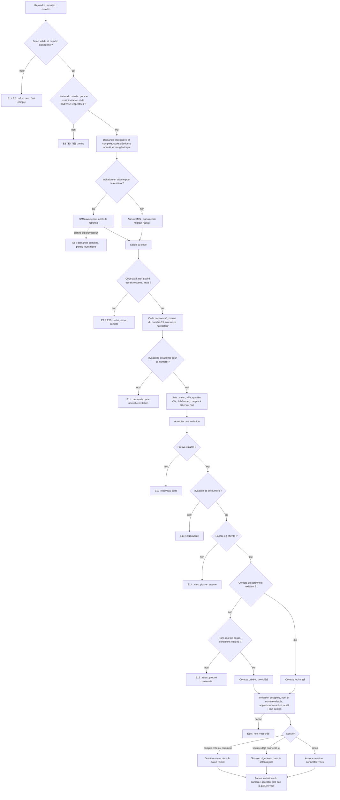
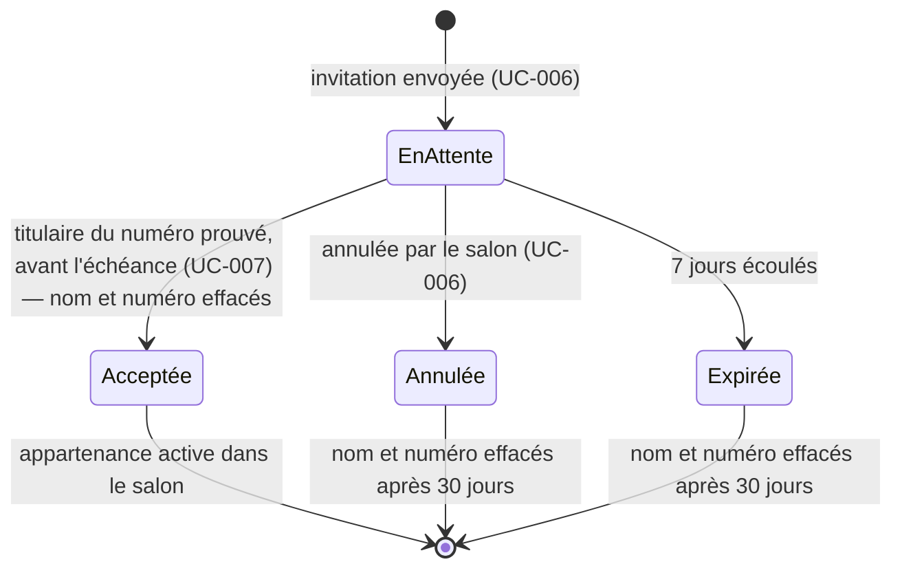

# UC-007 — Accepter une invitation (rejoindre un salon)

| Champ | Valeur |
|---|---|
| Statut | Prêt pour dev (D-047 à D-049) |
| Priorité | Must |
| Module | `organizations` (invitation, appartenance) + `identity` (défi SMS motif `INVITATION`, preuve du numéro, création ou complétion du compte, session) |
| Auteur | use-case-writer |
| Date | 2026-11-20 |
| Use cases liés | UC-006 (précède : l'invitation en attente existe), UC-001 (défi SMS réutilisé ; même création de compte), UC-002 (connexion habituelle d'un membre du personnel après l'acceptation), UC-003 (même schéma de non-énumération et de limites), UC-005 (salon actif, régénération de session), UC-008 (rôles et permissions ; réactivation d'une appartenance retirée), UC-009 (compte client léger, `@apres-UC-009`) |
| Exigences couvertes | EX-001, EX-004, EX-006, EX-009, EX-011, EX-012, EX-014 (en partie), EX-018 (en partie), EX-020, EX-022 (en partie : acceptation), EX-023, EX-024, EX-025, EX-026, EX-029, EX-037 (en partie), D-004, D-017, D-018, D-019, D-020, D-021, D-022, D-023, D-027, D-030, D-033, D-037, D-039, D-043, D-045, D-046 |

## 0. Traçabilité

| Exigence | Source | Où elle est traitée dans ce UC |
|---|---|---|
| EX-022, EX-037 | prd.md §7 Étape 4 « inviter ses collaborateurs » ; F07 « Ajouter… des collaborateurs. Affecter leurs rôles. » | Flux nominal, RG-007-11, RG-007-12, scénario « Une personne sans compte rejoint le salon qui l'a invitée » |
| EX-006 | prd.md §3 « Aucun collaborateur ne peut accéder à un salon sans appartenance autorisée » | RG-007-05, RG-007-11, plans « Sans preuve du numéro… », scénario « L'appartenance va au titulaire du numéro prouvé… » |
| EX-004 | prd.md §3 « appartenir à plusieurs salons… rôles différents » | RG-007-10, RG-007-14, scénarios « Un membre du personnel déjà connecté… », « …invitée par deux salons… » |
| EX-001, D-018 | prd.md §3 « identité de connexion unique » ; DECISIONS.md | RG-007-08 à RG-007-10, RG-007-16, scénarios « Deux acceptations simultanées… », « compte client léger… complété » (`@apres-UC-009`) |
| D-017, EX-018, EX-029 | DECISIONS.md (code SMS à l'activation d'une invitation) ; prd.md §7 Étape 1, §2.B | RG-007-02 à RG-007-05, RG-007-08, flux nominal 1-5 |
| D-019, D-030, D-033 | DECISIONS.md (non-énumération, pas de SMS sans raison, panne comptée) | RG-007-01, RG-007-02, plans « La demande de code reçoit la même réponse… », « Sans invitation en attente… », scénario « Une demande dont le SMS n'est pas parti… » |
| D-021, D-023 | DECISIONS.md | RG-007-03, RG-007-04, plans « 60 secondes », « 5 par heure et 10 par 24 heures », scénarios « 10 codes faux », « autre motif », « simultanées » |
| D-020, D-022 | DECISIONS.md | RG-007-08, plans « mot de passe », « nom… conditions » |
| D-043, D-046 | DECISIONS.md (lien public non secret, SMS sans nom de salon) | RG-007-02, RG-007-06, scénarios « …SMS qui ne nomme aucun salon », « Après le code, la personne découvre les salons… » |
| D-045, EX-025 | DECISIONS.md ; prd.md §12 Données | RG-007-12 (nom et numéro de l'invitation effacés à l'acceptation), RG-007-17, scénarios « Une invitation acceptée quitte les invitations… », audit |
| D-027, D-037, D-039, EX-009 | DECISIONS.md ; prd.md §3 « Le changement de salon change le contexte d'autorisation » | RG-007-13, scénarios « déjà connecté », « non connecté », « tablette » |
| EX-011, EX-012, EX-014 | prd.md §2, §4, §5.1 | RG-007-11 (ni Propriétaire ni rôle système), plan « L'acceptation ne porte que l'invitation choisie… » |
| EX-023 | prd.md §11 | RG-007-17, scénario « L'acceptation est tracée… » |
| EX-024 | prd.md §12 Sécurité | RG-007-01 à RG-007-07, RG-007-11, RG-007-16, scénarios `@securite` |
| EX-026 | prd.md §12 Dates | RG-007-06, RG-007-07 (échéance en UTC, affichée à l'heure du salon) |
| EX-020 | prd.md §7 introduction | §10 (chaque refus dit quoi faire), §15 Guidage |

## 1. Objectif

Permettre à la personne invitée par un salon (UC-006) de **rejoindre son équipe avec son propre compte**, depuis son
téléphone : elle prouve qu'elle possède le numéro invité par un code SMS, découvre alors le salon et le rôle
proposés, crée son compte si elle n'en a pas, et son **appartenance** au salon est créée avec le rôle de
l'invitation. Personne d'autre que le titulaire du numéro ne peut accepter, et personne ne peut savoir, sans ce
code, qu'un numéro est invité ni par quel salon.

## 2. User story

> En tant que **personne invitée par un salon** (coiffeur, barbier, praticienne, administrateur, responsable financier),
> je veux **accepter l'invitation avec le numéro qui a reçu le SMS**,
> afin de **voir mon planning et travailler dans ce salon avec mon propre compte et les droits de mon rôle**.

## 3. Acteurs

- **Acteur principal** : la personne invitée, titulaire du numéro, sur smartphone, réseau parfois lent. Trois
  situations : **aucun compte** (Brice), **compte du personnel** déjà existant (Paul), **compte client léger**
  (Aïcha, `@apres-UC-009`).
- **Acteurs secondaires** : le fournisseur de SMS (code) ; le salon qui a invité (peut annuler pendant ce temps,
  UC-006) ; un tiers malveillant (recherche d'invitations ou de comptes, tentative d'accepter l'invitation d'autrui,
  envoi de SMS en masse) ; la personne déjà connectée sur l'appareil partagé (tablette du salon).

## 4. Déclencheur

La personne ouvre la page publique « Rejoindre un salon » (`gomecoiffer.cm/rejoindre`, D-043), depuis le SMS
d'information de UC-006 ou le message WhatsApp du salon.

## 5. Préconditions

- Le navigateur a obtenu un jeton de sécurité (CSRF) de visiteur.
- Aucune autre précondition visible : la page se comporte de la même façon qu'une invitation existe ou non pour le
  numéro saisi, et que la personne soit connectée ou non (RG-007-01).
- Pour aboutir : au moins une invitation **en attente** (UC-006) pour ce numéro au moment de la demande de code et
  au moment de l'acceptation.

## 6. Postconditions

- **En cas de succès** :
  - l'invitation est **acceptée** (instant, compte qui l'a acceptée) ; son nom et son numéro sont **effacés** ;
  - une **appartenance active** existe pour le compte du numéro, dans le salon de l'invitation, avec son rôle ;
  - si le numéro n'avait pas de compte du personnel : compte **créé** (ou client léger **complété**), numéro
    vérifié, mot de passe, conditions acceptées ;
  - « invitation acceptée » (et, le cas échéant, « compte collaborateur créé » / « compte client complété ») est
    tracé dans l'audit, sans nom, numéro ni secret ;
  - session : ouverte ou régénérée dans le salon rejoint, ou inchangée, selon RG-007-13 ;
  - les autres invitations du numéro restent en attente.
- **En cas d'échec** : aucune appartenance, aucun compte créé ni modifié, invitation inchangée ; un code faux reste
  compté ; une demande de code acceptée reste comptée, même sans SMS (RG-007-02) ; la preuve du numéro reste valable
  jusqu'à son échéance (une saisie refusée se corrige sans nouveau code).

## 7. Règles métier

| ID | Règle | Exemple | Source |
|---|---|---|---|
| RG-007-01 | La **demande de code** ne prend qu'un **numéro camerounais** (formats RG-001-02) et exige le jeton de sécurité. La réponse (statut, contenu, durée du code, délai de renvoi, écran) est **identique** que le numéro ait une invitation en attente ou non, et quel que soit son compte. Une saisie mal formée ou sans jeton est refusée **sans rien compter**. | Écran : « Si une invitation est en attente pour le 6 55 •• •• 22, un code vient de vous être envoyé par SMS. Il expire dans 5 minutes. » — identique pour Brice, Paul et le 6 70 00 00 01. « 6 55 44 33 2 » refusé. | D-019, D-004, EX-024 |
| RG-007-02 | Le code n'est envoyé **qu'à un numéro qui a au moins une invitation en attente** (non échue). Sinon **aucun SMS** ne part, mais la demande est **enregistrée et comptée** comme un envoi (défi qu'aucun code ne peut satisfaire). Le SMS part **après la réponse** ; une panne du fournisseur n'est pas annoncée, est journalisée (type et code d'erreur, sans numéro ni texte), et la demande **compte quand même**. Texte fixe, **sans nom de salon** ni lien secret : « GoMeCoiffer : votre code pour rejoindre une équipe est 482913. Il expire dans 5 minutes. Ne le communiquez à personne. » | 6 70 00 00 01 (aucune invitation) et 6 70 11 22 33 (invitation expirée le 17/11) : rien n'est envoyé, une 2e demande 30 s après reçoit « …dans 30 secondes », comme Brice. | D-030, D-033, D-046, D-043 ; [HYPOTHÈSE] texte — Q7 |
| RG-007-03 | Le code compte **6 chiffres**, vaut **5 minutes**, accepte **5 essais**, ne sert **qu'une fois** ; **un seul** code actif par numéro pour le motif « invitation », un nouveau code **annule** le précédent. Les codes d'un autre motif (inscription, mot de passe oublié…) ne sont **jamais** acceptés ici. | Code envoyé à 10 h 00 min 00 s : accepté à 10 h 04 min 59 s, refusé à 10 h 05 min 00 s ; 482913 puis 105377 : seul 105377 vaut ; code de réinitialisation 105377 saisi ici → « Code incorrect ». | D-017, RG-001-04, RG-001-06, RG-003-03 |
| RG-007-04 | Pour un même numéro et le seul motif « invitation » : nouveau code **après 60 s**, au plus **5 codes par heure** et **10 par 24 h**, **plus aucun code après 10 codes faux en 24 h** ; limite par adresse réseau (30 demandes par heure, comme l'inscription). Les demandes et les vérifications d'un même numéro sont traitées **une à une** (une rafale n'envoie qu'un SMS). | 5 codes depuis 9 h 10 → demande de 10 h 00 refusée ; 5 codes de réinitialisation depuis 9 h 10 → code d'invitation accepté. | D-021, D-023, RG-003-04, RG-003-13 |
| RG-007-05 | Le bon code donne une **preuve du numéro** : valable **15 minutes**, sur **ce navigateur seulement**, non transmissible. Elle **n'ouvre aucune session** et ne permet que deux choses : voir les invitations en attente de ce numéro et en accepter. Sans preuve valable, toute acceptation est refusée (« Votre vérification a expiré : demandez un nouveau code pour continuer. »). Les refus de code sont **identiques** quel que soit le numéro. | Preuve à 10 h 02 min 00 s : acceptation à 10 h 16 min 59 s acceptée, à 10 h 17 min 00 s refusée. Brice prouve sur son téléphone : rien n'est acceptable depuis la tablette. | D-017, EX-006 ; [HYPOTHÈSE] durée — Q5 |
| RG-007-06 | **Rien du salon avant la preuve** : ni nom, ni rôle, ni nombre d'invitations. **Après la preuve**, la personne voit les invitations **en attente** de **son** numéro, tous salons confondus, les plus récentes d'abord : **nom commercial, ville, quartier, rôle, échéance** (heure du salon). Jamais une invitation expirée, annulée, acceptée ou adressée à un autre numéro, ni le nom de la personne qui a invité. L'écran dit aussi ce qu'il faut pour accepter (créer un compte, compléter son compte, ou rien), avec le nom saisi par le salon pré-rempli. Liste vide → « Aucune invitation en attente pour ce numéro : elle a peut-être expiré ou été annulée. Demandez au salon de vous inviter de nouveau. » | Brice voit Élégance Bonamoussadi (Administrateur de salon, avant le 26/11 15 h 00) puis Go Beauty Akwa (Coiffeur, avant le 26/11 10 h 00) ; il ne voit pas l'invitation de Paul. | D-046, D-019, EX-025, EX-026 ; [HYPOTHÈSE] contenu — Q3 |
| RG-007-07 | Accepter vise **une** invitation de la liste. Elle doit être **adressée au numéro prouvé** et **en attente à l'instant de l'acceptation** (l'échéance est exclue). Une invitation inexistante ou adressée à un autre numéro reçoit **le même refus « introuvable »** (404) ; une invitation du numéro qui a expiré, a été annulée ou déjà acceptée entre-temps → « Cette invitation n'est plus en attente : elle a été acceptée, annulée ou elle a expiré. » (422). | Échéance 26/11 10 h 00 : acceptée à 9 h 59 min 59 s, refusée à 10 h 00 min 00 s. Brice vise l'invitation de Paul → 404 identique à un identifiant inconnu. | EX-024, UC-006 RG-006-07, RG-006-13 |
| RG-007-08 | **Numéro sans compte** : l'acceptation exige un **nom** (2 à 80 caractères après nettoyage des espaces, pré-rempli avec le nom de l'invitation, modifiable), un **mot de passe** (10 à 128 caractères, pas courant, sans le numéro) et l'**acceptation des conditions**. Elle crée un **compte du personnel** au numéro vérifié à l'instant de la preuve. Aucun e-mail n'est demandé. Un refus (nom, mot de passe, conditions) ne crée rien et **ne consomme pas la preuve**. | « Wouri-Barber-2027 » accepté ; « salon2026 » refusé (9 caractères) ; « 655443322ab » refusé (contient le numéro) ; « B » refusé, « Bo » accepté. | D-020, D-022, RG-001-07, RG-001-08, EX-018 ; [HYPOTHÈSE] pas d'e-mail — Q8, nom pré-rempli — Q9 |
| RG-007-09 | **Compte client léger** (`@apres-UC-009`) : même saisie que RG-007-08 ; le compte est **complété** (nom, mot de passe, conditions), jamais dupliqué ; ses réservations restent les siennes. | Aïcha, cliente avec 2 réservations, accepte l'invitation de Bastos → un seul compte, 2 réservations retrouvées. | D-018, EX-001, RG-001-10 ; BACKLOG « numéros recyclés » — Q11 |
| RG-007-10 | **Compte du personnel existant** : ni nom ni mot de passe ne sont demandés ; le compte n'est **pas modifié** (nom, mot de passe, sessions, autres appartenances). La réponse ne montre ni ses autres salons ni le nom de son compte. | Paul accepte Akwa en un clic : toujours « Bastos-Fade-2026 », toujours Propriétaire de Deïdo et Coiffeur chez Clarisse. | D-017, EX-004 ; [HYPOTHÈSE] — **Q1** |
| RG-007-11 | L'appartenance est donnée au **compte du numéro prouvé**, **jamais** au compte connecté sur le navigateur. Salon et rôle sont **ceux de l'invitation** : jamais Propriétaire, jamais un rôle système. La demande ne porte que l'invitation visée et, pour un compte à créer ou compléter, le nom, le mot de passe et l'acceptation des conditions ; toute autre information (rôle, salon, numéro, utilisateur) fait refuser la demande entière (400). | Mireille connectée sur la tablette, Paul y accepte : Paul devient Administrateur d'Akwa, le compte de Mireille ne change pas. Demande avec « rôle : Propriétaire » → 400, rien n'est créé. | EX-006, EX-011, EX-012, EX-014, EX-024, D-042, CLAUDE.md §I.4 (mode strict) |
| RG-007-12 | L'acceptation est **tout ou rien** : invitation **acceptée** (instant, compte), appartenance **active**, compte créé ou complété, audit, ensemble ou pas du tout. À l'acceptation, le **nom et le numéro** saisis par le salon sont **effacés** de l'invitation (le compte porte le numéro) ; l'invitation garde salon, rôle, dates et compte. Elle quitte la liste des invitations du salon (UC-006 RG-006-14). | Panne pendant l'enregistrement → aucun compte, aucune appartenance, invitation toujours en attente ; Brice réessaie et réussit. | EX-025, D-045, BACKLOG « UC-007 : effacer le nom et le numéro… » ; [HYPOTHÈSE] effacement immédiat — Q10 |
| RG-007-13 | **Session après l'acceptation** : (a) compte **créé ou complété** → la personne est **connectée** sur ce navigateur : session **neuve** (nouvel identifiant, instant de connexion = acceptation), **salon actif = salon rejoint**, nouveau jeton ; une session déjà ouverte sur ce navigateur (autre compte) est **remplacée** ; (b) compte du personnel **déjà connecté sur ce navigateur** → sa session est **régénérée** (instant de connexion et version des identifiants conservés), salon actif = salon rejoint, nouveau jeton ; (c) sinon (personne de connecté, ou un autre compte) → **aucune session ouverte ni modifiée** : « Vous faites maintenant partie de l'équipe de Go Beauty Akwa. Connectez-vous avec votre mot de passe habituel pour y travailler. » | (a) Brice → connecté dans Akwa. (b) Paul connecté sur son téléphone dans Deïdo → passe dans Akwa, nouveau jeton. (c) Paul sur un navigateur vierge → rien ; à sa connexion, choix entre ses 3 salons (D-027). | D-037, D-039, D-027, RG-002-10, RG-002-11, RG-005-06 ; [HYPOTHÈSE] salon actif — Q4 |
| RG-007-14 | **Plusieurs invitations** (salons différents) : chacune s'accepte **séparément**, tant que la preuve est valable ; accepter l'une ne touche pas les autres ; chacune donne son appartenance avec son rôle. Après la première acceptation qui crée le compte, les suivantes suivent RG-007-10 / RG-007-13 (b). **Pas de refus explicite** au MVP : une invitation non acceptée expire seule au bout de 7 jours. | Brice accepte Akwa (compte créé) puis Élégance sans ressaisie : Coiffeur d'Akwa, Administrateur d'Élégance, salon actif Élégance. | EX-004, D-045 ; [HYPOTHÈSE] pas de refus — **Q2** |
| RG-007-15 | Une personne qui a **déjà une appartenance active** dans le salon de l'invitation n'en reçoit pas une seconde : refus « Vous faites déjà partie de l'équipe de ce salon. Connectez-vous pour y travailler. » (409) ; rien ne change. Défense en profondeur : UC-006 RG-006-09 empêche déjà d'inviter un membre. | Appartenance créée entre l'invitation et l'acceptation (cas non atteignable au lot 1) → refus, invitation inchangée. | EX-006, RG-006-09 |
| RG-007-16 | **Concurrence** : une invitation ne s'accepte **qu'une fois** ; une acceptation et une annulation simultanées ne réussissent pas toutes les deux ; deux acceptations simultanées pour un numéro sans compte ne créent **qu'un** compte et **qu'une** appartenance. | Double clic de Brice → 1 réussite, 1 refus « n'est plus en attente » ; un seul compte +237655443322. Deux onglets qui créent le compte pour Akwa et pour Élégance en même temps → l'un réussit, l'autre reçoit « Votre compte vient de changer : rechargez la page. » et accepte ensuite sans ressaisie. | EX-001, EX-024, RG-001-01 |
| RG-007-17 | **Audit** : « **invitation acceptée** » (salon, invitation, rôle, compte, instant) ; selon le cas « **compte collaborateur créé** » ou « **compte client complété** ». Jamais le nom, le numéro, le code, le mot de passe ni l'adresse réseau. Les demandes et vérifications de code vivent dans l'historique des envois, pas dans l'audit. | Deux lignes pour Brice, sans « Brice Nana » ni 6 55 44 33 22. | EX-023, EX-025, D-028, RG-006-15 |

## 8. Flux nominal

1. Brice ouvre « Rejoindre un salon », saisit 6 55 44 33 22 et demande « Recevoir un code ».
2. Le système vérifie le jeton, le format et les limites, enregistre la demande et affiche l'écran générique, sans
   rien dire de l'invitation (RG-007-01, RG-007-04).
3. Après la réponse, le système envoie le code par SMS, car une invitation est en attente pour ce numéro (RG-007-02).
4. Brice saisit le code « 482913 ».
5. Le système vérifie le code, le consomme et remet à ce navigateur une preuve du numéro valable 15 minutes
   (RG-007-03, RG-007-05).
6. Le système affiche ses invitations en attente (Élégance Bonamoussadi, Go Beauty Akwa) et demande de créer son
   compte, avec « Brice Nana » pré-rempli (RG-007-06).
7. Brice choisit « Accepter » sur Go Beauty Akwa, garde son nom, choisit « Wouri-Barber-2027 » et accepte les
   conditions.
8. Le système vérifie la preuve, l'invitation (son numéro, en attente), le nom, le mot de passe et les conditions
   (RG-007-07, RG-007-08, RG-007-11).
9. Le système crée le compte, l'appartenance « Coiffeur / Coiffeuse / Barbier » dans Go Beauty Akwa, marque
   l'invitation acceptée en effaçant nom et numéro, et trace l'acceptation, tout ou rien (RG-007-12, RG-007-17).
10. Le système ouvre une session neuve avec Go Beauty Akwa comme salon actif et remet un nouveau jeton (RG-007-13 a).
11. L'interface affiche « Bienvenue dans l'équipe de Go Beauty Akwa ! » puis le back-office du salon, et rappelle
    l'invitation d'Élégance Bonamoussadi encore en attente.

## 9. Flux alternatifs

- **A1 — Renvoi du code** (étape 4) : après 60 s, nouveau code, l'ancien est annulé (RG-007-03) ; retour à l'étape 2.
- **A2 — Numéro sans invitation en attente** (étape 3) : aucun SMS ; demande comptée ; même écran (RG-007-02).
  L'écran rappelle « Pas de SMS au bout d'une minute ? Vérifiez le numéro, ou demandez au salon de vous inviter de
  nouveau : une invitation est valable 7 jours. » ; fin du use case.
- **A3 — Compte du personnel déjà connecté sur ce navigateur** (étapes 6-10) : aucune saisie, « Accepter » suffit ;
  session régénérée dans le salon rejoint (RG-007-10, RG-007-13 b).
- **A4 — Compte du personnel non connecté, ou autre compte connecté** (étapes 6-10) : aucune saisie ; aucune
  session ouverte ni modifiée ; invitation à se connecter (RG-007-13 c) ; fin du use case (UC-002 ensuite).
- **A5 — Compte client léger** (`@apres-UC-009`, étape 9) : compte complété au lieu d'être créé (RG-007-09).
- **A6 — Plusieurs invitations** (étape 11) : la personne accepte la suivante sans ressaisie tant que la preuve est
  valable (RG-007-14) ; retour à l'étape 8.
- **A7 — Appareil partagé** (étape 10) : une session d'un autre compte (tablette de Mireille) est remplacée par celle
  du nouveau compte (RG-007-13 a) ; pour un compte du personnel existant, elle n'est pas touchée (RG-007-13 c).
- **A8 — Correction du numéro** (étape 4) : « Modifier mon numéro » ramène à l'étape 1 ; l'ancien code expirera seul.
- **A9 — Saisie refusée puis corrigée** (étape 8) : voir E15 ; la preuve reste valable ; retour à l'étape 7.

## 10. Flux d'exception

- **E1 — Numéro mal formé** (étape 2) : « Saisissez un numéro camerounais de 9 chiffres, par exemple
  6 77 12 34 56. » ; rien n'est compté.
- **E2 — Jeton de sécurité absent ou périmé** (étapes 2, 5, 8) : « Jeton de sécurité absent ou expiré : rechargez
  la page puis recommencez. » ; rien n'est compté.
- **E3 — Renvoi trop tôt** : « Un code vient d'être envoyé. Vous pourrez en demander un autre dans 20 secondes. »
- **E4 — Trop de codes demandés** (heure, 24 h, 10 codes faux) : « Trop de codes demandés pour ce numéro. Réessayez
  dans une heure ou contactez l'assistance. »
- **E5 — Fournisseur SMS indisponible** (étape 3) : écran habituel, aucun code n'arrive, demande comptée, panne
  journalisée sans numéro (RG-007-02).
- **E6 — Trop de demandes depuis une même adresse réseau** (étape 2) : « Trop de demandes depuis ce réseau.
  Réessayez dans une heure. »
- **E7 — Code faux** (étape 5) : « Code incorrect. Il vous reste 3 essais. »
- **E8 — Code expiré** : « Ce code a expiré. Demandez-en un nouveau. »
- **E9 — Essais épuisés** : « Trop d'essais. Demandez un nouveau code. », même avec le bon code.
- **E10 — Code plus valable** (aucun code demandé, déjà utilisé, remplacé) : « Ce code n'est plus valable. Demandez
  un nouveau code. »
- **E11 — Plus aucune invitation en attente après la preuve** (étape 6) : « Aucune invitation en attente pour ce
  numéro : elle a peut-être expiré ou été annulée. Demandez au salon de vous inviter de nouveau. »
- **E12 — Preuve absente ou expirée** (étape 8) : « Votre vérification a expiré : demandez un nouveau code pour
  continuer. » ; rien n'est créé.
- **E13 — Invitation introuvable** (inexistante ou adressée à un autre numéro) : 404 « Ressource introuvable. »,
  identique dans les deux cas ; rien ne change.
- **E14 — Invitation plus en attente** (expirée, annulée ou déjà acceptée entre-temps) : « Cette invitation n'est
  plus en attente : elle a été acceptée, annulée ou elle a expiré. » (422) ; l'interface relit la liste.
- **E15 — Nom, mot de passe ou conditions refusés** : message qui dit pourquoi (« Le mot de passe doit compter au
  moins 10 caractères. », « Ce mot de passe est trop courant : choisissez une phrase propre à vous. », « Le mot de
  passe ne doit pas contenir votre numéro de téléphone. », « Acceptez les conditions d'utilisation pour
  continuer. ») ; information en trop → « Certaines informations sont invalides : corrigez les champs signalés. »
  (400) ; rien n'est créé, la preuve reste valable.
- **E16 — Déjà membre du salon** : « Vous faites déjà partie de l'équipe de ce salon. Connectez-vous pour y
  travailler. » (409) ; défense en profondeur (RG-007-15).
- **E17 — Acceptations simultanées** : une seule réussit, l'autre reçoit E14 ; avec une annulation simultanée, une
  seule des deux aboutit (RG-007-16).
- **E18 — Panne pendant l'enregistrement** (étape 9) : « Impossible de rejoindre le salon pour le moment. Réessayez
  dans quelques minutes. » (500) ; rien n'est créé ; la preuve reste valable.

> Avant la preuve, aucun message ne dit si le numéro a une invitation ou un compte (D-019). Après la preuve, la
> personne, titulaire du numéro, apprend seulement ce qui concerne son numéro.

## 11. Workflow



Cycle de vie de l'invitation (complète celui de UC-006) :



## 12. Scénarios d'acceptation (BDD)

Identiques à `features/organizations/accepter-une-invitation.feature`. Raccourci des scénarios : « en créant son
compte » = avec le nom "Brice Nana", le mot de passe "Wouri-Barber-2027" et les conditions acceptées.

```gherkin
# language: fr
@UC-007
Fonctionnalité: Accepter une invitation (rejoindre un salon)
  Pour travailler dans le salon qui l'a invitée avec son propre compte,
  la personne invitée prouve qu'elle possède le numéro invité par un code SMS,
  découvre alors le salon et le rôle proposés, puis accepte : son appartenance au salon est créée avec ce rôle.

  Contexte:
    Étant donné que nous sommes le 20/11/2026 à 10 h 00, heure de Douala
    Et que les SMS sont envoyés normalement
    Et que Paul Ebode a un compte du personnel avec le mot de passe "Bastos-Fade-2026" pour le 6 99 00 11 22
    Et que Paul est "Propriétaire" de "Paul Barber Deïdo" et "Coiffeur" chez "Élégance Bonamoussadi"
    Et qu'aucun compte n'existe pour le 6 55 44 33 22 ni pour le 6 70 00 00 01
    Et que les invitations en attente sont :
      | salon                 | ville, quartier      | personne invitée | numéro        | rôle                           | envoyée le           | valable jusqu'au     |
      | Go Beauty Akwa        | Douala, Akwa         | Brice Nana       | 6 55 44 33 22 | Coiffeur / Coiffeuse / Barbier | 19/11/2026 à 10 h 00 | 26/11/2026 à 10 h 00 |
      | Élégance Bonamoussadi | Douala, Bonamoussadi | Brice Nana       | 6 55 44 33 22 | Administrateur de salon        | 19/11/2026 à 15 h 00 | 26/11/2026 à 15 h 00 |
      | Go Beauty Akwa        | Douala, Akwa         | Paul Ebode       | 6 99 00 11 22 | Administrateur de salon        | 19/11/2026 à 11 h 00 | 26/11/2026 à 11 h 00 |

  # --- Parcours nominal -------------------------------------------------------------------------

  @nominal @RG-007-05 @RG-007-08 @RG-007-11 @RG-007-13 @RG-007-14 @EX-022 @EX-037 @D-017
  Scénario: Une personne sans compte rejoint le salon qui l'a invitée
    Étant donné que Brice a prouvé son numéro 6 55 44 33 22 avec le code reçu par SMS
    Quand Brice accepte l'invitation de "Go Beauty Akwa" avec le nom "Brice Nana", le mot de passe "Wouri-Barber-2027" et les conditions acceptées
    Alors Brice est connecté et travaille dans le salon "Go Beauty Akwa" comme "Coiffeur / Coiffeuse / Barbier"
    Et Brice se connecte désormais avec le 6 55 44 33 22 et le mot de passe "Wouri-Barber-2027"
    Et l'invitation d'"Élégance Bonamoussadi" pour Brice est toujours en attente

  @nominal @RG-007-02 @D-046
  Scénario: Le code pour rejoindre une équipe arrive par un SMS qui ne nomme aucun salon
    Quand on demande un code pour rejoindre un salon avec le "6 55 44 33 22"
    Alors le 6 55 44 33 22 reçoit, après la réponse, le SMS "GoMeCoiffer : votre code pour rejoindre une équipe est 482913. Il expire dans 5 minutes. Ne le communiquez à personne."

  @nominal @RG-007-06 @EX-004
  Scénario: Après le code, la personne découvre les salons qui l'invitent
    Étant donné que Brice a reçu le code "482913" pour le 6 55 44 33 22
    Quand Brice saisit le code "482913"
    Alors il voit, dans cet ordre, les invitations :
      | salon                 | ville, quartier      | rôle                           | à accepter avant le  |
      | Élégance Bonamoussadi | Douala, Bonamoussadi | Administrateur de salon        | 26/11/2026 à 15 h 00 |
      | Go Beauty Akwa        | Douala, Akwa         | Coiffeur / Coiffeuse / Barbier | 26/11/2026 à 10 h 00 |
    Et on lui demande de créer son compte, avec le nom "Brice Nana" déjà rempli
    Et il ne voit pas l'invitation de Paul Ebode

  @nominal @RG-007-12 @EX-025
  Scénario: Une invitation acceptée quitte les invitations du salon et n'en garde ni le nom ni le numéro
    Étant donné que Brice a accepté l'invitation de "Go Beauty Akwa" en créant son compte
    Quand Mireille consulte les invitations de "Go Beauty Akwa"
    Alors elle n'y voit plus "Brice Nana"
    Et l'invitation acceptée ne garde que le salon, le rôle, ses dates et le compte de Brice

  # --- Demande du code : non-énumération et limites -------------------------------------------

  @securite @RG-007-01 @RG-007-02 @D-019 @D-030
  Plan du scénario: La demande de code reçoit la même réponse et ne nomme aucun salon
    Étant donné que le <numéro> a <situation>
    Quand on demande un code pour rejoindre un salon avec le "<numéro>"
    Alors la demande est acceptée et l'écran affiché est le même que pour le 6 55 44 33 22
    Et cet écran ne cite aucun salon ni aucun rôle
    Et ce qui est envoyé au <numéro> est <envoi>

    Exemples:
      | numéro        | situation                                           | envoi               |
      | 6 55 44 33 22 | une invitation en attente et aucun compte           | un SMS avec un code |
      | 6 99 00 11 22 | une invitation en attente et un compte du personnel | un SMS avec un code |
      | 6 70 00 00 01 | aucune invitation                                   | rien                |
      | 6 70 11 22 33 | seulement une invitation expirée le 17/11/2026      | rien                |

  @securite @RG-007-02 @RG-007-05
  Plan du scénario: Sans invitation en attente, aucun code saisi ne prouve le numéro
    Étant donné que le <numéro> a <situation>
    Et qu'un code pour rejoindre un salon a été demandé pour le <numéro>
    Quand on saisit le code "482913" pour le <numéro>
    Alors la vérification est refusée avec le motif "Code incorrect. Il vous reste 4 essais."
    Et aucune invitation n'est montrée

    Exemples:
      | numéro        | situation                                      |
      | 6 70 00 00 01 | aucune invitation                              |
      | 6 70 11 22 33 | seulement une invitation expirée le 17/11/2026 |

  @erreur @RG-007-01
  Plan du scénario: Seuls les numéros camerounais valides reçoivent un code
    Quand on demande un code pour rejoindre un salon avec le "<numéro saisi>"
    Alors la demande est <résultat>

    Exemples:
      | numéro saisi       | résultat                   |
      | 6 55 44 33 22      | acceptée                   |
      | +237 6 55 44 33 22 | acceptée                   |
      | 6 55 44 33 2       | refusée : numéro mal formé |
      | +33 6 12 34 56 78  | refusée : numéro mal formé |

  @erreur @RG-007-01
  Scénario: Une demande de code sans jeton de sécurité est refusée sans rien compter
    Quand on demande un code pour rejoindre un salon avec le "6 55 44 33 22" sans jeton de sécurité
    Alors la demande est refusée avec le motif "Jeton de sécurité absent ou expiré : rechargez la page puis recommencez."
    Et aucun SMS n'est envoyé au 6 55 44 33 22

  @erreur @RG-007-04 @D-021
  Plan du scénario: Un nouveau code ne peut être demandé qu'après 60 secondes
    Étant donné que Brice a reçu un code pour rejoindre un salon à 10 h 00 min 00 s
    Quand Brice demande un nouveau code à <heure>
    Alors la demande est <résultat>

    Exemples:
      | heure            | résultat                                 |
      | 10 h 00 min 59 s | refusée : nouveau code possible dans 1 s |
      | 10 h 01 min 00 s | acceptée                                 |

  @erreur @RG-007-04 @D-021 @D-023
  Plan du scénario: Au plus 5 codes par heure et 10 codes par 24 heures pour un même numéro
    Étant donné que <envois> ont été envoyés au 6 55 44 33 22 pour rejoindre un salon
    Quand Brice demande un code pour rejoindre un salon à 10 h 00
    Alors la demande est <résultat>

    Exemples:
      | envois                                            | résultat                |
      | 4 codes depuis 9 h 10                             | acceptée                |
      | 5 codes depuis 9 h 10                             | refusée : trop de codes |
      | 9 codes depuis hier 11 h 00, le dernier à 8 h 00  | acceptée                |
      | 10 codes depuis hier 11 h 00, le dernier à 8 h 00 | refusée : trop de codes |

  @securite @RG-007-04 @D-023
  Scénario: Après 10 codes faux en 24 heures, plus aucun code pour rejoindre un salon n'est envoyé
    Étant donné que 10 codes faux pour rejoindre un salon ont été saisis pour le 6 55 44 33 22 depuis hier 11 h 00
    Quand Brice demande un code pour rejoindre un salon à 10 h 00
    Alors la demande est refusée
    Et le motif indiqué est "Trop de codes demandés pour ce numéro. Réessayez dans une heure ou contactez l'assistance."

  @securite @RG-007-04
  Scénario: Des demandes de code simultanées n'envoient qu'un seul SMS
    Quand 5 demandes de code pour rejoindre un salon avec le "6 55 44 33 22" arrivent en même temps
    Alors un seul SMS est envoyé au 6 55 44 33 22
    Et les 4 autres demandes sont refusées pour renvoi trop tôt

  @erreur @securite @RG-007-02 @D-033
  Scénario: Une demande dont le SMS n'est pas parti compte dans les limites, sans que l'écran le dise
    Étant donné que le fournisseur SMS est indisponible
    Et que Brice a demandé un code pour rejoindre un salon à 10 h 00 sans le recevoir
    Quand Brice demande un nouveau code à 10 h 00 min 30 s
    Alors la demande est refusée avec le motif "Un code vient d'être envoyé. Vous pourrez en demander un autre dans 30 secondes."
    Et la réponse est la même que pour le 6 70 00 00 01 dans la même situation

  # --- Vérification du code et preuve du numéro -----------------------------------------------

  @erreur @RG-007-03
  Plan du scénario: Un code pour rejoindre un salon n'est valable que 5 minutes
    Étant donné que Brice a reçu le code "482913" à 10 h 00 min 00 s
    Quand Brice saisit le code "482913" à <heure>
    Alors la vérification est <résultat>

    Exemples:
      | heure            | résultat              |
      | 10 h 04 min 59 s | acceptée              |
      | 10 h 05 min 00 s | refusée : code expiré |

  @securite @RG-007-03
  Scénario: Après 5 codes faux, même le bon code est refusé
    Étant donné que Brice a reçu le code "482913"
    Et que 5 codes faux ont été saisis pour ce code
    Quand Brice saisit le code "482913"
    Alors la vérification est refusée avec le motif "Trop d'essais. Demandez un nouveau code."
    Et aucune invitation n'est montrée

  @alternatif @RG-007-03
  Scénario: Un nouveau code annule le précédent
    Étant donné que Brice a reçu le code "482913" à 10 h 00
    Et qu'il a reçu le code "105377" à 10 h 01
    Quand Brice saisit le code "482913"
    Alors la vérification est refusée avec le motif "Code incorrect. Il vous reste 4 essais."

  @securite @RG-007-03 @RG-007-04 @D-023
  Scénario: Les codes d'un autre motif ne comptent pas et ne permettent pas de rejoindre un salon
    Étant donné que 5 codes de réinitialisation ont été demandés pour le 6 99 00 11 22 depuis 9 h 10, le dernier étant "105377"
    Et que Paul a reçu le code "482913" pour rejoindre un salon à 10 h 00
    Quand Paul saisit le code "105377" pour rejoindre un salon
    Alors la vérification est refusée avec le motif "Code incorrect. Il vous reste 4 essais."

  @erreur @RG-007-06
  Scénario: Une invitation annulée pendant la saisie du code n'est plus proposée
    Étant donné que Paul a reçu le code "482913" pour rejoindre un salon
    Et que Mireille a ensuite annulé l'invitation de Paul
    Quand Paul saisit le code "482913"
    Alors on lui indique "Aucune invitation en attente pour ce numéro : elle a peut-être expiré ou été annulée. Demandez au salon de vous inviter de nouveau."

  @securite @RG-007-05 @EX-006
  Plan du scénario: Sans preuve du numéro sur ce navigateur, aucune invitation n'est acceptée
    Étant donné que <situation>
    Quand on accepte depuis ce navigateur l'invitation de Brice dans "Go Beauty Akwa" en créant son compte
    Alors l'acceptation est refusée avec le motif "Votre vérification a expiré : demandez un nouveau code pour continuer."
    Et aucun compte n'existe pour le 6 55 44 33 22

    Exemples:
      | situation                                                          |
      | aucun code n'a été saisi sur ce navigateur                         |
      | Brice a prouvé son numéro sur son téléphone, pas sur ce navigateur |

  @erreur @RG-007-05
  Plan du scénario: La preuve du numéro est valable 15 minutes
    Étant donné que Brice a prouvé son numéro 6 55 44 33 22 à 10 h 02 min 00 s
    Quand Brice accepte l'invitation de "Go Beauty Akwa" à <heure> en créant son compte
    Alors l'acceptation est <résultat>

    Exemples:
      | heure            | résultat                                                                                      |
      | 10 h 16 min 59 s | réussie                                                                                       |
      | 10 h 17 min 00 s | refusée avec le motif "Votre vérification a expiré : demandez un nouveau code pour continuer." |

  # --- Acceptation : invitation visée ---------------------------------------------------------

  @securite @RG-007-07 @EX-024
  Plan du scénario: Une invitation adressée à un autre numéro ne peut pas être acceptée, et le refus ne dit pas pourquoi
    Étant donné que Brice a prouvé son numéro 6 55 44 33 22
    Quand Brice accepte <invitation visée>
    Alors l'acceptation est refusée comme pour une invitation qui n'existe pas
    Et <conséquence>

    Exemples:
      | invitation visée                                 | conséquence                                    |
      | l'invitation de Paul Ebode dans "Go Beauty Akwa" | l'invitation de Paul est toujours en attente   |
      | une invitation dont l'identifiant n'existe pas   | rien n'a changé                                |

  @erreur @RG-007-07 @RG-007-12
  Scénario: Une invitation annulée après la saisie du code ne peut plus être acceptée
    Étant donné que Brice a prouvé son numéro 6 55 44 33 22
    Et que Mireille a ensuite annulé l'invitation de Brice dans "Go Beauty Akwa"
    Quand Brice accepte l'invitation de "Go Beauty Akwa" en créant son compte
    Alors l'acceptation est refusée avec le motif "Cette invitation n'est plus en attente : elle a été acceptée, annulée ou elle a expiré."
    Et aucun compte n'existe pour le 6 55 44 33 22

  @erreur @RG-007-07
  Plan du scénario: Une invitation s'accepte jusqu'à son échéance, échéance exclue
    Étant donné que Brice a prouvé son numéro 6 55 44 33 22 le 26/11/2026 à 9 h 50
    Quand Brice accepte l'invitation de "Go Beauty Akwa" le 26/11/2026 à <heure> en créant son compte
    Alors l'acceptation est <résultat>

    Exemples:
      | heure            | résultat                                                                                                       |
      | 9 h 59 min 59 s  | réussie                                                                                                        |
      | 10 h 00 min 00 s | refusée avec le motif "Cette invitation n'est plus en attente : elle a été acceptée, annulée ou elle a expiré." |

  @securite @RG-007-11 @EX-024 @EX-012 @EX-014
  Plan du scénario: L'acceptation ne porte que l'invitation choisie et, pour un nouveau compte, le nom, le mot de passe et les conditions
    Étant donné que Brice a prouvé son numéro 6 55 44 33 22
    Quand Brice accepte l'invitation de "Go Beauty Akwa" en créant son compte et en indiquant aussi <information>
    Alors l'acceptation est refusée avec le motif "Certaines informations sont invalides : corrigez les champs signalés."
    Et aucun compte n'existe pour le 6 55 44 33 22

    Exemples:
      | information                            |
      | le rôle "Propriétaire"                 |
      | le salon "Go Beauty Bastos"            |
      | le numéro 6 99 00 11 22                |
      | le rôle système "Super Administrateur" |

  # --- Acceptation : création du compte -------------------------------------------------------

  @erreur @RG-007-08 @D-020
  Plan du scénario: Le mot de passe du nouveau compte doit être difficile à deviner
    Étant donné que Brice a prouvé son numéro 6 55 44 33 22
    Quand Brice accepte l'invitation de "Go Beauty Akwa" avec le nom "Brice Nana", le mot de passe "<mot de passe>" et les conditions acceptées
    Alors l'acceptation est <résultat>

    Exemples:
      | mot de passe      | résultat                                    |
      | salon2026         | refusée : au moins 10 caractères            |
      | motdepasse123     | refusée : mot de passe trop courant         |
      | 655443322ab       | refusée : ne doit pas contenir votre numéro |
      | Wouri-Barber-2027 | réussie                                     |

  @erreur @RG-007-08 @D-022
  Plan du scénario: Le nouveau compte demande un nom de 2 à 80 caractères et l'acceptation des conditions
    Étant donné que Brice a prouvé son numéro 6 55 44 33 22
    Quand Brice accepte l'invitation de "Go Beauty Akwa" avec le nom <nom>, le mot de passe "Wouri-Barber-2027" et <conditions>
    Alors l'acceptation est <résultat>

    Exemples:
      | nom                     | conditions                   | résultat                                                          |
      | "Bo"                    | les conditions acceptées     | réussie                                                           |
      | "B"                     | les conditions acceptées     | refusée : nom trop court                                          |
      | un nom de 81 caractères | les conditions acceptées     | refusée : nom trop long                                           |
      | "Brice Nana"            | les conditions non acceptées | refusée : "Acceptez les conditions d'utilisation pour continuer." |

  @erreur @RG-007-08 @RG-007-05
  Scénario: Un mot de passe refusé ne fait perdre ni la preuve du numéro ni l'invitation
    Étant donné que Brice a prouvé son numéro 6 55 44 33 22
    Et que son acceptation a été refusée pour le mot de passe "salon2026"
    Quand Brice accepte l'invitation de "Go Beauty Akwa" avec le nom "Brice Nana", le mot de passe "Wouri-Barber-2027" et les conditions acceptées
    Alors Brice est connecté et travaille dans le salon "Go Beauty Akwa"

  @alternatif @RG-007-09 @D-018 @EX-001 @apres-UC-009
  Scénario: Le compte client léger d'une personne invitée est complété, pas dupliqué
    Étant donné que le 6 91 23 45 67 est le compte client d'Aïcha Bello, avec 2 réservations
    Et que "Go Beauty Bastos" a invité Aïcha Bello, au 6 91 23 45 67, comme "Praticien / Praticienne de beauté"
    Et qu'Aïcha a prouvé son numéro 6 91 23 45 67 avec le code reçu par SMS
    Quand Aïcha accepte l'invitation de "Go Beauty Bastos" avec le nom "Aïcha Bello", le mot de passe "Bastos-Ongles-2027" et les conditions acceptées
    Alors il existe un seul compte pour le +237691234567, qui retrouve ses 2 réservations
    Et Aïcha travaille dans le salon "Go Beauty Bastos" comme "Praticien / Praticienne de beauté"

  # --- Acceptation : compte du personnel existant et session ----------------------------------

  @alternatif @RG-007-10 @RG-007-13 @EX-004 @D-037
  Scénario: Un membre du personnel déjà connecté rejoint un autre salon sans ressaisir de mot de passe
    Étant donné que Paul est connecté sur son téléphone et travaille dans "Paul Barber Deïdo"
    Et que Paul a prouvé son numéro 6 99 00 11 22 sur son téléphone avec le code reçu par SMS
    Quand Paul accepte l'invitation de "Go Beauty Akwa"
    Alors Paul travaille dans le salon "Go Beauty Akwa" comme "Administrateur de salon", avec un nouveau jeton de sécurité
    Et Paul est toujours "Propriétaire" de "Paul Barber Deïdo" et "Coiffeur" chez "Élégance Bonamoussadi"
    Et Paul se connecte toujours avec "Bastos-Fade-2026"

  @alternatif @RG-007-10 @RG-007-13 @EX-004
  Scénario: Un membre du personnel non connecté rejoint le salon puis se connecte avec son mot de passe habituel
    Étant donné que Paul a prouvé son numéro 6 99 00 11 22 sur un navigateur où personne n'est connecté
    Quand Paul accepte l'invitation de "Go Beauty Akwa"
    Alors on lui indique "Vous faites maintenant partie de l'équipe de Go Beauty Akwa. Connectez-vous avec votre mot de passe habituel pour y travailler."
    Et aucune session n'est ouverte sur ce navigateur
    Et la réponse ne montre ni ses autres salons ni le nom de son compte
    Et à sa prochaine connexion, Paul choisit parmi "Élégance Bonamoussadi", "Go Beauty Akwa" et "Paul Barber Deïdo"

  @securite @RG-007-11 @RG-007-13 @EX-006
  Scénario: L'appartenance va au titulaire du numéro prouvé, jamais au compte connecté sur l'appareil
    Étant donné que Mireille Ndongo est connectée sur la tablette du salon
    Et que Paul a prouvé son numéro 6 99 00 11 22 sur cette tablette
    Quand Paul accepte l'invitation de "Go Beauty Akwa" sur cette tablette
    Alors Paul est "Administrateur de salon" de "Go Beauty Akwa"
    Et Mireille est toujours connectée sur la tablette, sans nouveau rôle

  @alternatif @RG-007-13 @RG-002-11
  Scénario: Créer son compte sur la tablette du salon remplace la session qui y était ouverte
    Étant donné que Mireille Ndongo est connectée sur la tablette du salon
    Et que Brice a prouvé son numéro 6 55 44 33 22 sur cette tablette
    Quand Brice accepte l'invitation de "Go Beauty Akwa" en créant son compte sur cette tablette
    Alors la tablette est connectée au compte de Brice, dans le salon "Go Beauty Akwa"
    Et l'ancienne session de Mireille sur la tablette ne donne plus accès à rien

  @alternatif @RG-007-14 @RG-007-13 @EX-004
  Scénario: Une personne invitée par deux salons les rejoint l'un après l'autre
    Étant donné que Brice a prouvé son numéro 6 55 44 33 22 avec le code reçu par SMS
    Et que Brice a accepté l'invitation de "Go Beauty Akwa" en créant son compte
    Quand Brice accepte l'invitation d'"Élégance Bonamoussadi"
    Alors Brice est "Coiffeur / Coiffeuse / Barbier" de "Go Beauty Akwa" et "Administrateur de salon" d'"Élégance Bonamoussadi"
    Et Brice travaille dans le salon "Élégance Bonamoussadi"
    Et cette seconde acceptation n'a demandé ni nom ni mot de passe

  # --- Concurrence, panne, audit --------------------------------------------------------------

  @securite @RG-007-16 @EX-001
  Scénario: Deux acceptations simultanées ne créent qu'un compte et qu'une appartenance
    Étant donné que Brice a prouvé son numéro 6 55 44 33 22
    Quand deux acceptations de l'invitation de "Go Beauty Akwa" par Brice, en créant son compte, arrivent en même temps
    Alors une seule réussit
    Et il existe un seul compte pour le +237655443322, membre une seule fois de "Go Beauty Akwa"

  @securite @RG-007-16
  Scénario: Une acceptation et une annulation simultanées ne réussissent pas toutes les deux
    Étant donné que Paul a prouvé son numéro 6 99 00 11 22
    Quand Paul accepte l'invitation de "Go Beauty Akwa" pendant que Mireille l'annule
    Alors une seule des deux actions réussit
    Et Paul est membre de "Go Beauty Akwa" si et seulement si l'invitation est acceptée

  @erreur @RG-007-12
  Scénario: Une panne pendant l'acceptation ne laisse ni compte ni appartenance
    Étant donné que Brice a prouvé son numéro 6 55 44 33 22
    Et que le service GoMeCoiffer tombe en panne pendant l'enregistrement de l'acceptation
    Quand Brice accepte l'invitation de "Go Beauty Akwa" en créant son compte
    Alors l'acceptation est refusée avec le motif "Impossible de rejoindre le salon pour le moment. Réessayez dans quelques minutes."
    Et aucun compte n'existe pour le 6 55 44 33 22
    Et l'invitation de Brice dans "Go Beauty Akwa" est toujours en attente

  @securite @RG-007-17 @EX-023 @EX-025
  Scénario: L'acceptation est tracée sans donnée personnelle ni secret
    Étant donné que Brice a prouvé son numéro 6 55 44 33 22
    Quand Brice accepte l'invitation de "Go Beauty Akwa" en créant son compte
    Alors le journal d'audit contient "compte collaborateur créé" et "invitation acceptée" pour "Go Beauty Akwa", avec le rôle et le compte de Brice
    Et aucune de ces lignes ne contient le nom "Brice Nana", le numéro 6 55 44 33 22, le code ni le mot de passe
```

## 13. Plan de tests TDD

Ordre : refus d'abord, du plus simple au plus complexe. Unitaire = règles sur fakes in-memory ; intégration = vraie
base (Testcontainers) ; E2E = parcours HTTP. `ListInvitationsForProvenPhone` est une query : E2E seulement.

| # | Niveau | Comportement testé | Étant donné | Quand | Alors | Règle |
|---|---|---|---|---|---|---|
| T1 | Unitaire | `Invitation.accept` : en attente → `ACCEPTED`, `endedAt`, compte, nom et numéro à `null`, événement `InvitationAccepted` (identifiants et rôle seulement) | invitation du 19/11 10 h | accept le 20/11 | comme décrit | RG-007-12 |
| T2 | Unitaire | `accept` aux bornes : 26/11 9:59:59 accepté ; 10:00:00 → `InvitationNoLongerPendingError` ; annulée / expirée / acceptée → même erreur | invitation | accept | comme décrit | RG-007-07 |
| T3 | Unitaire | `PhoneProof` : valable à +14 min 59 s, refusée à +15 min ; propre à un motif | horloge fixe | `isValidAt` | vrai / faux | RG-007-05 |
| T4 | Unitaire | Demande de code : numéro mal formé → refus, rien compté | — | demande | refus, 0 défi | RG-007-01 |
| T5 | Unitaire | Numéro avec invitation en attente → défi `INVITATION` réel + SMS programmé après le commit, texte exact sans nom de salon | lecture « invitation en attente » = oui | demande | 1 SMS (après commit) | RG-007-02 |
| T6 | Unitaire | Numéro sans invitation, ou invitation seulement expirée → défi inatteignable, 0 SMS, réponse identique à T5 | lecture = non | demande | réponses égales | RG-007-01, -02 |
| T7 | Unitaire | Limites lues pour le seul motif `INVITATION` (60 s, 5/h, 10/24 h, 10 faux) ; 5 codes `PASSWORD_RESET` ne comptent pas | historique en mémoire | demandes | refus / acceptation | RG-007-04 |
| T8 | Unitaire | Panne du fournisseur : demande comptée, panne journalisée sans numéro, même réponse qu'un numéro sans invitation | faux fournisseur en panne | demande puis demande à +30 s | 2e refusée (30 s) | RG-007-02 |
| T9 | Unitaire | Vérification : code faux / expiré (10:05:00) / épuisé / remplacé / défi inatteignable → refus, essai compté, aucune preuve | défi | vérification | erreurs `OTP_*` | RG-007-03, -05 |
| T10 | Unitaire | Bon code → défi consommé, preuve émise (numéro, 15 min), aucun compte touché | défi réel | vérification | preuve | RG-007-05 |
| T11 | Unitaire | Acceptation sans preuve ou preuve échue → `PhoneProofRequiredError`, rien créé | — | `AcceptInvitation` | refus | RG-007-05 |
| T12 | Unitaire | Invitation inconnue ou d'un autre numéro → `InvitationNotFoundError` (même erreur) | fakes | `AcceptInvitation` | 404 identique | RG-007-07 |
| T13 | Unitaire | Nouveau compte : nom, mot de passe (D-020), conditions vérifiés **avant** toute écriture ; refus → rien créé, preuve intacte | aucun compte | `AcceptInvitation` | erreurs nommées | RG-007-08 |
| T14 | Unitaire | Nouveau compte : compte créé (numéro vérifié à l'instant de la preuve, conditions datées), appartenance au rôle de l'invitation, invitation acceptée, audit ×2 ; résultat « ouvrir une session neuve dans ce salon » | aucun compte | `AcceptInvitation` | comme décrit | RG-007-08, -11, -12, -13a, -17 |
| T15 | Unitaire | Compte du personnel : informations de compte refusées si envoyées ; compte inchangé (empreinte, version des identifiants) ; résultat « régénérer » si la session courante est ce compte, sinon « aucune session » | Paul | `AcceptInvitation` | comme décrit | RG-007-10, -13b, -13c |
| T16 | Unitaire | L'appartenance va au compte du numéro, jamais à l'utilisateur de la session courante | session = Mireille, preuve = Paul | `AcceptInvitation` | membre = Paul | RG-007-11 |
| T17 | Unitaire | Déjà membre actif du salon → `AlreadySalonMemberError`, invitation inchangée | fakes | `AcceptInvitation` | 409 | RG-007-15 |
| T18 | Unitaire | Rôle `OWNER` en base (défense) → `OwnerRoleReservedError` par `grantCollaboratorRole` | invitation forgée | `AcceptInvitation` | refus | RG-007-11 |
| T19 | Unitaire | Deux invitations : accepter l'une laisse l'autre en attente ; la 2e acceptation suit le chemin « compte existant » | Brice | 2 acceptations | comme décrit | RG-007-14 |
| T20 | Unitaire `@apres-UC-009` | Compte client léger complété (même identifiant), audit « compte client complété » | Aïcha | `AcceptInvitation` | comme décrit | RG-007-09 |
| T21 | Intégration | Tout ou rien : panne forcée après la création du compte → aucune ligne (`users`, `salon_memberships`, `salon_invitations` inchangée, `audit_log`) | vraie base | `AcceptInvitation` | rollback | RG-007-12 |
| T22 | Intégration | Concurrence : 2 acceptations parallèles → 1 compte, 1 appartenance, 1 `INVITATION_NO_LONGER_PENDING` ; acceptation ∥ annulation → une seule (verrou optimiste / verrous consultatifs salon puis numéro) | vraie base | parallèle | comme décrit | RG-007-16 |
| T23 | Intégration | Preuve stockée hachée (jeton), jamais en clair ; purge des preuves échues ; lecture « invitation en attente pour ce numéro » filtrée par numéro dès l'entrée | vraie base | — | comme décrit | RG-007-02, -05 |
| T24 | E2E | Parcours : demande → SMS (faux fournisseur) → code → preuve (cookie) → liste → acceptation → session neuve, salon actif Akwa, nouveau jeton, résumé de session | Brice | parcours HTTP | comme décrit | RG-007-05, -06, -08, -13a |
| T25 | E2E | Non-énumération : 4 numéros (Brice, Paul, sans invitation, invitation expirée) → statut et corps identiques ; refus de code identiques | — | 4 + 4 requêtes | réponses égales | RG-007-01, -02 |
| T26 | E2E | Liste après preuve (`GET`) : seules les invitations en attente du numéro, plus récentes d'abord, sans nom de l'auteur ; sans preuve → refus ; **rapport d'index** (`query-perf`) | contexte | `GET` | comme décrit | RG-007-06 |
| T27 | E2E | Mode strict et formats : clés `role`, `salonId`, `phone`, `systemRole` → 400 ; id mal formé → 400 ; autre numéro / inconnu → 404 corps identique | Brice | `POST` | comme décrit | RG-007-07, -11 |
| T28 | E2E | Paul connecté : 200, session régénérée (ancien cookie refusé, nouveau jeton), salon actif Akwa, `credentialsVersion` et instant de connexion conservés ; Paul non connecté : 200 sans `Set-Cookie` de session, corps sans salons ni nom ; tablette de Mireille : sa session intacte (Paul) ou remplacée (Brice) | 3 navigateurs | `POST` | comme décrit | RG-007-10, -13 |
| T29 | E2E | Rafale de 5 demandes → 1 SMS ; sans jeton CSRF → 403, rien compté ; preuve de 15 min (horloge) | — | requêtes | comme décrit | RG-007-01, -04, -05 |
| T30 | E2E | Invitation acceptée absente de `GET /api/salon/invitations` (Mireille) ; audit sans nom ni numéro | Brice puis Mireille | requêtes | comme décrit | RG-007-12, -17 |
| T31 | Mutation | Bornes de la preuve (15 min) et de l'échéance de l'invitation ; choix de session (a / b / c) | — | Stryker | aucun mutant survivant | RG-007-05, -07, -13 |

Doubles de test : horloge fixe ; générateur de codes et d'identifiants déterministe ; faux fournisseur SMS (enregistre,
panne forçable) ; hacheur de mot de passe rapide en unitaire ; lecture « invitations en attente par numéro » en
mémoire ; port de comptes (`InviteeAccounts`) en mémoire ; journal d'audit en mémoire.

## 14. Données

- **Entrées** (corps en mode strict) :
  - demande de code : `phone` (camerounais, RG-001-02) ;
  - vérification : `phone`, `code` (6 chiffres) ;
  - acceptation : identifiant de l'invitation dans le chemin (UUID) ; corps vide pour un compte du personnel, sinon
    `{ name (2-80), password (10-128), termsAccepted: true }` ;
  - lus par la couche HTTP, pas dans le corps : jeton de sécurité, cookie de preuve du numéro, session éventuelle,
    adresse réseau.
- **Sorties** :
  - demande (202) : `{ maskedPhone, expiresInSeconds: 300, resendInSeconds: 60 }`, identique pour tout numéro ;
  - vérification (200) : `{ invitations: [{ invitationId, salonName, city, district, role, expiresAt,
    suggestedName }], account: 'NEW' | 'TO_COMPLETE' | 'EXISTING' }` + cookie de preuve (`HttpOnly`, `Secure`,
    `SameSite=Strict`, limité aux routes « rejoindre », 15 min) ;
  - acceptation (200) : `{ outcome: 'SIGNED_IN', salonName, csrfToken, session }` (cas a et b) ou
    `{ outcome: 'SIGN_IN_REQUIRED', salonName }` (cas c) ;
  - refus : `VALIDATION_FAILED` 400, `CSRF_INVALID` 403, `NOT_FOUND` 404, `ALREADY_SALON_MEMBER` 409,
    `ACCOUNT_STATE_CHANGED` 409 (informations de compte envoyées pour un compte existant, ou l'inverse : « Votre
    compte vient de changer : rechargez la page. »), `OTP_*`, `PHONE_PROOF_REQUIRED`, `INVITATION_NO_LONGER_PENDING`,
    `PASSWORD_*`, `TERMS_NOT_ACCEPTED`, nom invalide 422, 500 sans détail.
- **Stocké** :
  - défi `INVITATION` (empreinte du code, échéance, essais) ; preuve du numéro (empreinte du jeton, numéro, motif,
    instant, échéance), purgée après échéance ;
  - compte : nom, numéro, empreinte argon2id, numéro vérifié le, conditions acceptées le ;
  - appartenance : salon, compte, rôle, statut actif, accordée le ;
  - invitation : statut `ACCEPTED`, `ended_at`, compte qui a accepté ; nom et numéro à `NULL` ;
  - audit : action, salon, invitation, rôle, compte, instant.
- **SMS** : « GoMeCoiffer : votre code pour rejoindre une équipe est 482913. Il expire dans 5 minutes. Ne le
  communiquez à personne. »
- **Jeux de données** (reprennent UC-006) :
  - Brice Nana, 6 55 44 33 22, aucun compte ; invité par Go Beauty Akwa (Coiffeur, 19/11 10 h 00) et Élégance
    Bonamoussadi (Administrateur de salon, 19/11 15 h 00) ; mot de passe « Wouri-Barber-2027 » ;
  - Paul Ebode, 6 99 00 11 22, « Bastos-Fade-2026 », Propriétaire de Paul Barber Deïdo, Coiffeur chez Clarisse ; invité
    par Akwa (Administrateur de salon, 19/11 11 h 00) ;
  - Mireille Ndongo, propriétaire d'Akwa et de Bastos, connectée sur la tablette du salon ;
  - Grâce Mbarga, 6 70 11 22 33, invitation expirée le 17/11 ; 6 70 00 00 01 : aucune invitation ;
  - Aïcha Bello, 6 91 23 45 67, compte client léger avec 2 réservations (`@apres-UC-009`) ;
  - codes 482913, 105377.
- **Seed de démo** : une invitation en attente pour un numéro de démonstration, acceptable en local avec le faux
  fournisseur SMS (le code lisible dans les logs **en local seulement**).

## 15. Exigences non fonctionnelles

- **Sécurité** : routes publiques `@Public()` + CSRF ; code et jeton de preuve stockés hachés, comparaison à temps
  constant ; preuve liée au navigateur (cookie `HttpOnly`), jamais dans l'URL ni dans un corps de réponse ; identité
  du compte lue par le numéro prouvé, jamais dans la requête ni dans la session courante ; aucun numéro, nom, code ni
  mot de passe dans les logs, l'audit, les événements ou le suivi en direct ; nom commercial du salon affiché en texte
  échappé. Périmètre critique (OTP, invitation, activation de compte, mot de passe, session, appartenance, route
  publique, données personnelles) : `security-reviewer` obligatoire.
- **Non-énumération mesurable** : 30 demandes de code de chaque type (invitation + aucun compte, invitation + compte du
  personnel, aucune invitation, invitation expirée), limites désactivées : statut et corps identiques, médianes des
  temps de réponse à moins de 20 % l'une de l'autre.
- **Performance** : demande de code < 1 s sans attendre le fournisseur SMS ; vérification < 500 ms ; acceptation
  < 1,5 s (un calcul argon2id pour un compte créé).
- **Coût** : au plus 10 SMS de code par numéro et par 24 h, et aucun vers un numéro sans invitation en attente.
- **Guidage** (CLAUDE.md, tous modes) :
  - écran du numéro : « Saisissez le numéro qui a reçu l'invitation. Nous vous enverrons un code par SMS pour
    vérifier que c'est bien vous. » ;
  - écran du code : numéro masqué, temps restant, délai avant renvoi, « Pas de SMS au bout d'une minute ? Vérifiez le
    numéro ou demandez au salon de vous inviter de nouveau. » ;
  - liste : sous chaque rôle, la même aide que UC-006 §15 (ce que le rôle permet) ; « Vous pourrez rejoindre les
    autres salons ensuite. » ;
  - création du compte : aide sous le mot de passe (« au moins 10 caractères, une phrase propre à vous ; c'est avec
    lui et votre numéro que vous vous connecterez ») ; aide sous le nom (« le nom que verront vos collègues ») ;
  - compte existant : « Vous avez déjà un compte GoMeCoiffer : aucun mot de passe à créer. » ;
  - après l'acceptation (c) : bouton « Se connecter » avec le numéro pré-rempli ;
  - refus « preuve expirée » : bouton « Recevoir un nouveau code » ; « n'est plus en attente » : « Demandez au salon de
    vous inviter de nouveau. » ;
  - un écran par étape, utilisable à 390 px, remplissage du code par le téléphone accepté.

## 16. Hors périmètre

- **Refuser** une invitation (Q2) : au MVP, elle expire seule.
- **Réactiver une appartenance retirée** (UC-008) : contrainte d'unicité (salon, compte) en base ; à traiter avec le
  retrait d'une appartenance (`@apres-UC-008`).
- Accepter depuis le back-office sans code (« Invitations reçues ») ; accepter plusieurs invitations en une fois.
- Prévenir le salon en direct de l'acceptation (la liste des invitations et l'équipe se relisent à l'ouverture).
- Fiche d'intervenant créée à l'acceptation (lot 2, UC-006 §16).
- Compte client léger (UC-009) : seul son effet ici est décrit, `@apres-UC-009`.
- Écrans (front) : incrément séparé, avec les textes du §10 et du §15.

## 17. Questions ouvertes

Les questions **bloquantes** (Q1, Q2, Q3) changent le parcours ; les autres ont une hypothèse retenue qui peut être
confirmée sans changer la structure du use case.

| # | Question | Option recommandée (hypothèse retenue) | Alternative et impact |
|---|---|---|---|
| Q1 | **Bloquante.** **Une personne qui a déjà un compte GoMeCoiffer avec mot de passe** (par exemple un coiffeur qui travaille déjà dans un autre salon) : que lui demande-t-on pour rejoindre le salon ? | **Le code SMS seulement, puis « Accepter » en un clic.** Son compte ne change pas. Si elle est déjà connectée sur ce téléphone, elle passe directement dans le nouveau salon ; sinon on lui dit « Connectez-vous avec votre mot de passe habituel » (RG-007-10, RG-007-13). Pourquoi : le code prouve qu'elle a bien le téléphone invité, c'est ce que le salon a voulu ; rejoindre un salon ne donne accès à rien sans son mot de passe. Un seul parcours pour tout le monde, simple à expliquer. | **Demander aussi son mot de passe** sur la même page : elle est connectée tout de suite, mais la page devient une 2e porte de connexion à protéger contre les essais de mot de passe (mêmes blocages que la connexion, D-025), plus de développement et de tests. **Se connecter d'abord, puis accepter depuis son espace sans code** : pas de SMS, mais deux parcours différents à expliquer, et l'invitation peut viser un ancien numéro du compte. |
| Q2 | **Bloquante.** **La personne peut-elle refuser une invitation ?** Le PRD n'en parle pas. | **Non au MVP** : une invitation non acceptée expire seule au bout de 7 jours ; le salon peut l'annuler. Pourquoi : rien à construire, aucun nouvel état à afficher au salon ; une invitation non désirée ne coûte rien à la personne (pas de relance). | **Oui, bouton « Refuser »** après le code : le salon voit « refusée » au lieu d'attendre 7 jours. Coût : un état de plus dans l'invitation, une action de plus, la liste des invitations du salon (UC-006) à modifier, et quelques scénarios. |
| Q3 | **Bloquante.** **Que voit la personne avant et après le code ?** D-046 retire le nom du salon du SMS. | **Avant le code : rien** (ni salon, ni rôle, ni même s'il existe une invitation). **Après le code** : pour chaque invitation de son numéro, le nom du salon, sa ville et son quartier, le rôle proposé et la date limite ; pas le nom de la personne qui a invité (RG-007-06). Pourquoi : sinon n'importe qui pourrait taper un numéro et apprendre qu'il est recruté et par quel salon ; après le code, c'est bien la personne concernée. | **Montrer le salon dès la saisie du numéro** : un écran de moins avant de savoir de quoi il s'agit, mais tout le monde peut savoir qui est invité où (vie privée des collaborateurs, concurrence entre salons). **Ajouter le nom de la personne qui invite** : rassure, mais une donnée personnelle de plus montrée. |
| Q4 | Quel salon devient actif après l'acceptation ? | **Le salon rejoint** (RG-007-13), comme après la création d'une organisation (D-037) : la personne arrive là où on l'attend. | Garder le salon déjà ouvert (Paul reste dans Deïdo) : moins surprenant pour qui est en plein travail, mais la personne doit ensuite changer de salon elle-même. |
| Q5 | Combien de temps vaut la preuve du numéro ? | **15 minutes** (RG-007-05) : le temps de créer son compte et d'accepter deux ou trois invitations sur un réseau lent. | Plus court (5 min) : nouveau code plus souvent ; plus long : un téléphone ou une tablette laissé ouvert permet d'accepter à la place de la personne. |
| Q6 | Un numéro **sans invitation en attente** reçoit-il un SMS ? | **Non** (RG-007-02), comme le mot de passe oublié (D-030) : aucun SMS payant vers des inconnus ; la demande compte dans les limites. | SMS d'information « aucune invitation en attente » : plus clair pour une personne dont l'invitation a expiré, mais un moyen d'envoyer des SMS GoMeCoiffer à n'importe qui. |
| Q7 | Texte du SMS de code | « GoMeCoiffer : votre code pour rejoindre une équipe est 482913. Il expire dans 5 minutes. Ne le communiquez à personne. » Sans nom de salon (D-046). | Mention du salon : refusée par D-046. |
| Q8 | L'e-mail est-il demandé au nouveau collaborateur ? | **Non** (collecte minimale, RG-007-08) ; il pourra être ajouté au profil plus tard. | Facultatif comme à l'inscription (UC-001) : un champ de plus, aucun usage au MVP. |
| Q9 | Le nom du compte : celui saisi par le salon ou celui de la personne ? | **Pré-rempli avec le nom saisi par le salon, modifiable** ; c'est le nom choisi par la personne qui reste sur son compte. | Imposer le nom du salon : la personne ne peut pas corriger une faute ; laisser vide : une saisie de plus. |
| Q10 | Quand effacer le nom et le numéro d'une invitation acceptée ? | **À l'acceptation** (RG-007-12, BACKLOG) : le compte porte déjà le numéro, et l'équipe montre le nom choisi par la personne. | Après 30 jours comme les autres (D-045) : la propriétaire peut comparer le nom saisi et le nom choisi, mais une copie de plus des données personnelles. |
| Q11 | **Numéro erroné ou recyclé** : le salon tape un mauvais numéro (ou un ancien numéro réattribué par l'opérateur) ; le titulaire réel accepte et entre dans le salon avec le rôle prévu (par exemple Responsable financier). | **Accepter le risque au MVP** : la propriétaire voit dans l'équipe le nom choisi par la personne et peut la retirer (UC-008) ; l'acceptation est tracée. Pour un compte client léger (`@apres-UC-009`), la décision attendue du BACKLOG « Numéros recyclés » s'applique aussi. | Prévenir la propriétaire à chaque acceptation (SMS ou notification) : plus sûr pour les rôles financiers, un envoi de plus ; ou faire confirmer l'arrivée par le salon : une étape de plus pour chaque recrutement. |
| Q12 | L'auteur de l'invitation a perdu le droit d'inviter (UC-008) avant l'acceptation. | **L'invitation reste valable** : elle a été envoyée avec un droit valable ; le salon peut l'annuler. | Revérifier les droits de l'auteur à l'acceptation : plus strict, mais une invitation peut échouer sans que la personne comprenne pourquoi. |

## 18. Notes pour le tech lead

### Découpage (une intention = une commande ou une query)

| Élément | Type | Route | Protection | Effet / contenu |
|---|---|---|---|---|
| **`RequestInvitationCode`** — demander un code pour rejoindre un salon | commande (`identity`) | `POST /api/public/invitations/code` (202) | `@Public()`, CSRF, 30/h par adresse | Calqué sur `RequestPasswordResetCode` : verrou par numéro, politique d'envoi pour `OtpPurpose.INVITATION`, défi émis **pour tout numéro** (réel si le port de lecture `PendingInvitationsOfPhone` répond oui, inatteignable sinon), SMS par `AfterCommit.registerDetached`, panne journalisée. Réponse = forme `SignUpCodeSent`. |
| **`ProveInvitationPhone`** — vérifier le code | commande (`identity`) | `POST /api/public/invitations/phone-proof` (200) | `@Public()`, CSRF, 60/h par adresse | Défi vérifié et sauvegardé (refus par `RefuseAfterCommit` : l'essai reste compté) ; `PhoneProof` créée (jeton aléatoire, empreinte stockée, 15 min). Le répondeur pose le cookie et compose le corps en lisant `ListInvitationsForProvenPhone` par le `QueryBus`. |
| **`ListInvitationsForProvenPhone`** — invitations du numéro prouvé | query (`organizations`, SQL pur) | `GET /api/public/invitations` | `@Public()`, cookie de preuve | Preuve (empreinte du jeton, non échue) → numéro → `salon_invitations` `WHERE phone = $1 AND status = 'PENDING' AND expires_at > now` JOIN `salons` (nom, ville, quartier) ; état du compte (`users` par numéro) ; tri `sent_at DESC`. Rapport d'index (`query-perf`). |
| **`AcceptInvitation`** — accepter une invitation | commande (`organizations`) | `POST /api/public/invitations/:id/acceptance` (200) | `@Public()`, CSRF, 60/h par adresse, `ParseUUIDPipe` | Voir ci-dessous. Résultat `{ userId, salonId, salonName, session: 'OPEN_NEW' \| 'REGENERATE' \| 'NONE' }` ; le répondeur `InvitationAcceptanceResponder` ouvre ou régénère la session (salon actif, nouveau jeton, résumé) ou ne fait rien. |
| `PurgePhoneProofs` | tâche planifiée (`identity`) | aucune | — | Supprime les preuves échues ; idempotente. |

- **Contrats** (`packages/contracts`) : `RequestInvitationCodeSchema { phone }`, `ProveInvitationPhoneSchema { phone,
  code }`, `InvitationsForProvenPhoneSchema`, `AcceptInvitationSchema` (corps strict, union : vide ou `{ name,
  password, termsAccepted: true }`), `InvitationAcceptedSchema`. Réutiliser `SignUpCodeSent` et le résumé de session.
- **HTTP (D-034)** : mappers `to-request-invitation-code`, `to-prove-invitation-phone`, `to-accept-invitation` (lit le
  cookie de preuve, l'utilisateur de la session courante s'il y en a un, l'appareil) ; aucun `if` dans les routes ; le
  choix de session est décidé par le handler.

### `AcceptInvitation` : une transaction, trois agrégats, deux modules (exception nommée)

Ordre dans le handler :

1. Lire la preuve par le port `PhoneProofs` (déclaré dans `organizations`, implémenté par `identity`) → numéro, sinon
   `PhoneProofRequiredError`.
2. Verrous consultatifs **salon puis numéro** (même ordre qu'`InviteCollaborator`, pas d'interblocage).
3. Charger l'invitation par `(id, phone)` → sinon `InvitationNotFoundError` (404 identique) ; `accept` vérifie l'état et
   l'échéance.
4. Vérifier l'appartenance active (salon, compte) → `AlreadySalonMemberError`.
5. Obtenir le compte par le port `InviteeAccounts.provide(phone, details | null, provenAt, now)`, implémenté par
   `identity` : crée (`User.registerCollaborator`), complète (`completeAsCollaborator`, `@apres-UC-009`) ou renvoie le
   compte existant ; refuse `ACCOUNT_STATE_CHANGED` si `details` ne correspond pas à l'état du compte ; trace son
   audit. `NewPassword` est validé avant toute écriture.
6. `invitation.accept(userId, now)` ; `SalonMembership.grantCollaboratorRole(...)` ; audit « invitation acceptée ».
7. Décider la session : `OPEN_NEW` si compte créé ou complété ; `REGENERATE` si `currentSessionUserId === userId` ;
   sinon `NONE`.

- **Justification de l'exception** (skill `ddd` §5, à ajouter à la liste de `docs/domains.md`) : RG-007-12 exige le
  tout ou rien ; un compte créé sans l'appartenance demandée, ou une invitation acceptée sans appartenance, laisserait
  la personne bloquée (« Créez votre organisation ou demandez une invitation »). La transaction est celle du
  `TransactionalCommandBus` ; l'adaptateur `identity` passe par le même `TransactionHost` (CLS). `organizations`
  n'importe jamais l'`infrastructure/` d'`identity` : seulement les tokens de ports exportés par `IdentityModule`.
- **Alternative** (si l'archi la préfère) : deux étapes HTTP, « créer mon compte » (`identity`, avec la preuve) puis
  « accepter » (`organizations`, chemin du compte existant). Une transaction = un module, et une reprise naturelle (le
  compte existe, l'acceptation se rejoue) ; mais un état intermédiaire visible (compte sans salon) et un appel de plus
  sur réseau lent.

### Domaine

- `Invitation.accept(userId, now)` : comportement `PENDING` (refus à l'échéance exacte), terminaux → erreur ;
  `acceptedByUserId`, `endedAt`, `name = null`, `phone = null` ; événement `InvitationAccepted` (domaine, identifiants
  et rôle). La contrainte `salon_invitations_pending_has_contact` reste juste (statut non `PENDING`).
- `identity` : `User.registerCollaborator` (numéro vérifié à l'instant de la preuve, conditions datées, sans e-mail) ;
  `PhoneProof` (agrégat ou valeur persistée) ; `SmsMessages.invitationCode(code)`. Troisième « vérifier le code »
  (inscription, réinitialisation, invitation) : factoriser comme prévu au BACKLOG.
- Migrations : colonne `accepted_by_user_id` sur `salon_invitations` ; table des preuves (`phone_proofs` : empreinte du
  jeton unique, numéro, motif, `proven_at`, `expires_at`, index sur `expires_at`).
- Unicité `salon_memberships (salon_id, user_id)` : une appartenance retirée (UC-008) bloquera une nouvelle acceptation
  → réactivation à prévoir dans UC-008.

### Points de vigilance

- **Périmètre critique** (OTP, activation de compte, mot de passe, session, appartenance, route publique, données
  personnelles) → `security-reviewer` obligatoire.
- **Non-énumération** (D-019) : la lecture « invitation en attente pour ce numéro » ne doit changer ni la réponse ni sa
  durée (SMS après la réponse, défi pour tout numéro). Ne pas lire le compte avant la preuve.
- **Preuve** : jeton aléatoire ≥ 128 bits, stocké haché, cookie `HttpOnly` `Secure` `SameSite=Strict` limité aux routes
  « rejoindre » ; jamais dans l'URL loggée (BACKLOG socle).
- **Session** : `OPEN_NEW` = même chemin que l'inscription (session neuve, `RotationSafePgStore`) ; `REGENERATE` = même
  chemin que `SelectActiveSalon` (instant de connexion et version des identifiants conservés, D-039) ; ne jamais
  attacher l'appartenance à l'utilisateur de la session (RG-007-11, T16).
- **Limite SMS d'invitation par numéro (UC-006)** : effacer le numéro à l'acceptation retire cette invitation du
  compteur « 3 SMS par 24 h » ; sans effet de sécurité (l'acceptation exige le titulaire), à savoir.
- **Seed** : une invitation en attente acceptable en local ; mettre à jour `docs/domains.md`, `docs/events.md`
  (`InvitationAccepted`) et `docs/migrations-history.md`.

### Incréments livrables, dans l'ordre

1. Domaine : `Invitation.accept`, `PhoneProof`, `User.registerCollaborator` (T1-T3).
2. `RequestInvitationCode` + route + E2E de non-énumération (T4-T8, T25 en partie, T29).
3. `ProveInvitationPhone` + cookie + `ListInvitationsForProvenPhone` + rapport d'index (T9-T10, T23, T26).
4. `AcceptInvitation`, chemin « nouveau compte » + répondeur (T11-T14, T16-T18, T21, T24, T27).
5. Chemin « compte du personnel » et choix de session (T15, T19, T28), concurrence et audit (T22, T30), mutation (T31).
6. Seed, `PurgePhoneProofs`, docs.
7. Front : page « Rejoindre un salon » (numéro, code, liste, création du compte), aides du §15.
8. `@apres-UC-009` : T20 ; `@apres-UC-008` : réactivation d'une appartenance retirée.

### Definition of Ready

- [x] Chaque exigence de la section 0 est couverte par au moins un scénario
- [x] Toutes les règles métier ont au moins un exemple
- [x] Tous les flux d'exception ont un scénario Gherkin, sauf E6 (limiteur par adresse, vérifié en E2E comme à
  l'inscription), E10 (code déjà utilisé ou jamais demandé : T9) et E16 (défense en profondeur, non atteignable au
  lot 1 : T17)
- [ ] Aucune question ouverte bloquante (Q1, Q2, Q3 à trancher)
- [x] Le plan TDD couvre chaque règle
- [x] Le `.feature` est synchronisé avec la section 12
