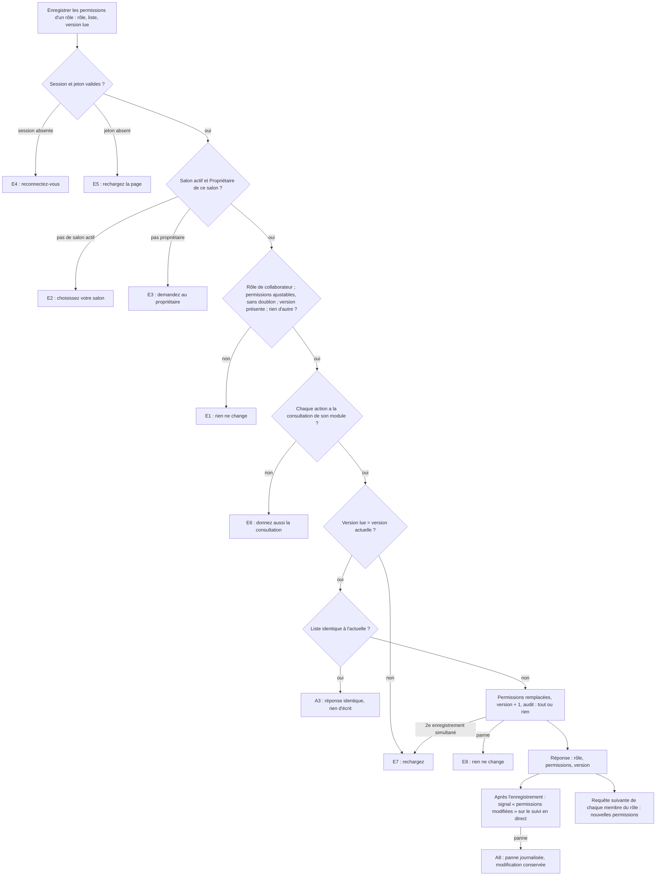
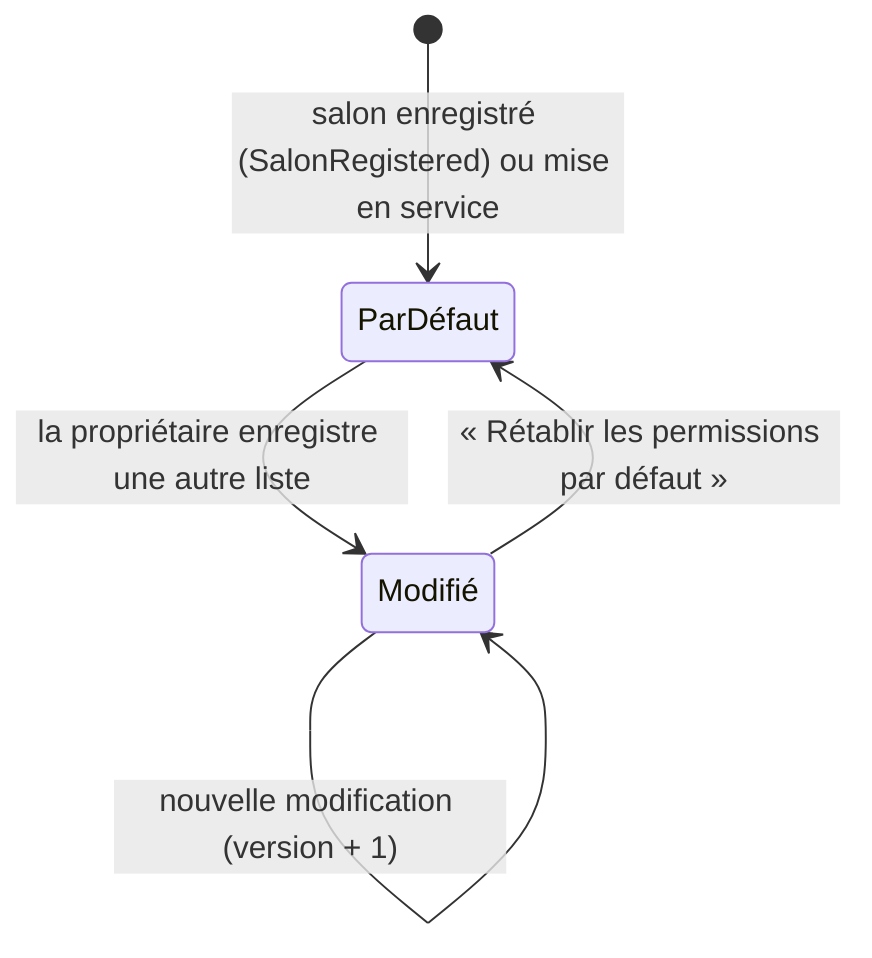

# UC-008 — Ajuster les permissions des rôles de son salon

| Champ | Valeur |
|---|---|
| Statut | Prêt pour dev (D-050 à D-052) |
| Priorité | Must |
| Module | `organizations` (impacts : `shared` pour `ActorRights` et le suivi en direct, `identity` pour le résumé de session) |
| Auteur | use-case-writer |
| Date | 2026-11-20 |
| Use cases liés | UC-004 (précède : le salon naît avec l'appartenance « Propriétaire » et l'événement `SalonRegistered`, sur lequel UC-008 recopie les permissions par défaut, D-038), UC-005 (salon actif ; droits relus à chaque requête), UC-006 (la règle « pas plus de droits que soi » lit désormais les permissions du rôle **dans ce salon**, T28), UC-007 (une invitation reste valable si son auteur perd le droit d'inviter, D-049), UC-010 (chaque nouveau salon reçoit les permissions par défaut par le même événement), **UC-011 « Gérer l'équipe du salon »** (suit : changer le rôle d'un collaborateur, le retirer, le réintégrer), **UC-012 « Attribuer et retirer un rôle système »** (suit : rôles système GoMeCoiffer) |
| Exigences couvertes | EX-007, EX-011 (en partie), EX-012 (en partie), EX-014, EX-016, EX-017, EX-020, EX-023, EX-024, EX-025, EX-038 (en partie), EX-039, BR-11 (en partie), BR-12, D-003, D-026 (inchangé), D-031, D-034, D-037, D-038, D-041, D-042 |

## 0. Traçabilité

| Exigence | Source | Où elle est traitée dans ce UC |
|---|---|---|
| EX-016 | prd.md §6 Fonctionnement attendu « Chaque rôle possède des permissions par défaut », « Le propriétaire peut les modifier depuis Paramètres → Rôles et permissions », « autoriser ou désactiver l'accès à un module », « s'appliquent immédiatement après validation » | RG-008-05, RG-008-09, RG-008-10, flux nominal, scénarios « Un nouveau salon reçoit… », « …donne l'accès aux finances… », « Une permission retirée est refusée dès la requête suivante… » |
| EX-039 | prd.md §7 Étape 6 « Présentation des autorisations par défaut. Le propriétaire peut les conserver ou les personnaliser. » | RG-008-05, RG-008-17, A6, scénarios « Un nouveau salon reçoit… », « La propriétaire voit les rôles de son salon… » |
| EX-014 | prd.md §5.1 « Les droits essentiels de propriété ne sont pas désactivables » ; §6 « Certaines actions sensibles restent protégées » | RG-008-03, RG-008-04, scénarios « Le rôle Propriétaire garde tous les droits… », plans « Seuls les quatre rôles… », « Les droits réservés au propriétaire… » |
| EX-017 | prd.md §6 Restriction « aucun administrateur salon ne peut … s'attribuer les droits réservés au propriétaire » ; §5.2 « paramètres de propriété, de facturation SaaS et de destination des fonds restent protégés » ; §5.4 « ne peut pas modifier … les permissions sensibles » | RG-008-01, RG-008-04, RG-008-12, plans « Seule la propriétaire règle… », « Un administrateur n'invite qu'à un rôle… », scénario « Même avec toutes les permissions ajustables… » |
| EX-007, D-003 | prd.md §3 « Les permissions sont évaluées par salon » ; §6 « Une personne peut avoir des permissions différentes dans deux salons » | RG-008-06, RG-008-07, scénarios « …rôle par rôle et salon par salon », « Les réglages visent toujours le salon ouvert » |
| EX-011, EX-012 | prd.md §2 Règle d'architecture, §4 | RG-008-03, RG-008-18, plan « Seuls les quatre rôles… » (rôle système refusé), scénario `@apres-UC-012` ; attribution des rôles système : UC-012 |
| EX-023 | prd.md §11 « Les modifications sensibles de permissions … trace d'audit » | RG-008-15, scénario « Chaque modification est tracée… » |
| EX-024, BR-12 | prd.md §12 Sécurité, §9 BR-12 | RG-008-01, RG-008-02, scénarios `@securite` |
| BR-11 | prd.md §9 « Un collaborateur ne consulte que les informations nécessaires à ses permissions » ; §5.3 « Par défaut, ce rôle n'accède pas aux finances globales » | RG-008-05 (moindre privilège par défaut), RG-008-11 |
| EX-038 | prd.md §7 Étape 4 (explication simple des rôles) | §15 Guidage (description de chaque rôle sur l'écran des rôles) |
| EX-020 | prd.md §7 introduction | §10 (chaque refus dit quoi faire), §15 Guidage |
| D-038 | DECISIONS.md « rôles salon prédéfinis décidés dans UC-008, branché sur `SalonRegistered` » | RG-008-05, §18 |
| D-042, BACKLOG « Invitations » | DECISIONS.md ; `RoleGrantPolicy` doit lire les permissions du rôle visé dans ce salon | RG-008-12, plan « Un administrateur n'invite qu'à un rôle… » (active UC-006 T28) |
| D-037, D-031 | DECISIONS.md (droits relus à chaque requête ; version des identifiants) | RG-008-10, §18 (`SqlActorRights` garde `credentialsVersion`) |

## 1. Objectif

Permettre au propriétaire de **décider ce que chaque rôle peut faire dans son salon**, en partant de permissions par
défaut sûres : il ouvre ou ferme l'accès à un module (réservations, finances, personnel…) pour tous les
administrateurs, coiffeurs, responsables financiers ou praticiens **de ce salon**, et le changement vaut tout de suite.
Ses propres droits de propriétaire restent entiers et personne d'autre ne peut les obtenir.

## 2. User story

> En tant que **propriétaire d'un salon**,
> je veux **voir les permissions de chaque rôle de mon salon et les ajuster**,
> afin que **chaque membre de mon équipe ait exactement les accès utiles à son travail, sans jamais toucher à ce qui
> relève de la propriété (abonnement, destination des fonds, salons)**.

## 3. Acteurs

- **Acteur principal** : le propriétaire, connecté, dans son salon actif (seul détenteur de « Rôles et permissions :
  administrer », Q1).
- **Acteurs secondaires** :
  - les **membres** du salon dont le rôle est réglé (administrateur, coiffeur, responsable financier, praticien) : ils
    subissent l'effet dès leur requête suivante et sont prévenus par le suivi en direct ;
  - un **administrateur de salon** ou tout autre membre qui tente de régler les rôles (E3) ;
  - l'**enregistrement d'un salon** (UC-004, UC-010) : l'événement `SalonRegistered` déclenche la recopie des
    permissions par défaut ;
  - le **suivi en direct** (service interne, peut être indisponible : A8).

## 4. Déclencheur

- Le propriétaire ouvre **Paramètres → Rôles et permissions** dans le back-office, ou l'étape 6 de l'onboarding
  (« Vérification des permissions »), choisit un rôle, coche ou décoche des permissions, puis valide « Enregistrer ».
- Secondaires : il consulte seulement l'écran (A6) ; il choisit « Rétablir les permissions par défaut » (A2).
- Système : un salon est enregistré (`SalonRegistered`) → permissions par défaut recopiées (RG-008-05).

## 5. Préconditions

- Une session authentifiée est ouverte, avec un jeton de sécurité (CSRF) valide.
- Un salon est actif dans la session (UC-004 ou UC-005).
- L'utilisateur est **Propriétaire** de ce salon (appartenance « Propriétaire » et propriété de l'organisation, D-041).
- Les quatre rôles de collaborateur du salon ont un réglage enregistré (recopié à la création du salon, ou à la mise
  en service pour les salons existants, RG-008-05).

## 6. Postconditions

- **En cas de succès (modification)** :
  - le rôle visé a, **dans le salon actif seulement**, exactement les permissions validées ; sa version augmente de 1 ;
  - les autres rôles du salon et le même rôle dans les autres salons sont inchangés ;
  - chaque membre de ce rôle dans ce salon a ces permissions **dès sa requête suivante**, sans reconnexion ;
  - « permissions d'un rôle modifiées » est tracé (permissions ajoutées et retirées), dans la même transaction ;
  - un signal « permissions modifiées » part sur le suivi en direct du salon, après l'enregistrement ;
  - la session du propriétaire n'est pas régénérée (ses droits ne changent pas).
- **En cas de succès sans changement** (A3) : rien n'est écrit, aucune trace, aucun signal.
- **En cas d'échec** : aucune permission, aucune version, aucune trace ni signal ne change ; l'écran garde la saisie.

## 7. Règles métier

| ID | Règle | Exemple | Source |
|---|---|---|---|
| RG-008-01 | Seul un utilisateur **connecté**, avec un **salon actif**, qui y est **Propriétaire**, consulte et modifie les permissions des rôles de ce salon (permission « Rôles et permissions : administrer », réservée au propriétaire, RG-008-04). Salon et auteur sont lus dans la session ; la demande ne porte que le **rôle visé**, la **liste des permissions** et la **version lue** à l'écran. | Mireille, dans « Go Beauty Akwa » → acceptée. Rodrigue (Administrateur de salon), Awa (Coiffeur), Hortense (Responsable financier) → 403 « Votre rôle dans ce salon ne permet pas cette action : demandez-la au propriétaire. » | EX-016, EX-017, EX-024, D-003, CLAUDE.md §I.4 ; [HYPOTHÈSE] propriétaire seul — **Q1** |
| RG-008-02 | **Catalogue des permissions du salon** (PRD §6), 17 permissions : Tableau de bord : consulter ; Réservations : voir les siennes, voir toutes, gérer ; Disponibilités : modifier les siennes, gérer celles de l'équipe ; Prestations : consulter, gérer ; Personnel : consulter, inviter, gérer ; Finances : consulter, déclarer un encaissement, exporter ; Paramètres salon : consulter, modifier ; Rôles et permissions : administrer. La liste envoyée ne contient que des permissions **ajustables** de ce catalogue (les 16 premières), **chacune une fois** ; toute autre information (permission inconnue, doublon, salon, personne, absence de version) fait refuser la demande entière (400). | « Réservations : supprimer » → 400 ; « Réservations : voir les siennes » deux fois → 400 ; demande avec « salon : Go Beauty Bastos » → 400, rien ne change. | prd.md §6 Modules contrôlables, EX-024, CLAUDE.md §I.4 (mode strict) |
| RG-008-03 | **Rôles réglables** : les **quatre rôles de collaborateur** seulement (Administrateur de salon, Coiffeur / Coiffeuse / Barbier, Responsable financier, Praticien / Praticienne de beauté). Le rôle **Propriétaire** n'est pas réglable : il a **toujours** les 17 permissions et les droits réservés. Un rôle système ou un métier n'est pas un rôle salon : le viser est refusé (400). Aucun rôle ne se crée ni ne se supprime au MVP. | « Propriétaire », « Super Administrateur », « Esthéticienne » → 400. | EX-014, EX-011, EX-015, prd.md §6 « profils prédéfinis … suffisent » ; [HYPOTHÈSE] pas de rôle créé — Q3 |
| RG-008-04 | **Droits réservés au propriétaire**, jamais donnés à un autre rôle : **Rôles et permissions : administrer**, **Gérer les salons de l'organisation**, **Gérer l'abonnement**, **Gérer les comptes de règlement (destination des fonds)**. Une demande qui en contient un est refusée (400) ; le domaine le refuse aussi si le contrôle de forme est contourné. Les trois derniers ne sont accordés qu'au propriétaire **réel** de l'organisation (déjà le cas, UC-004). | Ajouter « Gérer l'abonnement » à l'Administrateur → 400, rien ne change. | EX-014, EX-017, prd.md §5.1, §5.2, §6 « actions sensibles restent protégées » ; [HYPOTHÈSE] « administrer » réservé — **Q1** |
| RG-008-05 | **Permissions par défaut** (oui = accordée) : voir le tableau sous ces règles. Elles sont **recopiées dans chaque salon** à son enregistrement (même transaction que la création du salon, UC-004 et UC-010) ; les salons existants les reçoivent à la mise en service de ce use case. Changer un jour les valeurs par défaut de GoMeCoiffer ne modifie **pas** les salons existants. | « Élégance Bonamoussadi », créé le 20/11 à 10 h 00 : le Coiffeur a exactement « Réservations : voir les siennes » et « Disponibilités : modifier les siennes ». | EX-016, EX-039, prd.md §5.2-5.5, BR-11, D-038, A-23 ; [HYPOTHÈSE] valeurs — **Q2**, recopie — Q6 |
| RG-008-06 | Le réglage vaut **pour un rôle dans un salon** : il s'applique à **toutes** les personnes qui ont ce rôle dans ce salon, et à elles seules. Il ne change ni les autres rôles du salon, ni le même rôle dans les autres salons (même de la même organisation). **Pas de réglage par personne** : pour un cas particulier, on change le rôle de la personne (UC-011). | Mireille donne « Finances : consulter » à l'Administrateur d'Akwa : Rodrigue l'a dans Akwa, pas dans Bastos où il est aussi Administrateur. | EX-007, EX-016, prd.md §6 « droits des rôles de son établissement » ; [HYPOTHÈSE] — **Q3** |
| RG-008-07 | Une personne a, **dans chaque salon**, les permissions de **son rôle dans ce salon**, et rien d'un autre salon. | Rodrigue : Administrateur d'Akwa avec les finances, Administrateur de Bastos sans ; dans Bastos, « Finances : consulter » lui est refusé. | EX-007, prd.md §6 « permissions différentes dans deux salons », D-003 |
| RG-008-08 | **Une action demande la consultation du même module** : Réservations : gérer → voir toutes ; Prestations : gérer → consulter ; Personnel : inviter ou gérer → consulter ; Finances : déclarer un encaissement ou exporter → consulter ; Paramètres salon : modifier → consulter. Une liste qui ne respecte pas cela est refusée (422), en nommant les deux permissions. L'écran coche la consultation avec l'action et décoche l'action avec la consultation. Disponibilités et « voir les siennes » n'ont pas de dépendance. | Responsable financier avec « Finances : exporter » sans « Finances : consulter » → 422 « Pour donner « Finances : exporter », donnez aussi « Finances : consulter ». » | prd.md §6 (actions par module) ; [HYPOTHÈSE] — Q5 |
| RG-008-09 | La modification **remplace** l'ensemble des permissions du rôle par la liste validée (les cases cochées). Une liste **vide** est permise : les membres de ce rôle gardent leur appartenance et peuvent ouvrir le salon, sans accès à aucun module. | Mireille décoche tout pour le Praticien : Grâce ouvre toujours Akwa, sans aucun module. | prd.md §6 « autoriser ou désactiver l'accès à un module » ; [HYPOTHÈSE] liste vide — Q8 |
| RG-008-10 | **Effet immédiat** : dès la réponse, **chaque requête** d'un membre de ce rôle dans ce salon applique les nouvelles permissions (droits relus à chaque requête) ; personne n'est déconnecté, aucune session n'est fermée ni régénérée, aucun salon actif ne change. Après l'enregistrement, un **signal « permissions modifiées »** (rôle seulement, sans liste ni donnée personnelle) part sur le suivi en direct du salon pour que les écrans ouverts relisent leurs droits **en moins de 5 s** ; une panne du suivi en direct est journalisée et n'annule rien. | 10 h 00 : Mireille retire « Personnel : inviter » à l'Administrateur ; 10 h 00 min 01 s : l'invitation envoyée par Rodrigue est refusée (403) ; Rodrigue reste connecté dans Akwa. | EX-016 « s'appliquent immédiatement », D-037, prd.md §12 Disponibilité (< 5 s), EX-036 ; [HYPOTHÈSE] — Q7 |
| RG-008-11 | Chaque membre connaît **ses propres permissions dans le salon actif** : le résumé de session les porte (pour afficher ses menus et ses boutons). Il n'y voit **ni** les permissions des autres rôles **ni** celles d'un autre salon ; sans salon actif, la liste est vide. | Awa, dans Akwa : « Réservations : voir les siennes », « Disponibilités : modifier les siennes ». | BR-11, D-003, BACKLOG (front : `<RequirePermission>`) |
| RG-008-12 | **Pas d'élévation de droits à l'invitation** (UC-006 RG-006-04, D-042) : les permissions du rôle proposé sont lues **dans ce salon, à la même source que les droits relus à chaque requête**. L'annulation d'une invitation suit la même règle. Une invitation déjà envoyée reste valable si son auteur perd ensuite le droit d'inviter (D-049). | Rodrigue (Administrateur par défaut) invite un Coiffeur → enregistrée ; un Responsable financier → 422 ; après que Mireille a donné à l'Administrateur les trois permissions des finances → enregistrée. Si le Coiffeur d'Akwa reçoit « Finances : consulter », Rodrigue ne peut plus inviter de Coiffeur dans Akwa. | EX-017, D-042, D-049, BACKLOG « Invitations » |
| RG-008-13 | Enregistrer une liste **identique** à l'état actuel est accepté **sans rien écrire** : version inchangée, aucune trace, aucun signal. | Double clic sur « Enregistrer » sans rien changer → réponse identique, journal inchangé. | [HYPOTHÈSE] — Q9 |
| RG-008-14 | **Concurrence** : chaque rôle d'un salon a sa **version**. Un enregistrement fait à partir d'une version périmée (autre écran, autre appareil) est refusé (409) et ne change rien ; deux enregistrements simultanés du **même** rôle : **un seul** réussit ; deux rôles **différents** se règlent en même temps sans se gêner. | Tablette ouverte sur la version 3, téléphone enregistre la version 4 ; la tablette enregistre → 409 « Les permissions de ce rôle viennent d'être modifiées sur un autre écran. Rechargez pour voir la version à jour, puis recommencez. » | EX-024, CLAUDE.md §I.5 (verrou optimiste) |
| RG-008-15 | **Audit** : chaque modification écrit « **permissions d'un rôle modifiées** » (salon, rôle, permissions **ajoutées**, permissions **retirées**, auteur, instant, « défaut rétabli » oui/non), **dans la même transaction** : modification et trace ensemble ou pas du tout. Jamais de nom ni de numéro. | Ajout de « Finances : consulter » et retrait de « Personnel : inviter » → une ligne, rôle `SALON_ADMIN`, ajoutée `finances:view`, retirée `staff:invite`, auteur Mireille, 20/11/2026 10 h 00. | EX-023, EX-025, prd.md §11, D-028 |
| RG-008-16 | **Rétablir les permissions par défaut** d'un rôle : l'écran remplit la liste avec les valeurs par défaut (RG-008-05) ; l'enregistrement suit toutes les règles d'une modification (version, audit avec « défaut rétabli »). | L'Administrateur d'Akwa, modifié, revient exactement à ses 12 permissions par défaut et est de nouveau indiqué « par défaut ». | prd.md §7 Étape 6 « conserver ou personnaliser » ; [HYPOTHÈSE] — Q9 |
| RG-008-17 | **Consulter les rôles** (propriétaire seulement, salon actif seulement) : le Propriétaire (« Tous les droits, non modifiables »), puis les quatre rôles de collaborateur dans l'ordre du PRD, chacun avec ses permissions actuelles, ses permissions par défaut, l'indication « par défaut » ou « modifié », le **nombre** de personnes qui ont ce rôle dans ce salon (sans leurs noms) et sa version. | Akwa : Propriétaire (1), Administrateur de salon (modifié, 1), Coiffeur (par défaut, 1), Responsable financier (par défaut, 1), Praticien (par défaut, 1). Depuis Bastos, Mireille voit les réglages de Bastos. | EX-016, EX-039, EX-024, BR-12 |
| RG-008-18 | **Rôles séparés** : régler les rôles d'un salon ne donne ni ne retire **aucun rôle système** ; aucune permission salon n'ouvre l'administration GoMeCoiffer et aucun rôle système ne donne de permission dans un salon. | Serge, Administrateur Opérations et Administrateur de salon d'Akwa : Mireille retire tout à l'Administrateur → Serge garde son rôle système, sans aucun module dans Akwa. | EX-011, EX-012, prd.md §2 Règle d'architecture, D-003 |

**Permissions par défaut (RG-008-05)** — [HYPOTHÈSE] à valider (Q2). Le Propriétaire a tout, toujours.

| Permission | Administrateur de salon | Coiffeur / Coiffeuse / Barbier | Responsable financier | Praticien / Praticienne de beauté | Source |
|---|---|---|---|---|---|
| Tableau de bord : consulter | oui | non | oui | non | §5.2 « supervise » ; §5.4 « totaux encaissés » ; tableau de bord F07 avec les paiements du jour → pas pour Coiffeur/Praticien (§5.3) [HYPOTHÈSE] |
| Réservations : voir les siennes | oui | oui | non | oui | §5.3 « Voir son planning », A-23 ; couvre aussi le traitement de ses rendez-vous (Q4) |
| Réservations : voir toutes | oui | non | oui | non | §5.2 « Organiser le planning » ; §5.4 « Consulter les réservations et montants » |
| Réservations : gérer | oui | non | non | non | §5.2 « Gérer les réservations », « Traiter les reprogrammations » |
| Disponibilités : modifier les siennes | oui | oui | non | oui | §5.3 « Mettre à jour sa disponibilité », A-23 |
| Disponibilités : gérer celles de l'équipe | oui | non | non | non | §5.2 « Déclarer des absences et indisponibilités », « leurs horaires » |
| Prestations : consulter | oui | non | non | non | §5.2 |
| Prestations : gérer | oui | non | non | non | §5.2 « Ajouter et modifier des prestations » ; §5.4 « ne peut pas modifier … les prix » |
| Personnel : consulter | oui | non | non | non | §5.2 « Gérer les collaborateurs » |
| Personnel : inviter | oui | non | non | non | §5.2, D-042 |
| Personnel : gérer | oui | non | non | non | §5.2 (changement de rôle, retrait : UC-011) |
| Finances : consulter | non | non | oui | non | §5.4 ; §5.3 « n'accède pas aux finances globales » |
| Finances : déclarer un encaissement | non | non | oui | non | §5.4 ; F04 « responsable autorisé » |
| Finances : exporter | non | non | oui | non | §5.4 |
| Paramètres salon : consulter | oui | non | non | non | [HYPOTHÈSE] |
| Paramètres salon : modifier | non | non | non | non | §5.1 « Configurer les paramètres commerciaux » (propriétaire) [HYPOTHÈSE] |
| Rôles et permissions : administrer | jamais | jamais | jamais | jamais | réservé (RG-008-04) |

## 8. Flux nominal

1. Mireille, dans « Go Beauty Akwa », ouvre **Paramètres → Rôles et permissions**.
2. Le système vérifie session, salon actif et qu'elle y est Propriétaire, puis affiche les rôles du salon (RG-008-01,
   RG-008-17).
3. Elle choisit « Administrateur de salon » et coche « Finances : consulter », « Finances : déclarer un
   encaissement » et « Finances : exporter » ; l'aide sous chaque permission dit ce qu'elle ouvre (§15).
4. Elle valide « Enregistrer ».
5. Le système vérifie la session, le jeton, le salon actif, le droit réservé et la forme de la demande : rôle
   réglable, permissions ajustables, sans doublon, version présente (RG-008-01 à RG-008-04).
6. Le système vérifie les dépendances entre permissions et la version (RG-008-08, RG-008-14).
7. Le système remplace les permissions du rôle dans ce salon, augmente sa version et trace « permissions d'un rôle
   modifiées », tout ou rien (RG-008-09, RG-008-15).
8. Le système répond avec le rôle, ses permissions et sa nouvelle version.
9. Après l'enregistrement, le système envoie le signal « permissions modifiées » sur le suivi en direct du salon
   (RG-008-10).
10. L'interface affiche « Permissions de l'Administrateur de salon enregistrées. Elles s'appliquent dès maintenant à
    l'équipe qui a ce rôle dans Go Beauty Akwa (1 personne). »
11. À sa requête suivante, Rodrigue a les trois permissions des finances dans Akwa, sans se reconnecter (RG-008-10).

## 9. Flux alternatifs

- **A1 — Retirer une permission** (étape 3) : Mireille décoche « Personnel : inviter » pour l'Administrateur ; même
  déroulement ; la prochaine invitation de Rodrigue est refusée (403), ses invitations déjà envoyées restent valables
  (RG-008-10, RG-008-12).
- **A2 — Rétablir les permissions par défaut** (étape 3) : l'écran remet les valeurs par défaut ; même déroulement,
  audit avec « défaut rétabli » (RG-008-16).
- **A3 — Aucun changement** (étape 7) : liste identique → réponse identique, rien d'écrit, aucun signal (RG-008-13).
- **A4 — Rôle vidé** (étape 3) : tout décoché ; l'aide prévient « Les personnes de ce rôle pourront ouvrir le salon
  mais ne verront aucun module. » ; même déroulement (RG-008-09).
- **A5 — Autre salon** (étape 1) : Mireille passe à « Go Beauty Bastos » (UC-005) ; l'écran et l'enregistrement visent
  Bastos seul (RG-008-06, RG-008-17).
- **A6 — Consulter et conserver** (étape 2, onboarding étape 6) : Mireille lit les permissions par défaut et choisit
  « Conserver ces permissions » : rien n'est écrit.
- **A7 — Ouvrir l'invitation à l'administrateur** : « Personnel : inviter » est accordé par défaut ; si Mireille
  donne aussi les finances à l'Administrateur, Rodrigue peut inviter un Responsable financier (RG-008-12).
- **A8 — Suivi en direct indisponible** (étape 9) : panne journalisée ; la modification est enregistrée et appliquée à
  la requête suivante de chaque membre (RG-008-10).
- **A9 — Nouveau salon** (système) : à l'enregistrement d'un salon (UC-004, UC-010), ses quatre rôles reçoivent les
  permissions par défaut, dans la même transaction ; un échec annule la création du salon (RG-008-05).

## 10. Flux d'exception

- **E1 — Saisie invalide** (étape 5) : rôle Propriétaire, rôle système ou métier visé ; permission inconnue, réservée
  ou en double ; information en trop ; version absente → « Certaines informations sont invalides : corrigez les
  champs signalés. » (400, par champ) ; rien ne change.
- **E2 — Aucun salon actif** (étape 5) : « Choisissez d’abord le salon sur lequel vous travaillez. » (403).
- **E3 — Pas propriétaire** (étapes 2 et 5) : « Votre rôle dans ce salon ne permet pas cette action : demandez-la au
  propriétaire. » (403), même pour un administrateur qui a les 16 permissions ajustables.
- **E4 — Session absente ou expirée** (étape 5) : « Session absente ou expirée : reconnectez-vous. » (401).
- **E5 — Jeton de sécurité absent ou périmé** (étape 5) : « Jeton de sécurité absent ou expiré : rechargez la page
  puis recommencez. » (403).
- **E6 — Permission sans sa consultation** (étape 6) : « Pour donner « Finances : exporter », donnez aussi « Finances :
  consulter ». » (422) ; rien ne change.
- **E7 — Version périmée ou enregistrement simultané** (étape 6-7) : « Les permissions de ce rôle viennent d'être
  modifiées sur un autre écran. Rechargez pour voir la version à jour, puis recommencez. » (409) ; l'interface relit
  le rôle.
- **E8 — Panne pendant l'enregistrement** (étape 7) : « Enregistrement impossible pour le moment. Réessayez dans
  quelques minutes. » (500, sans détail) ; rien ne change, aucune trace, aucun signal.

> Service tiers : aucun. Le suivi en direct est un service interne dont la panne ne fait jamais échouer la
> modification (A8).

## 11. Workflow



Réglage d'un rôle dans un salon :



## 12. Scénarios d'acceptation (BDD)

Identiques à `features/organizations/ajuster-les-permissions-des-roles.feature`.

```gherkin
# language: fr
@UC-008
Fonctionnalité: Ajuster les permissions des rôles de son salon
  Pour confier à chacun ce dont il a besoin, et rien de plus,
  la propriétaire part des permissions par défaut de chaque rôle et les ajuste pour le salon ouvert :
  le changement vaut tout de suite pour toutes les personnes de ce rôle dans ce salon, et nulle part ailleurs.

  Contexte:
    Étant donné que nous sommes le 20/11/2026 à 10 h 00, heure de Douala
    Et que l'organisation de Mireille Ndongo compte les salons "Go Beauty Akwa" et "Go Beauty Bastos"
    Et que les appartenances actives sont :
      | personne        | salon            | rôle                              |
      | Mireille Ndongo | Go Beauty Akwa   | Propriétaire                      |
      | Mireille Ndongo | Go Beauty Bastos | Propriétaire                      |
      | Rodrigue Etoa   | Go Beauty Akwa   | Administrateur de salon           |
      | Rodrigue Etoa   | Go Beauty Bastos | Administrateur de salon           |
      | Awa Tchoua      | Go Beauty Akwa   | Coiffeur / Coiffeuse / Barbier    |
      | Hortense Mballa | Go Beauty Akwa   | Responsable financier             |
      | Grâce Mbarga    | Go Beauty Akwa   | Praticien / Praticienne de beauté |
    Et que les rôles de "Go Beauty Akwa" et de "Go Beauty Bastos" ont leurs permissions par défaut
    Et que Mireille est connectée et travaille dans le salon "Go Beauty Akwa"

  @nominal @RG-008-05 @EX-016 @EX-039
  Scénario: Un nouveau salon reçoit les permissions par défaut de chaque rôle
    Étant donné que Clarisse Fotso vient de créer son organisation avec le salon "Élégance Bonamoussadi"
    Quand Clarisse consulte les rôles et permissions de "Élégance Bonamoussadi"
    Alors les permissions des rôles de collaborateur sont :
      | permission                                | Administrateur de salon | Coiffeur / Coiffeuse / Barbier | Responsable financier | Praticien / Praticienne de beauté |
      | Tableau de bord : consulter               | oui                     | non                            | oui                   | non                               |
      | Réservations : voir les siennes           | oui                     | oui                            | non                   | oui                               |
      | Réservations : voir toutes                | oui                     | non                            | oui                   | non                               |
      | Réservations : gérer                      | oui                     | non                            | non                   | non                               |
      | Disponibilités : modifier les siennes     | oui                     | oui                            | non                   | oui                               |
      | Disponibilités : gérer celles de l'équipe | oui                     | non                            | non                   | non                               |
      | Prestations : consulter                   | oui                     | non                            | non                   | non                               |
      | Prestations : gérer                       | oui                     | non                            | non                   | non                               |
      | Personnel : consulter                     | oui                     | non                            | non                   | non                               |
      | Personnel : inviter                       | oui                     | non                            | non                   | non                               |
      | Personnel : gérer                         | oui                     | non                            | non                   | non                               |
      | Finances : consulter                      | non                     | non                            | oui                   | non                               |
      | Finances : déclarer un encaissement       | non                     | non                            | oui                   | non                               |
      | Finances : exporter                       | non                     | non                            | oui                   | non                               |
      | Paramètres salon : consulter              | oui                     | non                            | non                   | non                               |
      | Paramètres salon : modifier               | non                     | non                            | non                   | non                               |
    Et chacun de ces rôles est indiqué « par défaut »

  @nominal @RG-008-05
  Scénario: Un salon créé avant les permissions ajustables reçoit les permissions par défaut
    Étant donné que le salon "Paul Barber Deïdo" a été créé avant la mise en service des permissions ajustables
    Quand les permissions ajustables sont mises en service
    Alors les quatre rôles de collaborateur de "Paul Barber Deïdo" ont leurs permissions par défaut

  @nominal @RG-008-03 @RG-008-04 @EX-014
  Scénario: Le rôle Propriétaire garde tous les droits et ne se règle pas
    Quand Mireille consulte les rôles et permissions de "Go Beauty Akwa"
    Alors le rôle "Propriétaire" apparaît avec les 17 permissions du salon et les droits réservés au propriétaire
    Et il est indiqué « Tous les droits, non modifiables »
    Et seuls les quatre rôles de collaborateur peuvent être modifiés

  @nominal @RG-008-17
  Scénario: La propriétaire voit les rôles de son salon, ce qui a changé et combien de personnes chacun concerne
    Étant donné que Mireille a ajouté "Finances : consulter" aux permissions de "Administrateur de salon"
    Quand Mireille consulte les rôles et permissions de "Go Beauty Akwa"
    Alors elle voit, dans cet ordre :
      | rôle                              | réglage        | personnes |
      | Propriétaire                      | non modifiable | 1         |
      | Administrateur de salon           | modifié        | 1         |
      | Coiffeur / Coiffeuse / Barbier    | par défaut     | 1         |
      | Responsable financier             | par défaut     | 1         |
      | Praticien / Praticienne de beauté | par défaut     | 1         |
    Et aucun nom de membre n'y apparaît

  @nominal @RG-008-09 @RG-008-10 @EX-016
  Scénario: La propriétaire donne l'accès aux finances à l'administrateur de son salon
    Étant donné que Rodrigue est connecté et travaille dans le salon "Go Beauty Akwa"
    Quand Mireille ajoute aux permissions de "Administrateur de salon" : "Finances : consulter", "Finances : déclarer un encaissement" et "Finances : exporter"
    Alors le rôle "Administrateur de salon" de "Go Beauty Akwa" a ces trois permissions en plus de ses permissions par défaut
    Et dès sa requête suivante, sans se reconnecter, Rodrigue a "Finances : consulter" dans "Go Beauty Akwa"

  @nominal @RG-008-11 @BR-11
  Scénario: Chaque membre connaît ses propres permissions dans le salon ouvert, et seulement les siennes
    Étant donné qu'Awa est connectée et travaille dans le salon "Go Beauty Akwa"
    Quand Awa consulte le résumé de sa session
    Alors elle y voit ses permissions dans "Go Beauty Akwa" : "Réservations : voir les siennes" et "Disponibilités : modifier les siennes"
    Et elle n'y voit les permissions d'aucun autre rôle ni d'aucun autre salon

  @alternatif @RG-008-10 @RG-008-12
  Scénario: Une permission retirée est refusée dès la requête suivante, sans déconnecter personne
    Étant donné que Rodrigue est connecté et travaille dans le salon "Go Beauty Akwa"
    Et que Mireille a retiré "Personnel : inviter" des permissions de "Administrateur de salon"
    Quand Rodrigue invite "Esther Ngo Bilong", au 6 77 88 99 00, comme "Coiffeur / Coiffeuse / Barbier"
    Alors l'invitation est refusée avec le motif "Votre rôle dans ce salon ne permet pas cette action : demandez-la au propriétaire."
    Et Rodrigue est toujours connecté et travaille toujours dans le salon "Go Beauty Akwa"

  @alternatif @RG-008-06 @RG-008-07 @EX-007
  Scénario: Les permissions se règlent rôle par rôle et salon par salon
    Quand Mireille ajoute "Finances : consulter" aux permissions de "Administrateur de salon"
    Alors Rodrigue a "Finances : consulter" dans "Go Beauty Akwa"
    Mais Rodrigue n'a pas "Finances : consulter" dans "Go Beauty Bastos"
    Et les permissions des autres rôles de "Go Beauty Akwa" n'ont pas changé

  @alternatif @securite @RG-008-12 @EX-017
  Plan du scénario: Un administrateur n'invite qu'à un rôle dont il a toutes les permissions dans ce salon
    Étant donné que, dans "Go Beauty Akwa", <réglage>
    Et que Rodrigue est connecté et travaille dans le salon "Go Beauty Akwa"
    Quand Rodrigue invite "Esther Ngo Bilong", au 6 77 88 99 00, comme "<rôle>"
    Alors l'invitation est <résultat>

    Exemples:
      | réglage                                                                                  | rôle                           | résultat                                                                                                                            |
      | les rôles ont leurs permissions par défaut                                               | Coiffeur / Coiffeuse / Barbier | enregistrée                                                                                                                         |
      | les rôles ont leurs permissions par défaut                                               | Responsable financier          | refusée avec le motif "Ce rôle donne des droits que vous n'avez pas dans ce salon : demandez au propriétaire d'envoyer l'invitation." |
      | l'Administrateur de salon a reçu en plus les trois permissions des finances              | Responsable financier          | enregistrée                                                                                                                         |
      | le Coiffeur / Coiffeuse / Barbier a reçu en plus "Finances : consulter"                  | Coiffeur / Coiffeuse / Barbier | refusée avec le motif "Ce rôle donne des droits que vous n'avez pas dans ce salon : demandez au propriétaire d'envoyer l'invitation." |

  @alternatif @RG-008-16
  Scénario: La propriétaire rétablit les permissions par défaut d'un rôle
    Étant donné que Mireille a ajouté les trois permissions des finances aux permissions de "Administrateur de salon"
    Quand Mireille rétablit les permissions par défaut de "Administrateur de salon"
    Alors le rôle "Administrateur de salon" de "Go Beauty Akwa" a de nouveau exactement ses permissions par défaut
    Et il est indiqué « par défaut »

  @alternatif @RG-008-13
  Scénario: Enregistrer sans rien changer ne modifie rien et ne laisse aucune trace
    Quand Mireille enregistre les permissions de "Coiffeur / Coiffeuse / Barbier" sans rien changer
    Alors l'enregistrement est accepté
    Et le journal d'audit n'a aucune nouvelle ligne
    Et aucun signal « permissions modifiées » n'est envoyé

  @alternatif @RG-008-09
  Scénario: Un rôle peut être laissé sans aucune permission, sans retirer personne de l'équipe
    Quand Mireille retire toutes les permissions de "Praticien / Praticienne de beauté"
    Alors le rôle "Praticien / Praticienne de beauté" de "Go Beauty Akwa" n'a plus aucune permission
    Et Grâce peut toujours ouvrir le salon "Go Beauty Akwa"

  @alternatif @RG-008-14
  Scénario: Deux rôles différents se règlent en même temps sans se gêner
    Quand Mireille enregistre en même temps un réglage de "Administrateur de salon" et un réglage de "Responsable financier"
    Alors les deux réglages sont enregistrés

  @alternatif @RG-008-15 @EX-023 @EX-025
  Scénario: Chaque modification est tracée, sans donnée personnelle
    Quand Mireille enregistre pour "Administrateur de salon" ses permissions par défaut avec "Finances : consulter" et sans "Personnel : inviter"
    Alors le journal d'audit contient « permissions d'un rôle modifiées » pour "Go Beauty Akwa", rôle "Administrateur de salon", par Mireille, le 20/11/2026 à 10 h 00
    Et cette ligne indique la permission ajoutée "Finances : consulter" et la permission retirée "Personnel : inviter"
    Et elle ne contient ni nom ni numéro de téléphone

  @alternatif @RG-008-10 @EX-036
  Scénario: Les écrans ouverts du salon sont prévenus en direct
    Étant donné que Rodrigue suit "Go Beauty Akwa" en direct
    Quand Mireille ajoute "Finances : consulter" aux permissions de "Administrateur de salon"
    Alors Rodrigue reçoit en moins de 5 secondes le signal « permissions modifiées » pour le rôle "Administrateur de salon"
    Et ce signal ne contient ni la liste des permissions ni aucune donnée personnelle

  @erreur @RG-008-10
  Scénario: Une panne du suivi en direct ne fait pas perdre la modification
    Étant donné que le suivi en direct est indisponible
    Quand Mireille ajoute "Finances : consulter" aux permissions de "Administrateur de salon"
    Alors la modification est enregistrée
    Et dès sa requête suivante, Rodrigue a "Finances : consulter" dans "Go Beauty Akwa"

  @erreur @securite @RG-008-03 @EX-014 @EX-011 @EX-015
  Plan du scénario: Seuls les quatre rôles de collaborateur se règlent
    Quand Mireille modifie les permissions du rôle "<rôle visé>"
    Alors la modification est refusée avec le motif "Certaines informations sont invalides : corrigez les champs signalés."
    Et aucune permission n'a changé dans "Go Beauty Akwa"

    Exemples:
      | rôle visé            | raison                                |
      | Propriétaire         | tous les droits, non modifiables      |
      | Super Administrateur | rôle système attribué par GoMeCoiffer |
      | Esthéticienne        | métier, pas un rôle                   |

  @erreur @securite @RG-008-04 @EX-014 @EX-017
  Plan du scénario: Les droits réservés au propriétaire ne se donnent à aucun autre rôle
    Quand Mireille ajoute "<droit réservé>" aux permissions de "Administrateur de salon"
    Alors la modification est refusée avec le motif "Certaines informations sont invalides : corrigez les champs signalés."
    Et les permissions de "Administrateur de salon" n'ont pas changé

    Exemples:
      | droit réservé                                          |
      | Rôles et permissions : administrer                     |
      | Gérer les salons de l'organisation                     |
      | Gérer l'abonnement                                     |
      | Gérer les comptes de règlement (destination des fonds) |

  @erreur @securite @RG-008-02
  Plan du scénario: La demande ne porte que des permissions du catalogue, chacune une fois, et la version lue
    Quand Mireille enregistre les permissions de "Coiffeur / Coiffeuse / Barbier" avec <anomalie>
    Alors la modification est refusée avec le motif "Certaines informations sont invalides : corrigez les champs signalés."
    Et les permissions de "Coiffeur / Coiffeuse / Barbier" n'ont pas changé

    Exemples:
      | anomalie                                             |
      | une permission inconnue « Réservations : supprimer » |
      | deux fois « Réservations : voir les siennes »        |
      | en plus le salon "Go Beauty Bastos"                  |
      | en plus la personne "Awa Tchoua"                     |
      | sans la version qu'elle a consultée                  |

  @erreur @RG-008-08
  Plan du scénario: Une action demande la consultation du même module
    Quand Mireille enregistre pour "Responsable financier" une liste qui contient "<action>" mais pas "<consultation>"
    Alors la modification est refusée avec le motif "Pour donner « <action> », donnez aussi « <consultation> »."
    Et les permissions de "Responsable financier" n'ont pas changé

    Exemples:
      | action                              | consultation                 |
      | Finances : exporter                 | Finances : consulter         |
      | Finances : déclarer un encaissement | Finances : consulter         |
      | Réservations : gérer                | Réservations : voir toutes   |
      | Prestations : gérer                 | Prestations : consulter      |
      | Personnel : inviter                 | Personnel : consulter        |
      | Personnel : gérer                   | Personnel : consulter        |
      | Paramètres salon : modifier         | Paramètres salon : consulter |

  @erreur @RG-008-01
  Plan du scénario: Sans session, sans jeton ou sans salon ouvert, rien ne change
    Étant donné que <situation>
    Quand Mireille ajoute "Finances : consulter" aux permissions de "Administrateur de salon"
    Alors la modification est refusée avec le motif "<motif>"
    Et les permissions de "Administrateur de salon" n'ont pas changé

    Exemples:
      | situation                                           | motif                                                                    |
      | la session de Mireille a expiré                     | Session absente ou expirée : reconnectez-vous.                           |
      | la demande de Mireille n'a pas de jeton de sécurité | Jeton de sécurité absent ou expiré : rechargez la page puis recommencez. |
      | Mireille vient de se connecter, sans salon ouvert   | Choisissez d’abord le salon sur lequel vous travaillez.                  |

  @erreur @RG-008-14
  Scénario: Un enregistrement fait à partir d'un écran périmé est refusé
    Étant donné que Mireille a ouvert les permissions de "Administrateur de salon" sur sa tablette
    Et qu'elle a ensuite ajouté "Finances : consulter" à ce rôle depuis son téléphone
    Quand Mireille enregistre depuis sa tablette les permissions de "Administrateur de salon" sans "Personnel : inviter"
    Alors la modification est refusée avec le motif "Les permissions de ce rôle viennent d'être modifiées sur un autre écran. Rechargez pour voir la version à jour, puis recommencez."
    Et le rôle "Administrateur de salon" a toujours "Finances : consulter" et "Personnel : inviter"

  @erreur @RG-008-15
  Scénario: Une panne pendant l'enregistrement ne change rien
    Étant donné que le service GoMeCoiffer tombe en panne pendant l'enregistrement
    Quand Mireille ajoute "Finances : consulter" aux permissions de "Administrateur de salon"
    Alors la modification est refusée avec le motif "Enregistrement impossible pour le moment. Réessayez dans quelques minutes."
    Et les permissions de "Administrateur de salon" n'ont pas changé
    Et le journal d'audit n'a aucune nouvelle ligne

  @securite @RG-008-01 @EX-017
  Plan du scénario: Seule la propriétaire règle les permissions des rôles
    Étant donné que <personne> est connecté(e) et travaille dans le salon "Go Beauty Akwa"
    Quand <personne> ajoute "Finances : consulter" aux permissions de "<rôle visé>"
    Alors la modification est refusée avec le motif "Votre rôle dans ce salon ne permet pas cette action : demandez-la au propriétaire."
    Et les permissions de "<rôle visé>" n'ont pas changé

    Exemples:
      | personne        | rôle visé                      |
      | Rodrigue Etoa   | Administrateur de salon        |
      | Awa Tchoua      | Coiffeur / Coiffeuse / Barbier |
      | Hortense Mballa | Administrateur de salon        |

  @securite @RG-008-01 @RG-008-04 @EX-017
  Scénario: Même avec toutes les permissions ajustables, un administrateur ne consulte ni ne règle les rôles
    Étant donné que Mireille a donné à "Administrateur de salon" les 16 permissions ajustables
    Et que Rodrigue est connecté et travaille dans le salon "Go Beauty Akwa"
    Quand Rodrigue consulte les rôles et permissions de "Go Beauty Akwa"
    Alors la consultation est refusée avec le motif "Votre rôle dans ce salon ne permet pas cette action : demandez-la au propriétaire."

  @securite @RG-008-01 @BR-12 @EX-024
  Scénario: Les réglages visent toujours le salon ouvert
    Étant donné que Mireille passe au salon "Go Beauty Bastos"
    Quand Mireille ajoute "Finances : consulter" aux permissions de "Administrateur de salon"
    Alors Rodrigue a "Finances : consulter" dans "Go Beauty Bastos"
    Mais les permissions de "Administrateur de salon" de "Go Beauty Akwa" n'ont pas changé

  @securite @RG-008-14
  Scénario: Deux enregistrements simultanés du même rôle : un seul réussit
    Quand Mireille enregistre en même temps, depuis deux écrans ouverts sur la même version, deux réglages différents de "Administrateur de salon"
    Alors un seul réglage est enregistré
    Et l'autre est refusé avec le motif "Les permissions de ce rôle viennent d'être modifiées sur un autre écran. Rechargez pour voir la version à jour, puis recommencez."
    Et le journal d'audit n'a qu'une nouvelle ligne

  @securite @RG-008-18 @EX-011 @EX-012 @apres-UC-012
  Scénario: Régler les rôles d'un salon ne donne ni ne retire aucun rôle système
    Étant donné que Serge Kamga a le rôle système "Administrateur Opérations" et est "Administrateur de salon" de "Go Beauty Akwa"
    Quand Mireille retire toutes les permissions de "Administrateur de salon"
    Alors Serge a toujours le seul rôle système "Administrateur Opérations"
    Et Mireille n'a toujours aucun rôle système
```

## 13. Plan de tests TDD

Ordre : du catalogue aux règles, puis persistance, puis HTTP. Unitaire = fakes in-memory ; intégration = vraie base
(Testcontainers) ; E2E = HTTP. `GetSalonRoles` et le résumé de session sont des queries : E2E seulement.

| # | Niveau | Comportement testé | Étant donné | Quand | Alors | Règle |
|---|---|---|---|---|---|---|
| T1 | Unitaire | Catalogue : 17 permissions, 16 ajustables ; réservées = `roles:administer` + 3 droits protégés ; aucune réservée n'est ajustable | — | lecture du catalogue | comme décrit | RG-008-02, -04 |
| T2 | Unitaire | Valeurs par défaut exactes des 4 rôles (tableau RG-008-05) ; `OWNER` n'a pas de défaut réglable | — | `defaultPermissionsOf(role)` | ensembles exacts | RG-008-05 |
| T3 | Unitaire | Liste vide acceptée ; permission inconnue, réservée ou en double refusée dans le domaine (`PermissionNotAdjustableError`) | — | VO `RolePermissionSet` | comme décrit | RG-008-02, -04, -09 |
| T4 | Unitaire | Dépendances : chacune des 7 actions sans sa consultation → `PermissionRequiresViewError(action, view)` ; avec les deux → accepté ; défauts des 4 rôles valides | — | VO `RolePermissionSet` | comme décrit | RG-008-08 |
| T5 | Unitaire | Réglage initial : `RolePermissions.initialize(salonId, role)` → défauts, version 0 ; `OWNER` refusé (`OwnerRoleNotAdjustableError`) | — | `initialize` | comme décrit | RG-008-03, -05 |
| T6 | Unitaire | `adjust(list, expectedVersion, author, now)` : remplace, version + 1, événement `RolePermissionsAdjusted { salonId, role, added, removed, resetToDefault }` ; liste identique → rien, aucun événement | réglage version 3 | `adjust` | comme décrit | RG-008-09, -13, -16 |
| T7 | Unitaire | Version périmée → `RolePermissionsChangedMeanwhileError` (409), rien ne change | réglage version 4, lu en 3 | `adjust` | refus | RG-008-14 |
| T8 | Unitaire | `AdjustRolePermissions` : charge le rôle **du salon actif** ; audit avec ajoutées / retirées ; aucun audit ni signal sur no-op ou refus ; signal programmé **après le commit** (`AfterCommit`) avec `{ role }` seulement | fakes | handler | comme décrit | RG-008-10, -13, -15 |
| T9 | Unitaire | Permissions d'un membre : `OWNER` → 17 (+ 3 protégés si propriétaire réel) ; autre rôle → réglage du salon ; réglage absent → aucune (refus par défaut) | lecture en mémoire | `permissionsOfMember` | comme décrit | RG-008-03, -07 |
| T10 | Unitaire | `RoleGrantPolicy` lit le réglage du salon : Administrateur par défaut → Coiffeur oui, Responsable financier non ; + 3 finances → oui ; Coiffeur + `finances:view` → Coiffeur non | port de lecture en mémoire | `assertCanGrant` | comme décrit | RG-008-12 |
| T11 | Unitaire | `WhenSalonRegistered` → `InitializeSalonRoles` : 4 réglages par défaut ; rejoué → rien de plus (idempotent) | fakes | événement | comme décrit | RG-008-05 |
| T12 | Intégration | Migration : table des réglages (clé salon + rôle, `CHECK` rôle ∈ 4, `CHECK` permissions ⊆ 16 ajustables), **recopie des défauts pour chaque salon existant**, `down` réel | base avec 2 salons existants | `migration:run` / `revert` | comme décrit | RG-008-05 |
| T13 | Intégration | Repository : verrou optimiste par rôle ; 2 `adjust` parallèles du même rôle → 1 réussite, 1 `RolePermissionsChangedMeanwhileError` ; 2 rôles différents → 2 réussites | vraie base | `save` ×2 | comme décrit | RG-008-14 |
| T14 | Intégration | `SqlActorRights` : permissions lues dans le réglage (une requête, clés primaires) ; propriétaire inchangé ; `credentialsVersion` toujours renvoyée ; réglage d'un autre salon jamais lu | vraie base | `resolve` | comme décrit | RG-008-07, -10 |
| T15 | Intégration | `CreateOrganization` : réglages créés dans la même transaction ; panne forcée → ni salon ni réglage | vraie base | commande | comme décrit | RG-008-05 |
| T16 | E2E | `PUT /api/salon/roles/SALON_ADMIN/permissions` (200) : `{ role, permissions, version }` ; requête suivante de Rodrigue : résumé de session avec `finances:view` ; aucune régénération de session | Mireille, Rodrigue | requêtes | comme décrit | RG-008-09, -10, -11 |
| T17 | E2E | Mode strict : rôle `OWNER`, `SUPER_ADMIN`, `ESTHETICIAN` ; permission inconnue, réservée, en double ; clés `salonId`, `userId` ; version absente → 400, rien ne change | Mireille | `PUT` | 400 | RG-008-02, -03, -04 |
| T18 | E2E | Dépendances → 422 `PERMISSION_REQUIRES_VIEW` avec les deux permissions | Mireille | `PUT` | 422 | RG-008-08 |
| T19 | E2E | Sans session 401 ; sans jeton 403 ; sans salon actif 403 ; Rodrigue, Awa, Hortense 403 ; Rodrigue avec les 16 permissions → `GET` et `PUT` 403 | — | requêtes | comme décrit | RG-008-01, -04 |
| T20 | E2E | Version périmée → 409 ; 2 `PUT` parallèles même rôle → 200 + 409, jamais 500, 1 ligne d'audit ; rôles différents → 2 × 200 | Mireille | requêtes | comme décrit | RG-008-14 |
| T21 | E2E | Isolation : depuis Bastos, `PUT` et `GET` visent Bastos ; Akwa inchangé ; Rodrigue a `finances:view` dans Bastos seulement | Mireille, Rodrigue | requêtes | comme décrit | RG-008-06, -07 |
| T22 | E2E | `GET /api/salon/roles` : propriétaire non modifiable, 4 rôles dans l'ordre, actuel + défaut + « modifié », nombre de membres, version, aucun nom ; **rapport d'index** (`query-perf`) | données du scénario | `GET` | comme décrit | RG-008-17 |
| T23 | E2E | `GET /api/salon/session` : `permissions` du salon actif seulement ; vide sans salon actif ; **rapport d'index** | Awa, Paul | `GET` | comme décrit | RG-008-11 |
| T24 | E2E | **UC-006 T28 activé** : Rodrigue → Coiffeur 201, Responsable financier 422 `ROLE_ABOVE_INVITER` ; après ajout des finances → 201 ; après retrait de `staff:invite` → 403 | Mireille, Rodrigue | requêtes | comme décrit | RG-008-10, -12 |
| T25 | E2E | Audit : 1 ligne par modification (ajoutées, retirées, défaut rétabli), aucune sur no-op ou refus, sans nom ni numéro | Mireille | requêtes | comme décrit | RG-008-13, -15, -16 |
| T26 | E2E | Suivi en direct : le flux de Rodrigue reçoit `{ type: 'salon.role_permissions_changed', payload: { role } }` ; publication en panne → 200 et effet à la requête suivante | flux SSE ouvert | `PUT` | comme décrit | RG-008-10 |
| T27 | E2E | Panne forcée à l'enregistrement → 500 sans détail ; rien ne change ; même saisie ensuite → 200 | Mireille | `PUT` | comme décrit | RG-008-15 |
| T28 | E2E | `@apres-UC-012` : rôles système inchangés après un réglage | Serge | `PUT` | comme décrit | RG-008-18 |
| T29 | Mutation | Stryker sur `RolePermissionSet` (dépendances, réservées), `defaultPermissionsOf`, `permissionsOfMember`, `RoleGrantPolicy` | — | `pnpm mutation` | aucun mutant survivant sur ces règles | RG-008-04, -05, -08, -12 |

Doubles de test : horloge fixe ; générateur d'identifiants ; repository des réglages en mémoire ; lecture
`SalonRolePermissions` en mémoire ; journal d'audit en mémoire ; `RealtimePublisher` en mémoire (panne forçable).

## 14. Données

- **Entrées — modifier** :
  - chemin : `role` ∈ `SALON_ADMIN` | `HAIRDRESSER` | `FINANCE_MANAGER` | `PRACTITIONER` ;
  - corps strict : `permissions` — liste sans doublon, chaque code parmi les 16 ajustables (vide permise) ;
    `version` — entier ≥ 0, la version lue à l'écran ; `resetToDefault` — booléen facultatif (audit seulement, la
    liste reste la seule source) ;
  - lus par la couche HTTP, pas dans le corps : auteur et salon actif (session), jeton de sécurité.
- **Codes** (contrat) : `dashboard:view`, `bookings:view-own`, `bookings:view-all`, `bookings:manage`,
  `availability:edit-own`, `availability:manage-team`, `services:view`, `services:manage`, `staff:view`,
  `staff:invite`, `staff:manage`, `finances:view`, `finances:record-payment`, `finances:export`,
  `salon-settings:view`, `salon-settings:edit` ; réservés : `roles:administer`, `organization:manage-salons`,
  `subscription:manage`, `payout-accounts:manage`.
- **Sorties** :
  - modifier (200) : `{ role, permissions, version }` ;
  - consulter (200) : `{ owner: { permissions, reservedRights, members }, roles: [{ role, permissions,
    defaultPermissions, isDefault, members, version }] }` ;
  - résumé de session : champ `permissions` (salon actif) ajouté ;
  - signal en direct : `{ type: 'salon.role_permissions_changed', payload: { role } }` ;
  - refus : `VALIDATION_FAILED` 400, `UNAUTHENTICATED` 401, `CSRF_INVALID` / `FORBIDDEN` 403,
    `ROLE_PERMISSIONS_CHANGED_MEANWHILE` 409, `PERMISSION_REQUIRES_VIEW` 422, 500 sans détail.
- **Stocké** : un réglage par (salon, rôle de collaborateur) : permissions, version, modifié le, modifié par ; ligne
  d'audit `ROLE_PERMISSIONS_ADJUSTED`.
- **Jeux de données** :
  - Mireille Ndongo (6 77 12 34 56) : Propriétaire de « Go Beauty Akwa » (Douala, Akwa) et « Go Beauty Bastos »
    (Yaoundé, Bastos) ;
  - Rodrigue Etoa (6 94 55 66 77) : Administrateur de salon d'Akwa et de Bastos ;
  - Awa Tchoua (6 66 10 20 30) : Coiffeur d'Akwa ; Hortense Mballa (6 75 40 30 20) : Responsable financier d'Akwa ;
    Grâce Mbarga (6 70 11 22 33) : Praticienne de beauté d'Akwa ;
  - Clarisse Fotso : nouvelle organisation « Élégance Bonamoussadi » ; Paul Ebode : « Paul Barber Deïdo », salon
    antérieur à la mise en service ;
  - Serge Kamga : Administrateur Opérations (`@apres-UC-012`).
- **Seed de démo** (idempotent) : réglages par défaut des salons de démo, plus l'Administrateur d'Akwa avec
  « Finances : consulter » (écran « Rôles et permissions » non uniforme) ; un membre de démo par rôle dans Akwa,
  pour que les nombres de personnes ne soient pas à 0.

## 15. Exigences non fonctionnelles

- **Sécurité** : routes `/api/salon/roles*`, `@RequiresPermission('roles:administer')` (jamais accordée hors
  `OWNER`) + CSRF ; salon et auteur lus dans la session ; schéma strict ; aucun nom ni numéro dans la réponse, l'audit,
  les événements ou le signal en direct. Périmètre critique (autorisation, permissions, droits protégés du
  propriétaire, isolation entre salons, SQL sur les droits) : `security-reviewer` obligatoire.
- **Performance** : modification < 200 ms côté serveur ; consultation < 100 ms ; résolution des droits à chaque
  requête : **une** lecture par clés primaires (aucune requête de plus qu'aujourd'hui).
- **Effet** : nouvelles permissions appliquées à 100 % des requêtes reçues après la réponse ; écrans connectés
  prévenus en moins de 5 s (PRD §12).
- **Audit** : 100 % des modifications effectives tracées dans leur transaction.
- **Guidage** (CLAUDE.md, tous modes) :
  - sous chaque rôle (phrases du PRD §7 Étape 4) : Administrateur de salon « Organise le salon au quotidien. » ;
    Coiffeur / Coiffeuse / Barbier « Effectue les prestations capillaires. » ; Responsable financier « Suit les
    encaissements. » ; Praticien / Praticienne de beauté « Réalise les soins qui lui sont attribués. » ; Propriétaire
    « Garde le contrôle général : tous les droits, non modifiables. » ;
  - sous chaque permission, une aide courte (exemples) : « Finances : consulter » → « Voit les paiements en ligne,
    les encaissements et les totaux du salon. » ; « Personnel : inviter » → « Peut faire entrer de nouvelles
    personnes, seulement avec un rôle qui n'a pas plus de droits que le sien. » ; « Réservations : voir les
    siennes » → « Voit et traite ses propres rendez-vous : démarrer, terminer, client absent, nouvel horaire. » ;
    « Paramètres salon : modifier » → « Change les informations et réglages du salon. » ;
  - au-dessus des cases : « Ce réglage s'applique à toutes les personnes qui ont ce rôle dans ce salon, dès
    l'enregistrement. Vos autres salons ne changent pas. » ;
  - rôle vidé : « Les personnes de ce rôle pourront ouvrir le salon mais ne verront aucun module. » ;
  - droits réservés affichés grisés : « Réservé au propriétaire : ne peut pas être donné. » ;
  - case d'action cochée → consultation cochée automatiquement, avec l'aide « Nécessaire pour … » ;
  - onboarding étape 6 : « Voici ce que chaque rôle peut faire. Vous pouvez garder ces réglages ou les changer, ici
    ou plus tard dans Paramètres. » + bouton « Conserver ces permissions » ;
  - après l'enregistrement : « Permissions de l'Administrateur de salon enregistrées. Elles s'appliquent dès
    maintenant à l'équipe qui a ce rôle dans Go Beauty Akwa (1 personne). » ;
  - écran d'un rôle utilisable à 390 px (une liste de cases par module, pas un tableau large).

## 16. Hors périmètre

- **Changer le rôle d'un collaborateur, le retirer de l'équipe, le réintégrer** (réactivation d'une appartenance
  retirée), fermeture de ses flux en direct, liste de l'équipe : **UC-011** (voir §18).
- **Attribuer et retirer un rôle système**, premier Super Administrateur, rôles système dans `ActorRights` et le
  résumé de session : **UC-012** (voir §18).
- Réglage **par personne** ; création, renommage ou suppression de rôles ; constructeur de rôles (PRD §6).
- Déléguer « Rôles et permissions : administrer » à un autre rôle (Q1).
- Appliquer un réglage à **tous les salons** de l'organisation en une fois (Q10).
- Transférer la propriété ; plusieurs propriétaires.
- Les écrans et actions protégés par chaque permission : chaque lot pose `@RequiresPermission` avec ces codes
  (prestations lot 2, réservations lot 4, finances lots 4-5, tableau de bord lot 8).
- Écrans (front) : incrément séparé, avec les textes du §10 et du §15.

## 17. Questions ouvertes

Les questions **bloquantes** (Q1, Q2, Q3) changent les règles ; les autres ont une hypothèse retenue qui peut être
confirmée sans changer la structure du use case.

| # | Question | Option recommandée (hypothèse retenue) | Alternative et impact |
|---|---|---|---|
| Q1 | **Bloquante.** **Qui peut changer les permissions des rôles ?** Le PRD dit « le propriétaire peut les modifier » (§6) mais range aussi « Rôles et permissions : administrer » parmi les modules réglables (A-30). | **Le propriétaire seul.** « Rôles et permissions : administrer » ne se donne à personne (RG-008-01, RG-008-04). Pourquoi : quelqu'un qui règle les rôles peut se donner tous les accès (par exemple les finances) ; le PRD interdit à un administrateur de « s'attribuer les droits réservés au propriétaire ». Le propriétaire de plusieurs salons garde une seule personne responsable des accès. | **Le donner aussi à l'administrateur**, avec des garde-fous : il ne règle jamais son propre rôle et ne donne que des permissions qu'il a. Plus souple pour un propriétaire absent, mais plus de règles à construire et à tester (environ 1 jour de plus), et un risque d'erreur plus élevé sur un sujet de sécurité. |
| Q2 | **Bloquante.** **Permissions par défaut des 4 rôles** (tableau sous RG-008-05). Le PRD les décrit en phrases, sans le tableau de bord, les paramètres du salon ni le praticien (A-23, A-31). | **Le tableau proposé** : l'Administrateur organise tout le salon mais **sans les finances** et sans modifier les paramètres du salon ; le Coiffeur et le Praticien voient et traitent **leurs** rendez-vous et leurs disponibilités, **rien d'autre** (pas de tableau de bord, car il montre les paiements du jour) ; le Responsable financier voit le tableau de bord, toutes les réservations avec leurs montants et les finances. Pourquoi : chacun commence avec le minimum utile (PRD BR-11), et le propriétaire ouvre plus en un clic. | **Plus large** (le coiffeur voit le tableau de bord et la liste des prestations ; l'administrateur voit les finances) : moins de réglages au départ, mais des collaborateurs voient l'argent du salon sans que le propriétaire l'ait décidé. Toute ligne du tableau peut être changée sans changer le reste du use case. |
| Q3 | **Bloquante.** **Le réglage se fait-il par rôle (pour tout le salon) ou par personne ?** Peut-on créer ses propres rôles ? (A-32) | **Par rôle et par salon** (RG-008-06) : « tous les coiffeurs d'Akwa ». Pour un cas particulier, le propriétaire donne un autre rôle à la personne (UC-011). Pourquoi : c'est ce que dit le PRD (« profils prédéfinis avec permissions ajustables suffisent ») ; un écran simple, et deux coiffeurs du même salon ont toujours les mêmes accès. | **Par personne** (« Awa peut exporter, pas Paul ») : plus fin, mais un écran par personne, des droits difficiles à suivre quand l'équipe grandit, et la règle « pas plus de droits que soi » à l'invitation devient plus compliquée. Environ 2 jours de plus. |
| Q4 | Le PRD donne au Coiffeur « démarrer et terminer une prestation, signaler un client absent, proposer un nouveau créneau » (§5.3), sans action correspondante au §6 (A-29). | **« Réservations : voir les siennes » couvre aussi le traitement de ses propres rendez-vous** (aide sous la case). Le catalogue reste celui du PRD, une case de moins pour le propriétaire. | Ajouter « Réservations : traiter les siennes » : le propriétaire peut laisser un coiffeur voir sans agir, mais une case de plus, rarement utile. À décider avant le lot 4. |
| Q5 | Que faire d'une action donnée sans la consultation de son module (« exporter » sans « consulter ») ? | **Refuser** côté serveur (RG-008-08) ; l'écran coche la consultation automatiquement. Pas d'état incohérent (un bouton « Exporter » sur un écran qu'on ne peut pas ouvrir). | Accepter tel quel : plus simple, mais des réglages qui ne marchent pas et des questions au support. |
| Q6 | Les valeurs par défaut sont-elles **recopiées** dans chaque salon, ou lues dans un catalogue commun avec seulement les écarts ? | **Recopiées** à la création du salon (D-038, RG-008-05) : ce que le propriétaire voit est ce qui s'applique ; si GoMeCoiffer change un jour les valeurs par défaut, aucun salon existant ne reçoit de nouveaux accès sans le décider. | Catalogue commun + écarts : un changement de GoMeCoiffer s'applique à tous les salons d'un coup (pratique pour corriger), mais peut ouvrir des accès en silence. |
| Q7 | « Immédiatement » : que se passe-t-il pour une personne connectée dont les droits changent ? (A-33) | **Effet à sa requête suivante, sans déconnexion**, plus un signal en direct pour rafraîchir ses écrans (RG-008-10). | La déconnecter : plus visible, mais elle perd son travail en cours pour un simple ajout de droit. |
| Q8 | Peut-on retirer **toutes** les permissions d'un rôle ? | **Oui** (RG-008-09), avec une aide qui prévient. Retirer quelqu'un de l'équipe reste une action à part (UC-011). | Interdire la liste vide : protège d'une erreur, mais empêche de « geler » temporairement un rôle. |
| Q9 | Enregistrer sans changement, rétablir les valeurs par défaut | **Sans changement : rien d'écrit ni de trace** (RG-008-13). **Bouton « Rétablir les permissions par défaut »** par rôle (RG-008-16). | Tracer aussi les enregistrements sans changement : journal plus bruyant, sans information. |
| Q10 | Un propriétaire de plusieurs salons veut-il appliquer un réglage à tous ses salons d'un coup ? | **Pas au MVP** : salon par salon (PRD §3 « Chaque salon conserve … ses paramètres »). | « Appliquer à tous mes salons » : pratique pour une enseigne, mais une action multi-salons à sécuriser (un salon d'une autre organisation ne doit jamais être touché). |

## 18. Notes pour le tech lead

### Découpage du sujet « rôles » (justification)

UC-008 tel qu'annoncé dans l'index couvrait trois buts d'acteurs différents, sur trois routes et deux modules, avec
plus de 12 étapes : il est découpé en trois use cases livrables séparément.

| UC | But | Acteur | Routes | Points durs (recommandation provisoire, à rédiger) |
|---|---|---|---|---|
| **UC-008** (ce document) | Ajuster les permissions des rôles d'un salon | propriétaire | `/api/salon/roles*` | ci-dessus |
| **UC-011** Gérer l'équipe du salon | Voir l'équipe, changer le rôle d'un collaborateur, le retirer, le réintégrer | membre avec « Personnel : gérer » | `/api/salon/team*` | jamais le Propriétaire ni soi-même ; pas d'élévation (rôle actuel **et** nouveau rôle sans plus de droits que les siens) ; pas de « dernier propriétaire » au MVP (un seul propriétaire par organisation, D-035, rôle non modifiable) ; retrait = appartenance « retirée » (jamais supprimée, auditée), effet à la requête suivante et **fermeture immédiate de ses flux en direct** sur ce salon (BACKLOG) ; ses invitations envoyées restent valables (D-049) ; réintégration = nouvelle invitation acceptée qui **réactive** la même appartenance avec le nouveau rôle (unicité `(salon_id, user_id)`, UC-007) ; rendez-vous futurs d'un intervenant retiré : à trancher avec le lot 4. Reprend `@apres-UC-008` de UC-005 (T11/T23) et UC-007 (réactivation). |
| **UC-012** Attribuer et retirer un rôle système | Super Administrateur gère l'équipe GoMeCoiffer | Super Administrateur | `/api/admin/platform-roles*` | attribués par un Super Administrateur seulement, à un compte du personnel existant, **jamais à soi-même** ; premier Super Administrateur créé par une commande d'exploitation (hors HTTP) ; le dernier Super Administrateur ne peut pas être retiré ; plusieurs rôles système par personne permis (PRD §4) ; retrait → sessions de la personne fermées (version des identifiants ou équivalent) ; audit ; `ActorRights` et `GetMySession` renvoient enfin les rôles système (D-026 déjà appliqué par `AuthGuard`). Reprend `@apres-UC-008` de UC-002 (RG-002-12), UC-004 (T25) et UC-005 (T25). |

### Découpage de UC-008 (une intention = une commande ou une query)

| Élément | Type | Route | Protection | Effet / contenu |
|---|---|---|---|---|
| **`AdjustRolePermissions`** — régler les permissions d'un rôle | commande (`organizations`) | `PUT /api/salon/roles/:role/permissions` (200) | `@RequiresPermission('roles:administer')`, CSRF | charge le réglage `(salon actif, role)` ; `adjust(...)` ; repository (verrou optimiste) ; audit `ROLE_PERMISSIONS_ADJUSTED` ; signal par `AfterCommit` vers `RealtimePublisher.publishToSalon`. Réponse `{ role, permissions, version }`. |
| **`InitializeSalonRoles`** — recopier les défauts | commande interne, abonné `WhenSalonRegistered` (domaine, même transaction) | aucune | — | 4 réglages par défaut ; idempotente. Sert UC-004 et UC-010 sans les modifier. |
| **`GetSalonRoles`** — rôles et permissions du salon | query (SQL pur) | `GET /api/salon/roles` | `roles:administer` | réglages `WHERE salon_id = $1` + nombre d'appartenances actives par rôle `WHERE salon_id = $1 AND status = 'ACTIVE' GROUP BY role` ; défauts joints côté application (constante du domaine) ; rapport d'index (`query-perf`). |
| `GetMySession` (modifiée) | query (`identity`) | `GET /api/salon/session` | `@AuthenticatedOnly()` | ajoute `permissions` du salon actif, **même calcul** que `ActorRights` (port partagé) ; rapport d'index. |

- **Domaine** : remplacer l'agrégat prévu `SalonRoleSet` (`docs/domains.md`) par **un réglage par (salon, rôle)**
  (`RolePermissions` ou nom choisi par l'archi) : la version par rôle évite qu'un réglage de l'Administrateur bloque
  celui du Responsable financier (RG-008-14). VO `RolePermissionSet` (ajustables, sans doublon, dépendances) ;
  `defaultPermissionsOf(role)` ; erreurs `PermissionNotAdjustableError`, `PermissionRequiresViewError`,
  `OwnerRoleNotAdjustableError`, `RolePermissionsChangedMeanwhileError` ; événement `RolePermissionsAdjusted`
  (domaine, identifiants et codes seulement) à ajouter à `docs/events.md`, ainsi que l'abonné de `SalonRegistered`.
- **Une seule source des permissions** (BACKLOG « Invitations ») : un port de lecture
  `SalonRolePermissions` (`domain/repositories/read`, SQL pur dans `application/read-repositories`) utilisé par
  `RoleGrantPolicy` (via `InviteCollaborator` / `CancelInvitation`) ; `SqlActorRights` et `GetMySession` lisent la même
  table avec la même règle `permissionsOfMember` (propriétaire calculé, autres rôles lus). Supprimer le paramètre par
  défaut de `RoleGrantPolicy` (catalogue statique) : sans réglage lu, la politique refuse.
- **Persistance** : table `salon_role_permissions (salon_id FK, role CHECK ∈ 4, permissions text[] NOT NULL CHECK
  (permissions <@ ARRAY[16 codes]), version, updated_at, updated_by, PRIMARY KEY (salon_id, role))` ; migration
  écrite à la main avec **recopie des défauts pour les salons existants** (`INSERT … SELECT FROM salons`) et `down` ;
  `SqlActorRights` : `LEFT JOIN salon_role_permissions r ON r.salon_id = m.salon_id AND r.role = m.role` (clé
  primaire, aucune requête de plus).
- **Contrats** (`packages/contracts/organizations.ts`) : `AdjustablePermissionSchema` (16 codes),
  `AdjustableSalonRoleSchema` (4 rôles, = `InvitableSalonRoleSchema`), `AdjustRolePermissionsSchema { permissions,
  version, resetToDefault? }` strict, `RolePermissionsAdjustedSchema`, `SalonRolesSchema`, `DEFAULT_ROLE_PERMISSIONS`
  (pour l'écran et « Rétablir ») ; `SessionSummarySchema` + `permissions`. Libellés et aides côté front.
- **HTTP (D-034)** : mappers `to-adjust-role-permissions` (rôle du chemin validé par schéma), `to-get-salon-roles` ;
  pas de répondeur.
- **Catalogue** (`permission.enum.ts`) : figé tel quel (17 codes, Q4) ; ajouter la liste des ajustables et marquer
  `roles:administer` comme réservé (aujourd'hui dans `Permission`, distinct de `ProtectedOwnerRight`).

### Points de vigilance

- **Périmètre critique** : autorisation, droits protégés, isolation, SQL sur les droits → `security-reviewer`
  obligatoire dans les deux modes.
- **Refus par défaut** : un salon sans réglage (bug de recopie) donne **aucune** permission aux collaborateurs, jamais
  toutes ; T9, T14.
- **`credentialsVersion`** : `SqlActorRights` doit continuer à la renvoyer (D-031) ; rejouer les E2E de UC-003.
- **Pas de régénération de session** des membres dont les droits augmentent : on ne peut pas atteindre leurs cookies,
  et le risque visé par la régénération (identifiant de session posé avant l'authentification) ne s'applique pas à une
  session déjà authentifiée. À confirmer par la revue sécurité.
- **Suivi en direct** : le signal ne porte que le code du rôle ; le front relit `GET /api/salon/session` puis invalide
  ses tags. Les flux ne sont pas fermés (l'appartenance ne change pas) ; si un lot filtre un jour le contenu du flux par
  permission, revoir ce choix.
- **Ordre de déploiement** : la migration (avec recopie) passe avant le code qui lit la table ; `SqlActorRights` lit
  la table dès ce commit.
- **Tags `@apres-UC-008` existants** : UC-006 T28 → ce use case (T24) ; UC-005 T11/T23 et UC-007 réactivation →
  UC-011 ; UC-002 RG-002-12, UC-004 T25, UC-005 T25 → UC-012.

### Incréments livrables, dans l'ordre

1. Domaine : catalogue, défauts, `RolePermissionSet`, réglage, `permissionsOfMember` (T1-T7, T9).
2. Migration + recopie + repository + abonné `SalonRegistered` (T11-T13, T15).
3. Source unique : `SqlActorRights`, `RoleGrantPolicy` branchée sur le port, résumé de session (T10, T14, T23, T24).
4. `AdjustRolePermissions` + contrat + route + audit + signal (T8, T16-T21, T25-T27).
5. `GetSalonRoles` + rapport d'index (T22).
6. Seed (réglages, un membre par rôle), docs (`domains.md`, `events.md`, `migrations-history.md`), mutation (T29).
7. Front : Paramètres → Rôles et permissions, onboarding étape 6, `<RequirePermission>` avec les permissions du
   résumé de session, aides du §15.
8. `@apres-UC-012` : T28.

### Definition of Ready

- [x] Chaque exigence de la section 0 est couverte par au moins un scénario
- [x] Toutes les règles métier ont au moins un exemple
- [x] Tous les flux d'exception ont un scénario Gherkin (E1 par les plans de saisie, E2/E4/E5 par le plan « Sans
  session… », E3 par « Seule la propriétaire… » et « Même avec toutes les permissions… », E6 à E8 par leurs scénarios)
- [ ] Aucune question ouverte bloquante (Q1, Q2, Q3 à trancher)
- [x] Le plan TDD couvre chaque règle
- [x] Le `.feature` est synchronisé avec la section 12
