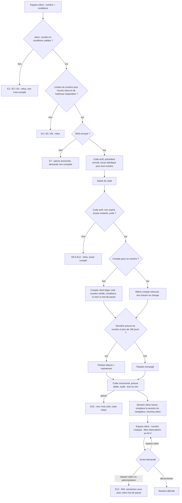

# UC-009 — Accéder à son espace client par code SMS (compte client léger)

| Champ | Valeur |
|---|---|
| Statut | Prêt pour dev (D-053 à D-055) |
| Priorité | Must |
| Module | `identity` (défi SMS motif `CLIENT_LOGIN`, compte client léger, session client) + `shared` (garde des espaces de routes) |
| Auteur | use-case-writer |
| Date | 2026-11-20 |
| Use cases liés | UC-001 (complète un compte client léger en compte propriétaire), UC-002 (refus identique d'un client léger à la connexion par mot de passe ; renvoi « Retrouvez vos réservations par SMS » ; déconnexion réutilisée), UC-003 (aucun code de réinitialisation pour un client léger ; la réinitialisation ferme aussi ses sessions client), UC-004 (un client léger ne crée pas d'organisation, E6 à aligner), UC-007 (un client léger invité est complété en compte du personnel), lot 4 (inclus par la réservation F03 étape 6 ; « Mes réservations ») |
| Exigences couvertes | EX-001, EX-013, EX-024, EX-025, EX-026, EX-027 (en partie), EX-028 (en partie : vérification du numéro), D-004, D-017, D-018, D-019, D-021, D-022, D-023, D-028, D-031 |

## 0. Traçabilité

| Exigence | Source | Où elle est traitée dans ce UC |
|---|---|---|
| D-018, EX-028 | DECISIONS.md ; prd.md F03 « Une vérification du numéro… permet de retrouver et modifier la réservation » | Flux nominal, RG-009-05, RG-009-07, scénarios « Une nouvelle cliente… », « Une cliente qui a déjà un compte… » |
| EX-001 | prd.md §3 « une identité de connexion unique » | RG-009-05, RG-009-14, scénarios « …retrouve le même compte », « Un membre du personnel qui vérifie son numéro… », « Deux vérifications simultanées… » |
| EX-013 | prd.md §4 « Le client de la marketplace est un utilisateur public, sans permission d'administration système » | RG-009-08, plan « Une session client n'ouvre aucun espace du salon ni de l'administration » |
| D-017 | DECISIONS.md (personnel : mot de passe ; SMS seulement pour les actions sensibles) | RG-009-08 (un code SMS n'ouvre jamais le back-office), scénario « Paul… n'ouvre que son espace client » |
| D-019 | DECISIONS.md (non-énumération) | RG-009-01, RG-009-10, plan « La demande de code reçoit la même réponse… », scénario « La réponse ne dit pas… » |
| D-021, D-023 | DECISIONS.md | RG-009-03, RG-009-04, plans « 60 secondes », « 5 par heure et 10 par 24 heures », scénarios « 10 codes faux », « autre motif », « simultanées », « panne » |
| D-022, EX-025 | DECISIONS.md ; prd.md §12 Données | RG-009-01 (conditions), RG-009-05 (ni nom, ni e-mail, ni mot de passe), RG-009-06 (numéro recyclé), RG-009-16 (audit sans numéro), scénario « Les conditions… » |
| D-004, D-028, D-031 | DECISIONS.md | RG-009-07, RG-009-11 à RG-009-13, scénarios « session », « déconnexion », « réinitialisation » |
| EX-024 | prd.md §12 Sécurité | RG-009-08, RG-009-14, scénarios `@securite` |
| EX-026 | prd.md §12 Dates | RG-009-06, RG-009-11 (instants en UTC, affichés à l'heure de Douala) |
| EX-027 | prd.md §1, §2.A « réserver sans application » | §1, §16 : l'espace client est une page web, aucune installation ; la consultation de la marketplace sans compte relève du lot 3 |

## 1. Objectif

Donner au client de la marketplace un **compte sans mot de passe** : il prouve son numéro par un code SMS, et une
**session client** s'ouvre sur son navigateur. Elle lui permettra de retrouver ses réservations (« Mes
réservations », lot 4) et sera reprise par l'étape « Fournir un numéro de téléphone » de la réservation (F03, lot 4).
Un même numéro reste **un seul utilisateur**, qu'il soit client, membre du personnel ou les deux ; mais un code SMS
n'ouvre **jamais** le back-office : le personnel y entre avec son mot de passe (D-017).

**Situation dans le parcours de réservation (PRD F03, F05)** : UC-009 ne crée ni ne montre de réservation. Il fournit
la **porte d'entrée client** (code, compte, session, séparation des espaces) que le lot 4 utilisera :
- F03 étape 6 « Fournir un numéro de téléphone » → la réservation **inclut** UC-009 si le lot 4 exige la vérification
  du numéro avant la confirmation (à décider au lot 4 : vérification ou lien sécurisé, F03) ;
- « Mes réservations / Reprogrammation » (PRD §13 Marketplace écran 6) → lecture du lot 4, filtrée par RG-009-06 ;
- F05 « Vue « Mes rendez-vous » » est celle du **professionnel** (back-office) : sans rapport avec l'espace client.

## 2. User story

> En tant que **client de la marketplace**,
> je veux **me faire reconnaître avec mon seul numéro de téléphone et un code reçu par SMS**,
> afin de **retrouver mes réservations sans créer de mot de passe ni installer d'application**.

## 3. Acteurs

- **Acteur principal** : le client, sur smartphone, réseau parfois lent. Trois situations : **aucun compte** (Nadège),
  **compte client léger** (Aïcha), **compte du personnel** qui réserve aussi comme client (Paul).
- **Acteurs secondaires** : le fournisseur de SMS ; un tiers malveillant (envoi de SMS en masse, recherche de comptes,
  tentative d'entrer dans le back-office avec un code SMS) ; le **nouveau titulaire d'un numéro recyclé** par
  l'opérateur ; la personne déjà connectée sur l'appareil partagé (tablette du salon).

## 4. Déclencheur

Le client choisit « Mes réservations » dans la marketplace, ou suit « Vous avez réservé comme client ? Retrouvez vos
réservations par SMS » depuis la connexion (UC-002 E2) ou le mot de passe oublié (UC-003 RG-003-14). Au lot 4,
l'étape « Fournir un numéro de téléphone » de la réservation.

## 5. Préconditions

- Le navigateur a obtenu un jeton de sécurité (CSRF) de visiteur.
- Aucune autre précondition : le use case se comporte de la même façon que le numéro ait un compte ou non, et que
  quelqu'un soit connecté ou non sur ce navigateur.

## 6. Postconditions

- **En cas de succès** :
  - un utilisateur existe pour ce numéro : **créé** comme compte client léger (numéro vérifié, conditions acceptées,
    ni nom, ni e-mail, ni mot de passe) ou **retrouvé** tel quel (client léger ou compte du personnel) ;
  - le code est consommé ; la dernière preuve de possession du numéro est datée ; « titulaire depuis » est posé ou
    remis à cet instant selon RG-009-06 ;
  - une **session client** neuve est ouverte sur ce navigateur, sans salon actif ni droit ; toute session
    précédente de ce navigateur est remplacée ; un nouveau jeton est remis ;
  - « compte client créé » (le cas échéant) et « connexion client » sont tracés, sans numéro ni code.
- **En cas d'échec** : aucun compte créé ni modifié, aucune session ouverte ni modifiée ; un code faux reste compté ;
  une demande de code dont le SMS est parti reste comptée ; une demande dont le SMS n'a pas pu partir ne compte pas.

## 7. Règles métier

| ID | Règle | Exemple | Source |
|---|---|---|---|
| RG-009-01 | La **demande de code** prend un **numéro camerounais** (formats RG-001-02), exige le jeton de sécurité et l'**acceptation des conditions d'utilisation et de la politique de confidentialité** (case à cocher, présentée à tous). Une saisie mal formée, sans jeton ou sans acceptation est refusée **sans rien compter**. La réponse (statut, contenu, durée du code, délai de renvoi, écran) est **identique** pour un numéro sans compte, un compte client léger et un compte du personnel, et **un vrai code part vers tout numéro valide**. | « 6 94 12 34 56 », « +237 6 94 12 34 56 » acceptés ; « 6 94 12 34 5 » refusé ; case non cochée → « Acceptez les conditions d'utilisation pour continuer. » ; écran « Saisissez le code reçu par SMS au 6 94 •• •• 56. Il expire dans 5 minutes. », identique pour Nadège, Aïcha et Paul. | D-019, D-022, D-004 ; [HYPOTHÈSE] case à chaque demande — Q6 |
| RG-009-02 | Le code d'accès client compte **6 chiffres**, vaut **5 minutes**, accepte **5 essais**, ne sert **qu'une fois** ; **un seul** code actif par numéro pour le motif « accès client » (`CLIENT_LOGIN`), un nouveau code **annule** le précédent. Les codes d'un autre motif (inscription, mot de passe oublié, invitation) ne sont **jamais** acceptés ici. Texte fixe, sans lien ni nom : « GoMeCoiffer : votre code pour retrouver vos réservations est 482913. Il expire dans 5 minutes. Ne le communiquez à personne. » | Code envoyé à 10 h 00 min 00 s : accepté à 10 h 04 min 59 s, refusé à 10 h 05 min 00 s ; 482913 puis 105377 : seul 105377 vaut ; code d'inscription 105377 saisi ici → « Code incorrect ». | D-017, RG-001-04, RG-001-06, RG-007-03 ; [HYPOTHÈSE] texte — Q9 |
| RG-009-03 | Pour un même numéro et le seul motif « accès client » : nouveau code **après 60 s**, au plus **5 codes par heure** et **10 par 24 h**, **plus aucun code après 10 codes faux en 24 h** ; limite par adresse réseau (30 demandes par heure, 60 vérifications par heure). Les demandes et les vérifications d'un même numéro sont traitées **une à une** (une rafale n'envoie qu'un SMS). Les codes des autres motifs ne comptent pas. | 5 codes depuis 9 h 10 → demande de 10 h 00 refusée ; 5 codes d'inscription depuis 9 h 10 → code d'accès client accepté. | D-021, D-023, RG-003-04, RG-007-04 |
| RG-009-04 | Si le SMS **ne peut pas partir** (fournisseur indisponible), la panne est **annoncée**, aucun code n'est actif et la demande **ne compte pas** dans les limites. (Tout numéro valide recevant un code, annoncer la panne ne révèle aucun compte.) | Panne à 10 h 00 → « L'envoi du SMS est impossible pour le moment. Réessayez dans quelques minutes. » ; demande de 10 h 00 min 30 s acceptée. | D-021, RG-001-15 ; [HYPOTHÈSE] — Q7 |
| RG-009-05 | Avec le bon code : numéro **sans compte** → un **compte client léger** est créé : numéro, numéro vérifié à cet instant, conditions acceptées à cet instant ; **ni nom, ni e-mail, ni mot de passe**. Numéro **avec un compte** (client léger ou personnel) → **ce même compte** est retrouvé, jamais dupliqué ; seuls la date de vérification du numéro et RG-009-06 changent ; mot de passe, nom, e-mail, appartenances, rôles et autres sessions **restent intacts**. | Nadège (aucun compte) → compte client créé ; Aïcha (client léger depuis le 02/11) → même compte ; Paul (personnel) → même compte, toujours « Bastos-Fade-2026 », toujours Propriétaire de Deïdo. | D-018, EX-001, EX-025 ; [HYPOTHÈSE] création à la vérification — **Q3**, pas de nom — Q5 |
| RG-009-06 | **Numéro recyclé — nouveau titulaire présumé** : quand un code juste (tout motif) arrive alors que la **dernière preuve de possession** du numéro (code SMS juste, tout motif, ou connexion réussie par mot de passe) date de **plus de 180 jours**, le compte reçoit « **titulaire depuis** » = cet instant. L'espace client ne montre que les réservations faites **depuis** cette date ; les plus anciennes restent visibles des salons, jamais effacées. La réponse est la même que sans changement. | Dernière preuve le 24/05/2026 à 10 h 00, code juste le 20/11/2026 à 10 h 00 (180 jours tout juste) → inchangé ; dernière preuve le 24/05/2026 à 9 h 59 min 59 s → titulaire depuis le 20/11/2026 à 10 h 00. Jeanne (6 75 31 42 00, dernière preuve le 10/04/2026) : le nouveau titulaire ne voit aucune des réservations de Jeanne. | BACKLOG « Numéros recyclés », A-11, D-032 ; [HYPOTHÈSE] — **Q1** |
| RG-009-07 | Le bon code ouvre une **session client** **neuve** sur ce navigateur : nouvel identifiant, nouveau jeton de sécurité, type « client », **aucun salon actif, aucun rôle**. Elle **remplace** toute session ouverte sur ce navigateur (client ou personnel, même utilisateur ou un autre). Aucun appareil n'est « reconnu » par ce parcours (les blocages de connexion par mot de passe ne sont ni levés ni touchés). | Mireille connectée sur la tablette d'Akwa ; Aïcha y vérifie son numéro → la tablette porte la session client d'Aïcha, celle de Mireille n'existe plus. | D-004, RG-002-10, RG-002-11, D-025 ; [HYPOTHÈSE] remplacement — Q8 |
| RG-009-08 | Une session client **ne donne accès qu'à l'espace client** (résumé de la session client ; « Mes réservations » au lot 4) et à la déconnexion. Tout espace du salon ou de l'administration GoMeCoiffer est **refusé** (403) : « Cet espace est réservé aux salons. Connectez-vous avec votre mot de passe, ou créez votre compte salon. » — **y compris pour un compte du personnel** : un code SMS n'ouvre jamais le back-office. | Paul vérifie son numéro comme client puis ouvre son planning de Deïdo → refusé ; Aïcha tente de créer une organisation → refusé. | EX-013, D-017, EX-024 ; [HYPOTHÈSE] — **Q2** |
| RG-009-09 | Une **session du personnel** (ouverte par mot de passe, UC-002) donne **aussi** accès à l'espace client de son utilisateur, **sans code**. | Paul, connecté par mot de passe, ouvre « Mes réservations » : aucun code demandé. | D-018, EX-001 ; [HYPOTHÈSE] — **Q2** |
| RG-009-10 | **Rien sur le compte** dans les réponses du parcours : ni « compte créé » ou « compte existant », ni nom, ni salons, ni rôle, ni e-mail. L'espace client montre seulement le **numéro masqué**. | Nadège reçoit « Vous êtes connecté avec le 6 94 •• •• 56 » ; Aïcha et Paul, une réponse de même forme avec leur numéro masqué, rien d'autre. Le nouveau titulaire du numéro de Jeanne n'apprend pas son nom. | D-019, EX-025 |
| RG-009-11 | Une session client expire après **7 jours sans activité** et **30 jours après la vérification**, quoi qu'il arrive. Ensuite : « Session absente ou expirée : reconnectez-vous. » et l'espace client propose « Recevoir un code ». | Aïcha vérifiée le 20/11/2026 à 10 h 00, inactive : accès le 27/11 à 9 h 59 accordé, à 10 h 01 refusé ; active chaque jour : refusé le 20/12/2026 à 10 h 01. | D-026 (par analogie) ; [HYPOTHÈSE] — Q4 |
| RG-009-12 | La **déconnexion** détruit la session client, efface les cookies de session et de jeton ; elle est idempotente (UC-002 RG-002-15). Un cookie recopié avant la déconnexion ne donne plus accès. | Aïcha se déconnecte ; rejouer son ancien cookie → « Session absente ou expirée ». | D-004, RG-002-15 |
| RG-009-13 | Une **réinitialisation du mot de passe** (UC-003) ferme **toutes** les sessions de l'utilisateur, sessions client comprises. Compléter un compte client léger (UC-001, UC-007) ne ferme pas ses sessions client, qui restent limitées à l'espace client. | Paul a une session client sur son téléphone ; il réinitialise son mot de passe sur la tablette → la session client du téléphone ne donne plus accès. | D-031, RG-003-08 |
| RG-009-14 | **Concurrence** : un code ne réussit **qu'une fois** ; deux vérifications simultanées, ou une vérification client et une inscription (UC-001) simultanées pour un numéro sans compte, ne créent **qu'un** utilisateur. | Double clic de Nadège → une session ouverte, l'autre « Ce code n'est plus valable. Demandez un nouveau code. » ; un seul compte +237694123456. | EX-001, RG-001-01, RG-003-13 |
| RG-009-15 | La vérification est **tout ou rien** : compte créé ou mis à jour, code consommé, audit. Une panne pendant l'enregistrement ne crée rien et ne consomme pas le code. | Panne → « Connexion impossible pour le moment. Réessayez dans quelques minutes. » ; le même code est accepté juste après. | EX-024 |
| RG-009-16 | **Audit** : « **compte client créé** » (compte, instant) et « **connexion client** » (compte, instant) ; la déconnexion est tracée comme en UC-002. Jamais le numéro, le code, l'adresse réseau ni le jeton. Les demandes et vérifications de code vivent dans l'historique des envois, pas dans l'audit. | Lignes « compte client créé » et « connexion client » pour Nadège à 10 h 02, sans 6 94 12 34 56. | EX-023, EX-025, D-028 ; [HYPOTHÈSE] — Q10 |

## 8. Flux nominal

1. Nadège ouvre « Mes réservations » dans la marketplace ; personne n'est connecté sur son téléphone.
2. Elle saisit 6 94 12 34 56, coche les conditions et demande « Recevoir un code ».
3. Le système vérifie le jeton, le format, les conditions et les limites (RG-009-01, RG-009-03), enregistre le code et
   envoie le SMS (RG-009-02).
4. Le système affiche l'écran du code : numéro masqué, 5 minutes, renvoi possible dans 60 s.
5. Nadège saisit « 482913 ».
6. Le système vérifie le code et le consomme (RG-009-02).
7. Le système crée son compte client léger et date la preuve du numéro ; il trace « compte client créé » et
   « connexion client », tout ou rien (RG-009-05, RG-009-06, RG-009-15, RG-009-16).
8. Le système ouvre une session client neuve et remet un nouveau jeton (RG-009-07).
9. L'interface affiche « Vous êtes connecté avec le 6 94 •• •• 56 » et l'espace client (« Mes réservations », lot 4).

## 9. Flux alternatifs

- **A1 — Renvoi du code** (étape 4) : après 60 s, nouveau code, l'ancien est annulé ; retour à l'étape 3.
- **A2 — Compte client léger existant** (étape 7) : le compte est retrouvé, rien n'est créé ; seule « connexion
  client » est tracée (RG-009-05).
- **A3 — Compte du personnel** (étape 7) : le compte est retrouvé sans aucune modification ; la session ouverte est
  une session **client**, qui ne donne pas le back-office (RG-009-05, RG-009-08).
- **A4 — Session déjà ouverte sur ce navigateur** (étape 8) : elle est remplacée (RG-009-07).
- **A5 — Membre du personnel déjà connecté par mot de passe** (étape 1) : l'espace client s'ouvre sans code ; fin du
  use case (RG-009-09).
- **A6 — Nouveau titulaire présumé** (étape 7) : dernière preuve à plus de 180 jours → « titulaire depuis » = cet
  instant (RG-009-06) ; même réponse.
- **A7 — Correction du numéro** (étape 4) : « Modifier mon numéro » ramène à l'étape 2 ; l'ancien code expirera seul.
- **A8 — Déconnexion** (espace client) : session détruite (RG-009-12) ; « Vous êtes déconnecté. »
- **A9 — Depuis la réservation** (lot 4, étape 1) : l'étape « Fournir un numéro de téléphone » mène aux étapes 2-8 ;
  l'interface revient ensuite à la réservation en cours.

## 10. Flux d'exception

- **E1 — Numéro mal formé** (étape 3) : « Saisissez un numéro camerounais de 9 chiffres, par exemple
  6 77 12 34 56. » ; rien n'est compté.
- **E2 — Conditions non acceptées** (étape 3) : « Acceptez les conditions d'utilisation pour continuer. » ; rien
  n'est compté.
- **E3 — Jeton de sécurité absent ou périmé** (étapes 3, 6) : « Jeton de sécurité absent ou expiré : rechargez la
  page puis recommencez. » ; rien n'est compté.
- **E4 — Renvoi trop tôt** : « Un code vient d'être envoyé. Vous pourrez en demander un autre dans 20 secondes. »
- **E5 — Trop de codes demandés** (heure, 24 h, 10 codes faux) : « Trop de codes demandés pour ce numéro. Réessayez
  dans une heure ou contactez l'assistance. »
- **E6 — Trop de demandes depuis une même adresse réseau** : « Trop de demandes depuis ce réseau. Réessayez dans une
  heure. »
- **E7 — Fournisseur SMS indisponible** (étape 3) : « L'envoi du SMS est impossible pour le moment. Réessayez dans
  quelques minutes. » ; demande non comptée (RG-009-04).
- **E8 — Code faux** (étape 6) : « Code incorrect. Il vous reste 3 essais. »
- **E9 — Code expiré** : « Ce code a expiré. Demandez-en un nouveau. »
- **E10 — Essais épuisés** : « Trop d'essais. Demandez un nouveau code. », même avec le bon code.
- **E11 — Code plus valable** (remplacé, déjà utilisé, jamais demandé) : « Ce code n'est plus valable. Demandez un
  nouveau code. »
- **E12 — Vérifications simultanées** : une seule réussit, l'autre reçoit E11 (RG-009-14).
- **E13 — Session client sur un espace du salon ou de l'administration** : 403 « Cet espace est réservé aux salons.
  Connectez-vous avec votre mot de passe, ou créez votre compte salon. » ; rien ne change (RG-009-08).
- **E14 — Session client expirée** : « Session absente ou expirée : reconnectez-vous. » ; l'espace client propose
  « Recevoir un code » (RG-009-11).
- **E15 — Panne pendant l'enregistrement** (étape 7) : « Connexion impossible pour le moment. Réessayez dans quelques
  minutes. » (500) ; rien n'est créé, le code reste utilisable (RG-009-15).

## 11. Workflow



## 12. Scénarios d'acceptation (BDD)

Identiques à `features/identity/acceder-a-son-espace-client.feature`. Les scénarios tagués `@lot-4` ne se jouent
qu'avec « Mes réservations » (lot 4) ; leur règle est testée dès UC-009 au niveau unitaire (plan TDD).

```gherkin
# language: fr
@UC-009
Fonctionnalité: Accéder à son espace client par code SMS (compte client léger)
  Pour retrouver ses réservations sans mot de passe ni application,
  le client prouve son numéro par un code SMS ; une session client s'ouvre sur son navigateur.
  Un même numéro reste un seul utilisateur, mais un code SMS n'ouvre jamais le back-office d'un salon.

  Contexte:
    Étant donné que nous sommes le 20/11/2026 à 10 h 00, heure de Douala
    Et que les SMS sont envoyés normalement
    Et qu'aucun compte n'existe pour le 6 94 12 34 56
    Et qu'Aïcha Mbarga a un compte client léger pour le 6 55 44 33 22, vérifié le 02/11/2026
    Et que Paul Ebode a un compte du personnel avec le mot de passe "Bastos-Fade-2026" pour le 6 99 00 11 22
    Et que Paul est "Propriétaire" de "Paul Barber Deïdo"

  # --- Parcours nominal -------------------------------------------------------------------------

  @nominal @RG-009-05 @RG-009-07 @D-018 @EX-028
  Scénario: Une nouvelle cliente accède à son espace client avec le code reçu par SMS
    Étant donné que Nadège Fotso a reçu le code "482913" pour retrouver ses réservations au 6 94 12 34 56
    Quand Nadège saisit le code "482913"
    Alors Nadège est connectée à son espace client avec le 6 94 12 34 56
    Et un compte client léger existe pour le +237694123456, sans nom ni mot de passe
    Et aucun mot de passe ne lui a été demandé

  @nominal @RG-009-02
  Scénario: Le code d'accès client arrive par un SMS à texte fixe
    Quand Nadège demande un code pour retrouver ses réservations avec le "6 94 12 34 56" en acceptant les conditions
    Alors le 6 94 12 34 56 reçoit le SMS "GoMeCoiffer : votre code pour retrouver vos réservations est 482913. Il expire dans 5 minutes. Ne le communiquez à personne."

  @nominal @RG-009-05 @EX-001
  Scénario: Une cliente qui a déjà un compte client retrouve le même compte
    Étant donné qu'Aïcha a reçu le code "482913" pour retrouver ses réservations
    Quand Aïcha saisit le code "482913"
    Alors Aïcha est connectée à son espace client avec le 6 55 44 33 22
    Et il existe un seul compte pour le +237655443322

  # --- Non-énumération et séparation des espaces ----------------------------------------------

  @securite @RG-009-01 @D-019
  Plan du scénario: La demande de code reçoit la même réponse quel que soit le compte du numéro
    Quand on demande un code pour retrouver ses réservations avec le "<numéro>" en acceptant les conditions
    Alors la demande est acceptée et l'écran affiché est le même que pour le 6 94 12 34 56
    Et le <numéro> reçoit un SMS avec un code

    Exemples:
      | numéro        |
      | 6 94 12 34 56 |
      | 6 55 44 33 22 |
      | 6 99 00 11 22 |

  @securite @RG-009-10 @D-019 @EX-025
  Plan du scénario: La connexion client ne dit rien du compte du numéro
    Étant donné que le <numéro> a reçu le code "482913" pour retrouver ses réservations
    Quand on saisit le code "482913" pour le <numéro>
    Alors la réponse est de la même forme que pour le 6 94 12 34 56
    Et elle ne contient ni nom, ni salon, ni rôle, ni indication qu'un compte existait

    Exemples:
      | numéro        |
      | 6 55 44 33 22 |
      | 6 99 00 11 22 |

  @securite @RG-009-05 @RG-009-08 @D-017 @EX-001
  Scénario: Un membre du personnel qui vérifie son numéro comme client n'ouvre que son espace client
    Étant donné que Paul a reçu le code "482913" pour retrouver ses réservations
    Et que Paul a saisi le code "482913"
    Quand Paul ouvre le planning de "Paul Barber Deïdo"
    Alors l'accès est refusé avec le motif "Cet espace est réservé aux salons. Connectez-vous avec votre mot de passe, ou créez votre compte salon."
    Et Paul se connecte toujours avec "Bastos-Fade-2026" et reste "Propriétaire" de "Paul Barber Deïdo"

  @securite @RG-009-08 @EX-013 @EX-024
  Plan du scénario: Une session client n'ouvre aucun espace du salon ni de l'administration
    Étant donné qu'Aïcha est connectée à son espace client
    Quand Aïcha <action>
    Alors l'accès est refusé avec le motif "Cet espace est réservé aux salons. Connectez-vous avec votre mot de passe, ou créez votre compte salon."
    Et rien n'a changé

    Exemples:
      | action                                      |
      | crée son organisation "Aïcha Coiffure"      |
      | consulte le résumé de sa session de salon   |
      | ouvre le salon "Paul Barber Deïdo"          |
      | ouvre l'administration GoMeCoiffer          |

  @alternatif @RG-009-09
  Scénario: Un membre du personnel connecté par mot de passe ouvre son espace client sans code
    Étant donné que Paul est connecté avec son mot de passe
    Quand Paul ouvre son espace client
    Alors l'espace client de Paul s'affiche
    Et aucun code ne lui est envoyé

  @alternatif @RG-009-07 @RG-002-11
  Scénario: Vérifier son numéro sur la tablette du salon remplace la session qui y était ouverte
    Étant donné que Mireille Ndongo est connectée avec son mot de passe sur la tablette de "Go Beauty Akwa"
    Et qu'Aïcha a reçu le code "482913" pour retrouver ses réservations
    Quand Aïcha saisit le code "482913" sur cette tablette
    Alors la tablette est connectée à l'espace client d'Aïcha, avec un nouveau jeton de sécurité
    Et l'ancienne session de Mireille sur la tablette ne donne plus accès à rien

  # --- Demande du code : formats, conditions, limites -----------------------------------------

  @erreur @RG-009-01
  Plan du scénario: Seuls les numéros camerounais valides reçoivent un code
    Quand on demande un code pour retrouver ses réservations avec le "<numéro saisi>" en acceptant les conditions
    Alors la demande est <résultat>

    Exemples:
      | numéro saisi       | résultat                   |
      | 6 94 12 34 56      | acceptée                   |
      | +237 6 94 12 34 56 | acceptée                   |
      | 6 94 12 34 5       | refusée : numéro mal formé |
      | +33 6 12 34 56 78  | refusée : numéro mal formé |

  @erreur @RG-009-01 @D-022
  Scénario: Les conditions d'utilisation doivent être acceptées pour recevoir un code
    Quand Nadège demande un code pour retrouver ses réservations avec le "6 94 12 34 56" sans accepter les conditions
    Alors la demande est refusée avec le motif "Acceptez les conditions d'utilisation pour continuer."
    Et aucun SMS n'est envoyé au 6 94 12 34 56

  @erreur @RG-009-01
  Scénario: Une demande de code sans jeton de sécurité est refusée sans rien compter
    Quand on demande un code pour retrouver ses réservations avec le "6 94 12 34 56" sans jeton de sécurité
    Alors la demande est refusée avec le motif "Jeton de sécurité absent ou expiré : rechargez la page puis recommencez."
    Et aucun SMS n'est envoyé au 6 94 12 34 56

  @erreur @RG-009-03 @D-021
  Plan du scénario: Un nouveau code ne peut être demandé qu'après 60 secondes
    Étant donné que Nadège a reçu un code pour retrouver ses réservations à 10 h 00 min 00 s
    Quand Nadège demande un nouveau code à <heure>
    Alors la demande est <résultat>

    Exemples:
      | heure            | résultat                                 |
      | 10 h 00 min 59 s | refusée : nouveau code possible dans 1 s |
      | 10 h 01 min 00 s | acceptée                                 |

  @erreur @RG-009-03 @D-021 @D-023
  Plan du scénario: Au plus 5 codes par heure et 10 codes par 24 heures pour un même numéro
    Étant donné que <envois> ont été envoyés au 6 94 12 34 56 pour retrouver ses réservations
    Quand Nadège demande un code pour retrouver ses réservations à 10 h 00
    Alors la demande est <résultat>

    Exemples:
      | envois                                            | résultat                |
      | 4 codes depuis 9 h 10                             | acceptée                |
      | 5 codes depuis 9 h 10                             | refusée : trop de codes |
      | 9 codes depuis hier 11 h 00, le dernier à 8 h 00  | acceptée                |
      | 10 codes depuis hier 11 h 00, le dernier à 8 h 00 | refusée : trop de codes |

  @securite @RG-009-03 @D-023
  Scénario: Après 10 codes faux en 24 heures, plus aucun code d'accès client n'est envoyé
    Étant donné que 10 codes faux pour retrouver ses réservations ont été saisis pour le 6 94 12 34 56 depuis hier 11 h 00
    Quand Nadège demande un code pour retrouver ses réservations à 10 h 00
    Alors la demande est refusée avec le motif "Trop de codes demandés pour ce numéro. Réessayez dans une heure ou contactez l'assistance."

  @securite @RG-009-02 @RG-009-03 @D-023
  Scénario: Les codes d'un autre motif ne comptent pas et n'ouvrent pas l'espace client
    Étant donné que 5 codes d'inscription ont été demandés pour le 6 94 12 34 56 depuis 9 h 10, le dernier étant "105377"
    Et que Nadège a reçu le code "482913" pour retrouver ses réservations à 10 h 00
    Quand Nadège saisit le code "105377" pour retrouver ses réservations
    Alors la vérification est refusée avec le motif "Code incorrect. Il vous reste 4 essais."

  @securite @RG-009-03
  Scénario: Des demandes de code simultanées n'envoient qu'un seul SMS
    Quand 5 demandes de code pour retrouver ses réservations avec le "6 94 12 34 56" arrivent en même temps
    Alors un seul SMS est envoyé au 6 94 12 34 56
    Et les 4 autres demandes sont refusées pour renvoi trop tôt

  @erreur @RG-009-04 @D-021
  Scénario: Une panne du fournisseur SMS est annoncée et ne compte pas dans les limites
    Étant donné que le fournisseur SMS est indisponible
    Et que Nadège a demandé un code pour retrouver ses réservations à 10 h 00
    Et que la demande a été refusée avec le motif "L'envoi du SMS est impossible pour le moment. Réessayez dans quelques minutes."
    Et que le fournisseur SMS fonctionne de nouveau
    Quand Nadège demande un code pour retrouver ses réservations à 10 h 00 min 30 s
    Alors la demande est acceptée

  # --- Vérification du code --------------------------------------------------------------------

  @erreur @RG-009-02
  Plan du scénario: Un code d'accès client n'est valable que 5 minutes
    Étant donné que Nadège a reçu le code "482913" à 10 h 00 min 00 s
    Quand Nadège saisit le code "482913" à <heure>
    Alors la vérification est <résultat>

    Exemples:
      | heure            | résultat              |
      | 10 h 04 min 59 s | acceptée              |
      | 10 h 05 min 00 s | refusée : code expiré |

  @securite @RG-009-02
  Scénario: Après 5 codes faux, même le bon code est refusé
    Étant donné que Nadège a reçu le code "482913"
    Et que 5 codes faux ont été saisis pour ce code
    Quand Nadège saisit le code "482913"
    Alors la vérification est refusée avec le motif "Trop d'essais. Demandez un nouveau code."
    Et aucun compte n'existe pour le 6 94 12 34 56

  @alternatif @RG-009-02
  Scénario: Un nouveau code annule le précédent
    Étant donné que Nadège a reçu le code "482913" à 10 h 00
    Et qu'elle a reçu le code "105377" à 10 h 01
    Quand Nadège saisit le code "482913"
    Alors la vérification est refusée avec le motif "Code incorrect. Il vous reste 4 essais."

  @securite @RG-009-14 @EX-001
  Scénario: Deux vérifications simultanées ne créent qu'un compte
    Étant donné que Nadège a reçu le code "482913" pour retrouver ses réservations
    Quand deux vérifications du code "482913" pour le 6 94 12 34 56 arrivent en même temps
    Alors une seule réussit
    Et l'autre est refusée avec le motif "Ce code n'est plus valable. Demandez un nouveau code."
    Et il existe un seul compte pour le +237694123456

  @erreur @RG-009-15
  Scénario: Une panne pendant la vérification ne crée rien et laisse le code utilisable
    Étant donné que Nadège a reçu le code "482913" pour retrouver ses réservations
    Et que le service GoMeCoiffer tombe en panne pendant l'enregistrement de la vérification
    Quand Nadège saisit le code "482913"
    Alors la vérification est refusée avec le motif "Connexion impossible pour le moment. Réessayez dans quelques minutes."
    Et aucun compte n'existe pour le 6 94 12 34 56
    Et le code "482913" est encore accepté juste après

  # --- Numéro recyclé ---------------------------------------------------------------------------

  @securite @RG-009-06 @EX-025
  Plan du scénario: Un numéro resté plus de 180 jours sans preuve change de titulaire présumé
    Étant donné que le 6 75 31 42 00 est le compte client de Jeanne Ewane, dont la dernière preuve du numéro date du <dernière preuve>
    Et que le 6 75 31 42 00 a reçu le code "482913" pour retrouver ses réservations
    Quand on saisit le code "482913" pour le 6 75 31 42 00
    Alors le titulaire du 6 75 31 42 00 est considéré comme <titulaire>

    Exemples:
      | dernière preuve          | titulaire                                   |
      | 24/05/2026 à 10 h 00     | inchangé                                    |
      | 24/05/2026 à 9 h 59 min 59 s | nouveau depuis le 20/11/2026 à 10 h 00  |
      | 10/04/2026 à 15 h 00     | nouveau depuis le 20/11/2026 à 10 h 00      |

  @securite @RG-009-06 @lot-4
  Scénario: Le nouveau titulaire d'un numéro recyclé ne voit pas les réservations de l'ancien
    Étant donné que Jeanne Ewane a réservé une "Coupe femme" chez "Go Beauty Akwa" le 05/04/2026 avec le 6 75 31 42 00
    Et que la dernière preuve du 6 75 31 42 00 date du 10/04/2026
    Quand le nouveau titulaire du 6 75 31 42 00 accède à son espace client avec le code reçu par SMS
    Alors son espace client ne montre aucune réservation
    Et "Go Beauty Akwa" voit toujours la réservation du 05/04/2026

  # --- Session client ---------------------------------------------------------------------------

  @erreur @RG-009-11
  Plan du scénario: Une session client expire après 7 jours sans activité et 30 jours après la vérification
    Étant donné qu'Aïcha s'est connectée à son espace client le 20/11/2026 à 10 h 00
    Et que <activité>
    Quand Aïcha ouvre son espace client le <instant>
    Alors l'accès est <résultat>

    Exemples:
      | activité                        | instant              | résultat                                                       |
      | elle n'a rien fait depuis       | 27/11/2026 à 9 h 59  | accordé                                                        |
      | elle n'a rien fait depuis       | 27/11/2026 à 10 h 01 | refusé : "Session absente ou expirée : reconnectez-vous."      |
      | elle a ouvert son espace chaque jour | 20/12/2026 à 9 h 59  | accordé                                                   |
      | elle a ouvert son espace chaque jour | 20/12/2026 à 10 h 01 | refusé : "Session absente ou expirée : reconnectez-vous." |

  @nominal @RG-009-12
  Scénario: La déconnexion ferme la session client
    Étant donné qu'Aïcha est connectée à son espace client
    Quand Aïcha se déconnecte
    Alors on lui indique "Vous êtes déconnecté."
    Et son ancien cookie de session ne donne plus accès à son espace client

  @securite @RG-009-13 @D-031
  Scénario: Une réinitialisation du mot de passe ferme aussi les sessions client du compte
    Étant donné que Paul est connecté à son espace client sur son téléphone, par code SMS
    Quand Paul réinitialise son mot de passe sur la tablette du salon
    Alors la session client de son téléphone ne donne plus accès à son espace client

  # --- Audit ------------------------------------------------------------------------------------

  @securite @RG-009-16 @EX-023 @EX-025
  Scénario: La création du compte client et la connexion sont tracées sans numéro ni code
    Étant donné que Nadège a reçu le code "482913" pour retrouver ses réservations
    Quand Nadège saisit le code "482913"
    Alors le journal d'audit contient "compte client créé" et "connexion client" pour le compte de Nadège à 10 h 00
    Et aucune de ces lignes ne contient le numéro 6 94 12 34 56 ni le code
```

## 13. Plan de tests TDD

Ordre : refus d'abord, du plus simple au plus complexe. Unitaire = fakes in-memory ; intégration = vraie base
(Testcontainers) ; E2E = HTTP. Le résumé de session client est une query : E2E seulement.

| # | Niveau | Comportement testé | Étant donné | Quand | Alors | Règle |
|---|---|---|---|---|---|---|
| T1 | Unitaire | Demande : numéro mal formé, conditions non acceptées → refus, 0 défi, 0 SMS | — | `RequestClientCode` | refus nommés | RG-009-01 |
| T2 | Unitaire | Demande valide → défi `CLIENT_LOGIN` réel, SMS au texte exact, réponse identique pour aucun compte / client léger / personnel | 3 numéros | 3 demandes | 3 SMS, réponses égales | RG-009-01, -02 |
| T3 | Unitaire | Limites lues pour le seul motif `CLIENT_LOGIN` (60 s, 5/h, 10/24 h, 10 faux) ; 5 codes `SIGN_UP` ne comptent pas | historique en mémoire | demandes | refus / acceptation aux bornes | RG-009-03 |
| T4 | Unitaire | Panne du fournisseur : refus `SMS_DELIVERY_FAILED`, aucun défi actif, demande non comptée ; la suivante à +30 s acceptée | faux fournisseur en panne | 2 demandes | comme décrit | RG-009-04 |
| T5 | Unitaire | Vérification : code faux / expiré (10:05:00) / épuisé / remplacé / d'un autre motif → refus, essai compté (`RefuseAfterCommit`), aucun compte, aucune session | défi | `VerifyClientCode` | erreurs `OTP_*` | RG-009-02 |
| T6 | Unitaire | Numéro sans compte → `User.registerClient` : numéro vérifié, conditions datées, nom / e-mail / mot de passe `null`, titulaire depuis = maintenant ; audit « compte client créé » + « connexion client » | aucun compte | vérification | comme décrit | RG-009-05, -16 |
| T7 | Unitaire | Client léger existant → même identifiant ; seul « connexion client » tracé | Aïcha | vérification | 1 compte, 1 ligne d'audit | RG-009-05, -16 |
| T8 | Unitaire | Compte du personnel → empreinte, nom, e-mail, `credentialsVersion` inchangés ; résultat = session **client** | Paul | vérification | comme décrit | RG-009-05, -08 |
| T9 | Unitaire | `User.recordPhoneProof(now)` : dernière preuve à 180 j pile → titulaire inchangé ; à 180 j + 1 s → titulaire depuis = maintenant ; dernière preuve absente (compte ancien) → traitée comme ancienne | horloge fixe | `recordPhoneProof` | comme décrit | RG-009-06 |
| T10 | Unitaire | Réponse de vérification identique (forme, champs) pour compte créé / client léger / personnel : numéro masqué seulement | 3 comptes | vérifications | réponses de même forme | RG-009-10 |
| T11 | Unitaire | Garde d'espace : session `CLIENT` refusée par `@AuthenticatedOnly()`, `@RequiresPermission`, `@RequiresSystemRole` (`STAFF_SIGN_IN_REQUIRED`) ; acceptée par la protection « espace client » ; session `STAFF` acceptée par les deux | sessions des deux types | garde | comme décrit | RG-009-08, -09 |
| T12 | Unitaire | Durées : client 7 j sans activité, 30 j absolus ; personnel inchangé (D-026) | horloge fixe | garde | refus aux bornes | RG-009-11 |
| T13 | Intégration | Unicité du numéro : vérification client ∥ inscription (UC-001) ∥ 2e vérification → 1 utilisateur ; verrou par numéro | vraie base | parallèle | 1 ligne `users` | RG-009-14 |
| T14 | Intégration | Tout ou rien : panne forcée après la création du compte → aucune ligne `users` / `audit_log`, défi toujours actif | vraie base | vérification | rollback | RG-009-15 |
| T15 | Intégration | Colonnes de titularité et de dernière preuve posées par la migration ; preuve datée par les autres motifs (inscription, réinitialisation, invitation y compris compte existant) et par la connexion par mot de passe | vraie base | chaque parcours | dates à jour | RG-009-06 |
| T16 | E2E | Parcours : demande → SMS (faux fournisseur) → code → session client (cookie neuf, nouveau jeton) → résumé de session client (numéro masqué, aucun nom) | Nadège | HTTP | comme décrit | RG-009-05, -07, -10 |
| T17 | E2E | Non-énumération : 3 numéros, demandes et vérifications : statut et corps identiques | Nadège, Aïcha, Paul | 3 + 3 requêtes | réponses égales | RG-009-01, -10 |
| T18 | E2E | Séparation : session client → 403 `STAFF_SIGN_IN_REQUIRED` sur `POST /api/salon/organizations`, `GET /api/salon/session`, `POST /api/salon/session/active-salon`, une route `/api/admin/*` ; rien n'a changé | Aïcha, Paul | requêtes | 403 corps identique | RG-009-08 |
| T19 | E2E | Session du personnel → espace client accessible sans code | Paul connecté par mot de passe | `GET` espace client | 200 | RG-009-09 |
| T20 | E2E | Remplacement : session de Mireille sur la tablette → remplacée par la session client d'Aïcha ; ancien cookie refusé | tablette | vérification | comme décrit | RG-009-07 |
| T21 | E2E | Rafale de 5 demandes → 1 SMS ; sans jeton CSRF → 403, rien compté ; conditions absentes → 400 | — | requêtes | comme décrit | RG-009-01, -03 |
| T22 | E2E | Déconnexion d'une session client (cookies effacés, ancien cookie refusé) ; réinitialisation du mot de passe de Paul ferme sa session client | Aïcha, Paul | requêtes | 401 ensuite | RG-009-12, -13 |
| T23 | E2E | Audit : « compte client créé », « connexion client » sans numéro ni code | Nadège | vérification | lignes conformes | RG-009-16 |
| T24 | E2E `@lot-4` | « Mes réservations » filtré par « titulaire depuis » (numéro recyclé) | Jeanne | lecture | aucune réservation antérieure | RG-009-06 |
| T25 | E2E `@apres-UC-009` | Rejouer UC-004 T26 et UC-007 T20 avec un compte client léger créé par ce parcours | Aïcha | parcours | conformes aux UC alignés | RG-009-08 |
| T26 | Mutation | Bornes : 180 jours, durées de session client, choix du type de session à la garde | — | Stryker | aucun mutant survivant | RG-009-06, -08, -11 |

Doubles de test : horloge fixe ; générateur de codes et d'identifiants déterministe ; faux fournisseur SMS
(enregistre, panne forçable) ; historique d'envois en mémoire ; repository d'utilisateurs en mémoire ; journal
d'audit en mémoire.

## 14. Données

- **Entrées** (corps en mode strict) :
  - demande de code : `phone` (camerounais), `termsAccepted: true` ;
  - vérification : `phone`, `code` (6 chiffres) ;
  - lus par la couche HTTP : jeton de sécurité, session éventuelle (à remplacer), adresse réseau.
- **Sorties** :
  - demande (202) : `{ maskedPhone, expiresInSeconds: 300, resendInSeconds: 60 }` (forme `SignUpCodeSent`),
    identique pour tout numéro ;
  - vérification (200) : `{ csrfToken, session: { kind: 'CLIENT', maskedPhone } }`, identique pour tout compte ;
  - résumé de session client : `{ kind: 'CLIENT' | 'STAFF', maskedPhone }` ;
  - refus : `VALIDATION_FAILED` 400, `CSRF_INVALID` 403, `STAFF_SIGN_IN_REQUIRED` 403, `OTP_*` 422,
    `TERMS_NOT_ACCEPTED` 422, `SMS_DELIVERY_FAILED` 503, 500 sans détail.
- **Stocké** :
  - défi `CLIENT_LOGIN` (empreinte du code, échéance, essais) ;
  - compte client léger : numéro, numéro vérifié le (= dernière preuve), titulaire depuis, conditions acceptées le,
    créé le ; **ni nom, ni e-mail, ni mot de passe** ;
  - session : type « client », utilisateur, instant de vérification, version des identifiants ;
  - audit : action, compte, instant.
- **SMS** : « GoMeCoiffer : votre code pour retrouver vos réservations est 482913. Il expire dans 5 minutes. Ne le
  communiquez à personne. »
- **Jeux de données** :
  - Nadège Fotso, 6 94 12 34 56, aucun compte ;
  - Aïcha Mbarga, 6 55 44 33 22, compte client léger vérifié le 02/11/2026 (repris de UC-002, UC-003, UC-004) ;
  - Paul Ebode, 6 99 00 11 22, compte du personnel « Bastos-Fade-2026 », Propriétaire de Paul Barber Deïdo ;
  - Mireille Ndongo, propriétaire de Go Beauty Akwa, connectée sur la tablette du salon ;
  - Jeanne Ewane, 6 75 31 42 00, compte client léger, dernière preuve le 10/04/2026, une réservation du 05/04/2026
    chez Go Beauty Akwa (`@lot-4`) ;
  - codes 482913, 105377.
- **Seed de démo** : un compte client léger de démonstration (code lisible dans les logs **en local seulement**, faux
  fournisseur SMS).

## 15. Exigences non fonctionnelles

- **Sécurité** : routes publiques `@Public()` + CSRF pour la demande et la vérification ; espace client protégé par
  sa propre protection (session client ou du personnel) ; session client refusée par **défaut** partout ailleurs
  (garde, pas seulement le domaine) ; identité lue dans la session, jamais dans la requête ; code stocké haché,
  comparaison à temps constant ; aucun numéro, code ni jeton dans les logs, l'audit ou le suivi en direct.
  Périmètre critique (OTP, session, autorisation, route publique, données personnelles) : `security-reviewer`
  obligatoire.
- **Non-énumération mesurable** : 30 demandes et 30 vérifications de chaque type (aucun compte, client léger,
  personnel) : statut et corps identiques, médianes des temps de réponse à moins de 20 % l'une de l'autre.
- **Performance** : demande de code < 2 s hors délai du fournisseur SMS ; vérification < 500 ms (aucun calcul
  argon2id).
- **Coût** : au plus 10 SMS d'accès client par numéro et par 24 h.
- **Guidage** (CLAUDE.md, tous modes) :
  - écran du numéro : « Saisissez votre numéro de téléphone. Nous vous enverrons un code par SMS pour retrouver vos
    réservations. Pas de mot de passe à retenir. » ; sous la case : « Nous gardons seulement votre numéro et vos
    réservations. » ;
  - écran du code : numéro masqué, temps restant, délai avant renvoi, « Pas de SMS au bout d'une minute ? Vérifiez le
    numéro ou demandez un nouveau code. » ;
  - espace client : « Vous êtes connecté avec le 6 94 •• •• 56. » ; lien « Vous travaillez dans un salon ?
    Connectez-vous avec votre mot de passe. » ;
  - refus 403 côté back-office : bouton « Se connecter » avec le numéro pré-rempli, et « Créer mon compte salon » ;
  - session expirée : bouton « Recevoir un code » ;
  - utilisable à 390 px, remplissage automatique du code par le téléphone accepté.

## 16. Hors périmètre

- « Mes réservations » (liste, détail, annulation, reprogrammation par le client) : lot 4 et lot 6 ; UC-009 n'en
  fournit que l'accès et la règle de titularité (RG-009-06).
- La réservation elle-même (F03) et la décision « vérification du numéro obligatoire avant confirmation, ou lien
  sécurisé » : lot 4.
- Nom du client : demandé à la réservation (lot 4), pas ici (Q5).
- Consultation de la marketplace sans compte (EX-027) : lot 3, aucune session n'y est exigée.
- Changement de numéro, suppression du compte client, export de ses données ; « déconnecter mes autres appareils ».
- Devenir membre du personnel : par l'inscription (UC-001) ou une invitation (UC-007), qui complètent le compte.
- Appareil reconnu ou « se souvenir de moi » pour éviter le code.
- Écrans (front) : livrés avec le lot 4 (voir §18).

## 17. Questions ouvertes

Les questions **bloquantes** (Q1, Q2, Q3) changent ce que le client voit ou ce que le code SMS ouvre ; les autres ont
une hypothèse retenue qui peut être confirmée sans changer la structure du use case.

| # | Question | Option recommandée (hypothèse retenue) | Alternative et impact |
|---|---|---|---|
| Q1 | **Bloquante (BACKLOG « Numéros recyclés »).** MTN et Orange redonnent les numéros inutilisés à de nouveaux clients. Le nouveau titulaire qui reçoit le code verrait les rendez-vous de l'ancien (salons, dates, prestations) et pourrait les annuler. Que fait-on ? | **Masquer l'ancien historique après 180 jours sans preuve du numéro** (RG-009-06) : si personne n'a prouvé posséder ce numéro (code SMS juste ou connexion par mot de passe) depuis plus de 180 jours, on considère que c'est une nouvelle personne ; son espace client ne montre que les réservations faites depuis. Les salons gardent tout. Pourquoi : simple, aucun effacement, protège la vie privée de l'ancien client ; un client fidèle qui revient après plus de 6 mois ne perd que l'affichage de ses vieux rendez-vous. Le délai (180 jours) est réglable. | **Accepter le risque** (comme D-032 pour le personnel) : rien à construire, mais l'historique d'un ancien client est montré à un inconnu. **Détacher l'ancien compte** (nouvel utilisateur pour le nouveau titulaire) : séparation totale, mais lourd (le numéro est l'identifiant unique) et l'ancien membre du personnel perdrait son compte. **Ne montrer que les 12 derniers mois** : simple, mais un numéro recyclé au bout de 4 mois montre tout. |
| Q2 | **Bloquante.** Que permet le code SMS reçu par un client ? Et un membre du personnel doit-il aussi recevoir un code pour voir ses réservations de client ? | **Le code SMS n'ouvre que l'espace client, jamais le back-office, même pour un propriétaire ou un collaborateur** (RG-009-08) ; à l'inverse, **un membre du personnel connecté avec son mot de passe voit ses réservations de client sans code** (RG-009-09). Pourquoi : le back-office protège l'argent et les clients du salon ; le mot de passe (D-017) y reste obligatoire, même si quelqu'un récupère le téléphone ou le numéro. Le personnel n'a pas de SMS de plus à payer. | **Le code SMS ouvre tout pour un membre du personnel** : plus simple pour lui, mais un numéro recyclé ou une carte SIM dupliquée donnerait la caisse et le planning du salon sans mot de passe. **Le personnel passe aussi par le code pour l'espace client** : séparation totale, mais un SMS de plus à chaque fois. Conséquence de l'option recommandée : UC-004 E6 répond par le refus d'espace (403 « Cet espace est réservé aux salons… ») au lieu du message actuel (à aligner). |
| Q3 | **Bloquante.** Quand crée-t-on le compte client : dès qu'une personne a vérifié son numéro, ou seulement à sa première réservation ? | **Dès la vérification** (RG-009-05) : on garde seulement le numéro et les dates (ni nom, ni e-mail). Pourquoi : un seul parcours, la personne voit tout de suite son espace (vide), l'inscription au salon (UC-001) et l'invitation (UC-007) complètent ce compte comme prévu. | **À la première réservation seulement** (lot 4) : aucun compte sans réservation (collecte encore plus minimale), mais il faut une « session de numéro prouvé » sans compte, un cas de plus à gérer dans UC-001 et UC-007, et l'espace client du lot 1 n'a rien à montrer. |
| Q4 | Combien de temps dure la session client ? | **7 jours sans activité, 30 jours au plus après la vérification** (RG-009-11) : la cliente qui réserve lundi revoit son rendez-vous jeudi sans nouveau SMS ; au plus un SMS par mois pour une habituée. | **Comme le personnel (24 h sans activité, 7 jours)** : aucun réglage nouveau, mais un SMS presque à chaque visite. **Plus long (90 jours)** : moins de SMS, mais un téléphone familial partagé montre les rendez-vous à toute la maison. |
| Q5 | Le nom du client est-il demandé à la vérification ? | **Non** : le nom est demandé à la réservation (lot 4), là où le salon en a besoin. | Demandé au premier passage : une saisie de plus avant de voir son espace, sans usage au lot 1. |
| Q6 | Comment le client accepte-t-il les conditions ? | **Case à cocher sur l'écran du numéro, pour tout le monde** (RG-009-01) ; date gardée à la création du compte. Même écran pour tous (D-019). | Simple mention « En continuant, vous acceptez… » : un geste de moins, consentement moins net au regard de la loi camerounaise (D-022). |
| Q7 | Panne du fournisseur SMS : annoncée ou non ? | **Annoncée et non comptée** (RG-009-04, D-021) : tout numéro reçoit un code, l'annonce ne révèle aucun compte. | Silencieuse et comptée (D-033) : utile seulement quand l'envoi dépend du compte ; ici, le client attend un SMS qui ne vient pas. |
| Q8 | Une session déjà ouverte sur le navigateur (tablette du salon) : remplacée ou refus ? | **Remplacée** (RG-009-07), comme à la connexion (RG-002-11) et à l'acceptation d'une invitation. | Refus « Déconnectez-vous d'abord » : protège la session du salon, mais bloque une cliente devant la tablette. |
| Q9 | Texte du SMS | « GoMeCoiffer : votre code pour retrouver vos réservations est 482913. Il expire dans 5 minutes. Ne le communiquez à personne. » | — |
| Q10 | Que trace-t-on ? | « compte client créé » et « connexion client », sans numéro ni adresse (RG-009-16), comme pour le personnel (D-028). | Ne rien tracer pour les clients : moins de lignes, mais aucune trace en cas de litige sur une réservation. |
| Q11 | Combien de temps garde-t-on un compte client **sans aucune réservation** ? | Décision attendue au BACKLOG (« Politique de conservation ») ; proposition : effacé après 12 mois sans réservation ni vérification. | Gardé indéfiniment : simple, contraire à la collecte minimale (PRD §12). |
| Q12 | N'importe qui peut faire envoyer jusqu'à 10 codes par jour à n'importe quel numéro (comme l'inscription). | **Accepté au MVP**, borné par les limites par numéro et par adresse ; alerte d'exploitation et défi anti-robot si un abus est observé (BACKLOG). | Défi anti-robot dès le départ : plus sûr, un écran de plus pour tous les clients. |

## 18. Notes pour le tech lead

### Découpage (une intention = une commande ou une query)

| Élément | Type | Route | Protection | Effet / contenu |
|---|---|---|---|---|
| **`RequestClientCode`** — demander un code d'accès client | commande (`identity`) | `POST /api/public/client/code` (202) | `@Public()`, CSRF, 30/h par adresse | Calqué sur `RequestSignUpCode` (UC-001) : verrou par numéro, `assertCanSendCode` sur l'historique `CLIENT_LOGIN`, défi réel pour tout numéro valide, conditions exigées, SMS `SmsMessages.clientCode` ; panne → `SmsDeliveryFailedError`, rien d'enregistré. |
| **`VerifyClientCode`** — vérifier le code et ouvrir la session client | commande (`identity`) | `POST /api/public/client/session` (200) | `@Public()`, CSRF, 60/h par adresse | Défi vérifié (refus `RefuseAfterCommit`) ; `User.registerClient` ou compte trouvé ; `user.recordPhoneProof(now)` (RG-009-06) ; audit ×1 ou ×2. Résultat `{ userId, credentialsVersion }`. Un répondeur ouvre une session **neuve** de type `CLIENT` (même chemin que l'inscription, `RotationSafePgStore`), nouveau jeton. |
| **`GetMyClientSession`** — résumé de session client | query (`identity`, SQL pur) | `GET /api/client/session` | protection « espace client » | `{ kind, maskedPhone }` ; ni nom ni salon. |
| Déconnexion | réutilise `SignOut` (UC-002) | `POST /api/public/auth/sign-out` | — | inchangé. |

- **Espace de routes** : décision `archi` à acter dans `DECISIONS.md` et `CLAUDE.md` §I.4 — **recommandé** : un
  5e espace `/api/client/*` protégé par un décorateur `@ClientArea()` (session `CLIENT` ou `STAFF`), connu de
  `RouteProtectionCheck`. Alternative : `/api/public/me/*`, mais une route publique qui exige une session brouille la
  règle « `@Public()` = sans session ».
- **Type de session** : champ `kind: 'STAFF' | 'CLIENT'` dans `SessionData`, posé à l'ouverture ; `AuthGuard` refuse
  une session `CLIENT` sur `@AuthenticatedOnly()`, `@RequiresPermission`, `@RequiresSystemRole` (code
  `STAFF_SIGN_IN_REQUIRED`, 403) **avant** toute résolution de droits ; sessions existantes sans `kind` = `STAFF`.
  Durées propres (`CLIENT_SESSION_TTL_HOURS` = 168, `CLIENT_SESSION_MAX_AGE_HOURS` = 720) dans le schéma de config.
  La version des identifiants est vérifiée aussi pour les sessions client (RG-009-13).
- **Domaine** (`identity`) : `User.registerClient({ id, phone, now })` ; `User.recordPhoneProof(now)` (met à jour
  `phoneVerifiedAt`, pose `holderSince` si l'écart dépasse `PHONE_HOLDER_GAP_DAYS` = 180) appelé par **tous** les
  parcours qui prouvent le numéro : inscription, réinitialisation, invitation (aujourd'hui l'acceptation par un compte
  existant ne date pas la preuve) et la connexion par mot de passe (`SignIn`) ; `SmsMessages.clientCode`.
  `OtpPurpose.CLIENT_LOGIN` existe déjà (enum et `CHECK` en base).
- **Migration** : colonne `holder_since timestamptz` sur `users` (remplie avec `phone_verified_at`, ou `created_at`
  si nul, pour les comptes existants), écrite à la main.
- **Troisième « vérifier le code » / « demander un code »** : la factorisation prévue au BACKLOG (inscription,
  réinitialisation, invitation) inclut ce 4e motif ; extraire l'envoi SMS dans `shared` (3e utilisateur, BACKLOG).

### Renvois vers les use cases déjà écrits

- **UC-004 E6, scénario `@apres-UC-009`, T26** : avec Q2 telle que recommandée, le refus vient de la garde d'espace
  (403 `STAFF_SIGN_IN_REQUIRED`, message RG-009-08) et non plus de `OWNER_ACCOUNT_REQUIRED` (422), qui reste en
  défense dans le domaine (UC-004 T7). Message et code du scénario de UC-004 à aligner par la session principale.
- **UC-007 RG-007-09, T20** : jouable dès UC-009 (compte client léger créé par ce parcours) ; « 2 réservations » se
  vérifie au lot 4. Une session client ouverte sur le navigateur est remplacée par la session neuve (RG-007-13 a).
- **UC-001 RG-001-10** : la complétion d'un client léger reste valable ; le code d'inscription date la preuve du
  numéro (RG-009-06 s'applique aussi : un numéro recyclé complété ne montre pas l'ancien historique).
- **UC-002 RG-002-02, E2** et **UC-003 RG-003-14** : inchangés ; le lien « Retrouvez vos réservations par SMS »
  mène à l'écran de UC-009.

### Points de vigilance

- **Périmètre critique** (OTP, session, autorisation, route publique, données personnelles) → `security-reviewer`.
- La garde d'espace doit exister **avant** la première session client ouverte en préprod (sinon une session client
  passerait `@AuthenticatedOnly()`).
- Non-énumération : la vérification ne lit le compte qu'après le code juste ; même réponse créé / existant.
- Coût SMS : un vrai code part vers tout numéro valide (comme l'inscription) ; surveiller le volume (BACKLOG).

### Incréments livrables, dans l'ordre

1. Garde d'espace + type de session + durées client (T11, T12, T18 avec une session client posée par le test).
2. Domaine : `registerClient`, `recordPhoneProof`, migration `holder_since` (T6-T9, T15).
3. `RequestClientCode` + route (T1-T4, T17 en partie, T21).
4. `VerifyClientCode` + répondeur + `GetMyClientSession` (T5, T10, T13, T14, T16, T19, T20, T22, T23).
5. Branchement de `recordPhoneProof` dans UC-001, UC-003, UC-007 et `SignIn` (T15) ; mutation (T26).
6. `@apres-UC-009` : UC-004 T26 (aligné), UC-007 T20 (T25) ; seed.
7. Lot 4 : écrans (numéro, code, espace client) avec « Mes réservations », T24.

### Definition of Ready

- [x] Chaque exigence de la section 0 est couverte par au moins un scénario
- [x] Toutes les règles métier ont au moins un exemple
- [x] Tous les flux d'exception ont un scénario Gherkin, sauf E6 (limiteur par adresse, vérifié en E2E comme à
  l'inscription) et E11 (code déjà utilisé : scénario « Deux vérifications simultanées » ; jamais demandé : T5)
- [ ] Aucune question ouverte bloquante (Q1, Q2, Q3 à trancher)
- [x] Le plan TDD couvre chaque règle
- [x] Le `.feature` est synchronisé avec la section 12
