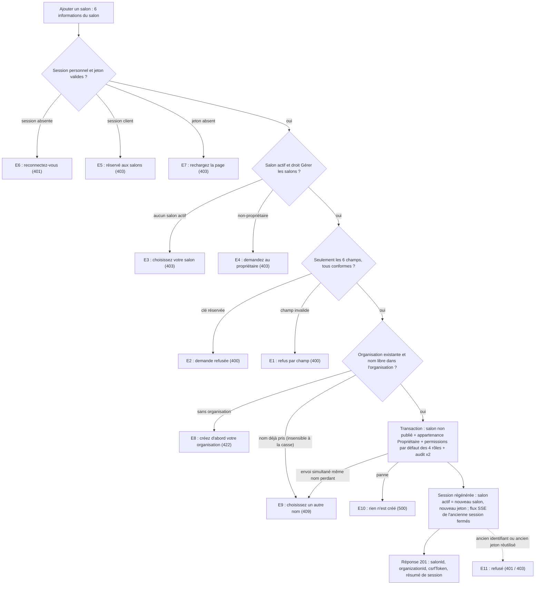
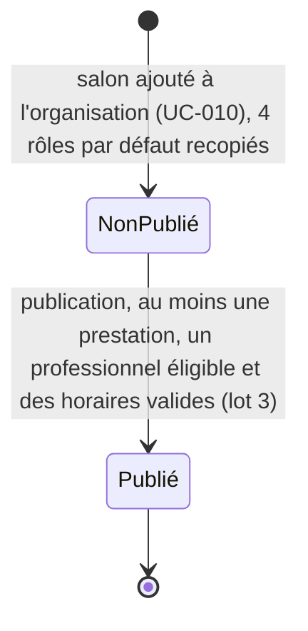

# UC-010 — Ajouter un salon à son organisation

| Champ | Valeur |
|---|---|
| Statut | Prêt pour dev (D-056) |
| Priorité | Must |
| Module | `organizations` (impacts : `identity` pour `GetMySession` inchangé, `shared` pour la session et le suivi en direct) |
| Auteur | use-case-writer |
| Date | 2026-11-20 |
| Use cases liés | UC-004 (précède : crée l'organisation et le premier salon), UC-005 (complète : ouvrir et changer de salon actif parmi les salons de l'organisation), UC-008 (abonné à `SalonRegistered` : recopie les permissions par défaut des 4 rôles ; protège `organization:manage-salons`), UC-009 (session client refusée ici, D-055), UC-012 (rôles système séparés) |
| Exigences couvertes | EX-002, EX-003, EX-005, EX-006, EX-008, EX-009, EX-011, EX-012, EX-013, EX-014, EX-016, EX-017, EX-020, EX-021, EX-023, EX-024, EX-025, EX-026, EX-030, EX-033, EX-034, D-003, D-004, D-007, D-027, D-028, D-031, D-034, D-035, D-036, D-037, D-038, D-039, D-041, D-050, D-051, D-052, D-054, D-055 |

## 0. Traçabilité cahier des charges

| Exigence | Source | Où elle est traitée dans ce UC |
|---|---|---|
| EX-002 | prd.md §3 Hiérarchie, Exemple « Un propriétaire crée son compte puis rattache trois établissements » | Flux nominal, RG-010-03, scénarios « Une propriétaire ajoute un deuxième salon… », « …un troisième salon… » |
| EX-003 | prd.md §3 Hiérarchie « Une organisation peut posséder plusieurs salons » | RG-010-03, flux nominal étape 7, scénarios « …un deuxième salon… », « …un troisième salon… » |
| EX-005 | prd.md §3 Exemple « Chaque salon conserve ses propres services, tarifs, collaborateurs, horaires, réservations et paramètres » | RG-010-08, RG-010-09, scénarios « …ne reprend rien de Go Beauty Akwa », « …permissions par défaut… », « Les collaborateurs des autres salons… » |
| EX-006, EX-024 | prd.md §3 Multi-tenancy, §12 Sécurité | RG-010-01, RG-010-08, RG-010-12, scénarios `@securite` |
| EX-008, EX-033 | prd.md §3 Multi-tenancy, §5.1 « Créer et gérer ses salons » | RG-010-01, RG-010-08, D-041 (appartenance « Propriétaire » créée avec le salon), scénarios « …ajoute un deuxième salon… », « Seul le propriétaire… » |
| EX-009, D-003 | prd.md §3 Multi-tenancy ; DECISIONS.md | RG-010-01 (salon actif exigé), RG-010-10 (nouveau salon ouvert en session), scénarios « Le nouveau salon s'ouvre… », « Sans salon ouvert… » |
| EX-011, EX-012 | prd.md §2 Règle d'architecture, §4 | RG-010-12, RG-010-13, scénario « Un administrateur GoMeCoiffer propriétaire ajoute un salon… » (`@apres-UC-012`) |
| EX-013, D-054, D-055 | prd.md §4 ; DECISIONS.md (espace client séparé) | RG-010-01, scénario « Une session client ne permet jamais d'ajouter un salon… » |
| EX-014, EX-017, D-050 | prd.md §5.1, §6 Restriction ; DECISIONS.md | RG-010-01 (droit protégé `organization:manage-salons`, jamais accordé à un administrateur même avec les 16 permissions ajustables), plan « Seul le propriétaire… » |
| EX-016, D-038, D-051, D-052 | prd.md §6 ; DECISIONS.md | RG-010-09 (recopie des permissions par défaut via `SalonRegistered` dans la même transaction, jamais les réglages d'un autre salon), scénario « Le nouveau salon reçoit les permissions par défaut… » |
| EX-020 | prd.md §7 introduction | §10 (chaque refus dit quoi faire), §15 Guidage |
| EX-021, D-027 | prd.md §7 fin ; DECISIONS.md | RG-010-11, scénario « À la connexion suivante, la propriétaire choisit parmi ses salons » |
| EX-023, EX-025, D-028 | prd.md §11, §12 Données ; DECISIONS.md | RG-010-07 (téléphone commercial public après publication), RG-010-14 (audit sans donnée personnelle), scénario « L'ajout d'un salon est tracé… » |
| EX-026, D-007 | prd.md §12 Dates ; DECISIONS.md | RG-010-08 (fuseau `Africa/Douala`, FCFA, instants UTC) |
| EX-030, D-036 | prd.md §7 Étape 2 ; DECISIONS.md | RG-010-04 à RG-010-07, §14, plan « Les six informations obligatoires… » |
| EX-034, D-036 | prd.md F01 critères, §7 Étape 7 ; DECISIONS.md | RG-010-08 (salon créé non publié, sans abonnement) |
| D-035 | DECISIONS.md | RG-010-02 (unicité du nom de salon au sein de l'organisation, pas entre organisations), RG-010-03 (nom de l'organisation inchangé), scénarios doublon / concurrence / autre organisation |
| D-037, D-039, D-004, D-031 | DECISIONS.md | RG-010-10 (session régénérée, nouveau jeton CSRF, fermeture des flux SSE de l'ancienne session, durée absolue et version des identifiants conservées) |
| D-041 | DECISIONS.md | RG-010-08 (appartenance « Propriétaire » créée sur chaque nouveau salon de l'organisation) |

## 1. Objectif

Permettre au **propriétaire d'une organisation existante** d'y **ajouter un nouvel établissement** (2e, 3e salon…)
depuis son seul compte utilisateur, en saisissant les six informations de base du salon. Le nouveau salon est créé
de façon atomique avec son appartenance « Propriétaire » et les permissions par défaut des quatre rôles de
collaborateur, reste **invisible des clients** jusqu'à sa publication, et s'ouvre aussitôt dans la session pour
démarrer sa configuration.

## 2. User story

> En tant que **propriétaire d'une organisation**,
> je veux **ajouter un nouveau salon à mon organisation (nom commercial, type, ville, quartier, point de repère, téléphone commercial)**,
> afin de **gérer plusieurs établissements depuis mon seul compte, chacun avec sa propre équipe, ses prestations et ses horaires**.

## 3. Acteurs

- **Acteur principal** : le propriétaire d'une organisation existante, connecté avec une session du personnel,
  travaillant dans l'un des salons de son organisation (détenteur du droit protégé « Gérer les salons de
  l'organisation »). Smartphone ou tablette, réseau parfois lent.
- **Acteurs secondaires** :
  - un **collaborateur** du salon (administrateur de salon même avec les 16 permissions ajustables, coiffeur,
    responsable financier, praticien) qui tente d'ajouter un salon (E4) ;
  - un **administrateur GoMeCoiffer** qui possède sa propre organisation (A5) ;
  - le **système** : recopie des permissions par défaut des quatre rôles (`SalonRegistered` → `InitializeSalonRoles`
    dans la même transaction), régénération de session, fermeture du suivi en direct de l'ancienne session, audit.
- Aucun service tiers (ni SMS, ni paiement) n'intervient.

## 4. Déclencheur

Le propriétaire choisit « Ajouter un salon » dans le sélecteur de salons ou dans **Paramètres → Mes salons** du
back-office.

## 5. Préconditions

- Une session **du personnel** authentifiée est ouverte sur ce navigateur (une session client est refusée, E5), avec
  un jeton de sécurité (CSRF) valide.
- Un salon est **actif** dans la session (sinon E3) `[HYPOTHÈSE]` — voir Q2.
- L'utilisateur possède le droit protégé **« Gérer les salons de l'organisation »** dans ce salon actif (c'est-à-dire
  qu'il est le propriétaire réel de l'organisation à laquelle ce salon appartient ; sinon E4).
- L'organisation existe déjà (créée via UC-004 ; sinon E8).

## 6. Postconditions

- **En cas de succès** :
  - un nouveau salon est rattaché à l'organisation du propriétaire : nom commercial unique dans l'organisation, type,
    ville, quartier, point de repère, téléphone commercial, fuseau `Africa/Douala`, **non publié** ; sans photo,
    description, horaires, prestation, intervenant, adresse publique ni abonnement ;
  - le nom de l'organisation reste inchangé ;
  - le propriétaire a une **appartenance active** à ce nouveau salon avec le rôle **Propriétaire** (D-041) ; ses
    autres appartenances et ses rôles système éventuels sont inchangés ; aucun autre collaborateur de l'organisation
    n'obtient d'accès à ce nouveau salon ;
  - les **quatre rôles de collaborateur** du nouveau salon ont leurs **permissions par défaut** recopiées dans la
    même transaction (UC-008, D-051) ;
  - la session est **régénérée** : nouvel identifiant, **nouveau jeton de sécurité** remis dans la réponse, même
    utilisateur, même instant de connexion, même version des identifiants et même dernière activité ; le nouveau
    salon devient le **salon actif** `[HYPOTHÈSE]` — voir Q1 ; l'ancien identifiant et l'ancien jeton sont refusés ;
  - les flux de suivi en direct ouverts avec l'ancienne session sont **fermés** ; ceux des autres appareils du
    propriétaire ne sont pas touchés ;
  - « salon ajouté à l'organisation » et « appartenance de propriétaire accordée » sont tracés dans le journal
    d'audit, sans donnée personnelle ;
  - la réponse contient l'identifiant du nouveau salon, l'identifiant de l'organisation, le nouveau jeton de sécurité
    et le résumé de session à jour.
- **En cas d'échec** : aucun salon, aucune appartenance, aucun réglage de rôle, aucune ligne d'audit ; la session
  n'est pas régénérée, son salon actif, son identifiant, son jeton et ses flux en direct sont inchangés ; les
  informations saisies restent à l'écran pour correction.

## 7. Règles métier

| ID | Règle | Exemple | Source |
|---|---|---|---|
| RG-010-01 | Seul le **propriétaire réel** d'une organisation, connecté avec une **session du personnel** et un **salon actif** où il détient le droit protégé **« Gérer les salons de l'organisation »**, peut ajouter un salon à son organisation. Ce droit n'est **jamais** accordé à un administrateur de salon (même avec les 16 permissions ajustables) ni à aucun autre collaborateur. L'utilisateur et l'organisation sont déduits de la session, jamais de la demande. Une session client est refusée (403) ; sans session → 401 ; sans salon actif → 403 `[HYPOTHÈSE]` (Q2) ; sans organisation (défense domaine) → 422. | Mireille, dans « Go Beauty Akwa » → acceptée. Rodrigue (Administrateur avec les 16 permissions) → 403. Paul, propriétaire de « Paul Barber Deïdo » mais travaillant dans « Élégance Bonamoussadi » (Coiffeur) → 403. Mireille sur session client SMS → 403. Nadège sans organisation → 422. | EX-006, EX-008, EX-013, EX-014, EX-017, EX-024, EX-033, D-003, D-050, D-054, D-055 ; `[HYPOTHÈSE]` salon actif — **Q2** |
| RG-010-02 | **Unicité du nom de salon dans l'organisation** : deux salons d'une même organisation ne peuvent pas porter le même nom commercial. La comparaison est **insensible à la casse** après retrait des espaces en début, en fin et en double `[HYPOTHÈSE]` (Q3). Un doublon (y compris par envoi simultané / double clic) est refusé (409) ; la garantie est **en base**. Deux organisations **différentes** peuvent avoir un salon du même nom. | Mireille possède « Go Beauty Akwa » : « Go Beauty Akwa », « go beauty akwa » et «   Go   Beauty  Akwa  » → 409. Deux envois simultanés de « Go Beauty Bastos » → 1 × 201, 1 × 409. Clarisse ajoute « Go Beauty Bastos » dans son organisation → accepté. | D-035 ; `[HYPOTHÈSE]` insensible à la casse — **Q3** |
| RG-010-03 | Le nouveau salon est rattaché à l'**organisation existante** du propriétaire : aucune nouvelle organisation n'est créée et le **nom de l'organisation ne change pas** `[HYPOTHÈSE]` (Q5). Aucune limite métier sur le nombre de salons par organisation au MVP `[HYPOTHÈSE]` (Q4). | Mireille (organisation « Go Beauty Akwa ») ajoute « Go Beauty Bastos » puis « Go Beauty Biyem-Assi » : 1 organisation nommée « Go Beauty Akwa », 3 salons. | EX-002, EX-003, D-035 ; `[HYPOTHÈSE]` — **Q4**, **Q5** |
| RG-010-04 | **Nom commercial** obligatoire, **2 à 60 caractères** après retrait des espaces au début, à la fin et en double (même règle que RG-004-04). | « GB » accepté ; « G » refusé ; 60 caractères acceptés, 61 refusés ; «   Go   Beauty  Bastos  » enregistré « Go Beauty Bastos ». | EX-030, D-036, UC-004 RG-004-04 |
| RG-010-05 | **Type** obligatoire, un seul parmi : **salon de coiffure**, **barber shop**, **esthétique**, **mixte** (même règle que RG-004-05). | « barber shop » accepté ; « institut de manucure » refusé. | EX-030, D-036, UC-004 RG-004-05 |
| RG-010-06 | **Ville** obligatoire, choisie dans la **liste fermée des 12 villes** tenue par GoMeCoiffer (`Douala`, `Yaoundé`, `Bafoussam`, `Bamenda`, `Buea`, `Limbé`, `Kribi`, `Garoua`, `Maroua`, `Ngaoundéré`, `Bertoua`, `Ebolowa`). **Quartier** obligatoire, texte libre de **2 à 60 caractères** après nettoyage des espaces (même règle que RG-004-06). | « Yaoundé » / « Bastos » acceptés ; ville « Paris » refusée ; quartier « A » refusé. | EX-030, D-036, UC-004 RG-004-06 |
| RG-010-07 | **Point de repère** obligatoire, **5 à 160 caractères** après nettoyage. **Téléphone commercial** obligatoire, numéro camerounais (9 chiffres commençant par 6 ou 2, avec ou sans `+237` et espaces, mêmes formats que RG-001-02). Il peut être identique à celui du propriétaire ou d'un autre salon ; il **n'est pas vérifié par SMS** et sera **affiché aux clients** une fois le salon publié. | « Avenue Jean-Paul II, face à l'ambassade de Chine » et « 6 91 22 33 44 » ou « +237 2 22 20 15 10 » acceptés ; 4 caractères ou « +33 6 12 34 56 78 » refusés. | EX-030, EX-025, D-036, UC-004 RG-004-07, RG-004-08 |
| RG-010-08 | Le nouveau salon est créé **non publié** (invisible dans la marketplace), au fuseau **`Africa/Douala`**, montants en FCFA, **vide** (ni photo, ni description, ni horaires, ni prestation, ni intervenant, ni adresse publique, ni abonnement) : rien n'est recopié d'un autre salon de l'organisation. Une **appartenance active « Propriétaire »** est créée pour le seul propriétaire (D-041) ; les collaborateurs des autres salons de l'organisation n'obtiennent **aucun accès** au nouveau salon. | « Go Beauty Bastos » : non publié, heure de Douala, 0 prestation, 0 collaborateur autre que Mireille ; Rodrigue, Awa et Hortense (membres d'Akwa) ne le voient pas. | EX-005, EX-006, EX-008, EX-026, EX-034, D-007, D-036, D-041 |
| RG-010-09 | À l'enregistrement du salon, les **permissions par défaut des quatre rôles de collaborateur** (Administrateur de salon, Coiffeur / Coiffeuse / Barbier, Responsable financier, Praticien / Praticienne de beauté) sont **recopiées dans la même transaction** via l'événement `SalonRegistered` (UC-008, D-051). Les réglages personnalisés d'un autre salon de l'organisation ne sont **pas** recopiés (D-052). | Mireille avait ouvert les finances à l'Administrateur d'Akwa ; à l'ajout de « Go Beauty Bastos », l'Administrateur de Bastos naît avec les permissions par défaut (sans les finances). | EX-016, D-038, D-051, D-052, UC-008 RG-008-05 |
| RG-010-10 | Après l'enregistrement, le nouveau salon devient le **salon actif** de la session `[HYPOTHÈSE]` (Q1) : la session est **régénérée** (nouvel identifiant, **nouveau jeton de sécurité** renvoyé dans la réponse), en conservant l'utilisateur, l'**instant de connexion** (la durée absolue n'est pas prolongée), la **version des identifiants** et la **dernière activité**. L'ancien identifiant et l'ancien jeton sont **refusés** ensuite. Les **flux de suivi en direct de l'ancienne session** sont fermés (sans toucher les autres appareils). Un refus ou une panne ne régénère rien et ne ferme aucun flux. | Mireille, connectée à 9 h 00 sur Akwa, ajoute « Go Beauty Bastos » à 10 h 00 depuis son téléphone : nouveau jeton, salon actif Bastos, flux SSE du téléphone fermé (la tablette du salon reste sur Akwa), session expire toujours 7 j après 9 h 00. | EX-009, D-003, D-004, D-026, D-028, D-031, D-037, D-039 ; `[HYPOTHÈSE]` bascule sur le nouveau salon — **Q1** |
| RG-010-11 | Le **résumé de session** renvoyé inclut le nouveau salon dans la **liste des salons** (triée par nom, avec nom, rôle `Propriétaire`, ville, quartier) et l'indique comme salon actif. À la connexion suivante (D-027), comme la propriétaire possède désormais plusieurs salons, aucun salon n'est ouvert d'office et l'étape suivante est **« choisir son salon »** (`CHOOSE_SALON`). | Mireille a désormais « Go Beauty Akwa » et « Go Beauty Bastos » ; le lendemain à la connexion, elle choisit son salon. | EX-002, EX-021, D-027, D-040 |
| RG-010-12 | La demande ne contient **que** les six informations du salon (mode strict). Toute information fixée par GoMeCoiffer (organisation, propriétaire, fuseau, statut de publication, rôle, rôle système) **fait refuser la demande entière** (400). | Demande avec « organisation : celle de Clarisse » ou « statut : publié » → 400, rien n'est créé. | EX-024, EX-012, CLAUDE.md §I.4 (mode strict) |
| RG-010-13 | **Rôles séparés** : ajouter un salon n'accorde **aucun rôle système** et ne retire pas ceux de l'utilisateur ; un rôle système ne donne **aucun droit** d'ajouter un salon à l'organisation d'autrui. Un administrateur GoMeCoiffer qui possède sa propre organisation peut y ajouter un salon, tout en conservant son rôle système et ses durées de session système (2 h inactivité, 12 h absolu). | Serge Kamga, Administrateur Opérations et Propriétaire de « Salon Kamga Essos », ajoute « Salon Kamga Mvog-Mbi » : propriétaire des deux, toujours Administrateur Opérations, session toujours limitée à 12 h. | EX-011, EX-012, D-026, D-038 |
| RG-010-14 | **Audit** : sont tracés dans la même transaction « **salon ajouté à l'organisation** » (organisation, salon, utilisateur, type, ville, instant) et « **appartenance de propriétaire accordée** » (salon, utilisateur, rôle `OWNER`, instant). Jamais le téléphone commercial, le point de repère ni le numéro du propriétaire. | Deux lignes à 10 h 00 pour Mireille et « Go Beauty Bastos », sans téléphone ni point de repère. | EX-023, EX-025, D-028, prd.md §11 |
| RG-010-15 | **Tout ou rien** : création du salon, appartenance « Propriétaire », recopie des permissions par défaut des quatre rôles (`SalonRegistered`) et lignes d'audit sont enregistrés **dans la même transaction** ou pas du tout. Une panne ne laisse aucun état partiel et ne modifie ni la session ni le salon actif. | Panne pendant l'initialisation des rôles ou l'audit → 0 salon, 0 appartenance, 0 réglage de rôle, 0 audit ; Mireille reste dans « Go Beauty Akwa » avec le même jeton. | EX-024, PRD §12 Fiabilité, UC-008 RG-008-05 |

## 8. Flux nominal

1. Mireille, connectée et travaillant dans « Go Beauty Akwa » (Propriétaire), choisit « Ajouter un salon ».
2. Elle saisit les six informations du nouveau salon : nom commercial (« Go Beauty Bastos »), type (« mixte »),
   ville (« Yaoundé »), quartier (« Bastos »), point de repère (« Avenue Jean-Paul II, face à l'ambassade de Chine »),
   téléphone commercial (« 6 91 22 33 44 »).
3. Elle valide « Ajouter ce salon ».
4. Le système vérifie la session du personnel, le jeton de sécurité, le salon actif, le droit protégé « Gérer les
   salons de l'organisation » et que la demande ne porte que les six informations (RG-010-01, RG-010-12).
5. Le système nettoie et contrôle chaque information (RG-010-04 à RG-010-07).
6. Le système charge l'organisation de Mireille et vérifie qu'aucun salon de cette organisation ne porte déjà ce nom
   (RG-010-02, RG-010-03).
7. Dans la même transaction, le système crée le salon non publié à l'heure de Douala, crée l'appartenance active
   « Propriétaire » pour Mireille, recopie les permissions par défaut des quatre rôles de collaborateur via
   `SalonRegistered` et écrit les deux lignes d'audit (RG-010-08, RG-010-09, RG-010-14, RG-010-15).
8. Le système régénère la session de Mireille (nouvel identifiant, salon actif « Go Beauty Bastos » ; instant de
   connexion, version des identifiants et dernière activité conservés), émet un nouveau jeton de sécurité et ferme
   les flux de suivi en direct de l'ancienne session (RG-010-10).
9. Le système renvoie l'identifiant du nouveau salon, l'identifiant de l'organisation, le nouveau jeton et le résumé
   de session à jour (RG-010-11).
10. L'interface prend le nouveau jeton, rouvre le suivi en direct sur « Go Beauty Bastos » et affiche « Le salon
    « Go Beauty Bastos » a été ajouté à votre organisation. Il n'est pas encore visible des clients : ajoutez ses
    prestations, son équipe et ses horaires pour le publier. »

## 9. Flux alternatifs

- **A1 — Espaces en trop** (étape 5) : les espaces en début, en fin et en double du nom commercial, du quartier et du
  point de repère sont retirés avant contrôle et contrôle d'unicité (RG-010-02, RG-010-04) ; suite à l'étape 6.
- **A2 — Troisième salon (et suivants)** (étape 6) : Mireille a déjà « Go Beauty Akwa » et « Go Beauty Bastos » et
  ajoute « Go Beauty Biyem-Assi » ; même déroulement, son organisation compte trois salons (RG-010-03).
- **A3 — Même nom dans une autre organisation** (étape 6) : Clarisse ajoute « Go Beauty Bastos » dans son
  organisation alors que Mireille possède déjà un « Go Beauty Bastos » ; accepté, les deux salons restent isolés
  (RG-010-02).
- **A4 — Téléphone commercial identique au numéro du propriétaire ou d'un autre salon** (étape 5) : accepté ; l'aide
  rappelle qu'il sera affiché aux clients après publication (RG-010-07).
- **A5 — Administrateur GoMeCoiffer propriétaire de son organisation** (étape 4) : Serge Kamga travaille dans
  « Salon Kamga Essos » et ajoute « Salon Kamga Mvog-Mbi » ; son rôle système et ses durées de session système
  (2 h / 12 h) sont conservés (RG-010-13).
- **A6 — Autre appareil connecté sur l'ancien salon** (étape 8) : la tablette du salon d'Akwa, connectée avec le
  compte de Mireille, garde sa propre session, son salon actif « Go Beauty Akwa » et son suivi en direct (RG-010-10).

## 10. Flux d'exception

- **E1 — Information invalide** (étape 5) : refus par champ (400), rien n'est créé. Messages identiques à UC-004 :
  « Le nom du salon doit compter de 2 à 60 caractères. » ; « Choisissez le type de votre salon : salon de coiffure,
  barber shop, esthétique ou mixte. » ; « Choisissez votre ville dans la liste. Elle n'y est pas ? Contactez
  l'assistance GoMeCoiffer. » ; « Indiquez le quartier (2 à 60 caractères), par exemple Bastos. » ; « Décrivez
  comment trouver le salon (5 à 160 caractères), par exemple : face à la pharmacie du Centre. » ; « Saisissez un
  numéro camerounais de 9 chiffres, par exemple 6 91 22 33 44. »
- **E2 — Information réservée à GoMeCoiffer dans la demande** (étape 4) : refus de la demande entière (400),
  « Certaines informations sont invalides : corrigez les champs signalés. » ; rien n'est créé (RG-010-12).
- **E3 — Aucun salon actif** (étape 4) : refus (403), « Choisissez d’abord le salon sur lequel vous travaillez. » ;
  rien n'est créé (RG-010-01).
- **E4 — Pas propriétaire de l'organisation du salon actif** (étape 4) : collaborateur (administrateur de salon même
  avec les 16 permissions ajustables, coiffeur, responsable financier, praticien) ou propriétaire d'une autre
  organisation travaillant dans un salon tiers → refus (403), « Votre rôle dans ce salon ne permet pas cette action :
  demandez-la au propriétaire. » ; rien n'est créé (RG-010-01).
- **E5 — Session client** (étape 4) : utilisateur connecté par code SMS client (même s'il est par ailleurs
  propriétaire) → refus (403), « Cet espace est réservé aux salons : connectez-vous avec votre mot de passe. » ;
  rien n'est créé (RG-010-01, D-055).
- **E6 — Session absente ou expirée** (étape 4) : refus (401), « Session absente ou expirée : reconnectez-vous. » ;
  rien n'est créé.
- **E7 — Jeton de sécurité absent ou périmé** (étape 4) : refus (403), « Jeton de sécurité absent ou expiré :
  rechargez la page puis recommencez. » ; rien n'est créé, salon actif inchangé.
- **E8 — Utilisateur sans organisation** (étape 6, défense domaine) : refus (422), « Créez d'abord votre organisation
  et votre premier salon. » ; rien n'est créé (RG-010-01).
- **E9 — Nom de salon déjà utilisé dans l'organisation (ou envoi simultané du même nom)** (étapes 6-7) : refus (409),
  « Votre organisation a déjà un salon nommé « Go Beauty Bastos ». Choisissez un autre nom. » ; rien n'est créé,
  session et salon actif inchangés (RG-010-02).
- **E10 — Service indisponible** (étapes 6-8) : refus (500), « Ajout du salon impossible pour le moment. Réessayez
  dans quelques minutes. » ; aucun salon, aucune appartenance, aucun rôle ni audit créé ; session, salon actif et
  jeton inchangés ; saisie conservée à l'écran (RG-010-15).
- **E11 — Ancien identifiant de session ou ancien jeton réutilisé** (après l'étape 9) : l'ancien identifiant reçoit
  « Session absente ou expirée : reconnectez-vous. » (401) ; une modification avec l'ancien jeton reçoit « Jeton de
  sécurité absent ou expiré : rechargez la page puis recommencez. » (403) (RG-010-10).

> Aucun service tiers n'intervient : pas de cas « fournisseur indisponible ».

## 11. Workflow



Cycle de vie du nouveau salon ajouté :



## 12. Scénarios d'acceptation (BDD)

Identiques à `features/organizations/ajouter-un-salon-a-son-organisation.feature`.

```gherkin
# language: fr
@UC-010
Fonctionnalité: Ajouter un salon à son organisation
  Pour gérer plusieurs établissements avec un seul compte utilisateur,
  le propriétaire d'une organisation ajoute un nouveau salon à son organisation :
  il en devient aussitôt propriétaire, le salon reçoit les permissions par défaut des quatre rôles de collaborateur,
  s'ouvre dans sa session et reste invisible des clients jusqu'à sa publication.

  Contexte:
    Étant donné que nous sommes le 20/11/2026 à 10 h 00, heure de Douala
    Et que l'organisation de Mireille Ndongo possède le salon "Go Beauty Akwa"
    Et que l'organisation de Clarisse Fotso possède le salon "Élégance Bonamoussadi"
    Et que les appartenances actives sont :
      | personne        | salon                 | rôle                              |
      | Mireille Ndongo | Go Beauty Akwa        | Propriétaire                      |
      | Rodrigue Etoa   | Go Beauty Akwa        | Administrateur de salon           |
      | Awa Tchoua      | Go Beauty Akwa        | Coiffeur / Coiffeuse / Barbier    |
      | Hortense Mballa | Go Beauty Akwa        | Responsable financier             |
      | Clarisse Fotso  | Élégance Bonamoussadi | Propriétaire                      |
      | Paul Ebode      | Élégance Bonamoussadi | Coiffeur / Coiffeuse / Barbier    |
      | Paul Ebode      | Paul Barber Deïdo     | Propriétaire                      |
    Et que Mireille est connectée et travaille dans le salon "Go Beauty Akwa"
    Et que le nouveau salon à ajouter est décrit ainsi :
      | nom commercial  | Go Beauty Bastos                                  |
      | type            | mixte                                             |
      | ville           | Yaoundé                                           |
      | quartier        | Bastos                                            |
      | point de repère | Avenue Jean-Paul II, face à l'ambassade de Chine  |
      | téléphone       | 6 91 22 33 44                                     |

  @nominal @RG-010-03 @RG-010-08 @RG-010-09 @EX-002 @EX-003 @EX-005 @EX-008 @EX-030 @EX-033 @EX-034
  Scénario: Une propriétaire ajoute un deuxième salon à son organisation
    Quand Mireille ajoute ce salon à son organisation
    Alors le salon "Go Beauty Bastos" est rattaché à l'organisation de Mireille, à l'heure de Douala
    Et le salon "Go Beauty Bastos" n'est pas publié et ne reprend rien de "Go Beauty Akwa"
    Et Mireille est "Propriétaire" du salon "Go Beauty Bastos" et reste "Propriétaire" de "Go Beauty Akwa"
    Et le nom de l'organisation de Mireille reste "Go Beauty Akwa"

  @nominal @RG-010-09 @EX-016 @D-038 @D-051
  Scénario: Le nouveau salon reçoit les permissions par défaut des quatre rôles, pas les réglages d'un autre salon
    Étant donné que Mireille a ajouté "Finances : consulter" au rôle "Administrateur de salon" dans "Go Beauty Akwa"
    Quand Mireille ajoute ce salon à son organisation
    Alors les quatre rôles de collaborateur de "Go Beauty Bastos" ont exactement leurs permissions par défaut
    Et le rôle "Administrateur de salon" de "Go Beauty Bastos" n'a pas "Finances : consulter"

  @nominal @RG-010-10 @RG-010-11 @EX-009 @D-003
  Scénario: Le nouveau salon s'ouvre dans la session et figure dans la liste des salons
    Quand Mireille ajoute ce salon à son organisation
    Alors le salon ouvert dans la session de Mireille est "Go Beauty Bastos"
    Et sa liste de salons contient "Go Beauty Akwa" et "Go Beauty Bastos", chacun avec le rôle "Propriétaire"
    Et Mireille peut aussitôt agir dans "Go Beauty Bastos" comme propriétaire

  @securite @RG-010-10 @D-037 @D-039 @D-004
  Scénario: L'ajout d'un salon régénère la session et ferme le suivi en direct de l'ancien salon
    Étant donné que Mireille s'est connectée à 9 h 00 et suit "Go Beauty Akwa" en direct sur son téléphone
    Et que Mireille suit aussi "Go Beauty Akwa" en direct sur la tablette du salon
    Quand Mireille ajoute ce salon à son organisation depuis son téléphone
    Alors sa session sur son téléphone reçoit un nouvel identifiant et un nouveau jeton de sécurité
    Et l'ancien identifiant de session et l'ancien jeton de sécurité sont refusés ensuite
    Et sa session expire toujours le 27/11/2026 à 9 h 00, 7 jours après sa connexion
    Et le suivi en direct de son téléphone s'arrête, tandis que la tablette continue de suivre "Go Beauty Akwa"

  @alternatif @RG-010-03 @EX-002 @EX-003
  Scénario: Une propriétaire ajoute un troisième salon à son organisation
    Étant donné que Mireille a déjà ajouté le salon "Go Beauty Bastos" à son organisation
    Quand Mireille ajoute à son organisation le salon "Go Beauty Biyem-Assi", de type "salon de coiffure", à "Yaoundé", quartier "Biyem-Assi", repère "Carrefour Biyem-Assi, à côté de la boulangerie Select", téléphone "6 78 55 44 33"
    Alors l'organisation de Mireille compte trois salons : "Go Beauty Akwa", "Go Beauty Bastos" et "Go Beauty Biyem-Assi"
    Et Mireille est "Propriétaire" de chacun des trois salons

  @alternatif @RG-010-02 @D-035
  Scénario: Une autre organisation peut ajouter un salon du même nom
    Étant donné que Mireille a déjà ajouté le salon "Go Beauty Bastos" à son organisation
    Et que Clarisse est connectée et travaille dans le salon "Élégance Bonamoussadi"
    Quand Clarisse ajoute à son organisation un salon nommé "Go Beauty Bastos" avec des informations valides
    Alors le salon "Go Beauty Bastos" est créé dans l'organisation de Clarisse
    Et Clarisse ne voit pas le salon "Go Beauty Bastos" de Mireille

  @alternatif @RG-010-04
  Scénario: Les espaces en trop du nom commercial sont retirés avant enregistrement
    Quand Mireille ajoute ce salon à son organisation, mais dont le nom commercial est "  Go   Beauty  Bastos  "
    Alors le salon "Go Beauty Bastos" est rattaché à l'organisation de Mireille

  @alternatif @RG-010-11 @EX-021 @D-027
  Scénario: À la connexion suivante, la propriétaire choisit parmi ses salons
    Étant donné que Mireille a ajouté le salon "Go Beauty Bastos" puis s'est déconnectée
    Quand Mireille se connecte le lendemain avec son mot de passe
    Alors aucun salon n'est ouvert dans sa session
    Et on l'invite à choisir son salon parmi "Go Beauty Akwa" et "Go Beauty Bastos"

  @alternatif @securite @RG-010-13 @EX-011 @EX-012 @apres-UC-012
  Scénario: Un administrateur GoMeCoiffer propriétaire ajoute un salon à sa propre organisation sans mélanger les rôles
    Étant donné que Serge Kamga a le rôle système "Administrateur Opérations" et est "Propriétaire" de "Salon Kamga Essos"
    Et que Serge est connecté et travaille dans "Salon Kamga Essos"
    Quand Serge ajoute ce salon à son organisation, mais dont le nom commercial est "Salon Kamga Mvog-Mbi"
    Alors Serge est "Propriétaire" de "Salon Kamga Mvog-Mbi"
    Et Serge a toujours le seul rôle système "Administrateur Opérations"
    Et sa session expire toujours au plus tard 12 heures après sa connexion

  @securite @RG-010-08 @EX-005 @EX-006
  Scénario: Les collaborateurs des autres salons de l'organisation n'obtiennent aucun accès au nouveau salon
    Quand Mireille ajoute ce salon à son organisation
    Alors Rodrigue, Awa et Hortense ne voient pas "Go Beauty Bastos" dans leur liste de salons
    Et aucun d'eux ne peut ouvrir "Go Beauty Bastos"

  @erreur @RG-010-02 @D-035
  Plan du scénario: Deux salons d'une même organisation ne peuvent pas porter le même nom
    Quand Mireille ajoute ce salon à son organisation, mais dont le nom commercial est <nom>
    Alors l'ajout est refusé avec le motif "Votre organisation a déjà un salon nommé « Go Beauty Akwa ». Choisissez un autre nom."
    Et l'organisation de Mireille ne compte toujours que le salon "Go Beauty Akwa"
    Et le salon ouvert dans la session de Mireille reste "Go Beauty Akwa"

    Exemples:
      | nom                    |
      | "Go Beauty Akwa"       |
      | "go beauty akwa"       |
      | "  Go   Beauty  Akwa " |

  @securite @RG-010-02 @D-035
  Scénario: Deux ajouts simultanés du même nom dans la même organisation ne créent qu'un salon
    Quand deux ajouts du salon "Go Beauty Bastos" par Mireille arrivent en même temps
    Alors un seul réussit
    Et l'autre est refusé avec le motif "Votre organisation a déjà un salon nommé « Go Beauty Bastos ». Choisissez un autre nom."
    Et l'organisation de Mireille ne compte qu'un seul salon "Go Beauty Bastos"

  @erreur @RG-010-04 @RG-010-05 @RG-010-06 @RG-010-07 @EX-030 @D-036
  Plan du scénario: Les six informations obligatoires du nouveau salon sont contrôlées
    Quand Mireille ajoute ce salon à son organisation, mais dont le <champ> est <valeur>
    Alors l'ajout est <résultat>

    Exemples:
      | champ           | valeur                      | résultat                                        |
      | nom commercial  | "G"                         | refusé : nom de 2 à 60 caractères               |
      | nom commercial  | "GB"                        | accepté                                         |
      | nom commercial  | un texte de 60 caractères   | accepté                                         |
      | nom commercial  | un texte de 61 caractères   | refusé : nom de 2 à 60 caractères               |
      | type            | "institut de manucure"      | refusé : type de salon à choisir dans la liste  |
      | type            | "barber shop"               | accepté                                         |
      | ville           | "Paris"                     | refusé : ville à choisir dans la liste          |
      | quartier        | "A"                         | refusé : quartier de 2 à 60 caractères          |
      | point de repère | un texte de 4 caractères    | refusé : point de repère de 5 à 160 caractères  |
      | point de repère | un texte de 5 caractères    | accepté                                         |
      | point de repère | un texte de 161 caractères  | refusé : point de repère de 5 à 160 caractères  |
      | téléphone       | "6 91 22 33 4"              | refusé : numéro camerounais de 9 chiffres       |
      | téléphone       | "+33 6 12 34 56 78"         | refusé : numéro camerounais de 9 chiffres       |
      | téléphone       | "6 77 12 34 56"             | accepté                                         |
      | téléphone       | "+237 2 22 20 15 10"        | accepté                                         |

  @securite @RG-010-12 @EX-024 @EX-012
  Plan du scénario: Les informations fixées par GoMeCoiffer ne peuvent pas être imposées dans la demande
    Quand Mireille ajoute ce salon à son organisation en indiquant aussi <information>
    Alors l'ajout est refusé avec le motif "Certaines informations sont invalides : corrigez les champs signalés."
    Et aucun nouveau salon n'est créé

    Exemples:
      | information                              |
      | l'organisation de Clarisse Fotso         |
      | Clarisse Fotso comme propriétaire        |
      | le statut « publié »                     |
      | le fuseau « Europe/Paris »               |
      | le rôle système « Super Administrateur » |

  @securite @RG-010-01 @EX-014 @EX-017 @EX-033 @D-050
  Plan du scénario: Seul le propriétaire de l'organisation peut ajouter un salon, jamais un collaborateur
    Étant donné que <situation>
    Et que <personne> est connecté et travaille dans le salon "<salon actif>"
    Quand <personne> ajoute ce salon à l'organisation
    Alors l'ajout est refusé avec le motif "Votre rôle dans ce salon ne permet pas cette action : demandez-la au propriétaire."
    Et aucun nouveau salon n'est créé

    Exemples:
      | personne | salon actif           | situation                                                                        |
      | Rodrigue | Go Beauty Akwa        | Rodrigue a toutes les 16 permissions ajustables dans "Go Beauty Akwa"            |
      | Awa      | Go Beauty Akwa        | Awa est "Coiffeur / Coiffeuse / Barbier" dans "Go Beauty Akwa"                   |
      | Hortense | Go Beauty Akwa        | Hortense est "Responsable financier" dans "Go Beauty Akwa"                       |
      | Paul     | Élégance Bonamoussadi | Paul est propriétaire de "Paul Barber Deïdo", mais travaille dans le salon de Clarisse |

  @erreur @RG-010-01 @EX-009 @D-003
  Scénario: Sans salon ouvert, l'ajout d'un salon est refusé
    Étant donné que Mireille est connectée, sans salon ouvert
    Quand Mireille ajoute ce salon à son organisation
    Alors l'ajout est refusé avec le motif "Choisissez d’abord le salon sur lequel vous travaillez."
    Et aucun nouveau salon n'est créé

  @erreur @RG-010-01 @EX-019 @D-035
  Scénario: Un utilisateur sans organisation ne peut pas ajouter de salon
    Étant donné que Nadège Fouda a un compte du personnel sans organisation
    Quand on tente d'ajouter ce salon à l'organisation de Nadège
    Alors l'ajout est refusé avec le motif "Créez d'abord votre organisation et votre premier salon."
    Et aucun salon n'est créé

  @securite @RG-010-01 @EX-013 @D-054 @D-055
  Scénario: Une session client ne permet jamais d'ajouter un salon, même pour une propriétaire
    Étant donné que Mireille a ouvert une session client par code SMS sur ce navigateur
    Quand Mireille ajoute ce salon à son organisation
    Alors l'ajout est refusé avec le motif "Cet espace est réservé aux salons : connectez-vous avec votre mot de passe."
    Et aucun nouveau salon n'est créé

  @erreur @RG-010-01
  Scénario: Sans session, aucun salon n'est ajouté
    Étant donné que la session de Mireille a expiré
    Quand Mireille ajoute ce salon à son organisation
    Alors l'ajout est refusé avec le motif "Session absente ou expirée : reconnectez-vous."
    Et aucun nouveau salon n'est créé

  @erreur @RG-010-01 @EX-024
  Scénario: Un ajout sans jeton de sécurité est refusé
    Quand Mireille ajoute ce salon à son organisation sans jeton de sécurité
    Alors l'ajout est refusé avec le motif "Jeton de sécurité absent ou expiré : rechargez la page puis recommencez."
    Et aucun nouveau salon n'est créé
    Et le salon ouvert dans la session de Mireille reste "Go Beauty Akwa"

  @securite @RG-010-14 @EX-023 @EX-025
  Scénario: L'ajout d'un salon est tracé dans le journal d'audit sans donnée personnelle
    Quand Mireille ajoute ce salon à son organisation
    Alors le journal d'audit contient « salon ajouté à l'organisation » et « appartenance de propriétaire accordée » à 10 h 00 pour Mireille et le salon "Go Beauty Bastos"
    Et ni le téléphone commercial, ni le point de repère, ni le numéro de Mireille n'y figurent

  @erreur @RG-010-15
  Scénario: Une panne pendant l'ajout ne laisse rien à moitié et ne change pas la session
    Étant donné que le service GoMeCoiffer tombe en panne pendant l'enregistrement du nouveau salon
    Quand Mireille ajoute ce salon à son organisation
    Alors l'ajout est refusé avec le motif "Ajout du salon impossible pour le moment. Réessayez dans quelques minutes."
    Et le salon "Go Beauty Bastos" n'existe pas, ni appartenance ni réglage de rôle associé
    Et le salon ouvert dans la session de Mireille reste "Go Beauty Akwa"
    Et l'identifiant de session et le jeton de sécurité de Mireille sont toujours acceptés
```

## 13. Plan de tests TDD

Ordre : refus et cas dégénérés d'abord, du plus simple au plus complexe. Unitaire = fakes in-memory ; intégration =
vraie base PostgreSQL (Testcontainers) ; E2E = parcours HTTP. `GetMySession` est une query : elle ne se teste qu'en
E2E. Les VO `SalonName`, `SalonType`, `City`, `District`, `Landmark` et `PhoneNumber` sont déjà testés en UC-004
(T1-T5) et réutilisés tels quels.

| # | Niveau | Comportement testé | Étant donné | Quand | Alors | Règle |
|---|---|---|---|---|---|---|
| T1 | Unitaire | Utilisateur sans organisation refusé, rien enregistré | `Organizations` en mémoire sans organisation pour Nadège | `AddSalonToOrganization` | `OrganizationRequiredError` (`ORGANIZATION_REQUIRED`), 0 salon, 0 appartenance, 0 audit | RG-010-01 |
| T2 | Unitaire | Doublon de nom dans la même organisation (exact, casse différente, espaces en trop) refusé | Organisation de Mireille avec « Go Beauty Akwa » | `AddSalonToOrganization` avec « Go Beauty Akwa », « go beauty akwa », «   Go   Beauty  Akwa  » | `SalonNameAlreadyExistsError` (`SALON_NAME_ALREADY_EXISTS`), toujours 1 salon, 0 audit | RG-010-02 |
| T3 | Unitaire | Même nom dans une **autre** organisation accepté | Mireille possède « Go Beauty Bastos » ; Clarisse possède « Élégance Bonamoussadi » | `AddSalonToOrganization` par Clarisse avec « Go Beauty Bastos » | succès, rattaché à l'organisation de Clarisse | RG-010-02 |
| T4 | Unitaire | Ajout nominal : `Organization.addSalon` crée un salon non publié (`Africa/Douala`), rattaché à l'organisation (nom de l'organisation inchangé), une appartenance `OWNER` active, émet `SalonRegistered` ; réponse `{ organizationId, salonId }` | Organisation « Go Beauty Akwa » de Mireille, horloge fixe | `AddSalonToOrganization` « Go Beauty Bastos » | état décrit ; événement `SalonRegistered` enregistré ; nom d'organisation toujours « Go Beauty Akwa » | RG-010-03, -08 |
| T5 | Unitaire | 3e salon dans la même organisation accepté | Mireille avec Akwa et Bastos | `AddSalonToOrganization` « Go Beauty Biyem-Assi » | succès, 3 salons et 3 appartenances `OWNER` | RG-010-03 |
| T6 | Unitaire | Audit : 2 lignes (`SALON_ADDED`, `SALON_MEMBERSHIP_GRANTED` avec `role: OWNER`), sans téléphone commercial, ni point de repère, ni numéro du propriétaire | Organisation de Mireille | réussite | 2 lignes d'audit conformes | RG-010-14 |
| T7 | Intégration | Contrainte d'unicité en base `(organization_id, LOWER(name))` : 2e insertion même nom ou casse différente dans la même organisation → `SalonNameAlreadyExistsError` (traduction de `23505`) ; même nom dans une autre organisation → accepté | Salon « Go Beauty Akwa » en base | insertion doublon même org / autre org | erreur métier traduite / succès | RG-010-02 |
| T8 | Intégration | `WhenSalonRegistered` + tout ou rien : l'ajout via `TransactionalCommandBus` recopie les 4 rôles par défaut de Bastos (sans toucher Akwa ni reprendre ses personnalisations) ; un échec forcé pendant l'initialisation des rôles ou l'audit annule toute la transaction (0 salon, 0 appartenance, 0 rôle, 0 audit) | Base avec Akwa (Administrateur personnalisé avec finances) | `AddSalonToOrganization` nominal puis avec échec forcé | 4 rôles par défaut sur Bastos / rollback complet sur échec | RG-010-09, -15 |
| T9 | E2E | Parcours nominal : `POST /api/salon/salons` (201) → `{ organizationId, salonId, csrfToken, session }` ; salon ouvert = Bastos ; liste des salons triée (`Go Beauty Akwa`, `Go Beauty Bastos`, ville et quartier) ; 4 rôles par défaut sur Bastos (`GET /api/salon/roles`) ; action exigeant une permission permise aussitôt dans Bastos | Mireille connectée dans Akwa | `POST` puis `GET /api/salon/session` et `GET /api/salon/roles` | 201, 200, état complet conforme | RG-010-03, -08, -09, -10, -11 |
| T10 | E2E | Reprise à la connexion suivante : `POST /api/public/auth/sign-in` après l'ajout → `nextStep: CHOOSE_SALON`, `activeSalonId: null`, les 2 salons listés | Mireille après ajout de Bastos | nouvelle connexion | comme décrit | RG-010-11 |
| T11 | E2E | Doublon de nom → 409 (`Go Beauty Akwa`, `go beauty akwa`) ; 2 envois parallèles de `Go Beauty Bastos` → 1 × 201 + 1 × 409, exactement 1 salon Bastos en base ; autre organisation (Clarisse) avec `Go Beauty Bastos` → 201 | Mireille, Clarisse | `POST` | 409 / 201+409 / 201 | RG-010-02 |
| T12 | E2E | Droits (table `it.each`) : Rodrigue (Administrateur avec les **16 permissions ajustables**), Awa (Coiffeur), Hortense (Responsable financier), Paul travaillant dans « Élégance Bonamoussadi » → 403 `FORBIDDEN` ; rien créé | Collaborateurs connectés | `POST /api/salon/salons` | 403, 0 salon créé | RG-010-01 |
| T13 | E2E | Isolation : après ajout de Bastos par Mireille, `GET /api/salon/session` de Rodrigue, Awa et Hortense ne contient pas Bastos, et `POST /api/salon/session/active-salon` sur Bastos leur renvoie 404 | Mireille + équipe d'Akwa | ajout puis lectures / ouverture | isolation stricte | RG-010-08 |
| T14 | E2E | Protections d'accès : sans session → 401 ; session `CLIENT` (même celle de Mireille via UC-009) → 403 `STAFF_SIGN_IN_REQUIRED` ; sans jeton CSRF → 403 `CSRF_INVALID` ; connecté sans salon actif → 403 `ACTIVE_SALON_REQUIRED` ; rien créé | Sessions diverses | `POST /api/salon/salons` | 401 / 403 | RG-010-01 |
| T15 | E2E | Validation et mode strict : 1 cas invalide par champ (bornes fines en UC-004 T1-T5) + clés interdites (`organizationId`, `ownerUserId`, `publicationStatus`, `timezone`, `systemRole`) → 400 + `errors`, rien créé | Mireille dans Akwa | `POST` | 400, 0 salon créé | RG-010-04 à -07, -12 |
| T16 | E2E | Régénération de session et SSE : nouvel identifiant de cookie et nouveau `csrfToken` ; ancien cookie → 401 ; ancien jeton → 403 ; durée absolue 7 j conservée ; réinitialisation UC-003 ferme la session régénérée ; flux SSE de l'ancienne session fermé, flux SSE d'une autre session (tablette sur Akwa) conservé | Mireille, 2 sessions | ajout puis vérifications | comme décrit | RG-010-10 |
| T17 | E2E | Refus et panne ne régénèrent rien : 400, 409 et 500 forcé → ancien cookie, ancien jeton, ancien salon actif (Akwa) et flux SSE inchangés ; 0 ligne en base | Mireille dans Akwa | `POST` en erreur | session intacte | RG-010-10, -15 |
| T18 | E2E | Audit en base : 2 lignes (`SALON_ADDED`, `SALON_MEMBERSHIP_GRANTED`), sans téléphone commercial ni point de repère ni numéro | Mireille dans Akwa | ajout | 2 lignes conformes | RG-010-14 |
| T19 | E2E | `@apres-UC-012` : administrateur GoMeCoiffer propriétaire de son organisation ajoute un salon → 201, rôle système conservé, durée absolue 12 h toujours appliquée | Serge Kamga | ajout puis horloge à 12 h + 1 s | 201 puis 401 | RG-010-13 |

Doubles de test : horloge fixe ; générateur d'identifiants déterministe ; repositories en mémoire (`Organizations`,
`Salons` avec unicité `(organizationId, lower(name))`, `SalonMemberships`) ; journal d'audit en mémoire.
L'intégration utilise les vraies tables PostgreSQL et la migration d'index unique insensible à la casse.

## 14. Données

- **Entrées** (corps de la demande, mode strict — identique à UC-004) :
  - `name` — nom commercial, texte, obligatoire, 2 à 60 caractères après nettoyage ;
  - `type` — `HAIR_SALON`, `BARBER_SHOP`, `BEAUTY`, `MIXED` ;
  - `city` — valeur exacte parmi les 12 villes de `CameroonCitySchema` (D-036) ;
  - `district` — quartier, texte libre, obligatoire, 2 à 60 caractères après nettoyage ;
  - `landmark` — adresse descriptive / point de repère, texte libre, obligatoire, 5 à 160 caractères après nettoyage ;
  - `phone` — téléphone commercial camerounais, obligatoire, formats de RG-001-02, normalisé en `+237XXXXXXXXX` ;
  - lus par la couche HTTP, jamais dans le corps : utilisateur et salon actif (session), jeton de sécurité (CSRF).
- **Sorties** :
  - succès (`201`) : `{ organizationId, salonId, csrfToken, session }` où `csrfToken` est le nouveau jeton de sécurité
    (session régénérée) et `session` le résumé de session (`SessionSummary`) avec `activeSalonId = salonId` et le
    nouveau salon présent dans `salons` ;
  - refus : `VALIDATION_FAILED` (400 avec `errors` par champ), `UNAUTHENTICATED` (401), `STAFF_SIGN_IN_REQUIRED`
    (403), `CSRF_INVALID` (403), `ACTIVE_SALON_REQUIRED` (403), `FORBIDDEN` (403), `SALON_NAME_ALREADY_EXISTS` (409),
    `ORGANIZATION_REQUIRED` (422), erreur interne (500).
- **Stocké** :
  - salon : identifiant, `organization_id`, `name`, `type`, `city`, `district`, `landmark`, `phone`, `timezone`
    (`Africa/Douala`), `publication_status` (`NOT_PUBLISHED`), instant de création, version ;
  - appartenance : identifiant, `salon_id`, `user_id`, `role` (`OWNER`), `status` (`ACTIVE`), instant, version ;
  - permissions des rôles : 4 lignes dans `salon_role_permissions` (permissions par défaut, recopiées par
    `InitializeSalonRoles` sur `SalonRegistered`) ;
  - audit : 2 lignes (`SALON_ADDED` avec `{ organizationId, type, city }`, `SALON_MEMBERSHIP_GRANTED` avec
    `{ role: 'OWNER' }`), sans téléphone ni point de repère.
- **Jeux de données de test** :
  - Mireille Ndongo (`6 77 12 34 56`), propriétaire de « Go Beauty Akwa » (Douala, Akwa) → ajoute « Go Beauty
    Bastos » (mixte, Yaoundé, Bastos, « Avenue Jean-Paul II, face à l'ambassade de Chine », `6 91 22 33 44`) puis
    « Go Beauty Biyem-Assi » (salon de coiffure, Yaoundé, Biyem-Assi, « Carrefour Biyem-Assi, à côté de la
    boulangerie Select », `6 78 55 44 33`) ;
  - Rodrigue Etoa (Administrateur de salon chez « Go Beauty Akwa »), Awa Tchoua (Coiffeur), Hortense Mballa
    (Responsable financier) ;
  - Clarisse Fotso, propriétaire de « Élégance Bonamoussadi » (Douala, Bonamoussadi) ;
  - Paul Ebode (`6 99 00 11 22`), Coiffeur chez « Élégance Bonamoussadi » et Propriétaire de « Paul Barber Deïdo » ;
  - Serge Kamga, Administrateur Opérations et Propriétaire de « Salon Kamga Essos » → ajoute « Salon Kamga
    Mvog-Mbi » (`@apres-UC-012`) ;
  - Nadège Fouda (`6 70 11 22 33`), compte du personnel sans organisation.
- **Seed de démo** : enrichir optionnellement le seeder `organizations` (idempotent) avec « Go Beauty Bastos » pour
  Mireille (comme prévu en UC-004 §14), afin de disposer immédiatement d'un scénario multi-salons en local.

## 15. Exigences non fonctionnelles

- **Sécurité** : route dans `/api/salon/*` protégée par `@RequiresPermission('organization:manage-salons')` + CSRF +
  rate-limit (ex. 20 créations/h par session) ; schéma Zod en mode strict ; utilisateur et organisation déduits de la
  session ; session `CLIENT` bloquée par le socle (D-055) ; régénération de session + fermeture SSE sur bascule du
  salon actif (D-039) ; aucune donnée personnelle dans l'audit ni les logs. Périmètre critique (autorisation,
  droits protégés du propriétaire, session, isolation multi-salons) : `security-reviewer` obligatoire.
- **Isolation** : le nouveau salon n'est visible que de son propriétaire ; les collaborateurs des autres salons de la
  même organisation n'y ont aucun accès tant qu'ils n'y sont pas invités (UC-006/UC-007).
- **Performance** : ajout < 500 ms côté serveur (1 lecture d'organisation, 1 insertion salon, 1 appartenance, 4 lignes
  `salon_role_permissions`, 2 lignes d'audit dans la même transaction).
- **Disponibilité** : transaction tout ou rien (RG-010-15) ; renvoyer la même saisie après une panne réussit.
- **Guidage** (EX-020) :
  - mêmes aides de champs qu'en UC-004 §15 (Type, Téléphone commercial, Point de repère, Ville) ;
  - aide en haut du formulaire : « Ce nouveau salon aura ses propres prestations, horaires, collaborateurs et
    permissions. » ;
  - après l'ajout : « Le salon « Go Beauty Bastos » a été ajouté à votre organisation. Il n'est pas encore visible
    des clients : ajoutez ses prestations, son équipe et ses horaires pour le publier. » ;
  - formulaire d'un seul écran, utilisable à 390 px ; bouton « Ajouter ce salon » désactivé pendant l'envoi ; saisie
    conservée en cas de refus ou de panne.

## 16. Hors périmètre

- Créer sa première organisation et son premier salon : UC-004.
- Changer de salon actif ensuite : UC-005.
- Modifier les informations d'un salon existant (F07), renommer l'organisation, archiver ou supprimer un salon.
- Transférer un salon à une autre organisation ou avoir plusieurs propriétaires.
- Recopier les prestations, horaires, collaborateurs ou réglages de permissions personnalisés depuis un autre salon
  de l'organisation (chaque salon part propre, D-052).
- Photo principale, description, horaires d'ouverture (EX-031, EX-032), publication (lot 3), abonnement SaaS et
  activation/suspension par GoMeCoiffer (lot 7).
- Ajout d'un salon par un administrateur GoMeCoiffer pour le compte d'un client.

## 17. Questions ouvertes

| # | Question | Hypothèse retenue en attendant | Impact si différent |
|---|---|---|---|
| Q1 | Après l'ajout d'un nouveau salon, le **salon actif en session** doit-il **basculer** sur le nouveau salon (avec régénération de session et fermeture des flux SSE de l'ancienne session, comme UC-004 et UC-005) ou **rester** sur le salon courant ? | `[HYPOTHÈSE]` **Basculer sur le nouveau salon** avec régénération de session et fermeture des flux SSE de l'ancienne session (RG-010-10). Le propriétaire qui vient de créer un salon veut aussitôt le configurer (un clic de moins sur téléphone, cohérent avec UC-004 et UC-007). | Si on reste sur le salon courant : pas de régénération de session ni de fermeture SSE dans le répondeur HTTP (`{ organizationId, salonId, session }` sans `csrfToken`), `activeSalonId` inchangé, et le front propose un bouton « Ouvrir ce salon » (UC-005). |
| Q2 | Faut-il avoir un **salon actif** où l'on est Propriétaire pour ajouter un salon (`@RequiresPermission('organization:manage-salons')`), ou doit-on aussi pouvoir le faire depuis l'écran « Choisissez votre salon » (sans salon actif) ? | `[HYPOTHÈSE]` **Salon actif requis** (`@RequiresPermission('organization:manage-salons')`, RG-010-01). Exploite directement le droit protégé déjà résolu par `SqlActorRights` (qui vérifie `organizations.owner_user_id`), reste 100 % conforme à D-003 (contexte d'autorisation = salon actif) et évite toute confusion quand un utilisateur est propriétaire d'un salon et collaborateur d'un autre (Paul). | Si autorisé sans salon actif (`@AuthenticatedOnly()` + vérification directe de `organizations.owner_user_id`) : l'utilisateur peut ajouter un salon depuis « Choisissez votre salon » ; un utilisateur sans organisation reçoit directement 422 `ORGANIZATION_REQUIRED` en HTTP, et il faut gérer explicitement le cas d'un collaborateur connecté dans le salon d'autrui. |
| Q3 | L'unicité du nom de salon dans l'organisation (D-035) doit-elle être **insensible à la casse** ? Et aux accents ? | `[HYPOTHÈSE]` **Insensible à la casse** après nettoyage des espaces (`LOWER(name)`), **accents distincts** au MVP (RG-010-02). Évite les doublons accidentels (« Go Beauty Bastos » / « go beauty bastos ») sans dépendre de l'extension `unaccent`. | Si sensible à la casse : simple contrainte `UNIQUE (organization_id, name)`. Si insensible aux accents : extension PostgreSQL `unaccent` + fonction `IMMUTABLE`. |
| Q4 | Y a-t-il un **nombre maximal de salons** par organisation au MVP ? | `[HYPOTHÈSE]` **Aucune limite métier** au MVP (RG-010-03), seulement un garde-fou anti-abus de débit (20 ajouts/h par session). L'abonnement étant facturé par salon (PRD §10), limiter le nombre de salons n'a pas de sens commercial. | Ajouter un plafond configurable (ex. 20 salons) et un refus 422 `SALON_LIMIT_REACHED`. |
| Q5 | Ajouter un salon modifie-t-il le **nom de l'organisation** ? | `[HYPOTHÈSE]` **Non** : l'organisation garde le nom pris à sa création (RG-010-03). | Prévoir un champ ou un renommage séparé (hors périmètre). |

## 18. Notes pour le tech lead

### Découpage (une intention = une commande)

| Élément | Type | Route | Protection | Effet / contenu |
|---|---|---|---|---|
| **`AddSalonToOrganization`** — ajouter un salon à son organisation | commande (`organizations`) | `POST /api/salon/salons` (201) | `@RequiresPermission('organization:manage-salons')`, CSRF, `@Throttle` (20/h par session) | charge l'organisation du propriétaire (`OrganizationRequiredError` 422 si absente), vérifie l'unicité du nom dans l'organisation (`SalonNameAlreadyExistsError` 409), appelle `organization.addSalon(...)` → nouveau `Salon` (`NOT_PUBLISHED`, `Africa/Douala`, émet `SalonRegistered` → `WhenSalonRegistered` / `InitializeSalonRolesHandler` dans la même transaction) + `SalonMembership` (`OWNER`, D-041) + audit ×2 (`SALON_ADDED`, `SALON_MEMBERSHIP_GRANTED`). Réponse `{ organizationId, salonId }`. |

- **HTTP (D-034)** : mapper pur `to-add-salon-to-organization.request-mapper.ts` ; répondeur HTTP dédié (ou extension
  de `owner-session.responder.ts` / `active-salon.responder.ts`) qui, après le commit : régénère la session en
  conservant `userId`, `authenticatedAt`, `credentialsVersion` et `lastActivityAt`, pose `activeSalonId = salonId`,
  émet le nouveau `csrfToken`, ferme les flux SSE de l'ancienne session (`closeStreamsOfSession`, D-039), puis
  renvoie `{ organizationId, salonId, csrfToken, session }` (résumé par `GetMySession`).
- **Contrats** (`packages/contracts/src/organizations.ts`) : réutiliser les champs de `CreateOrganizationSchema` (ou
  extraire un `SalonDraftSchema` partagé par `CreateOrganizationSchema` et `AddSalonToOrganizationSchema`, mode
  strict) et `SalonAddedSchema` (`{ organizationId, salonId, csrfToken, session: SessionSummarySchema }`).
- **Exception « une commande, plusieurs agrégats »** (skill `ddd` §5, à inscrire dans `docs/domains.md`) :
  `AddSalonToOrganization` écrit `Salon`, `SalonMembership` (`OWNER`) et (via `SalonRegistered`) `RolePermissions`
  dans la même transaction, justifié par D-041 et RG-010-15 (jamais de salon sans propriétaire ni sans ses 4 rôles
  par défaut).

### Domaine et persistance (D-024)

- **Domaine** :
  - réutiliser les VO existants (`SalonName`, `SalonType`, `City`, `District`, `Landmark`, `PhoneNumber`) ;
  - ajouter `Organization.addSalon(salonDraft, ids, now)` qui produit `{ salon, ownerMembership }` ; c'est le seul
    autre point (avec `Organization.found`) autorisé à créer une appartenance `OWNER` (`grantCollaboratorRole`
    continue de refuser `OWNER` avec `OWNER_ROLE_RESERVED`) ;
  - erreurs métier : `OrganizationRequiredError` (`ORGANIZATION_REQUIRED`, 422), `SalonNameAlreadyExistsError`
    (`SALON_NAME_ALREADY_EXISTS`, 409).
- **Persistance (migration)** :
  - ajouter un index unique insensible à la casse sur `salons` :
    `CREATE UNIQUE INDEX idx_salons_organization_lower_name ON salons (organization_id, LOWER(name));` ;
  - dans le repository d'écriture `TypeOrmSalons`, traduire le code PostgreSQL `23505` sur cet index en
    `SalonNameAlreadyExistsError` (409), jamais d'erreur SQL brute.
- **Queries** : `GetMySession` et `GetSalonRoles` fonctionnent déjà sans modification (le nouveau salon apparaît
  automatiquement dans `salons` trié par nom, avec ville, quartier et rôle `OWNER`, et ses 4 rôles par défaut sont
  lisibles par `GetSalonRoles`).

### Points de vigilance

- **Périmètre critique** (droit protégé `organization:manage-salons`, isolation multi-salons, régénération de session,
  fermeture SSE) : `security-reviewer` obligatoire.
- **Vérification du propriétaire réel** : `SqlActorRights` accorde `organization:manage-salons` uniquement lorsque
  `organizations.owner_user_id = userId` ; dans `AddSalonToOrganizationHandler`, charger l'organisation par
  `ownerUserId` (jamais par un `organizationId` venu du client) et vérifier que le salon actif appartient bien à
  cette organisation.
- **Double clic et session** : comme en UC-004, deux requêtes parallèles du même nom partent avec l'ancien cookie ;
  la perdante (409) ne doit **jamais** modifier ni sauvegarder la session (`RotationSafePgStore` protège déjà contre
  la recréation d'une session remplacée, D-039). Côté front, désactiver le bouton pendant l'envoi.
- **Aucune donnée personnelle** dans l'audit, les événements (`SalonRegistered`) ni les logs (jamais le téléphone
  commercial, le point de repère ni le numéro du propriétaire).

### Incréments livrables, dans l'ordre

1. Domaine : `Organization.addSalon`, erreurs `OrganizationRequiredError` et `SalonNameAlreadyExistsError`, handler
   `AddSalonToOrganization` + fakes (unitaires T1-T6).
2. Migration d'index unique `(organization_id, LOWER(name))`, traduction `23505` dans `TypeOrmSalons`, test de
   rollback atomique avec `WhenSalonRegistered` (intégration T7-T8).
3. Contrat `packages/contracts`, contrôleur `POST /api/salon/salons`, mapper, répondeur HTTP avec régénération de
   session et fermeture SSE (E2E T9-T18 ; T19 `@apres-UC-012`).
4. Front : écran / tiroir « Ajouter un salon » depuis le back-office, aides et messages (§10, §15).

### Definition of Ready

- [x] Chaque exigence listée en section 0 est couverte par au moins un scénario
- [x] Toutes les règles métier ont au moins un exemple
- [x] Tous les flux d'exception ont un scénario Gherkin (E1–E11 tous couverts)
- [ ] Aucune question ouverte bloquante — **Q1** (bascule du salon actif) et **Q2** (salon actif requis) sont à valider par le user avant le développement (hypothèses prêtes et cohérentes)
- [x] Le plan TDD couvre chaque règle (T1–T19)
- [x] Le `.feature` est synchronisé avec la section 12

