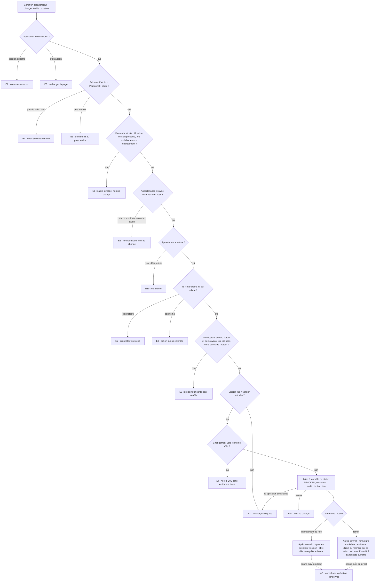
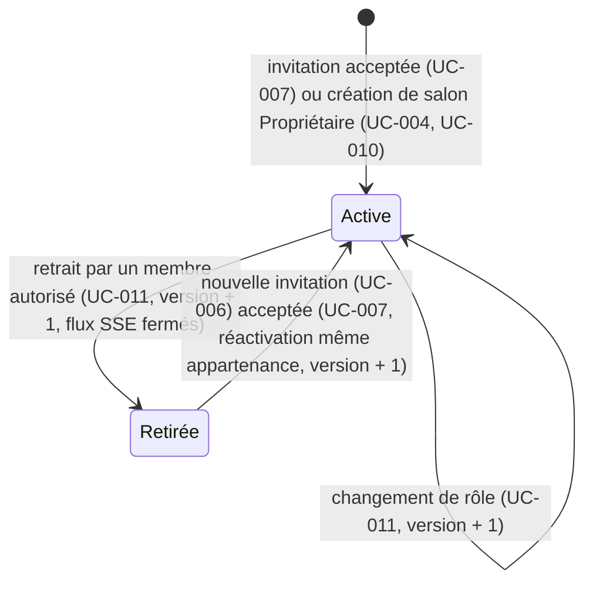

# UC-011 — Gérer l'équipe du salon

| Champ | Valeur |
|---|---|
| Statut | Prêt pour dev |
| Priorité | Must |
| Module | `organizations` (impacts : `shared` pour `ActorRights` et la fermeture ciblée des flux en direct SSE) |
| Auteur | use-case-writer |
| Date | 2026-11-20 |
| Use cases liés | UC-004 (précède : appartenance « Propriétaire »), UC-005 (précède : salon actif ; reprend `@apres-UC-008` T11/T23 sur l'appartenance retirée), UC-006 (précède : invitations ; une personne retirée peut être invitée de nouveau ; ses invitations déjà envoyées restent valables, D-049), UC-007 (précède : acceptation d'une invitation ; reprend `@apres-UC-008` pour réactiver une appartenance retirée), UC-008 (précède : permissions ajustables par rôle et par salon, `SalonRolePermissions` source unique), UC-012 (séparation des rôles système, `@apres-UC-012`), lot 2 (fiche d'intervenant), lot 4 (rendez-vous futurs d'un intervenant retiré) |
| Exigences couvertes | EX-004, EX-006, EX-007, EX-011 (en partie), EX-012 (en partie), EX-014, EX-015, EX-016 (en partie), EX-017, EX-020, EX-023, EX-024, EX-025, EX-026, EX-036 (en partie), EX-037, F07 (en partie), BR-11 (en partie), BR-12, D-002, D-003, D-028, D-034, D-035, D-037, D-039, D-041, D-042, D-047, D-049, D-050, D-051, D-052 |

## 0. Traçabilité cahier des charges

| Exigence | Source | Où elle est traitée dans ce UC |
|---|---|---|
| EX-037, F07 | prd.md F07 « Ajouter et désactiver des collaborateurs. Affecter leurs rôles. » | Flux nominal, A1, A2, RG-011-02, RG-011-08, RG-011-10, RG-011-13, scénarios « …consulte l'équipe… », « …change le rôle… », « …retire un collaborateur… », « …réintégré par une nouvelle invitation… » |
| EX-006 | prd.md §3 Règles de multi-tenancy « Aucun collaborateur ne peut accéder à un salon sans appartenance autorisée » | RG-011-07, RG-011-10, RG-011-11, scénarios « La propriétaire retire un collaborateur… », « Le retrait ferme immédiatement les flux en direct… », plan « Un membre inexistant ou d'un autre salon… » |
| EX-007, D-003 | prd.md §3 « Les permissions sont évaluées par salon » ; DECISIONS.md | RG-011-01, RG-011-06, RG-011-07, RG-011-08, scénario « Retirer ou changer le rôle d'un collaborateur dans un salon ne touche pas ses autres salons » |
| EX-004 | prd.md §3 « Un utilisateur peut appartenir à plusieurs salons, éventuellement avec des rôles différents » | RG-011-07, RG-011-10, scénario « Retirer ou changer le rôle d'un collaborateur dans un salon ne touche pas ses autres salons » |
| EX-014 | prd.md §5.1 « Les droits essentiels de propriété ne sont pas désactivables » | RG-011-03, RG-011-04, plan « Le propriétaire du salon ne peut ni changer de rôle ni être retiré de l'équipe » |
| EX-017 | prd.md §6 Restriction « aucun administrateur salon ne peut … s'attribuer les droits réservés au propriétaire » | RG-011-04, RG-011-05, RG-011-06, plans « Pas d'élévation de droits… », « Un collaborateur ne peut ni changer son propre rôle ni se retirer lui-même… » |
| EX-011, EX-012 | prd.md §2 Règle d'architecture, §4 | RG-011-03, RG-011-16, plan « Seuls les quatre rôles de collaborateur… », scénario `@apres-UC-012` |
| EX-015 | prd.md §5.5 « Ces spécialités sont des métiers, et non des rôles de sécurité » | RG-011-03, plan « Seuls les quatre rôles de collaborateur… » |
| EX-016 | prd.md §6 « Les changements s'appliquent immédiatement après validation » | RG-011-08, RG-011-10, scénarios d'effet immédiat |
| EX-023 | prd.md §11 « Les modifications sensibles de permissions … trace d'audit » | RG-011-15, scénario « Le changement de rôle, le retrait et la réintégration sont tracés sans donnée personnelle » |
| EX-024, BR-12 | prd.md §12 Sécurité, §9 BR-12 | RG-011-01, RG-011-07, RG-011-14, scénarios `@securite` |
| EX-025, BR-11 | prd.md §12 Données, §9 BR-11 | RG-011-02 (pas de numéro de téléphone exposé dans la liste), RG-011-15 (audit, événements et signaux sans PII) |
| EX-026 | prd.md §12 Dates | RG-011-02 (date d'arrivée conservée en UTC, affichée à l'heure du salon) |
| EX-036, D-002 | prd.md §12 Fiabilité ; DECISIONS.md | RG-011-08, RG-011-11, scénarios « Les écrans ouverts… », « Le retrait ferme immédiatement les flux en direct… » |
| EX-020 | prd.md §7 introduction | §10 (chaque refus dit quoi faire), §15 Guidage |
| D-035, D-041 | DECISIONS.md (propriétaire unique par organisation, appartenance Propriétaire sur chaque salon) | RG-011-04 |
| D-037, D-039 | DECISIONS.md (droits relus à chaque requête par `ActorRights`, 404 uniforme) | RG-011-07, RG-011-08, RG-011-10 |
| D-042, D-050, D-051, D-052 | DECISIONS.md (règle de non-élévation, 4 rôles de collaborateur, permissions lues dans `SalonRolePermissions`, no-op) | RG-011-03, RG-011-06, RG-011-09 |
| D-047, D-049 | DECISIONS.md (acceptation par code SMS, invitations déjà envoyées restent valables) | RG-011-12, RG-011-13 |

## 1. Objectif

Permettre au propriétaire — ou à un membre disposant du droit « Personnel : gérer » — de **consulter l'équipe active du salon**, de **changer le rôle d'un collaborateur**, de **le retirer de l'équipe** avec coupure immédiate de ses accès et de ses flux en direct sur ce salon, et de **le réintégrer** ultérieurement via une nouvelle invitation acceptée qui réactive sa même appartenance. Le propriétaire reste intouchable, personne ne peut agir sur soi-même ni élever des droits au-delà des siens, et chaque changement reste strictement isolé au salon actif.

## 2. User story

> En tant que **propriétaire ou membre autorisé (« Personnel : gérer ») d'un salon**,
> je veux **voir mon équipe, changer le rôle d'un collaborateur, retirer quelqu'un qui quitte le salon et pouvoir le réintégrer plus tard**,
> afin que **seules les bonnes personnes accèdent au salon avec exactement le rôle adapté, dès l'instant où la décision est prise**.

## 3. Acteurs

- **Acteur principal** : le propriétaire du salon actif, ou tout membre actif dont le rôle possède « Personnel : consulter » (`staff:view`) pour voir l'équipe et « Personnel : gérer » (`staff:manage`) pour changer un rôle ou retirer un collaborateur (par exemple l'Administrateur de salon par défaut, D-051).
- **Acteurs secondaires** :
  - le **collaborateur visé**, dont le rôle change ou dont l'accès au salon est coupé immédiatement (et ses flux en direct sur ce salon fermés) ;
  - le **collaborateur retiré puis réinvité**, qui accepte une nouvelle invitation (UC-007) et retrouve son appartenance réactivée ;
  - un **membre sans droit** (Coiffeur, Responsable financier, Administrateur privé de `staff:manage`) ou un **tiers d'un autre salon** ;
  - le **suivi en direct** (service interne SSE : signaux de changement de rôle et fermeture immédiate des flux au retrait).
- Aucun service tiers externe (ni SMS, ni paiement) n'intervient directement lors de la consultation, du changement de rôle ou du retrait (la réintégration passe par UC-006 et UC-007).

## 4. Déclencheur

- L'acteur ouvre l'écran **Équipe** du back-office du salon actif pour consulter les membres.
- Depuis la fiche ou la ligne d'un collaborateur, il choisit **« Changer le rôle »** puis valide le nouveau rôle, ou choisit **« Retirer de l'équipe »** puis confirme le retrait.
- Pour réintégrer un collaborateur retiré, le salon lui envoie une **nouvelle invitation** (UC-006) que le collaborateur accepte (UC-007).

## 5. Préconditions

- Une session du personnel authentifiée est ouverte (`STAFF`, D-055), avec un jeton de sécurité (CSRF) valide pour toute modification.
- Un **salon actif** est sélectionné dans la session (UC-004 ou UC-005).
- L'acteur dispose dans ce salon de « Personnel : consulter » (`staff:view`) pour voir la liste, et de « Personnel : gérer » (`staff:manage`) pour changer le rôle ou retirer un collaborateur.
- Le collaborateur visé a une appartenance active dans ce salon (pour un changement de rôle ou un retrait).

## 6. Postconditions

- **En cas de succès (changer le rôle)** :
  - le collaborateur porte le nouveau rôle dans le salon actif ; la version de son appartenance augmente de 1 ;
  - ses permissions dans ce salon sont celles de son nouveau rôle **dès sa requête suivante**, sans déconnexion ni régénération de session ;
  - « rôle d'un collaborateur modifié » est tracé dans le journal d'audit (dans la même transaction, sans donnée personnelle) ;
  - un signal en direct part après le commit sur le suivi en direct du salon ;
  - ses autres salons et les autres membres du salon ne changent pas.
- **En cas de succès sans changement de rôle** (A2) : rien n'est écrit, version inchangée, aucune trace d'audit, aucun signal.
- **En cas de succès (retirer un collaborateur)** :
  - son appartenance passe au statut **retirée (`REVOKED`)** avec la date et l'auteur du retrait, version + 1 ; la ligne n'est **jamais supprimée** ;
  - dès sa requête suivante, il n'a plus accès à ce salon : si c'était son salon actif, le salon actif est oublié, le salon quitte sa liste de salons et toute tentative de le rouvrir renvoie 404 ;
  - tous ses **flux en direct ouverts sur ce salon** sont **fermés immédiatement** après le commit (sans toucher ses flux sur d'autres salons) ;
  - « collaborateur retiré de l'équipe » est tracé dans l'audit (dans la même transaction, sans donnée personnelle) ;
  - son compte utilisateur, ses appartenances dans d'autres salons et ses invitations déjà envoyées (D-049) restent intacts.
- **En cas de succès (réintégration via UC-006 + UC-007)** :
  - la **même appartenance** `(salon_id, user_id)` repasse de `REVOKED` à `ACTIVE` avec le rôle de la nouvelle invitation, version + 1, et « collaborateur réintégré » est tracé dans l'audit.
- **En cas d'échec** : aucune appartenance modifiée, aucune ligne d'audit, aucun signal ni fermeture de flux en direct.

## 7. Règles métier

| ID | Règle | Exemple | Source |
|---|---|---|---|
| RG-011-01 | Seul un utilisateur **connecté** (session du personnel), avec un **salon actif** et la permission requise dans ce salon agit : **« Personnel : consulter »** (`staff:view`) pour voir l'équipe ; **« Personnel : gérer »** (`staff:manage`) pour changer un rôle ou retirer un collaborateur. Salon, auteur et droits sont lus dans la session et relus à chaque requête. Changement de rôle : la demande ne porte que le **nouveau rôle** et la **version lue** ; retrait : seulement la **version lue**. Toute autre information (salon, utilisateur, statut, permissions) fait refuser la demande entière (400). | Mireille ou Rodrigue (Administrateur par défaut) voit et gère l'équipe d'Akwa ; Awa (Coiffeur) et Hortense (Responsable financier) → 403. Demande avec « salon : Go Beauty Bastos » → 400. | EX-006, EX-007, EX-024, BR-12, D-003, D-037, prd.md §6, CLAUDE.md §I.4 (mode strict) |
| RG-011-02 | La **liste de l'équipe** montre, pour le **seul salon actif**, les membres ayant une appartenance **active** (`ACTIVE`) : identifiant d'appartenance, **nom**, **rôle**, **date d'arrivée** (affichée à l'heure du salon), **version** et l'indication s'il s'agit de l'utilisateur courant. Tri : **Propriétaire en premier**, puis les autres par **nom**. Ni numéro de téléphone, ni membres retirés, ni invitations en attente, ni membres d'un autre salon, ni rôles système. | Dans « Go Beauty Akwa » : Mireille Ndongo (Propriétaire), puis Awa Tchoua (Coiffeur), Grâce Mbarga (Praticienne), Hortense Mballa (Responsable financier), Rodrigue Etoa (Administrateur) ; aucun numéro affiché ; Paul Ebode (Élégance Bonamoussadi) n'y figure pas. | EX-006, EX-007, EX-024, EX-025, EX-026, BR-11, BR-12, F07 ; `[HYPOTHÈSE]` — Q3, Q4 |
| RG-011-03 | Le **nouveau rôle** d'un collaborateur est **un seul** parmi les **quatre rôles de collaborateur** : Administrateur de salon, Coiffeur / Coiffeuse / Barbier, Responsable financier, Praticien / Praticienne de beauté. Le rôle **Propriétaire**, un **rôle système** ou une **spécialité / métier** ne peuvent jamais être attribués (refus 400). | Passer Awa à « Administrateur de salon » → accepté ; à « Propriétaire », « Super Administrateur » ou « Esthéticienne » → 400. | EX-012, EX-014, EX-015, EX-017, EX-037, prd.md §5, D-050 |
| RG-011-04 | **Protection absolue du Propriétaire** : personne ne peut changer le rôle du **Propriétaire** ni le **retirer** de l'équipe (même un administrateur ayant toutes les permissions ajustables, et même le Propriétaire lui-même). Refus (422) : « Le propriétaire du salon ne peut ni changer de rôle ni être retiré de l'équipe. » (Un seul propriétaire par organisation au MVP, D-035.) | Rodrigue tente de passer Mireille à « Coiffeur » ou de la retirer → 422. Mireille tente de se retirer d'Akwa → 422. | EX-014, EX-017, prd.md §5.1, D-035, D-041, UC-008 §18 |
| RG-011-05 | **Interdiction d'agir sur soi-même** : un collaborateur ne peut **jamais** changer son propre rôle ni se retirer lui-même de l'équipe. Refus (422) : « Vous ne pouvez pas modifier votre propre rôle ni vous retirer vous-même de l'équipe : demandez au propriétaire. » | Rodrigue (Administrateur d'Akwa) tente de se passer « Coiffeur » ou de se retirer d'Akwa → 422, son appartenance ne change pas. | EX-017, EX-024, UC-008 §18 ; `[HYPOTHÈSE]` — Q5 |
| RG-011-06 | **Pas d'élévation de droits** : pour changer le rôle d'un collaborateur, l'auteur doit posséder dans ce salon **toutes les permissions du rôle actuel** du collaborateur **ET** **toutes les permissions du nouveau rôle** (lues dans le réglage du salon `SalonRolePermissions`, même source que UC-006 et UC-008). Pour retirer un collaborateur, il doit posséder **toutes les permissions du rôle actuel** du collaborateur. Le Propriétaire, qui a toutes les permissions, peut gérer tout collaborateur. Refus (422) : « Ce collaborateur ou ce rôle dispose de droits que vous n'avez pas dans ce salon : demandez au propriétaire. » | Rodrigue (Administrateur par défaut, sans finances) passe Awa de Coiffeur à Praticien → accepté ; passe Awa à Responsable financier → 422 ; change le rôle de Hortense (Responsable financier) ou retire Hortense → 422. Si Mireille donne les 3 permissions des finances à l'Administrateur, Rodrigue peut alors gérer Hortense. Si Mireille donne « Finances : consulter » au Coiffeur seul, Rodrigue ne peut plus gérer Awa. | EX-017, EX-007, D-042, D-051, UC-008 RG-008-12 & §18 |
| RG-011-07 | **Isolation par salon et refus 404 uniforme** : un changement de rôle ou un retrait vise **uniquement le salon actif** et ne touche jamais les appartenances du collaborateur dans d'autres salons (même de la même organisation). Un identifiant de membre **inexistant** ou d'un **autre salon** (même organisation ou autre organisation) reçoit **le même refus « introuvable »** (404, même code, même message, rien ne révèle son existence). | Mireille retire Rodrigue d'Akwa : Rodrigue reste Administrateur de « Go Beauty Bastos ». Depuis Akwa, viser l'appartenance de Rodrigue dans Bastos ou celle de Paul dans « Élégance Bonamoussadi » → même 404 qu'un identifiant inconnu. | EX-004, EX-006, EX-007, EX-024, BR-12, D-003, UC-005 RG-005-03 |
| RG-011-08 | **Effet immédiat du changement de rôle** : dès la réponse, le rôle est changé et la version augmente de 1 ; **dès sa requête suivante**, le collaborateur a les permissions de son nouveau rôle dans ce salon (relues par `ActorRights`), sans être déconnecté ni perdre son salon actif. Après le commit, un signal en direct (sans donnée personnelle : identifiant du membre et nouveau rôle seulement) est envoyé sur le suivi en direct du salon pour rafraîchir ses écrans en moins de 5 s ; une panne du suivi en direct est journalisée et n'annule pas le changement. | Mireille passe Awa de Coiffeur à Administrateur de salon à 10 h 00 ; à 10 h 00 min 01 s, sans se reconnecter, Awa peut inviter un collaborateur dans Akwa. | EX-007, EX-016, EX-036, EX-037, D-037, D-052, UC-008 RG-008-10 |
| RG-011-09 | **Aucun changement (no-op)** : demander le **même rôle** que le rôle actuel du collaborateur (avec une version à jour et les droits requis) est accepté **sans rien écrire** : version inchangée, aucune ligne d'audit, aucun signal en direct. | Mireille valide « Coiffeur / Coiffeuse / Barbier » pour Awa (déjà Coiffeur) → 200, version inchangée, 0 ligne d'audit, 0 signal. | D-052, UC-008 RG-008-13 ; `[HYPOTHÈSE]` — Q6 |
| RG-011-10 | **Retrait (`REVOKED`) et effet immédiat** : retirer un collaborateur passe son appartenance à l'état **retirée (`REVOKED`)** (date et auteur enregistrés, version + 1) sans **jamais supprimer** la ligne. Dès sa requête suivante, le collaborateur n'a plus d'appartenance active dans ce salon : si ce salon était son salon actif, celui-ci est oublié (action refusée « Choisissez d’abord le salon sur lequel vous travaillez. », 403), le salon disparaît de sa liste de salons et tenter de le rouvrir renvoie 404. Sa session reste ouverte pour ses éventuels autres salons. Agir (changer de rôle ou retirer) sur une appartenance déjà retirée est refusé (422) : « Ce collaborateur a déjà été retiré de l'équipe de ce salon. » | Mireille retire Grâce d'Akwa pendant que Grâce y travaille : la requête suivante de Grâce reçoit 403 « Choisissez d’abord… », Akwa disparaît de sa liste, rouvrir Akwa renvoie 404. Retirer Grâce une seconde fois → 422. | EX-006, EX-037, F07, D-003, D-039, UC-005 RG-005-14 & T11/T23, UC-008 §18 |
| RG-011-11 | **Fermeture immédiate des flux en direct (SSE) au retrait** : après le commit du retrait, le serveur **ferme immédiatement tous les flux en direct** du membre retiré sur **ce salon** (tous ses appareils/sessions ouverts sur ce salon), sans toucher ses flux ouverts sur d'autres salons. Une panne du service de suivi en direct est journalisée et n'annule pas le retrait. | Rodrigue suit Akwa sur son téléphone et Bastos sur la tablette ; Mireille retire Rodrigue d'Akwa → le flux d'Akwa sur le téléphone est fermé aussitôt, le flux de Bastos sur la tablette reste ouvert. | EX-006, EX-036, D-002, BACKLOG « flux SSE `salon:<id>` », UC-008 §18 |
| RG-011-12 | **Invitations déjà envoyées** : retirer un collaborateur ou changer son rôle n'annule pas les invitations en attente qu'il avait déjà envoyées dans ce salon ; elles restent valables jusqu'à leur échéance ou annulation explicite par le salon. | Rodrigue a invité Brice Nana dans Akwa à 9 h 00 ; Mireille retire Rodrigue à 10 h 00 → l'invitation de Brice reste en attente et acceptable. | D-049, UC-008 §18 |
| RG-011-13 | **Réintégration par nouvelle invitation acceptée** : un collaborateur retiré (`REVOKED`) peut être invité de nouveau dans le même salon (UC-006 RG-006-09 n'interdit que les membres **actifs**). Quand il accepte cette invitation (UC-007), sa **même appartenance** `(salon_id, user_id)` est **réactivée** (`ACTIVE`) avec le rôle de la nouvelle invitation (version + 1, date de retrait effacée, date de réintégration enregistrée), au lieu d'être refusée comme doublon. | Grâce, retirée d'Akwa le 20/11 à 10 h 00, est réinvitée comme « Administrateur de salon » le 21/11 et accepte → son appartenance à Akwa redevient active avec le rôle « Administrateur de salon », et Akwa réapparaît dans sa liste de salons. | EX-004, EX-006, EX-037, UC-006 RG-006-09, UC-007 §16, UC-008 §18 ; `[HYPOTHÈSE]` — Q2 |
| RG-011-14 | **Concurrence (verrou optimiste par appartenance)** : chaque appartenance a sa **version**. Une modification ou un retrait envoyé avec une version périmée est refusé (409) : « Ce membre vient d'être modifié sur un autre écran. Rechargez l'équipe puis recommencez. » Deux opérations simultanées sur le **même membre** : **une seule** réussit, l'autre reçoit 409. Deux opérations simultanées sur deux membres **différents** réussissent toutes les deux. | Mireille ouvre la fiche d'Awa sur téléphone et tablette (version 0) ; le téléphone la passe à Administrateur (version 1) ; la tablette tente de la retirer avec version 0 → 409, Awa reste Administrateur. | EX-024, CLAUDE.md §I.5 (verrou optimiste) |
| RG-011-15 | **Audit (tout ou rien, sans donnée personnelle)** : dans la même transaction que la modification, le système trace « **rôle d'un collaborateur modifié** » (salon, appartenance, compte cible, ancien rôle, nouveau rôle, auteur, instant), « **collaborateur retiré de l'équipe** » (salon, appartenance, compte cible, rôle au retrait, auteur, instant) et, à la réintégration via UC-007, « **collaborateur réintégré** » (salon, appartenance, compte cible, rôle, invitation, instant). Jamais de nom, numéro ni adresse réseau. Aucune trace sur refus, panne ou no-op. | Changement d'Awa Coiffeur → Administrateur par Mireille → 1 ligne d'audit sans « Awa Tchoua » ni 6 66 10 20 30. | EX-023, EX-025, prd.md §11, D-028 |
| RG-011-16 | **Séparation des rôles système** : gérer l'équipe d'un salon ne donne ni ne retire **aucun rôle système** ; un rôle système ne donne aucun droit de gestion d'équipe dans un salon. | Serge Kamga (Administrateur Opérations et Administrateur de salon d'Akwa) retiré d'Akwa → garde son seul rôle système « Administrateur Opérations ». | EX-011, EX-012, prd.md §2, D-003 |
| RG-011-17 | **Rendez-vous futurs et fiche d'intervenant (renvoi lots 2 et 4)** : le retrait d'un collaborateur émet un événement de domaine `CollaboratorRemoved` (identifiants et rôle seulement, sans PII) sur lequel le lot 2 (désactivation de la fiche d'intervenant, BR-01) et le lot 4 (sort des rendez-vous futurs confirmés) se brancheront. Au lot 1, le retrait n'est jamais bloqué par un planning encore inexistant. | Grâce est retirée au lot 1 : `CollaboratorRemoved` est émis dans la transaction ; aucun abonnement encore branché. | prd.md BR-01, F07, UC-008 §18 ; `[HYPOTHÈSE]` — Q1 |

## 8. Flux nominal

### Parcours principal — Changer le rôle d'un collaborateur

1. Mireille, dans « Go Beauty Akwa », ouvre **Équipe**.
2. Le système vérifie sa session, son salon actif et son droit « Personnel : consulter », puis affiche les membres actifs de « Go Beauty Akwa » (Propriétaire en premier, puis par nom, sans numéro de téléphone) (RG-011-01, RG-011-02).
3. Mireille choisit Awa Tchoua (« Coiffeur / Coiffeuse / Barbier »), sélectionne « Changer le rôle », choisit « Administrateur de salon » (l'aide sous le rôle rappelle ce qu'il permet) et valide.
4. Le système vérifie la session, le jeton de sécurité, le salon actif, le droit « Personnel : gérer » et la forme de la demande : identifiant bien formé, rôle parmi les 4 rôles de collaborateur, version présente, aucune clé en trop (RG-011-01, RG-011-03).
5. Le système charge l'appartenance visée **dans le salon actif** et vérifie qu'elle existe, qu'elle est active, qu'elle n'est ni celle du Propriétaire ni celle de l'auteur (RG-011-04, RG-011-05, RG-011-07, RG-011-10).
6. Le système vérifie que l'auteur possède dans ce salon toutes les permissions du rôle actuel d'Awa **et** toutes les permissions du nouveau rôle (RG-011-06).
7. Le système vérifie la version lue, remplace le rôle d'Awa par « Administrateur de salon », augmente sa version de 1 et trace « rôle d'un collaborateur modifié », tout ou rien (RG-011-08, RG-011-14, RG-011-15).
8. Le système répond avec l'appartenance à jour (identifiant, nouveau rôle, nouvelle version).
9. Après le commit, le système envoie un signal en direct sur le salon pour que les écrans ouverts d'Awa relisent leurs permissions en moins de 5 s (RG-011-08).
10. L'interface affiche « Awa Tchoua est maintenant Administrateur de salon dans Go Beauty Akwa. Ses nouveaux droits s'appliquent dès maintenant. »
11. Dès sa requête suivante, sans se reconnecter, Awa dispose des permissions d'Administrateur de salon dans « Go Beauty Akwa » (RG-011-08).

## 9. Flux alternatifs

- **A1 — Retirer un collaborateur de l'équipe** (étape 3) :
  1. Mireille choisit « Retirer de l'équipe » sur Grâce Mbarga (« Praticien / Praticienne de beauté ») et confirme dans la boîte de confirmation (« Grâce Mbarga perdra tout accès à Go Beauty Akwa dès maintenant. Vous pourrez la réinviter plus tard si besoin. »).
  2. Le système vérifie session, jeton, salon actif, droit « Personnel : gérer », forme stricte (identifiant + version) (RG-011-01), appartenance existante dans ce salon et active, ni Propriétaire ni soi-même (RG-011-04, RG-011-05, RG-011-07, RG-011-10), et que l'auteur possède toutes les permissions du rôle actuel de Grâce (RG-011-06).
  3. Le système vérifie la version, passe l'appartenance à `REVOKED` (date, auteur, version + 1), émet `CollaboratorRemoved` et trace « collaborateur retiré de l'équipe », tout ou rien (RG-011-10, RG-011-14, RG-011-15, RG-011-17).
  4. Après le commit, le système **ferme immédiatement les flux en direct** de Grâce sur « Go Beauty Akwa » (RG-011-11).
  5. L'interface retire Grâce de la liste et affiche « Grâce Mbarga a été retirée de l'équipe de Go Beauty Akwa. Son accès est coupé. »
- **A2 — Réintégrer un collaborateur retiré** (après A1, via UC-006 et UC-007) : Mireille envoie une nouvelle invitation à Grâce (UC-006) comme « Administrateur de salon » ; Grâce prouve son numéro et accepte (UC-007) ; son appartenance `(Akwa, Grâce)` repasse de `REVOKED` à `ACTIVE` avec le rôle « Administrateur de salon » (version + 1) et « collaborateur réintégré » est tracé (RG-011-13, RG-011-15).
- **A3 — Administrateur de salon qui gère l'équipe dans la limite de ses droits** (étapes 3 à 7 et A1) : Rodrigue (Administrateur par défaut) passe Awa de Coiffeur à Praticien ou retire Grâce → accepté (RG-011-06).
- **A4 — Changement vers le même rôle (no-op)** (étape 7) : le nouveau rôle est identique au rôle actuel → réponse 200 avec la même version, rien d'écrit, aucune trace d'audit, aucun signal (RG-011-09).
- **A5 — Consulter seulement l'équipe** (étape 2) : un collaborateur qui a « Personnel : consulter » sans « Personnel : gérer » voit la liste sans boutons d'action (RG-011-01, RG-011-02).
- **A6 — Collaborateur membre de plusieurs salons** (A1) : Mireille retire Rodrigue d'Akwa ; Rodrigue reste Administrateur de « Go Beauty Bastos », sa session reste active et ses flux sur Bastos ne sont pas coupés (RG-011-07, RG-011-10, RG-011-11).
- **A7 — Panne du suivi en direct** (étape 9 ou A1.4) : la panne est journalisée ; le changement de rôle ou le retrait reste enregistré et s'applique dès la requête suivante du collaborateur (RG-011-08, RG-011-11).

## 10. Flux d'exception

- **E1 — Saisie invalide** (étape 4 ou A1.2) : identifiant mal formé, rôle hors des 4 rôles de collaborateur (Propriétaire, rôle système, métier), version absente ou négative, information en trop → « Certaines informations sont invalides : corrigez les champs signalés. » (400) ; rien ne change (RG-011-01, RG-011-03).
- **E2 — Session absente ou expirée** (étapes 2, 4, A1.2) : « Session absente ou expirée : reconnectez-vous. » (401).
- **E3 — Jeton de sécurité absent ou périmé** (étapes 4, A1.2) : « Jeton de sécurité absent ou expiré : rechargez la page puis recommencez. » (403).
- **E4 — Aucun salon actif** (étapes 2, 4, A1.2) : « Choisissez d’abord le salon sur lequel vous travaillez. » (403).
- **E5 — Droit insuffisant** (étapes 2, 4, A1.2) : absence de `staff:view` (consultation) ou de `staff:manage` (changement de rôle / retrait) → « Votre rôle dans ce salon ne permet pas cette action : demandez-la au propriétaire. » (403).
- **E6 — Membre introuvable** (étapes 5, A1.2) : identifiant inexistant ou appartenant à un autre salon (même organisation ou autre) → refus 404 identique (« Ressource introuvable. ») ; rien ne change (RG-011-07).
- **E7 — Propriétaire protégé** (étapes 5, A1.2) : « Le propriétaire du salon ne peut ni changer de rôle ni être retiré de l'équipe. » (422) ; rien ne change (RG-011-04).
- **E8 — Action sur soi-même** (étapes 5, A1.2) : « Vous ne pouvez pas modifier votre propre rôle ni vous retirer vous-même de l'équipe : demandez au propriétaire. » (422) ; rien ne change (RG-011-05).
- **E9 — Rôle actuel ou nouveau rôle au-dessus des droits de l'auteur** (étapes 6, A1.2) : « Ce collaborateur ou ce rôle dispose de droits que vous n'avez pas dans ce salon : demandez au propriétaire. » (422) ; rien ne change (RG-011-06).
- **E10 — Collaborateur déjà retiré** (étapes 5, A1.2) : « Ce collaborateur a déjà été retiré de l'équipe de ce salon. » (422) ; l'interface relit l'équipe (RG-011-10).
- **E11 — Version périmée ou modification simultanée** (étapes 7, A1.3) : « Ce membre vient d'être modifié sur un autre écran. Rechargez l'équipe puis recommencez. » (409) ; l'interface relit l'équipe (RG-011-14).
- **E12 — Panne pendant l'enregistrement** (étapes 7, A1.3) : « Opération impossible pour le moment. Réessayez dans quelques minutes. » (500, sans détail) ; rien ne change, aucune trace, aucun signal ni fermeture de flux (RG-011-15).

> Aucun service tiers externe n'intervient. Le suivi en direct est un service interne dont la panne ne fait jamais échouer l'opération (A7).

## 11. Workflow



Cycle de vie d'une appartenance (`SalonMembership`) :



## 12. Scénarios d'acceptation (BDD)

Identiques à `features/organizations/gerer-l-equipe-du-salon.feature`.

```gherkin
# language: fr
@UC-011
Fonctionnalité: Gérer l'équipe du salon
  Pour maintenir des accès exacts et sûrs au fil de la vie du salon,
  la propriétaire ou un membre autorisé consulte l'équipe du salon ouvert,
  change le rôle d'un collaborateur, le retire avec effet immédiat et peut le réintégrer par une nouvelle invitation.

  Contexte:
    Étant donné que nous sommes le 20/11/2026 à 10 h 00, heure de Douala
    Et que l'organisation de Mireille Ndongo compte les salons "Go Beauty Akwa" et "Go Beauty Bastos"
    Et que les appartenances actives sont :
      | personne        | salon                 | rôle                              | arrivée le           |
      | Mireille Ndongo | Go Beauty Akwa        | Propriétaire                      | 18/11/2026 à 9 h 00  |
      | Mireille Ndongo | Go Beauty Bastos      | Propriétaire                      | 18/11/2026 à 9 h 30  |
      | Rodrigue Etoa   | Go Beauty Akwa        | Administrateur de salon           | 19/11/2026 à 8 h 00  |
      | Rodrigue Etoa   | Go Beauty Bastos      | Administrateur de salon           | 19/11/2026 à 8 h 30  |
      | Awa Tchoua      | Go Beauty Akwa        | Coiffeur / Coiffeuse / Barbier    | 19/11/2026 à 9 h 00  |
      | Hortense Mballa | Go Beauty Akwa        | Responsable financier             | 19/11/2026 à 10 h 00 |
      | Grâce Mbarga    | Go Beauty Akwa        | Praticien / Praticienne de beauté | 19/11/2026 à 11 h 00 |
      | Clarisse Fotso  | Élégance Bonamoussadi | Propriétaire                      | 18/11/2026 à 10 h 00 |
      | Paul Ebode      | Élégance Bonamoussadi | Coiffeur / Coiffeuse / Barbier    | 19/11/2026 à 12 h 00 |
    Et que les rôles de "Go Beauty Akwa" et de "Go Beauty Bastos" ont leurs permissions par défaut
    Et que Mireille est connectée et travaille dans le salon "Go Beauty Akwa"

  # --- Consultation, changement de rôle, retrait et réintégration ------------------------------

  @nominal @RG-011-02 @EX-037 @EX-025 @EX-026 @BR-11
  Scénario: La propriétaire consulte l'équipe active du salon ouvert
    Quand Mireille consulte l'équipe de "Go Beauty Akwa"
    Alors elle voit, dans cet ordre :
      | personne        | rôle                              | arrivée le           |
      | Mireille Ndongo | Propriétaire                      | 18/11/2026 à 9 h 00  |
      | Awa Tchoua      | Coiffeur / Coiffeuse / Barbier    | 19/11/2026 à 9 h 00  |
      | Grâce Mbarga    | Praticien / Praticienne de beauté | 19/11/2026 à 11 h 00 |
      | Hortense Mballa | Responsable financier             | 19/11/2026 à 10 h 00 |
      | Rodrigue Etoa   | Administrateur de salon           | 19/11/2026 à 8 h 00  |
    Et aucun numéro de téléphone n'apparaît dans la liste
    Et Paul Ebode n'apparaît pas dans cette liste

  @nominal @RG-011-08 @EX-037 @EX-016 @EX-007
  Scénario: La propriétaire change le rôle d'une coiffeuse avec effet immédiat
    Étant donné qu'Awa est connectée et travaille dans le salon "Go Beauty Akwa"
    Quand Mireille change le rôle d'Awa Tchoua en "Administrateur de salon" dans "Go Beauty Akwa"
    Alors Awa Tchoua apparaît comme "Administrateur de salon" dans l'équipe de "Go Beauty Akwa"
    Et dès sa requête suivante, sans se reconnecter, Awa peut inviter un collaborateur dans "Go Beauty Akwa"
    Et Awa est toujours connectée dans le salon "Go Beauty Akwa"

  @nominal @RG-011-10 @EX-006 @EX-037
  Scénario: La propriétaire retire un collaborateur de l'équipe avec coupure immédiate de son accès
    Étant donné que Grâce est connectée et travaille dans le salon "Go Beauty Akwa"
    Quand Mireille retire Grâce Mbarga de l'équipe de "Go Beauty Akwa"
    Alors Grâce Mbarga n'apparaît plus dans l'équipe active de "Go Beauty Akwa"
    Et son appartenance est conservée à l'état "retirée"
    Et dès sa requête suivante dans "Go Beauty Akwa", Grâce est refusée avec le motif "Choisissez d’abord le salon sur lequel vous travaillez."
    Et "Go Beauty Akwa" ne figure plus dans la liste des salons de Grâce
    Et toute tentative de Grâce pour rouvrir "Go Beauty Akwa" est refusée comme pour un salon qui n'existe pas

  @nominal @RG-011-13 @EX-006 @EX-037
  Scénario: Un collaborateur retiré est réintégré par une nouvelle invitation qui réactive son appartenance
    Étant donné que Mireille a retiré Grâce Mbarga de l'équipe de "Go Beauty Akwa"
    Et que Mireille a ensuite invité de nouveau Grâce Mbarga, au 6 70 11 22 33, comme "Administrateur de salon" dans "Go Beauty Akwa"
    Et que Grâce a prouvé son numéro 6 70 11 22 33 avec le code reçu par SMS
    Quand Grâce accepte la nouvelle invitation de "Go Beauty Akwa"
    Alors la même appartenance de Grâce à "Go Beauty Akwa" redevient active avec le rôle "Administrateur de salon"
    Et Grâce apparaît de nouveau dans l'équipe active de "Go Beauty Akwa" comme "Administrateur de salon"
    Et "Go Beauty Akwa" réapparaît dans la liste des salons de Grâce

  # --- Flux alternatifs ------------------------------------------------------------------------

  @alternatif @RG-011-06 @EX-017
  Scénario: Un administrateur de salon change le rôle d'un collaborateur dans la limite de ses droits
    Étant donné que Rodrigue est connecté et travaille dans le salon "Go Beauty Akwa"
    Quand Rodrigue change le rôle d'Awa Tchoua en "Praticien / Praticienne de beauté" dans "Go Beauty Akwa"
    Alors Awa Tchoua apparaît comme "Praticien / Praticienne de beauté" dans l'équipe de "Go Beauty Akwa"

  @alternatif @RG-011-06 @EX-017
  Scénario: Un administrateur de salon retire un collaborateur dans la limite de ses droits
    Étant donné que Rodrigue est connecté et travaille dans le salon "Go Beauty Akwa"
    Quand Rodrigue retire Grâce Mbarga de l'équipe de "Go Beauty Akwa"
    Alors Grâce Mbarga n'apparaît plus dans l'équipe active de "Go Beauty Akwa"

  @alternatif @RG-011-09
  Scénario: Changer le rôle d'un collaborateur vers son rôle actuel n'écrit rien et ne laisse aucune trace
    Quand Mireille change le rôle d'Awa Tchoua en "Coiffeur / Coiffeuse / Barbier" dans "Go Beauty Akwa"
    Alors la demande est acceptée
    Et la version de l'appartenance d'Awa n'a pas changé
    Et le journal d'audit n'a aucune nouvelle ligne
    Et aucun signal en direct n'est envoyé

  @alternatif @RG-011-12 @D-049
  Scénario: Les invitations déjà envoyées par un collaborateur retiré restent valables
    Étant donné que Rodrigue a invité "Brice Nana", au 6 55 44 33 22, comme "Coiffeur / Coiffeuse / Barbier" dans "Go Beauty Akwa"
    Quand Mireille retire Rodrigue Etoa de l'équipe de "Go Beauty Akwa"
    Alors l'invitation de "Brice Nana" dans "Go Beauty Akwa" est toujours en attente

  @alternatif @securite @RG-011-07 @RG-011-10 @EX-004 @EX-007 @BR-12
  Scénario: Retirer un collaborateur dans un salon ne touche pas son rôle dans un autre salon
    Étant donné que Rodrigue travaille dans "Go Beauty Bastos" sur la tablette du salon
    Quand Mireille retire Rodrigue Etoa de l'équipe de "Go Beauty Akwa"
    Alors Rodrigue n'a plus accès à "Go Beauty Akwa"
    Mais Rodrigue est toujours "Administrateur de salon" de "Go Beauty Bastos"
    Et Rodrigue continue de travailler dans "Go Beauty Bastos" sans interruption

  @alternatif @RG-011-08 @EX-036
  Scénario: Les écrans ouverts sont prévenus en direct d'un changement de rôle
    Étant donné qu'Awa suit "Go Beauty Akwa" en direct
    Quand Mireille change le rôle d'Awa Tchoua en "Administrateur de salon" dans "Go Beauty Akwa"
    Alors Awa reçoit en moins de 5 secondes le signal « rôle d'un collaborateur modifié » dans "Go Beauty Akwa"
    Et ce signal ne contient ni nom ni numéro de téléphone

  @erreur @RG-011-08
  Scénario: Une panne du suivi en direct n'annule pas le changement de rôle
    Étant donné que le suivi en direct est indisponible
    Quand Mireille change le rôle d'Awa Tchoua en "Administrateur de salon" dans "Go Beauty Akwa"
    Alors le changement de rôle est enregistré
    Et dès sa requête suivante, Awa a les permissions d'"Administrateur de salon" dans "Go Beauty Akwa"

  # --- Fermeture immédiate des flux SSE au retrait ---------------------------------------------

  @securite @RG-011-11 @EX-006 @EX-036
  Scénario: Le retrait ferme immédiatement les flux en direct du collaborateur sur ce salon, sans toucher ses autres salons
    Étant donné que Rodrigue suit "Go Beauty Akwa" en direct sur son téléphone
    Et que Rodrigue suit "Go Beauty Bastos" en direct sur la tablette du salon
    Quand Mireille retire Rodrigue Etoa de l'équipe de "Go Beauty Akwa"
    Alors le flux en direct de Rodrigue sur "Go Beauty Akwa" est fermé immédiatement
    Et une nouvelle de "Go Beauty Akwa" ne lui parvient plus
    Mais le flux en direct de Rodrigue sur "Go Beauty Bastos" reste ouvert

  @erreur @RG-011-11
  Scénario: Une panne du suivi en direct n'annule pas le retrait
    Étant donné que le suivi en direct est indisponible
    Quand Mireille retire Grâce Mbarga de l'équipe de "Go Beauty Akwa"
    Alors Grâce Mbarga est retirée de l'équipe de "Go Beauty Akwa"
    Et dès sa requête suivante, son accès à "Go Beauty Akwa" est coupé

  # --- Audit -----------------------------------------------------------------------------------

  @securite @RG-011-15 @EX-023 @EX-025
  Scénario: Le changement de rôle et le retrait sont tracés dans l'audit sans donnée personnelle
    Étant donné que Mireille a changé le rôle d'Awa Tchoua en "Administrateur de salon" dans "Go Beauty Akwa"
    Quand Mireille retire Grâce Mbarga de l'équipe de "Go Beauty Akwa"
    Alors le journal d'audit contient « rôle d'un collaborateur modifié » pour Awa (de "Coiffeur / Coiffeuse / Barbier" à "Administrateur de salon") et « collaborateur retiré de l'équipe » pour Grâce (rôle "Praticien / Praticienne de beauté") dans "Go Beauty Akwa"
    Et aucune de ces lignes ne contient de nom, de numéro de téléphone ni d'adresse réseau

  # --- Protections métier (Propriétaire, soi-même, non-élévation) ------------------------------

  @securite @RG-011-04 @EX-014 @EX-017
  Plan du scénario: Le propriétaire du salon ne peut ni changer de rôle ni être retiré de l'équipe
    Étant donné que <auteur> est connecté(e) et travaille dans le salon "Go Beauty Akwa"
    Quand <auteur> tente de <action> Mireille Ndongo dans "Go Beauty Akwa"
    Alors l'opération est refusée avec le motif "Le propriétaire du salon ne peut ni changer de rôle ni être retiré de l'équipe."
    Et Mireille Ndongo est toujours "Propriétaire" de "Go Beauty Akwa"

    Exemples:
      | auteur          | action                                           |
      | Rodrigue Etoa   | changer le rôle en "Coiffeur / Coiffeuse / Barbier" de |
      | Rodrigue Etoa   | retirer de l'équipe                              |
      | Mireille Ndongo | changer le rôle en "Administrateur de salon" de  |
      | Mireille Ndongo | retirer de l'équipe                              |

  @securite @RG-011-05 @EX-017
  Plan du scénario: Un collaborateur ne peut ni changer son propre rôle ni se retirer lui-même de l'équipe
    Étant donné que Rodrigue est connecté et travaille dans le salon "Go Beauty Akwa"
    Quand Rodrigue tente de <action> dans "Go Beauty Akwa"
    Alors l'opération est refusée avec le motif "Vous ne pouvez pas modifier votre propre rôle ni vous retirer vous-même de l'équipe : demandez au propriétaire."
    Et Rodrigue Etoa est toujours "Administrateur de salon" de "Go Beauty Akwa"

    Exemples:
      | action                                                     |
      | changer son propre rôle en "Coiffeur / Coiffeuse / Barbier" |
      | se retirer lui-même de l'équipe                            |

  @securite @RG-011-06 @EX-017 @EX-007
  Plan du scénario: Pas d'élévation de droits lors d'un changement de rôle ou d'un retrait
    Étant donné que, dans "Go Beauty Akwa", <réglage>
    Et que Rodrigue est connecté et travaille dans le salon "Go Beauty Akwa"
    Quand Rodrigue tente de <action> dans "Go Beauty Akwa"
    Alors l'opération est <résultat>

    Exemples:
      | réglage                                                                     | action                                                                   | résultat                                                                                                                  |
      | les rôles ont leurs permissions par défaut                                  | changer le rôle d'Awa Tchoua en "Responsable financier"                  | refusée avec le motif "Ce collaborateur ou ce rôle dispose de droits que vous n'avez pas dans ce salon : demandez au propriétaire." |
      | les rôles ont leurs permissions par défaut                                  | changer le rôle d'Hortense Mballa en "Coiffeur / Coiffeuse / Barbier"    | refusée avec le motif "Ce collaborateur ou ce rôle dispose de droits que vous n'avez pas dans ce salon : demandez au propriétaire." |
      | les rôles ont leurs permissions par défaut                                  | retirer Hortense Mballa de l'équipe                                      | refusée avec le motif "Ce collaborateur ou ce rôle dispose de droits que vous n'avez pas dans ce salon : demandez au propriétaire." |
      | l'Administrateur de salon a reçu en plus les trois permissions des finances | changer le rôle d'Hortense Mballa en "Coiffeur / Coiffeuse / Barbier"    | réussie                                                                                                                   |
      | l'Administrateur de salon a reçu en plus les trois permissions des finances | retirer Hortense Mballa de l'équipe                                      | réussie                                                                                                                   |
      | le Coiffeur / Coiffeuse / Barbier a reçu en plus "Finances : consulter"     | retirer Awa Tchoua de l'équipe                                           | refusée avec le motif "Ce collaborateur ou ce rôle dispose de droits que vous n'avez pas dans ce salon : demandez au propriétaire." |

  # --- Validation stricte, autorisations et isolation ------------------------------------------

  @erreur @securite @RG-011-03 @EX-012 @EX-014 @EX-015
  Plan du scénario: Seuls les quatre rôles de collaborateur peuvent être attribués
    Quand Mireille change le rôle d'Awa Tchoua en "<rôle demandé>" dans "Go Beauty Akwa"
    Alors l'opération est refusée avec le motif "Certaines informations sont invalides : corrigez les champs signalés."
    Et Awa Tchoua est toujours "Coiffeur / Coiffeuse / Barbier" de "Go Beauty Akwa"

    Exemples:
      | rôle demandé              | raison                                |
      | Propriétaire              | rôle lié à la propriété               |
      | Super Administrateur      | rôle système attribué par GoMeCoiffer |
      | Esthéticienne             | métier, pas un rôle                   |

  @erreur @securite @RG-011-01 @EX-024
  Plan du scénario: La demande ne porte que les champs attendus et la version lue
    Quand Mireille demande un changement de rôle d'Awa Tchoua dans "Go Beauty Akwa" avec <anomalie>
    Alors l'opération est refusée avec le motif "Certaines informations sont invalides : corrigez les champs signalés."
    Et Awa Tchoua est toujours "Coiffeur / Coiffeuse / Barbier" de "Go Beauty Akwa"

    Exemples:
      | anomalie                                      |
      | un identifiant de membre mal formé "membre-1" |
      | en plus le salon "Go Beauty Bastos"           |
      | en plus le statut "REVOKED"                   |
      | sans la version qu'elle a consultée           |

  @securite @RG-011-07 @EX-006 @EX-024 @BR-12
  Plan du scénario: Un membre inexistant ou d'un autre salon reçoit le même refus « introuvable »
    Quand Mireille tente de <action> sur <membre visé> depuis "Go Beauty Akwa"
    Alors l'opération est refusée comme pour un membre qui n'existe pas
    Et <conséquence>

    Exemples:
      | action              | membre visé                                        | conséquence                                                         |
      | changer le rôle     | un membre dont l'identifiant n'existe pas          | rien n'a changé                                                     |
      | changer le rôle     | l'appartenance de Rodrigue dans "Go Beauty Bastos" | Rodrigue est toujours "Administrateur de salon" de "Go Beauty Bastos" |
      | retirer de l'équipe | l'appartenance de Paul dans "Élégance Bonamoussadi" | Paul est toujours "Coiffeur / Coiffeuse / Barbier" d'"Élégance Bonamoussadi" |

  @securite @RG-011-01 @EX-007 @EX-024
  Plan du scénario: Sans le droit requis, consulter ou gérer l'équipe est refusé
    Étant donné que <situation>
    Quand <personne> tente de <action> dans "Go Beauty Akwa"
    Alors l'opération est refusée avec le motif "Votre rôle dans ce salon ne permet pas cette action : demandez-la au propriétaire."

    Exemples:
      | personne        | situation                                                                        | action                                           |
      | Awa Tchoua      | Awa est connectée et travaille dans "Go Beauty Akwa"                             | consulter l'équipe                               |
      | Hortense Mballa | Hortense est connectée et travaille dans "Go Beauty Akwa"                        | retirer Grâce Mbarga de l'équipe                 |
      | Rodrigue Etoa   | Mireille a retiré "Personnel : gérer" des permissions de "Administrateur de salon" | changer le rôle d'Awa Tchoua en "Praticien / Praticienne de beauté" |

  @erreur @RG-011-01
  Plan du scénario: Sans session, sans jeton de sécurité ou sans salon ouvert, rien ne change
    Étant donné que <situation>
    Quand Mireille change le rôle d'Awa Tchoua en "Administrateur de salon"
    Alors l'opération est refusée avec le motif "<motif>"
    Et Awa Tchoua est toujours "Coiffeur / Coiffeuse / Barbier" de "Go Beauty Akwa"

    Exemples:
      | situation                                           | motif                                                                    |
      | la session de Mireille a expiré                     | Session absente ou expirée : reconnectez-vous.                           |
      | la demande de Mireille n'a pas de jeton de sécurité | Jeton de sécurité absent ou expiré : rechargez la page puis recommencez. |
      | Mireille vient de se connecter, sans salon ouvert   | Choisissez d’abord le salon sur lequel vous travaillez.                  |

  # --- État incohérent, concurrence et panne ---------------------------------------------------

  @erreur @RG-011-10
  Plan du scénario: Un collaborateur déjà retiré ne peut plus être modifié ni retiré une seconde fois
    Étant donné que Mireille a déjà retiré Grâce Mbarga de l'équipe de "Go Beauty Akwa"
    Quand Mireille tente de <action> Grâce Mbarga dans "Go Beauty Akwa"
    Alors l'opération est refusée avec le motif "Ce collaborateur a déjà été retiré de l'équipe de ce salon."

    Exemples:
      | action                                           |
      | changer le rôle en "Coiffeur / Coiffeuse / Barbier" de |
      | retirer de l'équipe                              |

  @erreur @RG-011-14
  Scénario: Une modification faite à partir d'un écran périmé est refusée
    Étant donné que Mireille a ouvert l'équipe de "Go Beauty Akwa" sur sa tablette et sur son téléphone
    Et qu'elle a ensuite changé le rôle d'Awa Tchoua en "Administrateur de salon" depuis son téléphone
    Quand Mireille retire Awa Tchoua depuis sa tablette sans avoir rechargé
    Alors l'opération est refusée avec le motif "Ce membre vient d'être modifié sur un autre écran. Rechargez l'équipe puis recommencez."
    Et Awa Tchoua est toujours "Administrateur de salon" de "Go Beauty Akwa"

  @securite @RG-011-14
  Scénario: Deux opérations simultanées sur le même collaborateur : une seule réussit
    Quand Mireille lance en même temps, depuis deux écrans sur la même version, un changement de rôle d'Awa Tchoua et son retrait de "Go Beauty Akwa"
    Alors une seule opération réussit
    Et l'autre est refusée avec le motif "Ce membre vient d'être modifié sur un autre écran. Rechargez l'équipe puis recommencez."
    Et le journal d'audit n'a qu'une nouvelle ligne

  @alternatif @RG-011-14
  Scénario: Deux collaborateurs différents sont modifiés en même temps sans se gêner
    Quand Mireille change en même temps le rôle d'Awa Tchoua et retire Grâce Mbarga de "Go Beauty Akwa"
    Alors les deux opérations réussissent

  @erreur @RG-011-15
  Scénario: Une panne pendant l'enregistrement ne change rien et ne ferme aucun flux en direct
    Étant donné que Grâce suit "Go Beauty Akwa" en direct
    Et que le service GoMeCoiffer tombe en panne pendant l'enregistrement du retrait
    Quand Mireille retire Grâce Mbarga de l'équipe de "Go Beauty Akwa"
    Alors l'opération est refusée avec le motif "Opération impossible pour le moment. Réessayez dans quelques minutes."
    Et Grâce Mbarga est toujours "Praticien / Praticienne de beauté" de "Go Beauty Akwa"
    Et le journal d'audit n'a aucune nouvelle ligne
    Et le flux en direct de Grâce sur "Go Beauty Akwa" est toujours ouvert

  @securite @RG-011-16 @EX-011 @EX-012 @apres-UC-012
  Scénario: Gérer l'équipe d'un salon ne donne ni ne retire aucun rôle système
    Étant donné que Serge Kamga a le rôle système "Administrateur Opérations" et est "Administrateur de salon" de "Go Beauty Akwa"
    Quand Mireille retire Serge Kamga de l'équipe de "Go Beauty Akwa"
    Alors Serge a toujours le seul rôle système "Administrateur Opérations"
    Et Mireille n'a toujours aucun rôle système
```

## 13. Plan de tests TDD

Ordre : règles de domaine sur `SalonMembership` et la politique de gestion, puis handlers unitaires (fakes in-memory), puis persistance et réactivation en intégration (Testcontainers), puis E2E HTTP (y compris la query `ListSalonTeam` et le rejeu des `@apres-UC-008` de UC-005 et UC-007).

| # | Niveau | Comportement testé | Étant donné | Quand | Alors | Règle |
|---|---|---|---|---|---|---|
| T1 | Unitaire | `SalonMembership.changeRole` : refus `OWNER` cible (`OwnerMembershipProtectedError`), refus rôle cible `OWNER` (`OwnerRoleReservedError`), refus statut `REVOKED` (`MembershipAlreadyRevokedError`) | appartenances en mémoire | `changeRole` | erreurs nommées, rien ne change | RG-011-03, -04, -10 |
| T2 | Unitaire | `SalonMembership.changeRole` : version périmée → `TeamMemberChangedMeanwhileError` ; même rôle → no-op (`changed: false`, 0 événement, version inchangée) ; nouveau rôle → rôle remplacé, version + 1, événement `CollaboratorRoleChanged` (sans PII) | appartenance active version 0 | `changeRole` | comme décrit | RG-011-08, -09, -14 |
| T3 | Unitaire | `SalonMembership.revoke` : refus `OWNER` cible (`OwnerMembershipProtectedError`), refus déjà `REVOKED` (`MembershipAlreadyRevokedError`), version périmée (`TeamMemberChangedMeanwhileError`) ; succès → `REVOKED`, `revokedAt`, `revokedByUserId`, version + 1, événement `CollaboratorRemoved` (sans PII) | appartenances en mémoire | `revoke` | comme décrit | RG-011-04, -10, -14, -17 |
| T4 | Unitaire | `SalonMembership.reinstate` : statut `REVOKED` → `ACTIVE`, nouveau rôle, `revokedAt = null`, `revokedByUserId = null`, version + 1, événement `CollaboratorReinstated` ; refus si déjà `ACTIVE` (`AlreadySalonMemberError`) ou rôle `OWNER` (`OwnerRoleReservedError`) | appartenance `REVOKED` / `ACTIVE` | `reinstate` | comme décrit | RG-011-13 |
| T5 | Unitaire | Politique `TeamManagementPolicy` : refus si cible = auteur (`CannotManageOwnMembershipError`) ; refus si rôle actuel OU nouveau rôle a une permission absente des permissions de l'auteur dans ce salon (`RoleAboveManagerError`) ; accepté pour le Propriétaire et pour un Administrateur dans la limite de ses permissions (y compris après ajustement des permissions du salon) | port `SalonRolePermissions` en mémoire | `assertCanChangeRole` / `assertCanRevoke` | comme décrit | RG-011-05, -06 |
| T6 | Unitaire | `ChangeCollaboratorRole` handler : introuvable ou autre salon → `TeamMemberNotFoundError` (404) ; succès → sauvegarde + audit `COLLABORATOR_ROLE_CHANGED` sans PII + signal SSE programmé via `AfterCommit` ; no-op → 0 sauvegarde, 0 audit, 0 signal ; refus → 0 écriture | fakes in-memory | `execute` | comme décrit | RG-011-07, -08, -09, -15 |
| T7 | Unitaire | `RemoveCollaborator` handler : introuvable ou autre salon → `TeamMemberNotFoundError` (404) ; succès → sauvegarde `REVOKED` + audit `COLLABORATOR_REMOVED` sans PII + `closeUserStreamsInSalon(userId, salonId)` programmé via `AfterCommit` ; refus → 0 écriture, 0 fermeture | fakes in-memory | `execute` | comme décrit | RG-011-07, -10, -11, -15 |
| T8 | Unitaire | `AcceptInvitation` (UC-007 mis à jour) : si `(salonId, userId)` existe à l'état `REVOKED`, appelle `reinstate` au lieu de créer une nouvelle appartenance, trace `COLLABORATOR_REINSTATED` en plus d'`INVITATION_ACCEPTED` ; si `ACTIVE`, continue de lever `AlreadySalonMemberError` | fakes in-memory | `AcceptInvitation` | comme décrit | RG-011-13, -15 |
| T9 | Intégration | Migration : ajout des colonnes `version`, `revoked_at`, `revoked_by_user_id`, `reinstated_at` (ou équivalent) sur `salon_memberships`, `CHECK` cohérent statut/dates, `down` réel | base PostgreSQL | `migration:run` / `revert` | schéma valide | RG-011-10, -13, -14 |
| T10 | Intégration | Repository `SalonMemberships` : verrou optimiste sur `save` ; 2 opérations parallèles sur le même membre → 1 succès + 1 `TeamMemberChangedMeanwhileError` ; 2 membres différents → 2 succès ; `findByIdInSalon(id, salonId)` ne renvoie jamais un membre d'un autre salon | vraie base | `save` / `findByIdInSalon` | comme décrit | RG-011-07, -14 |
| T11 | Intégration | `SqlActorRights` : appartenance passée à `REVOKED` → `isMember = false`, permissions vides ; après `reinstate` → `isMember = true` et permissions du nouveau rôle ; autre salon du même utilisateur intact | vraie base | `resolve` | comme décrit | RG-011-07, -10, -13 |
| T12 | E2E | `GET /api/salon/team` (200) : Propriétaire en premier puis par nom, sans numéro de téléphone, sans membres retirés ni autres salons ; `staff:view` requis (Awa et Hortense → 403) ; **rapport d'index** (`query-perf`) | données du contexte | `GET` | comme décrit | RG-011-01, -02 |
| T13 | E2E | `PUT /api/salon/team/:id/role` (200) : Awa → `SALON_ADMIN`, version + 1 ; requête suivante d'Awa : `POST /api/salon/invitations` 201 sans reconnexion ; signal SSE reçu sur le salon (< 5 s) sans PII ; no-op → 200, version inchangée, 0 audit, 0 signal | Mireille, Awa | requêtes HTTP + SSE | comme décrit | RG-011-08, -09, -15 |
| T14 | E2E | `POST /api/salon/team/:id/removal` (200) : Grâce retirée (`REVOKED` en base, jamais supprimée) ; requête suivante de Grâce → 403 « Choisissez d’abord… », `activeSalonId: null` dans `GET /api/salon/session`, Akwa absent de sa liste, `POST /api/salon/session/active-salon` Akwa → 404 identique (**active `@apres-UC-008` de UC-005 T11 et T23**) | Mireille, Grâce | requêtes HTTP | comme décrit | RG-011-10 |
| T15 | E2E | Fermeture immédiate SSE au retrait : flux SSE de Rodrigue sur Akwa fermé immédiatement à son retrait d'Akwa, flux sur Bastos reste ouvert et continue de recevoir ; panne du suivi en direct → 200 et effet à la requête suivante | Mireille, Rodrigue (2 sessions) | retrait + SSE | comme décrit | RG-011-11 |
| T16 | E2E | Réintégration complète (**active `@apres-UC-008` de UC-007**) : Grâce retirée d'Akwa → réinvitée par Mireille (UC-006, 201) → prouve son numéro et accepte (UC-007, 200) → même `membershipId` réactivé avec nouveau rôle, audit `COLLABORATOR_REINSTATED`, Akwa réapparaît dans sa liste et son équipe | Mireille, Grâce | parcours complet | comme décrit | RG-011-13, -15 |
| T17 | E2E | Protections métier (422) : Propriétaire visé par Rodrigue ou par Mireille ; Rodrigue sur lui-même ; élévation (Rodrigue → Awa en `FINANCE_MANAGER`, Rodrigue → Hortense changement ou retrait) ; après ajout des finances à `SALON_ADMIN` → Rodrigue gère Hortense (200) ; Coiffeur + `finances:view` → Rodrigue bloqué sur Awa (422) ; membre déjà retiré → 422 | Mireille, Rodrigue | requêtes HTTP | comme décrit | RG-011-04, -05, -06, -10 |
| T18 | E2E | Isolation 404 uniforme : identifiant inconnu, appartenance de Bastos visée depuis Akwa, appartenance d'Élégance visée depuis Akwa → **corps et statut 404 strictement identiques** ; Rodrigue retiré d'Akwa reste Administrateur actif de Bastos ; invitations déjà envoyées par Rodrigue restent `PENDING` (D-049) | Mireille, Rodrigue, Clarisse | requêtes HTTP | comme décrit | RG-011-07, -12 |
| T19 | E2E | Mode strict & sécurité : `OWNER`, `SUPER_ADMIN`, `ESTHETICIAN`, id mal formé, version absente, clés en trop → 400 ; sans session → 401 ; sans CSRF → 403 ; sans salon actif → 403 ; session `CLIENT` → 403 `STAFF_SIGN_IN_REQUIRED` ; Rodrigue privé de `staff:manage` → 403 | — | requêtes HTTP | comme décrit | RG-011-01, -03 |
| T20 | E2E | Concurrence & panne : version périmée → 409 ; 2 requêtes parallèles sur Awa (changement ∥ retrait) → 200 + 409, jamais 500, 1 ligne d'audit ; Awa ∥ Grâce → 2 × 200 ; panne forcée → 500 sans détail, 0 écriture, 0 audit, flux SSE toujours ouvert | Mireille | requêtes HTTP | comme décrit | RG-011-14, -15 |
| T21 | E2E | Audit sans PII : 1 ligne `COLLABORATOR_ROLE_CHANGED` et 1 ligne `COLLABORATOR_REMOVED`, sans nom, téléphone ni IP | Mireille | requêtes HTTP | comme décrit | RG-011-15 |
| T22 | E2E | `@apres-UC-012` : retirer Serge Kamga d'Akwa laisse intact son rôle système `OPS_ADMIN` | Mireille, Serge | retrait | comme décrit | RG-011-16 |
| T23 | Mutation | Stryker sur `SalonMembership` (`changeRole`, `revoke`, `reinstate`) et `TeamManagementPolicy` (non-élévation rôle actuel ET nouveau rôle, protection propriétaire, soi-même) | — | `pnpm mutation` | aucun mutant survivant | RG-011-04 à -06, -10, -13 |

Doubles de test : horloge fixe ; repository `SalonMemberships` en mémoire (verrou optimiste simulé, panne forçable) ; port de lecture `SalonRolePermissions` en mémoire ; journal d'audit en mémoire ; `RealtimePublisher` / `RealtimeStreamCloser` en mémoire (enregistre les signaux et fermetures ciblées, panne forçable).

## 14. Données

- **Entrées — consulter l'équipe** : aucune dans le corps ; salon actif et auteur lus dans la session.
- **Entrées — changer le rôle** (corps strict) :
  - chemin : `membershipId` (UUID) ;
  - corps : `role` ∈ `SALON_ADMIN` | `HAIRDRESSER` | `FINANCE_MANAGER` | `PRACTITIONER`, `version` (entier ≥ 0) ;
  - lus par la couche HTTP : auteur, salon actif, jeton CSRF.
- **Entrées — retirer un collaborateur** (corps strict) :
  - chemin : `membershipId` (UUID) ;
  - corps : `version` (entier ≥ 0) ;
  - lus par la couche HTTP : auteur, salon actif, jeton CSRF.
- **Sorties** :
  - consulter l'équipe (200) : `{ members: [{ membershipId, name, role, joinedAt, isCurrentUser, version }] }` ;
  - changer le rôle (200) : `{ membershipId, role, version }` ;
  - retirer un collaborateur (200) : `{ membershipId, status: 'REVOKED', version }` ;
  - signal en direct (changement de rôle) : `{ type: 'salon.member_role_changed', payload: { membershipId, role } }` (aucune donnée personnelle) ;
  - refus : `VALIDATION_FAILED` 400, `UNAUTHENTICATED` 401, `CSRF_INVALID` / `FORBIDDEN` / `STAFF_SIGN_IN_REQUIRED` 403, `NOT_FOUND` 404, `TEAM_MEMBER_CHANGED_MEANWHILE` 409, `OWNER_MEMBERSHIP_PROTECTED` / `CANNOT_MANAGE_OWN_MEMBERSHIP` / `ROLE_ABOVE_MANAGER` / `MEMBERSHIP_ALREADY_REVOKED` 422, 500 sans détail.
- **Stocké** :
  - `salon_memberships` : `status` (`ACTIVE` | `REVOKED`), `role`, `version`, `revoked_at`, `revoked_by_user_id`, `reinstated_at` (jamais supprimée ; unicité `(salon_id, user_id)` conservée) ;
  - `audit_log` : `COLLABORATOR_ROLE_CHANGED`, `COLLABORATOR_REMOVED`, `COLLABORATOR_REINSTATED` (identifiants et rôles seulement).
- **Jeux de données** (cohérents avec UC-005 à UC-008) :
  - Mireille Ndongo (`6 77 12 34 56`) : Propriétaire de « Go Beauty Akwa » (Douala, Akwa) et « Go Beauty Bastos » (Yaoundé, Bastos) ;
  - Rodrigue Etoa (`6 94 55 66 77`) : Administrateur de salon d'Akwa et de Bastos ;
  - Awa Tchoua (`6 66 10 20 30`) : Coiffeur d'Akwa ; Hortense Mballa (`6 75 40 30 20`) : Responsable financier d'Akwa ; Grâce Mbarga (`6 70 11 22 33`) : Praticienne de beauté d'Akwa ;
  - Clarisse Fotso (`6 78 90 12 34`) : Propriétaire d'« Élégance Bonamoussadi » ; Paul Ebode (`6 99 00 11 22`) : Coiffeur d'Élégance Bonamoussadi ;
  - Serge Kamga : Administrateur Opérations (`@apres-UC-012`).

## 15. Exigences non fonctionnelles

- **Sécurité** : routes `/api/salon/team*`, `@RequiresPermission('staff:view')` sur la lecture, `@RequiresPermission('staff:manage')` + CSRF sur les écritures ; session `STAFF` obligatoire (D-055) ; salon et auteur lus dans la session ; schéma strict ; 404 uniforme hors salon actif ; aucune donnée personnelle dans l'audit, les événements de domaine ni les signaux SSE. Périmètre critique (autorisation, non-élévation de droits, révocation d'accès, isolation entre salons, fermeture SSE) : `security-reviewer` obligatoire.
- **Performance** : consultation de l'équipe < 100 ms ; changement de rôle et retrait < 200 ms côté serveur.
- **Effet et temps réel** : 100 % des requêtes suivant un changement de rôle ou un retrait appliquent le nouvel état ; signaux SSE livrés et flux SSE du membre retiré fermés en moins de 5 s (et immédiatement côté processus serveur après le commit).
- **Audit** : 100 % des changements de rôle effectifs, retraits et réintégrations tracés dans leur transaction.
- **Guidage** (CLAUDE.md, tous modes) :
  - en-tête de l'écran « Équipe » : « Gérez ici les personnes qui travaillent dans ce salon. Un changement de rôle ou un retrait s'applique immédiatement, uniquement dans ce salon. » ;
  - badge « Vous » sur sa propre ligne, boutons de modification masqués sur la ligne du Propriétaire et sur sa propre ligne ;
  - sur un collaborateur hors de portée d'un administrateur (rôle au-dessus de ses droits) : boutons désactivés avec l'aide « Ce collaborateur a des droits que vous n'avez pas : demandez au propriétaire. » ;
  - sélecteur de rôle : mêmes descriptions simples que UC-006 / UC-008 §15 ;
  - boîte de confirmation avant retrait : « Retirer Grâce Mbarga de Go Beauty Akwa ? Son accès à ce salon sera coupé immédiatement. Ses autres salons ne seront pas touchés, et vous pourrez l'inviter de nouveau plus tard. » ;
  - après changement de rôle : « Awa Tchoua est maintenant Administrateur de salon dans Go Beauty Akwa. Ses nouveaux droits s'appliquent dès maintenant. » ;
  - après retrait : « Grâce Mbarga a été retirée de l'équipe de Go Beauty Akwa. Son accès est coupé. » ;
  - écran utilisable à 390 px (cartes empilées par membre, pas de tableau large).

## 16. Hors périmètre

- **Inviter** un nouveau collaborateur ou annuler une invitation : **UC-006** ; **accepter** une invitation : **UC-007** (seule la réactivation d'une appartenance `REVOKED` lors de l'acceptation est ajoutée ici).
- **Ajuster les permissions d'un rôle** : **UC-008**.
- **Rôles système** GoMeCoiffer : **UC-012**.
- **Quitter un salon soi-même** (« Quitter ce salon ») : hors MVP (Q5).
- **Transférer la propriété** d'une organisation ou nommer un second propriétaire : hors MVP.
- **Modifier le profil d'intervenant** (spécialités, prestations autorisées, horaires, pauses) : **lot 2**.
- **Réaffectation ou annulation automatique des rendez-vous futurs** d'un intervenant retiré : **lot 4** (Q1).
- **Écrans front** : incrément séparé, avec les textes du §10 et du §15.

## 17. Questions ouvertes

Aucune question bloquante pour le lot 1 : les hypothèses ci-dessous sont prêtes à être implémentées et pourront être ajustées sans changer la structure du use case.

| # | Question | Hypothèse retenue en attendant | Impact si différent |
|---|---|---|---|
| Q1 | **Sort des rendez-vous futurs confirmés d'un intervenant retiré** (lot 4, PRD BR-01 / F07) : faut-il bloquer le retrait tant que des rendez-vous futurs existent, les annuler, ou les signaler à réaffecter ? | Au lot 1, le retrait est toujours autorisé et émet `CollaboratorRemoved` ; le traitement des rendez-vous futurs sera tranché dans le use case du planning (lot 4). | Ajout d'un contrôle ou d'un abonné sur `CollaboratorRemoved` au lot 4, sans casser UC-011. |
| Q2 | **Réintégration d'un collaborateur retiré** : par une nouvelle invitation acceptée (UC-006 + UC-007) ou par un bouton « Réactiver » en un clic côté salon ? | **Nouvelle invitation acceptée** qui réactive la même appartenance `(salon_id, user_id)` (RG-011-13, UC-008 §18). Garantit le consentement du collaborateur et réutilise les parcours existants. | Ajouter une commande `ReinstateCollaborator` et un filtre « Anciens membres » dans l'écran Équipe (+0,5 jour). |
| Q3 | **Affichage des anciens membres retirés et tri de l'équipe** : faut-il un onglet « Anciens membres » au MVP ? | **Membres actifs uniquement** au MVP, triés Propriétaire en premier puis par nom (RG-011-02). | Ajouter un paramètre de filtre optionnel sur `ListSalonTeam`. |
| Q4 | **Numéro de téléphone dans la liste d'équipe** : faut-il l'afficher aux membres ayant `staff:view` ? | **Non affiché** dans la liste d'équipe au MVP (collecte et exposition minimales, BR-11, EX-025). | Ajouter le numéro (ou numéro masqué) dans `ListSalonTeam` si les salons le demandent sur le terrain. |
| Q5 | **Un collaborateur peut-il quitter un salon de lui-même ?** | **Non au MVP** (RG-011-05) : seul un responsable autorisé retire un collaborateur. | Ajouter un cas d'usage dédié « Quitter un salon » (hors Propriétaire). |
| Q6 | **Changement vers le même rôle déjà actif** : no-op (200 sans écriture) ou refus 422 ? | **No-op** (200, version inchangée, 0 audit, 0 signal), aligné sur UC-008 RG-008-13 / D-052. | Retourner 422 `ROLE_UNCHANGED` : un cas de test à inverser. |

## 18. Notes pour le tech lead

### Découpage (une intention = une commande ou une query)

| Élément | Type | Route | Protection | Effet / contenu |
|---|---|---|---|---|
| **`ListSalonTeam`** — voir l'équipe active | query (`organizations`, SQL pur) | `GET /api/salon/team` (200) | `@RequiresPermission('staff:view')` | `salon_memberships m JOIN users u ON u.id = m.user_id WHERE m.salon_id = $1 AND m.status = 'ACTIVE' ORDER BY (m.role = 'OWNER') DESC, lower(u.name) ASC` ; jamais de téléphone ni de rôle système ; rapport d'index (`query-perf`). |
| **`ChangeCollaboratorRole`** — changer le rôle | commande (`organizations`) | `PUT /api/salon/team/:id/role` (200) | `@RequiresPermission('staff:manage')`, CSRF, `ParseUUIDPipe` | charge l'appartenance par `(id, salon actif)` → 404 uniforme ; `TeamManagementPolicy.assertCanChangeRole` (ni Propriétaire, ni soi-même, permissions du rôle actuel **et** du nouveau rôle ⊆ permissions de l'auteur via `SalonRolePermissions`) ; `membership.changeRole` (verrou optimiste, no-op) ; audit `COLLABORATOR_ROLE_CHANGED` ; signal SSE `salon.member_role_changed { membershipId, role }` via `AfterCommit`. |
| **`RemoveCollaborator`** — retirer un collaborateur | commande (`organizations`) | `POST /api/salon/team/:id/removal` (200) | `@RequiresPermission('staff:manage')`, CSRF, `ParseUUIDPipe` | charge l'appartenance par `(id, salon actif)` → 404 uniforme ; `TeamManagementPolicy.assertCanRevoke` (ni Propriétaire, ni soi-même, permissions du rôle actuel ⊆ permissions de l'auteur) ; `membership.revoke` (`REVOKED`, verrou optimiste, événement `CollaboratorRemoved`) ; audit `COLLABORATOR_REMOVED` ; `AfterCommit` → `closeUserStreamsInSalon(membership.userId, salonId)`. |
| **`AcceptInvitation`** (mise à jour UC-007) | commande (`organizations`) | `POST /api/public/invitations/:id/acceptance` | inchangée | si une appartenance `(salonId, userId)` existe déjà : si `ACTIVE` → `AlreadySalonMemberError` (409) ; si `REVOKED` → `membership.reinstate(invitation.role, now)` + `save` + audit `COLLABORATOR_REINSTATED` (en plus d'`INVITATION_ACCEPTED`). |

### Points de vigilance

- **Périmètre critique** : autorisation, non-élévation de droits (rôle actuel **et** nouveau rôle), révocation immédiate d'accès, isolation multi-salons, fermeture SSE → `security-reviewer` obligatoire.
- **Fermeture ciblée des flux SSE (`closeUserStreamsInSalon`)** : aujourd'hui `shared` sait fermer les flux d'un utilisateur entier (UC-003) ou d'une session (UC-005). Ajouter une fermeture ciblée par `(userId, salonId)` afin de couper immédiatement tous les appareils/sessions du collaborateur ouverts sur **ce salon** sans toucher ses flux sur d'autres salons (RG-011-11).
- **Source unique des permissions** : `TeamManagementPolicy` doit lire `SalonRolePermissions` (même port que `RoleGrantPolicy` de UC-006/UC-008, refus par défaut si absent).
- **Unicité `(salon_id, user_id)` et verrou optimiste** : `salon_memberships` a déjà la contrainte unique `(salon_id, user_id)`. Ajouter `version` (verrou optimiste), `revoked_at`, `revoked_by_user_id`, `reinstated_at` (migration écrite à la main avec `down` réel). Vérifier que l'index partiel `WHERE status = 'ACTIVE'` couvre `ListSalonTeam` et `SqlActorRights`.
- **Rejeu des tags `@apres-UC-008`** : activer les vrais tests avec statut `REVOKED` dans UC-005 (T11, T23) et la réactivation dans UC-007.
- **Contrôleurs sans logique (D-034)** : mappers `to-list-salon-team`, `to-change-collaborator-role`, `to-remove-collaborator` ; pas de répondeur HTTP spécifique.

### Incréments livrables, dans l'ordre

1. Domaine : méthodes `changeRole`, `revoke`, `reinstate` sur `SalonMembership`, événements `CollaboratorRoleChanged`, `CollaboratorRemoved`, `CollaboratorReinstated`, erreurs dédiées, `TeamManagementPolicy` (T1–T5).
2. Persistance : migration sur `salon_memberships` (`version`, `revoked_at`, `revoked_by_user_id`, `reinstated_at`), `findByIdInSalon`, verrou optimiste sur `save`, vérification `SqlActorRights` sur `REVOKED` (T9–T11).
3. Fermeture SSE ciblée `(userId, salonId)` dans `shared`.
4. Commandes `ChangeCollaboratorRole` et `RemoveCollaborator` + contrats `@gomecoiffer/contracts` + routes + audit + SSE (T6–T7, T13–T15, T17–T21).
5. Réintégration dans `AcceptInvitation` (UC-007) + rejeu `@apres-UC-008` de UC-005 et UC-007 (T8, T16).
6. Query `ListSalonTeam` + rapport d'index (`query-perf`) (T12).
7. Mutation testing Stryker (T23) et mise à jour de `docs/domains.md`, `docs/events.md`, `docs/migrations-history.md`.
8. Front : écran « Équipe » avec les textes et aides du §10 et du §15.
9. `@apres-UC-012` : T22.

### Definition of Ready

- [x] Chaque exigence listée en section 0 est couverte par au moins un scénario
- [x] Toutes les règles métier ont au moins un exemple
- [x] Tous les flux d'exception ont un scénario Gherkin (E1 à E12 couverts)
- [x] Aucune question ouverte bloquante
- [x] Le plan TDD couvre chaque règle
- [x] Le `.feature` est synchronisé avec la section 12

