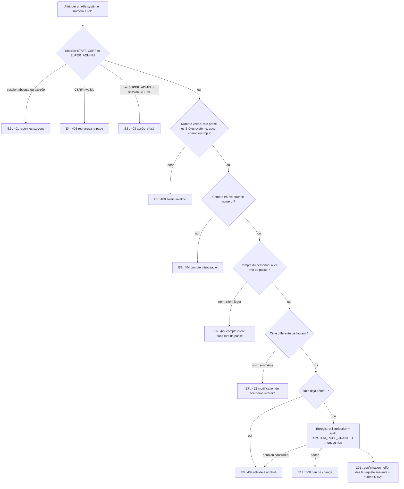
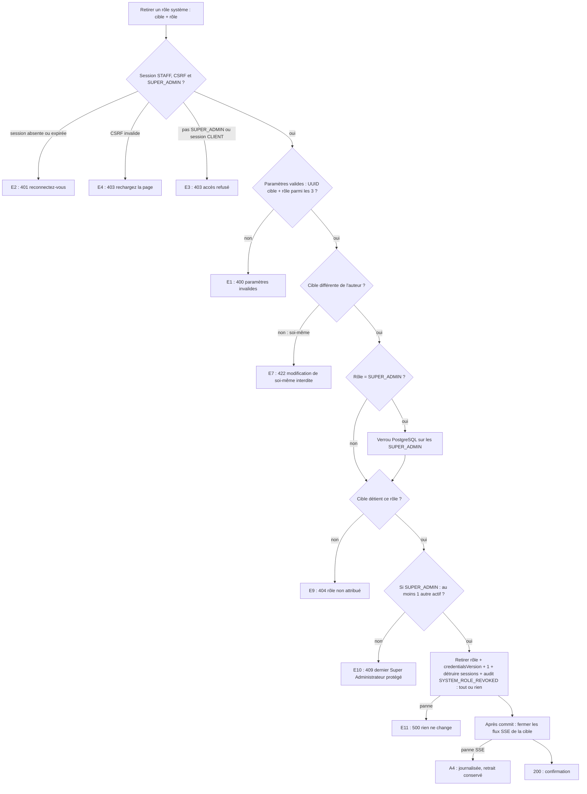
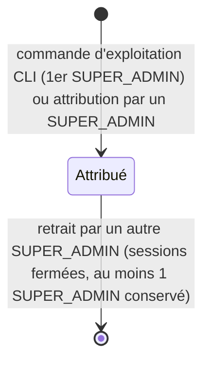

# UC-012 — Attribuer et retirer un rôle système

| Champ | Valeur |
|---|---|
| Statut | Prêt pour dev (D-058) |
| Priorité | Must |
| Module | `platform` (impacts : `shared` pour `ActorRights`, fermeture SSE et durées de session D-026 ; `identity` pour `GetMySession` et révocation des sessions par `credentialsVersion`) |
| Auteur | use-case-writer |
| Date | 2026-11-20 |
| Use cases liés | UC-001 / UC-007 (précèdent : le destinataire possède un compte du personnel avec mot de passe), UC-002 (connexion : étape suivante `PLATFORM_ADMIN` D-027, durées de session réduites 2 h / 12 h D-026 — reprend `@apres-UC-008` de RG-002-12), UC-003 (fermeture des sessions par `credentialsVersion`, D-031), UC-004 (séparation rôles système / propriété de salon — reprend `@apres-UC-008` T25), UC-005 (ouverture de salon sans mélanger les rôles — reprend `@apres-UC-008` T25), UC-008 (rôles salon séparés des rôles système — reprend `@apres-UC-012` T28), UC-009 (compte client léger et session `CLIENT` refusés ici, D-055), lot 7 (abonnements, supervision et suspension de salons utilisant ces rôles système) |
| Exigences couvertes | EX-011, EX-012, EX-013 (en partie), EX-020 (en partie), EX-023, EX-024, EX-025, EX-026, prd.md §4, prd.md §13 « Gestion des administrateurs », D-003, D-004, D-017, D-018, D-026, D-027, D-028, D-031, D-034, D-038, D-055 |

## 0. Traçabilité cahier des charges

| Exigence | Source | Où elle est traitée dans ce UC |
|---|---|---|
| EX-011 | prd.md §2 Règle d'architecture « les rôles système ne sont pas des rôles salon. Les autorisations sont évaluées dans leur propre périmètre », §4 | RG-012-01, RG-012-02, RG-012-08, RG-012-09, scénarios « Attribuer ou retirer un rôle système ne change aucune appartenance… », « Un rôle système ne donne aucun accès au back-office d'un salon… » |
| EX-012 | prd.md §4 « Les rôles système sont attribués exclusivement par GoMeCoiffer. Les utilisateurs de salons ne peuvent jamais s'attribuer ces rôles. » | RG-012-01, RG-012-05, RG-012-07, plan « Seul un Super Administrateur consulte, attribue ou retire… », scénarios « Initialisation du premier Super Administrateur… », « Un Super Administrateur ne peut jamais modifier ses propres rôles… » |
| PRD §4 (trois rôles et cumul) | prd.md §4 « Super Administrateur », « Administrateur Opérations », « Administrateur Finance Plateforme », « une même personne autorisée peut remplir plusieurs responsabilités internes » | RG-012-02, RG-012-03, scénarios « Un Super Administrateur attribue un rôle système… », « Une même personne peut cumuler plusieurs rôles système » |
| PRD §13 « Gestion des administrateurs » | prd.md §13 Administration plateforme « 4. Gestion des administrateurs » | RG-012-10, flux nominal, scénario « Le Super Administrateur consulte la liste des administrateurs GoMeCoiffer… » |
| EX-013, D-018, D-055 | prd.md §4 « Le client de la marketplace est un utilisateur public, sans permission d'administration système » ; DECISIONS.md | RG-012-01, RG-012-04, plans « Seul un Super Administrateur… » (session client refusée), « Seul un compte du personnel existant… » (compte client léger refusé) |
| EX-023 | prd.md §11 « Les modifications sensibles de permissions … doivent conserver une trace d'audit » | RG-012-12, scénario « Chaque attribution et chaque retrait est tracé sans donnée personnelle » |
| EX-024 | prd.md §12 Sécurité « contrôle d'accès côté backend, séparation stricte » | RG-012-01, RG-012-05, RG-012-06, RG-012-11, tous les scénarios `@securite` |
| EX-025 | prd.md §12 Données « collecte minimale des informations, conservation encadrée et droits d'accès limités » | RG-012-10 (numéro masqué dans la liste), RG-012-12 (audit sans nom ni numéro) |
| EX-026 | prd.md §12 Dates « conserver les instants en UTC » | RG-012-10, RG-012-12, §14 |
| D-026 | DECISIONS.md « utilisateur portant un rôle système : 2 h sans activité et 12 h après la connexion » | RG-012-08, plan « La durée de session réduite s'applique… », scénario « Après retrait de son dernier rôle système… » (reprend `@apres-UC-008` de UC-002 RG-002-12 et UC-005 T25) |
| D-027 | DECISIONS.md « Étape suivante après la connexion : rôle système → administration » | RG-012-08, scénario « Un Super Administrateur attribue un rôle système… » (reprend `@apres-UC-008` de UC-004 T25) |
| D-031, D-028 | DECISIONS.md « toutes les sessions fermées par une version des identifiants vérifiée à chaque requête » ; « audit sans numéro ni adresse réseau » | RG-012-08, RG-012-12, scénario « Un Super Administrateur retire un rôle système et ferme immédiatement les sessions… » |
| D-003, D-038 | DECISIONS.md « rôles système et permissions salon sont deux mondes séparés » ; un administrateur GoMeCoiffer peut posséder sa propre organisation | RG-012-09, scénarios « Attribuer ou retirer un rôle système ne change aucune appartenance… » (reprend `@apres-UC-012` de UC-008 T28) |

## 1. Objectif

Permettre à l'exploitant GoMeCoiffer, par l'intermédiaire d'un **Super Administrateur**, de gérer l'équipe interne
d'administration de la plateforme : consulter les administrateurs actifs, attribuer un ou plusieurs rôles système
(`SUPER_ADMIN`, `OPERATIONS_ADMIN`, `FINANCE_ADMIN`) à des comptes du personnel existants, et retirer un rôle système
avec effet immédiat (fermeture des sessions de la personne), tout en protégeant le dernier Super Administrateur et en
maintenant une séparation absolue avec les rôles salon.

## 2. User story

> En tant que **Super Administrateur de GoMeCoiffer**,
> je veux **consulter l'équipe d'administration, attribuer un rôle système à un collaborateur interne disposant d'un
> compte du personnel et lui retirer un rôle système**,
> afin de **déléguer la supervision des opérations et de la finance plateforme en toute sécurité, sans jamais mélanger
> les accès plateforme et les accès salon ni risquer de perdre le dernier Super Administrateur**.

## 3. Acteurs

- **Acteur principal** : un **Super Administrateur** GoMeCoiffer, connecté (session `STAFF`).
- **Acteurs secondaires** :
  - l'**exploitant technique** (opérateur serveur) : exécute la commande d'exploitation hors HTTP pour nommer le
    premier Super Administrateur ;
  - le **collaborateur interne ciblé** (compte du personnel existant, avec ou sans appartenance salon) : reçoit ou
    perd un rôle système ;
  - un **Administrateur Opérations**, un **Administrateur Finance Plateforme**, un **membre de salon** ou un **client**
    qui tente d'accéder à la gestion des administrateurs (E3) ;
  - le **suivi en direct (SSE)** : ferme les flux ouverts de la personne lorsqu'un rôle système lui est retiré (service
    interne, peut être indisponible : A4).

## 4. Déclencheur

- **Consultation** : le Super Administrateur ouvre **Administration → Gestion des administrateurs** (PRD §13).
- **Attribution** : il saisit le numéro de téléphone d'un membre de l'équipe disposant déjà d'un compte du personnel,
  choisit un rôle système et valide « Attribuer ce rôle ».
- **Retrait** : il sélectionne un rôle système d'un autre administrateur dans la liste et confirme « Retirer ce rôle ».
- **Initialisation (bootstrap)** : l'exploitant exécute la commande d'exploitation hors HTTP pour désigner le premier
  Super Administrateur.

## 5. Préconditions

- **Pour les actions HTTP (consulter, attribuer, retirer)** :
  - une session du personnel (`STAFF`) valide et non expirée (durées D-026 : 2 h inactivité / 12 h absolues) est ouverte ;
  - un jeton de sécurité (CSRF) valide est présent pour toute modification (attribution, retrait) ;
  - l'utilisateur connecté porte le rôle système actif **Super Administrateur** (`SUPER_ADMIN`) ;
  - aucun salon actif n'est requis (périmètre plateforme indépendant des salons).
- **Pour l'attribution (HTTP ou CLI)** :
  - le destinataire possède déjà un **compte du personnel** avec mot de passe (créé par UC-001 ou UC-007).

## 6. Postconditions

- **En cas de succès — attribution** :
  - le compte cible porte ce rôle système en plus de ses éventuels rôles système existants ;
  - ses appartenances et permissions salon sont inchangées ;
  - dès sa requête suivante, ses droits (`ActorRights`), son résumé de session (`GetMySession`), son étape suivante à la
    connexion (`PLATFORM_ADMIN`, D-027) et les durées de session réduites (2 h / 12 h, D-026) reflètent ce rôle ;
  - « rôle système attribué » est tracé dans le journal d'audit (sans PII), dans la même transaction.
- **En cas de succès — retrait** :
  - le rôle système est retiré du compte cible ; ses autres rôles système éventuels et toutes ses appartenances salon
    restent inchangés ;
  - la version des identifiants (`credentialsVersion`) du compte cible est incrémentée et toutes ses sessions actives
    sont fermées dans la même transaction ;
  - après le commit, tous ses flux de suivi en direct (SSE) sont fermés ;
  - « rôle système retiré » est tracé dans le journal d'audit (sans PII), dans la même transaction ;
  - au moins un Super Administrateur actif subsiste sur la plateforme.
- **En cas d'échec** : aucun rôle n'est ajouté ni retiré, la version des identifiants et les sessions du compte cible
  sont inchangées, aucune ligne d'audit n'est écrite et aucun flux SSE n'est fermé.

## 7. Règles métier

| ID | Règle | Exemple | Source |
|---|---|---|---|
| RG-012-01 | **Accès réservé au Super Administrateur** : seul un utilisateur connecté avec une session du personnel (`STAFF`) portant le rôle système `SUPER_ADMIN` consulte la liste des administrateurs, attribue ou retire un rôle système. L'auteur est lu dans la session, jamais dans la demande. Aucun salon actif n'est requis. Un Administrateur Opérations seul, un Administrateur Finance Plateforme seul ou un membre de salon (même Propriétaire) est refusé (403 « Action réservée à l’équipe GoMeCoiffer. »). Une session client (`CLIENT`, D-055) est refusée (403 `STAFF_SIGN_IN_REQUIRED`). Toute information en trop dans la demande (auteur, salon, permission salon…) fait refuser la demande entière (400). | Henri (`SUPER_ADMIN`) consulte et attribue → accepté. Serge (`OPERATIONS_ADMIN` seul), Mireille (`OWNER` d'Akwa) → 403 « Action réservée à l’équipe GoMeCoiffer. ». Aïcha (session client) → 403. Demande avec « salon : Go Beauty Akwa » → 400. | EX-011, EX-012, EX-024, D-003, D-055, CLAUDE.md §I.4 |
| RG-012-02 | **Trois rôles système fermés** : seuls **Super Administrateur** (`SUPER_ADMIN`), **Administrateur Opérations** (`OPERATIONS_ADMIN`) et **Administrateur Finance Plateforme** (`FINANCE_ADMIN`) existent. Viser un rôle salon (« Propriétaire », « Administrateur de salon »…) ou un rôle inconnu est refusé (400). | Attribuer « Administrateur Opérations » → accepté. Attribuer « Propriétaire » ou « Modérateur » → 400. | prd.md §4, EX-011 |
| RG-012-03 | **Cumul permis, sans doublon** : une même personne peut détenir 1, 2 ou les 3 rôles système en même temps. Attribuer un rôle système qu'elle possède **déjà** est refusé (409) sans créer de doublon ni écrire d'audit. | Serge porte `OPERATIONS_ADMIN` ; Henri lui ajoute `FINANCE_ADMIN` → Serge porte les deux. Henri tente d'ajouter de nouveau `OPERATIONS_ADMIN` → 409 « Cette personne possède déjà ce rôle système. » | prd.md §4 (« une même personne autorisée peut remplir plusieurs responsabilités internes ») ; `[HYPOTHÈSE]` refus 409 sur doublon — **Q1** |
| RG-012-04 | **Destinataire éligible** : un rôle système ne s'attribue qu'à un **compte du personnel existant** (compte muni d'un mot de passe, UC-001 ou UC-007), désigné par son numéro camerounais normalisé (`+237XXXXXXXXX`, RG-001-02). Un numéro sans compte est refusé (404) ; un **compte client léger** (sans mot de passe, D-018) est refusé (422). | Brice (`6 93 44 55 66`, compte du personnel) → accepté. `6 70 00 00 01` (sans compte) → 404. Aïcha (`6 55 44 33 22`, compte client léger) → 422. | EX-013, D-017, D-018, UC-008 §18 ; `[HYPOTHÈSE]` désignation par numéro à l'attribution — **Q2** |
| RG-012-05 | **Jamais à soi-même** : un Super Administrateur ne peut ni s'attribuer un rôle système à lui-même, ni se retirer un de ses propres rôles système, même s'il existe d'autres Super Administrateurs. | Henri (`SUPER_ADMIN`) tente de s'attribuer `FINANCE_ADMIN` ou de se retirer `SUPER_ADMIN` (alors que Nadine est aussi `SUPER_ADMIN`) → 422 « Vous ne pouvez pas modifier vos propres rôles système. Demandez à un autre Super Administrateur. » | EX-012, UC-008 §18 ; `[HYPOTHÈSE]` interdit aussi l'auto-attribution d'un rôle secondaire — **Q3** |
| RG-012-06 | **Protection du dernier Super Administrateur** : retirer `SUPER_ADMIN` est refusé (409) si la cible est le dernier Super Administrateur actif. Retirer un rôle que la personne ne possède pas est refusé (404). Retirer `OPERATIONS_ADMIN` ou `FINANCE_ADMIN` (ou `SUPER_ADMIN` quand au moins un autre `SUPER_ADMIN` existe) est autorisé. | Henri et Nadine sont tous deux `SUPER_ADMIN` : Henri retire `SUPER_ADMIN` à Nadine → accepté (il reste Henri). Retirer ensuite `SUPER_ADMIN` à Henri (s'il ne se visait pas lui-même) ou retirer le dernier `SUPER_ADMIN` → 409 « Impossible de retirer le dernier Super Administrateur. Attribuez d'abord ce rôle à une autre personne. » Retirer `FINANCE_ADMIN` à Serge qui n'a que `OPERATIONS_ADMIN` → 404. | EX-024, UC-008 §18 |
| RG-012-07 | **Premier Super Administrateur hors HTTP** : le premier Super Administrateur est attribué par une **commande d'exploitation (CLI)** exécutée hors HTTP sur le serveur, en désignant un compte du personnel existant par son numéro. Cette commande est **idempotente** (si le compte est déjà `SUPER_ADMIN`, elle réussit sans erreur ni doublon) et refuse un numéro sans compte ou un compte client léger. Elle trace l'attribution dans l'audit (auteur `SYSTEM_CLI`, sans PII) uniquement lorsqu'elle crée effectivement l'attribution. | Avant tout admin : commande CLI pour Henri (`6 90 11 22 33`) → Henri devient `SUPER_ADMIN`, 1 ligne d'audit. Relance de la commande pour Henri → succès, toujours 1 attribution, aucune nouvelle ligne d'audit. | EX-012, UC-008 §18 ; `[HYPOTHÈSE]` utilisable aussi en secours d'exploitation — **Q4** |
| RG-012-08 | **Effet immédiat, droits et sessions** : `ActorRights` et le résumé de session (`GetMySession`) relisent les vrais rôles système à chaque requête. **Attribution** : accès effectif dès la requête suivante ; étape suivante à la connexion = `PLATFORM_ADMIN` (D-027) ; durées de session réduites (2 h sans activité, 12 h absolues, D-026) appliquées dès la requête suivante (une session déjà ouverte depuis plus de 12 h ou inactive depuis plus de 2 h expire aussitôt). **Retrait** : incrémentation de `credentialsVersion` et fermeture de **toutes les sessions** de la personne dans la même transaction, puis fermeture de tous ses flux SSE après commit ; une panne du suivi en direct est journalisée et n'annule pas le retrait. Les appareils reconnus (D-025) ne sont pas révoqués. | Henri attribue `OPERATIONS_ADMIN` à Brice (connecté depuis 1 h) : dès la requête suivante, Brice accède aux routes `OPERATIONS_ADMIN` et sa session expirera après 2 h d'inactivité ou 12 h absolues. Henri retire `OPERATIONS_ADMIN` à Brice : toutes les sessions de Brice reçoivent 401 dès la requête suivante et ses flux SSE se ferment ; après reconnexion, il retrouve 24 h / 7 j. | EX-011, D-026, D-027, D-031, UC-008 §18 ; `[HYPOTHÈSE]` sessions conservées à l'attribution (soumises aussitôt à D-026) — **Q5** |
| RG-012-09 | **Séparation totale des mondes** : attribuer ou retirer un rôle système ne crée, ne modifie ni ne retire aucune appartenance ni permission salon. Un rôle système ne donne aucun droit dans un salon où la personne n'a pas d'appartenance active. | Serge est `OPERATIONS_ADMIN` et Propriétaire de « Salon Kamga Essos » : Henri lui retire `OPERATIONS_ADMIN` → Serge se reconnecte et reste Propriétaire de « Salon Kamga Essos ». Henri (`SUPER_ADMIN`, sans appartenance à Akwa) tente d'ouvrir « Go Beauty Akwa » → 404 (UC-005 RG-005-03). | EX-011, EX-012, D-003, D-038 |
| RG-012-10 | **Consultation de la liste des administrateurs** : le Super Administrateur voit toutes les personnes détenant au moins un rôle système actif, triées par nom puis date d'attribution, avec : identifiant utilisateur, nom complet, numéro de téléphone **masqué** (ex. `6 •• •• •• 55`), rôles système détenus avec leur date d'attribution (UTC), ainsi que le nombre total de Super Administrateurs. Aucun numéro en clair ni aucun utilisateur sans rôle système n'y figure. | Henri consulte la liste : voit Henri Ondoa (`SUPER_ADMIN`), Nadine Tchatchouang (`SUPER_ADMIN`), Serge Kamga (`OPERATIONS_ADMIN`, `6 •• •• •• 55`) ; `superAdminCount = 2`. Ni Mireille ni Aïcha n'apparaissent. | prd.md §13, EX-025, EX-026 ; `[HYPOTHÈSE]` numéro masqué plutôt qu'en clair — **Q6** |
| RG-012-11 | **Concurrence garantie en base** : (a) deux attributions simultanées du même rôle à la même personne → contrainte d'unicité `(user_id, role)` : une seule réussit (201), l'autre reçoit 409 ; (b) deux retraits simultanés visant les deux derniers `SUPER_ADMIN` (ex. Henri retire Nadine et Nadine retire Henri en même temps) → sérialisés par verrou PostgreSQL : un seul réussit (200), l'autre reçoit 409 (jamais 0 `SUPER_ADMIN`) ; (c) deux retraits simultanés du même rôle de la même personne → un seul réussit (200), l'autre reçoit 404. | Henri et Nadine (seuls `SUPER_ADMIN`) se retirent mutuellement au même instant → un seul retrait aboutit, il reste 1 `SUPER_ADMIN` actif. | EX-024, UC-008 §18 |
| RG-012-12 | **Audit sans PII et tout-ou-rien** : chaque attribution effective écrit « **rôle système attribué** » (`SYSTEM_ROLE_GRANTED` : cible, rôle, auteur ou `SYSTEM_CLI`, instant UTC) ; chaque retrait effectif écrit « **rôle système retiré** » (`SYSTEM_ROLE_REVOKED` : cible, rôle, auteur, instant UTC). Écriture dans la même transaction que la modification (et que l'incrémentation de `credentialsVersion` au retrait). Jamais de nom, de numéro de téléphone, d'e-mail ni d'adresse réseau dans l'audit ni dans les événements. | Retrait de `OPERATIONS_ADMIN` à Serge par Henri le 20/11/2026 à 10 h 00 → 1 ligne d'audit avec les identifiants et le code rôle, sans « Serge Kamga » ni « 6 92 33 44 55 ». Panne en base → rien n'est modifié, aucune ligne d'audit. | EX-023, EX-025, prd.md §11, D-028 |

## 8. Flux nominal

### 8.1 Attribuer un rôle système

1. Henri (`SUPER_ADMIN`) ouvre **Administration → Gestion des administrateurs**.
2. Le système vérifie sa session `STAFF` (durées D-026) et son rôle `SUPER_ADMIN`, puis affiche la liste des
   administrateurs GoMeCoiffer et le nombre de Super Administrateurs (RG-012-01, RG-012-10).
3. Henri choisit « Ajouter un rôle système », saisit le numéro de Brice (`6 93 44 55 66`), sélectionne
   « Administrateur Finance Plateforme » et valide (l'aide sous le rôle résume ses responsabilités, §15).
4. Le système vérifie la session, le jeton CSRF, le rôle `SUPER_ADMIN` et la forme stricte de la demande (numéro
   camerounais valide, rôle parmi les 3 rôles système, aucun champ en trop) (RG-012-01, RG-012-02).
5. Le système vérifie que le numéro correspond à un compte du personnel existant (avec mot de passe), que ce n'est pas
   le compte d'Henri lui-même, et que Brice ne possède pas déjà ce rôle (RG-012-03, RG-012-04, RG-012-05).
6. Le système enregistre l'attribution du rôle `FINANCE_ADMIN` à Brice et trace « rôle système attribué » dans le
   journal d'audit, en tout-ou-rien (RG-012-11, RG-012-12).
7. Le système renvoie la confirmation (`userId`, rôle, date d'attribution).
8. L'interface met à jour la liste et affiche « Rôle « Administrateur Finance Plateforme » attribué à Brice Mvondo.
   L'accès est actif dès maintenant. »
9. Dès sa requête suivante, Brice dispose du rôle `FINANCE_ADMIN` dans son résumé de session et ses contrôles d'accès,
   et les durées de session de 2 h / 12 h s'appliquent (RG-012-08).

### 8.2 Retirer un rôle système

1. Depuis **Administration → Gestion des administrateurs**, Henri sélectionne « Retirer » sur le rôle
   « Administrateur Opérations » de Serge Kamga et confirme.
2. Le système vérifie la session `STAFF`, le jeton CSRF, le rôle `SUPER_ADMIN` et la forme stricte des paramètres
   (identifiant utilisateur valide, rôle parmi les 3 rôles système) (RG-012-01, RG-012-02).
3. Le système vérifie qu'Henri ne se vise pas lui-même et que Serge possède bien ce rôle (RG-012-05, RG-012-06).
4. S'il s'agit du rôle `SUPER_ADMIN`, le système acquiert le verrou de sérialisation et vérifie qu'il existe au moins
   un autre `SUPER_ADMIN` actif (RG-012-06, RG-012-11).
5. Dans une même transaction, le système retire le rôle, incrémente `credentialsVersion` de Serge, détruit ses sessions
   actives et trace « rôle système retiré » dans le journal d'audit (RG-012-08, RG-012-12).
6. Après le commit, le système ferme tous les flux de suivi en direct (SSE) ouverts par Serge (RG-012-08).
7. Le système renvoie la confirmation (`userId`, rôle, date de retrait).
8. L'interface met à jour la liste et affiche « Rôle « Administrateur Opérations » retiré. Les sessions actives de cette
   personne ont été fermées. »

## 9. Flux alternatifs

- **A1 — Initialiser le premier Super Administrateur (CLI hors HTTP)** : l'exploitant exécute la commande
  d'exploitation en passant le numéro d'Henri (`6 90 11 22 33`). Le système vérifie le compte du personnel, attribue
  `SUPER_ADMIN` et trace `SYSTEM_ROLE_GRANTED` (auteur `SYSTEM_CLI`). Si Henri est déjà `SUPER_ADMIN`, la commande
  réussit sans modification ni nouvelle ligne d'audit (RG-012-07).
- **A2 — Cumuler plusieurs rôles système** (flux 8.1 étape 3) : Serge porte déjà `OPERATIONS_ADMIN` ; Henri lui
  attribue `FINANCE_ADMIN`. Serge détient les deux rôles ; ses appartenances salon éventuelles restent intactes
  (RG-012-03, RG-012-09).
- **A3 — Retirer `SUPER_ADMIN` lorsqu'il existe au moins un autre Super Administrateur** (flux 8.2 étape 4) : Henri et
  Nadine sont tous deux `SUPER_ADMIN` ; Henri retire `SUPER_ADMIN` à Nadine. Le retrait réussit, les sessions de Nadine
  sont fermées, et Henri reste `SUPER_ADMIN` (RG-012-06).
- **A4 — Suivi en direct (SSE) indisponible lors d'un retrait** (flux 8.2 étape 6) : la panne de fermeture SSE est
  journalisée mais le retrait reste validé ; les sessions de la cible sont déjà invalidées par `credentialsVersion` dès
  la requête suivante (RG-012-08).
- **A5 — Retrait du dernier rôle système d'un administrateur qui possède aussi un salon** (flux 8.2 étape 5) : Serge
  perd `OPERATIONS_ADMIN` ; ses sessions sont fermées ; lorsqu'il se reconnecte, il n'a plus aucun rôle système,
  retrouve les durées de session du personnel (24 h / 7 j), son appartenance « Propriétaire » à « Salon Kamga Essos »
  est intacte et l'étape suivante le conduit vers son salon (RG-012-08, RG-012-09).

## 10. Flux d'exception

- **E1 — Saisie ou paramètres invalides** (étape 4 / 8.2 étape 2) : numéro mal formé, identifiant utilisateur non UUID,
  rôle salon ou rôle inconnu, ou champ en trop → « Certaines informations sont invalides : corrigez les champs
  signalés. » (400, par champ) ; rien ne change (RG-012-01, RG-012-02).
- **E2 — Session absente ou expirée** (étape 4 / 8.2 étape 2) : « Session absente ou expirée : reconnectez-vous. »
  (401) ; y compris si la session d'Henri a dépassé 2 h d'inactivité ou 12 h absolues (RG-012-01, D-026).
- **E3 — Droits insuffisants** (étapes 2, 4 / 8.2 étape 2) :
  - session `STAFF` sans rôle `SUPER_ADMIN` (ex. `OPERATIONS_ADMIN`, `FINANCE_ADMIN`, `OWNER` de salon) → « Action
    réservée à l’équipe GoMeCoiffer. » (403) ;
  - session `CLIENT` (D-055) → « Cet espace est réservé aux comptes du personnel : connectez-vous avec votre mot de
    passe. » (403 `STAFF_SIGN_IN_REQUIRED`).
- **E4 — Jeton de sécurité (CSRF) absent ou périmé** (étape 4 / 8.2 étape 2) : « Jeton de sécurité absent ou expiré :
  rechargez la page puis recommencez. » (403) ; rien ne change.
- **E5 — Compte introuvable à l'attribution** (étape 5) : aucun utilisateur ne possède ce numéro → « Aucun compte du
  personnel n'existe pour ce numéro. Demandez à la personne de créer son compte d'abord. » (404) ; rien ne change
  (RG-012-04).
- **E6 — Compte client léger à l'attribution** (étape 5) : le numéro correspond à un compte sans mot de passe → « Ce
  compte est un compte client sans mot de passe. La personne doit d'abord créer un compte du personnel avec mot de
  passe. » (422) ; rien ne change (RG-012-04).
- **E7 — Auto-modification (attribution ou retrait à soi-même)** (étape 5 / 8.2 étape 3) : « Vous ne pouvez pas
  modifier vos propres rôles système. Demandez à un autre Super Administrateur. » (422) ; rien ne change (RG-012-05).
- **E8 — Rôle système déjà attribué (y compris double envoi simultané)** (étape 5-6) : « Cette personne possède déjà ce
  rôle système. » (409) ; rien ne change, aucune ligne d'audit (RG-012-03, RG-012-11).
- **E9 — Rôle système non détenu au retrait (y compris double retrait simultané)** (8.2 étape 3) : « Ce rôle système
  n'est pas attribué à cette personne. » (404) ; rien ne change (RG-012-06, RG-012-11).
- **E10 — Retrait du dernier Super Administrateur (y compris retraits croisés simultanés)** (8.2 étape 4) : « Impossible
  de retirer le dernier Super Administrateur. Attribuez d'abord ce rôle à une autre personne. » (409) ; rien ne change,
  aucune session fermée (RG-012-06, RG-012-11).
- **E11 — Panne pendant l'enregistrement** (étape 6 / 8.2 étape 5) : « Enregistrement impossible pour le moment.
  Réessayez dans quelques minutes. » (500, sans détail) ; transaction annulée, aucun rôle modifié, aucune session
  fermée, aucune trace d'audit (RG-012-12).

> Aucun service tiers externe (ni SMS, ni paiement) n'intervient. Le suivi en direct (SSE) est un service interne dont
> la panne post-commit ne fait jamais échouer le retrait (A4).

## 11. Workflow

Attribution d'un rôle système :



Retrait d'un rôle système :



Cycle de vie d'une attribution de rôle système :



## 12. Scénarios d'acceptation (BDD)

Identiques à `features/platform/attribuer-et-retirer-un-role-systeme.feature`.

```gherkin
# language: fr
@UC-012
Fonctionnalité: Attribuer et retirer un rôle système
  Pour répartir l'administration de la plateforme GoMeCoiffer en toute sécurité,
  un Super Administrateur consulte les administrateurs actifs, attribue un ou plusieurs rôles système
  à des comptes du personnel existants et retire un rôle système avec effet immédiat,
  sans jamais modifier ses propres rôles, retirer le dernier Super Administrateur ni mélanger rôles système et rôles salon.

  Contexte:
    Étant donné que nous sommes le 20/11/2026 à 10 h 00, heure de Douala
    Et que les comptes existants sont :
      | personne            | numéro        | type de compte      |
      | Henri Ondoa         | 6 90 11 22 33 | compte du personnel |
      | Nadine Tchatchouang | 6 91 22 33 44 | compte du personnel |
      | Serge Kamga         | 6 92 33 44 55 | compte du personnel |
      | Brice Mvondo        | 6 93 44 55 66 | compte du personnel |
      | Mireille Ndongo     | 6 77 12 34 56 | compte du personnel |
      | Aïcha Mbarga        | 6 55 44 33 22 | compte client léger |
    Et qu'aucun compte n'existe pour le 6 70 00 00 01
    Et que les rôles système actifs sont :
      | personne    | rôle système              |
      | Henri Ondoa | Super Administrateur      |
      | Serge Kamga | Administrateur Opérations |
    Et que les appartenances salon actives sont :
      | personne        | salon             | rôle                    |
      | Mireille Ndongo | Go Beauty Akwa    | Propriétaire            |
      | Serge Kamga     | Salon Kamga Essos | Propriétaire            |
      | Serge Kamga     | Go Beauty Akwa    | Administrateur de salon |
    Et qu'Henri est connecté en tant que membre du personnel

  @nominal @RG-012-07 @EX-012
  Scénario: Initialisation du premier Super Administrateur par commande d'exploitation
    Étant donné qu'aucun utilisateur n'a encore de rôle système sur la plateforme
    Quand l'exploitant exécute la commande d'initialisation du premier Super Administrateur pour le "6 90 11 22 33"
    Alors Henri Ondoa possède le rôle système "Super Administrateur"
    Et le journal d'audit contient « rôle système attribué » pour Henri Ondoa, rôle "Super Administrateur", par "commande d'exploitation"

  @alternatif @RG-012-07
  Scénario: Relancer la commande d'exploitation pour un Super Administrateur existant est sans effet
    Quand l'exploitant exécute la commande d'initialisation du premier Super Administrateur pour le "6 90 11 22 33"
    Alors la commande réussit
    Et Henri Ondoa possède toujours une seule fois le rôle système "Super Administrateur"
    Et le journal d'audit n'a aucune nouvelle ligne

  @nominal @RG-012-01 @RG-012-02 @RG-012-04 @RG-012-08 @EX-012
  Scénario: Un Super Administrateur attribue un rôle système à un compte du personnel
    Étant donné que Brice Mvondo est connecté depuis 9 h 30
    Quand Henri attribue le rôle système "Administrateur Finance Plateforme" au "6 93 44 55 66"
    Alors Brice Mvondo possède le rôle système "Administrateur Finance Plateforme"
    Et dès sa requête suivante, le résumé de session de Brice mentionne le rôle système "Administrateur Finance Plateforme"
    Et à sa prochaine connexion, on invite Brice à ouvrir l'administration GoMeCoiffer

  @nominal @RG-012-03 @EX-011
  Scénario: Une même personne peut cumuler plusieurs rôles système
    Quand Henri attribue le rôle système "Administrateur Finance Plateforme" au "6 92 33 44 55"
    Alors Serge Kamga possède les rôles système "Administrateur Opérations" et "Administrateur Finance Plateforme"

  @nominal @RG-012-10 @EX-025
  Scénario: Le Super Administrateur consulte la liste des administrateurs GoMeCoiffer sans numéro en clair
    Quand Henri consulte la liste des administrateurs GoMeCoiffer
    Alors il voit les administrateurs suivants :
      | nom         | numéro masqué | rôles système             |
      | Henri Ondoa | 6 •• •• •• 33 | Super Administrateur      |
      | Serge Kamga | 6 •• •• •• 55 | Administrateur Opérations |
    Et la liste indique 1 Super Administrateur actif
    Et ni Brice Mvondo, ni Mireille Ndongo, ni Aïcha Mbarga n'apparaissent dans la liste
    Et aucun numéro de téléphone complet n'est exposé

  @nominal @RG-012-06 @RG-012-08 @EX-012
  Scénario: Un Super Administrateur retire un rôle système et ferme immédiatement les sessions de la personne
    Étant donné que Serge Kamga est connecté sur deux appareils et suit GoMeCoiffer en direct
    Quand Henri retire le rôle système "Administrateur Opérations" à Serge Kamga
    Alors Serge Kamga ne possède plus le rôle système "Administrateur Opérations"
    Et les deux sessions de Serge sont refusées dès la requête suivante avec le motif "Session absente ou expirée : reconnectez-vous."
    Et les flux de suivi en direct de Serge sont fermés

  @alternatif @RG-012-06
  Scénario: Un Super Administrateur peut retirer le rôle Super Administrateur s'il en reste au moins un autre
    Étant donné que Nadine Tchatchouang possède aussi le rôle système "Super Administrateur"
    Quand Henri retire le rôle système "Super Administrateur" à Nadine Tchatchouang
    Alors Nadine Tchatchouang ne possède plus le rôle système "Super Administrateur"
    Et Henri Ondoa reste Super Administrateur actif

  @alternatif @RG-012-08 @D-026
  Plan du scénario: La durée de session réduite s'applique dès qu'une personne porte un rôle système
    Étant donné que Serge Kamga s'est connecté le 20/11/2026 à 08 h 00
    Quand Serge accède à l'administration le 20/11/2026 à <heure> après <inactivité> sans activité
    Alors l'accès est <résultat>

    Exemples:
      | heure   | inactivité | résultat                 |
      | 09 h 59 | 1 h 59     | accordé                  |
      | 10 h 01 | 2 h 01     | refusé : session expirée |
      | 20 h 01 | 0 h 30     | refusé : session expirée |

  @alternatif @RG-012-08 @D-026
  Scénario: Après retrait de son dernier rôle système, la personne retrouve les durées de session du personnel à sa reconnexion
    Étant donné qu'Henri a retiré le rôle système "Administrateur Opérations" à Serge Kamga
    Et que Serge s'est reconnecté le 20/11/2026 à 10 h 05
    Quand Serge accède à son espace le 20/11/2026 à 13 h 00 après 2 h 55 sans activité
    Alors l'accès est accordé

  @securite @RG-012-09 @EX-011 @EX-012
  Scénario: Attribuer ou retirer un rôle système ne change aucune appartenance ni permission salon
    Quand Henri retire le rôle système "Administrateur Opérations" à Serge Kamga
    Alors Serge Kamga reste "Propriétaire" du salon "Salon Kamga Essos"
    Et Serge Kamga reste "Administrateur de salon" du salon "Go Beauty Akwa"
    Et lorsque Serge se reconnecte, on l'invite à choisir son salon

  @securite @RG-012-09 @EX-011 @EX-024
  Scénario: Un rôle système ne donne aucun accès au back-office d'un salon sans appartenance
    Quand Henri tente d'ouvrir le salon "Go Beauty Akwa"
    Alors l'ouverture est refusée comme pour un salon qui n'existe pas

  @securite @RG-012-12 @EX-023 @EX-025
  Scénario: Chaque attribution et chaque retrait est tracé sans donnée personnelle
    Étant donné qu'Henri a attribué le rôle système "Administrateur Finance Plateforme" au "6 93 44 55 66" à 10 h 00
    Quand Henri retire le rôle système "Administrateur Finance Plateforme" à Brice Mvondo à 10 h 05
    Alors le journal d'audit contient « rôle système attribué » à 10 h 00 et « rôle système retiré » à 10 h 05 pour Brice Mvondo, rôle "Administrateur Finance Plateforme", par Henri Ondoa
    Et ni le nom ni le numéro de téléphone de Brice ou d'Henri n'y figurent

  @erreur @RG-012-08
  Scénario: Une panne du suivi en direct n'empêche pas le retrait d'un rôle système
    Étant donné que le service de suivi en direct est indisponible
    Et que Serge Kamga est connecté
    Quand Henri retire le rôle système "Administrateur Opérations" à Serge Kamga
    Alors le retrait est enregistré
    Et la session de Serge est refusée dès la requête suivante avec le motif "Session absente ou expirée : reconnectez-vous."

  @securite @RG-012-01 @EX-012 @EX-024
  Plan du scénario: Seul un Super Administrateur consulte, attribue ou retire un rôle système
    Étant donné que <personne> est connecté(e) avec <type de session>
    Quand <personne> tente d'attribuer le rôle système "Administrateur Finance Plateforme" au "6 93 44 55 66"
    Alors la demande est refusée avec le motif "<motif>"
    Et Brice Mvondo n'a toujours aucun rôle système

    Exemples:
      | personne        | type de session         | motif                                                                                    |
      | Serge Kamga     | une session personnel   | Action réservée à l’équipe GoMeCoiffer.                                                  |
      | Mireille Ndongo | une session personnel   | Action réservée à l’équipe GoMeCoiffer.                                                  |
      | Aïcha Mbarga    | une session client      | Cet espace est réservé aux comptes du personnel : connectez-vous avec votre mot de passe. |

  @erreur @RG-012-01
  Plan du scénario: Sans session ou sans jeton de sécurité, aucune action n'est effectuée
    Étant donné que <situation>
    Quand Henri attribue le rôle système "Administrateur Finance Plateforme" au "6 93 44 55 66"
    Alors la demande est refusée avec le motif "<motif>"
    Et Brice Mvondo n'a toujours aucun rôle système

    Exemples:
      | situation                                         | motif                                                                    |
      | la session d'Henri a expiré                       | Session absente ou expirée : reconnectez-vous.                           |
      | la demande d'Henri n'a pas de jeton de sécurité   | Jeton de sécurité absent ou expiré : rechargez la page puis recommencez. |

  @erreur @securite @RG-012-01 @RG-012-02
  Plan du scénario: Seuls les trois rôles système et les informations attendues sont acceptés
    Quand Henri attribue <rôle> au "<numéro>" <extra>
    Alors la demande est refusée avec le motif "Certaines informations sont invalides : corrigez les champs signalés."
    Et aucun rôle système n'a été ajouté

    Exemples:
      | rôle                               | numéro        | extra                                     |
      | le rôle "Propriétaire"             | 6 93 44 55 66 | sans information en trop                  |
      | le rôle inconnu "Modérateur"       | 6 93 44 55 66 | sans information en trop                  |
      | le rôle "Administrateur Opérations"| 6 93 44 55 6  | sans information en trop                  |
      | le rôle "Administrateur Opérations"| 6 93 44 55 66 | en indiquant en plus le salon "Go Beauty Akwa" |

  @erreur @RG-012-04
  Plan du scénario: Seul un compte du personnel existant peut recevoir un rôle système
    Quand Henri attribue le rôle système "Administrateur Opérations" au "<numéro>"
    Alors la demande est refusée avec le motif "<motif>"
    Et aucun rôle système n'a été ajouté

    Exemples:
      | numéro        | motif                                                                                                                      |
      | 6 70 00 00 01 | Aucun compte du personnel n'existe pour ce numéro. Demandez à la personne de créer son compte d'abord.                     |
      | 6 55 44 33 22 | Ce compte est un compte client sans mot de passe. La personne doit d'abord créer un compte du personnel avec mot de passe. |

  @erreur @securite @RG-012-05 @EX-012
  Plan du scénario: Un Super Administrateur ne peut jamais modifier ses propres rôles système
    Étant donné que Nadine Tchatchouang possède aussi le rôle système "Super Administrateur"
    Quand Henri tente de <action> sur son propre compte
    Alors la demande est refusée avec le motif "Vous ne pouvez pas modifier vos propres rôles système. Demandez à un autre Super Administrateur."
    Et les rôles système d'Henri n'ont pas changé

    Exemples:
      | action                                                   |
      | s'attribuer le rôle "Administrateur Finance Plateforme"  |
      | se retirer le rôle "Super Administrateur"                |

  @erreur @RG-012-03
  Scénario: Attribuer un rôle système déjà détenu est refusé sans créer de doublon
    Quand Henri attribue le rôle système "Administrateur Opérations" au "6 92 33 44 55"
    Alors la demande est refusée avec le motif "Cette personne possède déjà ce rôle système."
    Et le journal d'audit n'a aucune nouvelle ligne

  @erreur @RG-012-06
  Scénario: Retirer un rôle système non détenu par la personne est refusé
    Quand Henri retire le rôle système "Administrateur Finance Plateforme" à Serge Kamga
    Alors la demande est refusée avec le motif "Ce rôle système n'est pas attribué à cette personne."
    Et les sessions de Serge ne sont pas fermées

  @securite @RG-012-06
  Scénario: Impossible de retirer le dernier Super Administrateur actif
    Étant donné qu'Henri Ondoa est le seul Super Administrateur actif
    Et que le système traite une demande de retrait du rôle "Super Administrateur" d'Henri Ondoa
    Quand le retrait du dernier Super Administrateur est évalué
    Alors le retrait est refusé avec le motif "Impossible de retirer le dernier Super Administrateur. Attribuez d'abord ce rôle à une autre personne."
    Et Henri Ondoa reste Super Administrateur actif

  @securite @RG-012-11
  Scénario: Deux attributions simultanées du même rôle ne créent qu'une seule attribution
    Quand deux demandes d'Henri attribuant "Administrateur Finance Plateforme" au "6 93 44 55 66" arrivent en même temps
    Alors une seule réussit
    Et l'autre est refusée avec le motif "Cette personne possède déjà ce rôle système."
    Et le journal d'audit n'a qu'une nouvelle ligne

  @securite @RG-012-06 @RG-012-11
  Scénario: Deux retraits simultanés des deux derniers Super Administrateurs en conservent toujours un
    Étant donné que Nadine Tchatchouang possède aussi le rôle système "Super Administrateur"
    Et que Nadine est connectée
    Quand Henri retire "Super Administrateur" à Nadine au même instant où Nadine retire "Super Administrateur" à Henri
    Alors un seul des deux retraits réussit
    Et l'autre est refusé avec le motif "Impossible de retirer le dernier Super Administrateur. Attribuez d'abord ce rôle à une autre personne."
    Et il reste exactement 1 Super Administrateur actif sur la plateforme

  @erreur @RG-012-12
  Scénario: Une panne pendant l'enregistrement ne laisse aucun changement partiel
    Étant donné que le service GoMeCoiffer tombe en panne pendant le retrait
    Et que Serge Kamga est connecté
    Quand Henri retire le rôle système "Administrateur Opérations" à Serge Kamga
    Alors la demande est refusée avec le motif "Enregistrement impossible pour le moment. Réessayez dans quelques minutes."
    Et Serge Kamga possède toujours le rôle système "Administrateur Opérations"
    Et la session de Serge est toujours active
    Et le journal d'audit n'a aucune nouvelle ligne
```

## 13. Plan de tests TDD

Ordre : du catalogue et des invariants métier aux handlers, puis persistance et concurrence en vraie base, puis HTTP et
rejeux `@apres-UC-008` / `@apres-UC-012`. Unitaire = fakes in-memory ; intégration = vraie base (Testcontainers) ; E2E
= HTTP. `ListPlatformAdmins` et `GetMySession` sont des queries : E2E uniquement.

| # | Niveau | Comportement testé | Étant donné | Quand | Alors | Règle |
|---|---|---|---|---|---|---|
| T1 | Unitaire | Catalogue des 3 rôles système (`SUPER_ADMIN`, `OPERATIONS_ADMIN`, `FINANCE_ADMIN`) : aucun rôle salon ni valeur inconnue accepté | — | validation du rôle | 3 acceptés, `OWNER` / `MOD` refusés | RG-012-02 |
| T2 | Unitaire | Agrégat `PlatformAdmin.grant` : ajout d'un rôle, cumul de plusieurs rôles, événement `SystemRoleGranted` sans PII ; doublon → `SystemRoleAlreadyGrantedError` | agrégat vide puis avec `OPERATIONS_ADMIN` | `grant` | rôles cumulés / erreur sur doublon | RG-012-03, -12 |
| T3 | Unitaire | Agrégat `PlatformAdmin.revoke` : retrait d'un rôle détenu, événement `SystemRoleRevoked` sans PII ; rôle non détenu → `SystemRoleNotAssignedError` | agrégat avec `OPERATIONS_ADMIN` | `revoke` | retiré / erreur si absent | RG-012-06, -12 |
| T4 | Unitaire | `GrantSystemRoleHandler` : numéro sans compte → `StaffAccountNotFoundError` (404) ; compte client léger → `StaffAccountRequiredError` (422) ; auteur = cible → `SelfSystemRoleModificationError` (422) | fakes en mémoire | `execute` | erreurs exactes, 0 écriture, 0 audit | RG-012-04, -05 |
| T5 | Unitaire | `GrantSystemRoleHandler` : succès → rôle enregistré, audit `SYSTEM_ROLE_GRANTED` sans PII, aucune fermeture de session | Brice compte du personnel, Henri auteur | `execute` | succès, 1 ligne d'audit | RG-012-03, -08, -12 |
| T6 | Unitaire | `RevokeSystemRoleHandler` : auteur = cible → `SelfSystemRoleModificationError` (422) ; rôle absent → `SystemRoleNotAssignedError` (404) ; dernier `SUPER_ADMIN` (`superAdminCount <= 1`) → `LastSuperAdminError` (409) | fakes en mémoire | `execute` | erreurs exactes, 0 session fermée, 0 audit | RG-012-05, -06 |
| T7 | Unitaire | `RevokeSystemRoleHandler` : succès → rôle retiré, `credentialsVersion` incrémentée + sessions détruites, audit `SYSTEM_ROLE_REVOKED` sans PII, fermeture SSE enregistrée en `AfterCommit` | Serge `OPERATIONS_ADMIN`, Henri auteur | `execute` | comme décrit | RG-012-08, -12 |
| T8 | Unitaire | `BootstrapSuperAdminHandler` (CLI) : numéro sans compte → refus ; client léger → refus ; compte du personnel → `SUPER_ADMIN` + audit `SYSTEM_CLI` ; déjà `SUPER_ADMIN` → idempotent (0 écriture, 0 audit) | fakes en mémoire | `execute` | comme décrit | RG-012-07 |
| T9 | Intégration | Migration : table `platform_admin_roles` (PK `(user_id, role)`, `CHECK` rôle ∈ 3, FK `users(id)`), `down` réel ; doublon → `SystemRoleAlreadyGrantedError` (traduction `23505`) | vraie base | `migration:run` / `revert` / double insert | comme décrit | RG-012-02, -03, -11 |
| T10 | Intégration | Verrou PostgreSQL sur le dernier `SUPER_ADMIN` : 2 retraits croisés parallèles (Henri retire Nadine, Nadine retire Henri) → exactement 1 succès + 1 `LastSuperAdminError`, 1 `SUPER_ADMIN` restant en base | 2 `SUPER_ADMIN` en base | 2 transactions concurrentes | comme décrit | RG-012-06, -11 |
| T11 | Intégration | Tout-ou-rien au retrait : panne forcée après suppression du rôle (avant incrémentation `credentialsVersion` ou audit) → transaction annulée, rôle intact, sessions intactes, 0 audit | Serge en base | `RevokeSystemRole` | rollback complet | RG-012-12 |
| T12 | Intégration | `SqlActorRights` : renvoie désormais les vrais `systemRoles` de `platform_admin_roles` (une lecture), conserve `credentialsVersion` et l'isolation salon | Henri `SUPER_ADMIN`, Serge `OPERATIONS_ADMIN` + `OWNER` Essos | `resolve` | rôles système exacts, aucun droit salon sur Akwa pour Henri | RG-012-08, -09 |
| T13 | E2E | Parcours attribution : `POST /api/admin/platform-roles` (201) → `GET /api/salon/session` de Brice montre `systemRoles: ['FINANCE_ADMIN']`, `nextStep: 'PLATFORM_ADMIN'` ; cumul 2e rôle pour Serge → 201 | Henri, Brice, Serge | requêtes HTTP | comme décrit | RG-012-03, -08 |
| T14 | E2E | `GET /api/admin/platform-roles` (200) : liste triée, `maskedPhone` (aucun numéro complet), rôles + `grantedAt`, `superAdminCount`, aucun utilisateur sans rôle système ; **rapport d'index** (`query-perf`) | Henri, Serge, Brice, Mireille, Aïcha | `GET` | comme décrit | RG-012-10 |
| T15 | E2E | Parcours retrait : `DELETE /api/admin/platform-roles/:userId/:role` (200) → 2 sessions de Serge reçoivent 401 dès la requête suivante, flux SSE de Serge fermé ; panne SSE forcée → 200 quand même et sessions 401 | Henri, Serge (2 sessions + SSE) | `DELETE` | comme décrit | RG-012-08 |
| T16 | E2E | Contrôle d'accès (`it.each`) : sans session → 401 ; sans CSRF → 403 ; Serge (`OPERATIONS_ADMIN`), Brice (`FINANCE_ADMIN`), Mireille (`OWNER`) → 403 « Action réservée à l’équipe GoMeCoiffer. » ; Aïcha (session `CLIENT`) → 403 `STAFF_SIGN_IN_REQUIRED` sur `GET`, `POST`, `DELETE` | acteurs | requêtes HTTP | 401 / 403 | RG-012-01 |
| T17 | E2E | Validation stricte : rôle `OWNER`, rôle inconnu, numéro mal formé, UUID cible mal formé, champ `salonId` ou `actorUserId` en trop → 400 + `errors`, rien modifié | Henri | `POST` / `DELETE` | 400 | RG-012-01, -02 |
| T18 | E2E | Erreurs métier : numéro sans compte → 404 ; compte client léger (Aïcha) → 422 ; auto-attribution et auto-retrait → 422 ; doublon → 409 ; retrait d'un rôle non détenu → 404 | Henri | `POST` / `DELETE` | 404 / 422 / 409 | RG-012-03 à -06 |
| T19 | E2E | Concurrence HTTP : 2 `POST` parallèles identiques → 201 + 409 (1 ligne d'audit) ; 2 `DELETE` croisés des 2 derniers `SUPER_ADMIN` → 200 + 409 (1 `SUPER_ADMIN` restant) ; 2 `DELETE` parallèles du même rôle → 200 + 404 | Henri, Nadine | requêtes parallèles | jamais 500 | RG-012-06, -11 |
| T20 | E2E | Audit en base : `SYSTEM_ROLE_GRANTED` et `SYSTEM_ROLE_REVOKED` présents avec identifiants et code rôle, sans nom ni numéro ; 0 ligne sur refus ou panne forcée (500 sans détail) | Henri, Brice | requêtes | comme décrit | RG-012-12 |
| T21 | E2E | **Rejeu `@apres-UC-008` de UC-002 (RG-002-12) et UC-005 (T25)** : durées de session D-026 (2 h inactivité, 12 h absolues) appliquées à Serge tant qu'il est `OPERATIONS_ADMIN` (même après ouverture de son salon), et retour à 24 h / 7 j après retrait et reconnexion | Serge | horloge fixe | accordé / 401 aux bornes | RG-012-08 |
| T22 | E2E | **Rejeu `@apres-UC-008` de UC-004 (T25) et `@apres-UC-012` de UC-008 (T28)** : séparation totale — retrait de `OPERATIONS_ADMIN` laisse intactes les appartenances salon de Serge ; réglage d'un rôle salon par Mireille ne touche pas les rôles système de Serge ; Henri (`SUPER_ADMIN`) ne peut pas ouvrir Akwa (404) | Henri, Serge, Mireille | requêtes | comme décrit | RG-012-09 |
| T23 | Intégration | Commande CLI bootstrap (appel du point d'entrée de commande en base réelle) : création du 1er `SUPER_ADMIN`, idempotence au 2e appel, refus sur compte client léger | vraie base | CLI | comme décrit | RG-012-07 |
| T24 | Mutation | Stryker sur `PlatformAdmin` (`grant`, `revoke`) et gardes `LastSuperAdmin` / `SelfSystemRoleModification` / `StaffAccountRequired` | — | `pnpm mutation` | aucun mutant survivant | RG-012-03 à -06 |

Doubles de test : horloge fixe ; repository `PlatformAdmins` en mémoire (avec verrou simulé) ; lecture des comptes
du personnel en mémoire (`UserAccountLookup`) ; port `UserSessionsRevoker` en mémoire ; `RealtimeCloser` en mémoire
(panne forçable) ; journal d'audit en mémoire.

## 14. Données

- **Entrées — attribuer (`POST /api/admin/platform-roles`, corps strict)** :
  - `phone` — numéro camerounais obligatoire, formats de RG-001-02, normalisé en `+237XXXXXXXXX` ;
  - `role` — `SUPER_ADMIN` | `OPERATIONS_ADMIN` | `FINANCE_ADMIN` ;
  - lus par la couche HTTP, pas dans le corps : auteur (`userId` de la session), jeton CSRF.
- **Entrées — retirer (`DELETE /api/admin/platform-roles/:userId/:role`)** :
  - `userId` — UUID obligatoire (paramètre de chemin) ;
  - `role` — `SUPER_ADMIN` | `OPERATIONS_ADMIN` | `FINANCE_ADMIN` (paramètre de chemin) ;
  - corps vide (rejeté s'il contient des champs inattendus) ; auteur lu dans la session, jeton CSRF.
- **Entrées — CLI bootstrap** :
  - `--phone` — numéro camerounais normalisé d'un compte du personnel existant.
- **Sorties** :
  - consulter (`GET /api/admin/platform-roles`, 200) : `{ superAdminCount, admins: [{ userId, name, maskedPhone, roles: [{ role, grantedAt }] }] }` ;
  - attribuer (201) : `{ userId, role, grantedAt }` ;
  - retirer (200) : `{ userId, role, revokedAt }` ;
  - `GetMySession` (existant, désormais alimenté) : `systemRoles: ('SUPER_ADMIN' | 'OPERATIONS_ADMIN' | 'FINANCE_ADMIN')[]`, `nextStep: 'PLATFORM_ADMIN'` si `systemRoles.length > 0` ;
  - refus : `VALIDATION_FAILED` 400 (avec `errors`), `UNAUTHENTICATED` 401, `CSRF_INVALID` / `FORBIDDEN` / `STAFF_SIGN_IN_REQUIRED` 403, `STAFF_ACCOUNT_NOT_FOUND` / `SYSTEM_ROLE_NOT_ASSIGNED` 404, `SYSTEM_ROLE_ALREADY_GRANTED` / `LAST_SUPER_ADMIN` 409, `STAFF_ACCOUNT_REQUIRED` / `SELF_SYSTEM_ROLE_MODIFICATION` 422, 500 sans détail.
- **Stocké** :
  - table `platform_admin_roles` : `user_id` (UUID, FK `users(id)`), `role` (`CHECK` ∈ 3 valeurs), `granted_at` (`timestamptz`), `granted_by_user_id` (UUID nullable si `SYSTEM_CLI`), clé primaire `(user_id, role)` ;
  - audit : `SYSTEM_ROLE_GRANTED`, `SYSTEM_ROLE_REVOKED` (identifiants et code rôle seulement, instant UTC, aucune PII).
- **Jeux de données de test** :
  - Henri Ondoa (`6 90 11 22 33`) : `SUPER_ADMIN` ;
  - Nadine Tchatchouang (`6 91 22 33 44`) : compte du personnel (ou 2e `SUPER_ADMIN` selon le scénario) ;
  - Serge Kamga (`6 92 33 44 55`) : `OPERATIONS_ADMIN`, Propriétaire de « Salon Kamga Essos » et Administrateur de salon de « Go Beauty Akwa » ;
  - Brice Mvondo (`6 93 44 55 66`) : compte du personnel sans rôle système ;
  - Mireille Ndongo (`6 77 12 34 56`) : Propriétaire de « Go Beauty Akwa » ;
  - Aïcha Mbarga (`6 55 44 33 22`) : compte client léger ;
  - `6 70 00 00 01` : numéro sans compte.
- **Seed de démo** (idempotent, hors prod via `seed-guard.ts`) : Henri Ondoa (`SUPER_ADMIN`) et Serge Kamga
  (`OPERATIONS_ADMIN`), pour tester l'espace `/admin` en local dès le démarrage.

## 15. Exigences non fonctionnelles

- **Sécurité** :
  - périmètre critique (`@RequiresSystemRole('SUPER_ADMIN')`, SQL sur les droits, révocation de sessions, séparation
    des mondes) : `security-reviewer` obligatoire dans tous les modes ;
  - protection d'espace `/api/admin/platform-roles*` : `@RequiresSystemRole('SUPER_ADMIN')` + CSRF ; session `CLIENT`
    refusée par le garde global (D-055) ;
  - aucun numéro de téléphone complet, nom ou secret dans les logs, l'audit ou les événements de domaine ;
  - la commande CLI bootstrap n'est jamais exposée en HTTP et refuse de créer un compte sans mot de passe.
- **Performance** :
  - `GET /api/admin/platform-roles` < 100 ms (lecture SQL directe, faible volumétrie interne < 100 administrateurs) ;
  - `POST` / `DELETE` < 200 ms ;
  - `SqlActorRights` : lecture des rôles système via l'index PK `(user_id, role)` (surcharge < 2 ms).
- **Fiabilité et cohérence** :
  - 0 % de perte du dernier `SUPER_ADMIN` même sous accès concurrents ;
  - 100 % des retraits invalident toutes les sessions de la cible dans la même transaction.
- **Traçabilité / Audit** : 100 % des attributions (HTTP et CLI) et retraits effectifs tracés dans leur transaction.
- **Guidage de l'utilisateur** (CLAUDE.md, tous modes) :
  - sous le sélecteur de rôle système, une aide courte suit le rôle choisi (textes du PRD §4) :
    - Super Administrateur : « Paramètres globaux, supervision, gestion des administrateurs et suspension des salons. »
    - Administrateur Opérations : « Vérification des établissements, assistance et supervision des réservations. »
    - Administrateur Finance Plateforme : « Abonnements, facturation SaaS, commissions éventuelles et rapprochements financiers. »
  - sous le champ numéro : « Saisissez le numéro d'une personne ayant déjà un compte du personnel avec mot de passe. » ;
  - sur ses propres rôles dans la liste : bouton « Retirer » désactivé avec l'aide « Vous ne pouvez pas modifier vos propres rôles : demandez à un autre Super Administrateur. » ;
  - sur le dernier Super Administrateur : aide « Dernier Super Administrateur actif : nommez un autre Super Administrateur avant de retirer ce rôle. » ;
  - confirmation avant retrait : « Retirer ce rôle fermera immédiatement toutes les sessions actives de cette personne. » ;
  - utilisable à 390 px (liste en cartes, pas de tableau large).

## 16. Hors périmètre

- Création d'un compte utilisateur depuis l'administration (la personne crée son compte du personnel par UC-001 ou
  UC-007 avant de recevoir un rôle système).
- Personnalisation des permissions des rôles système ou création de nouveaux rôles système (PRD §4 : trois rôles fixes).
- Double facteur (2FA / OTP) pour les administrateurs GoMeCoiffer (hors MVP, déjà noté dans UC-002 §16).
- Suspension ou suppression d'un compte utilisateur.
- Gestion des salons, abonnements, incidents de paiement et indicateurs opérationnels par les rôles système (lot 7).
- Écrans front-end « Administration → Gestion des administrateurs » : incrément séparé consommant les contrats et les
  textes de guidage des §10 et §15.

## 17. Questions ouvertes

Aucune question ouverte bloquante ne remet en cause la structure du use case ; les hypothèses suivantes sont à
confirmer par le user lors de la revue (elles peuvent être ajustées sans changer le découpage).

| # | Question | Hypothèse retenue en attendant | Impact si différent |
|---|---|---|---|
| Q1 | Que répondre lorsqu'on attribue un rôle système qu'une personne possède **déjà** ? | **Refus explicite 409** (« Cette personne possède déjà ce rôle système. »), sans écrire d'audit (RG-012-03). | Répondre 200 idempotent sans erreur : change uniquement le code retour HTTP sur doublon et un scénario/test. |
| Q2 | Comment le Super Administrateur désigne-t-il la personne à qui il attribue un rôle système ? | **Par son numéro de téléphone** (normalisé) à l'attribution, et par son identifiant (issu de la liste) au retrait (RG-012-04). Pas d'annuaire global de tous les utilisateurs (EX-025). | Ajouter une recherche globale par nom/téléphone : nécessite une query dédiée avec garde-fous PII et pagination. |
| Q3 | Un Super Administrateur peut-il s'attribuer un rôle secondaire (`OPERATIONS_ADMIN` ou `FINANCE_ADMIN`) à lui-même ? | **Non — règle uniforme « jamais soi-même »** pour toute attribution et tout retrait (RG-012-05). | Autoriser l'auto-attribution d'un rôle non-`SUPER_ADMIN` : assouplit le démarrage à 1 seul Super Administrateur, mais introduit une exception à la règle de séparation des tâches (en démarrage léger à 1 personne, la CLI ou le rôle `SUPER_ADMIN` couvre le besoin). |
| Q4 | La commande CLI d'initialisation du premier Super Administrateur peut-elle aussi servir en secours s'il faut nommer un nouveau Super Administrateur hors HTTP ? | **Oui**, la même commande idempotente reste disponible côté exploitation serveur (RG-012-07). | Bloquer la CLI dès qu'un `SUPER_ADMIN` existe déjà : empêche un usage involontaire, mais oblige à une intervention manuelle en base si le seul Super Administrateur perd son accès. |
| Q5 | Lors de l'**attribution** d'un rôle système, faut-il fermer immédiatement les sessions existantes de la personne ou les laisser ouvertes en appliquant aussitôt D-026 (2 h / 12 h) ? | **Les laisser ouvertes** et appliquer D-026 dès la requête suivante (une session trop ancienne expire immédiatement) (RG-012-08). La fermeture forcée est réservée au **retrait**. | Fermer aussi les sessions à l'attribution (incrémenter `credentialsVersion`) : force la personne à se reconnecter pour entrer en mode admin (2 lignes de code, plus strict mais interrompt un travail en cours). |
| Q6 | La liste des administrateurs GoMeCoiffer affiche-t-elle le numéro de téléphone complet ou **masqué** ? | **Masqué** (`6 •• •• •• 55`, même format que UC-009), pour limiter l'exposition de PII (RG-012-10, EX-025). | Afficher le numéro complet : plus pratique pour le support interne, mais expose les numéros en clair dans la réponse HTTP de liste. |

## 18. Notes pour le tech lead

### Découpage (une intention = une commande ou une query)

| Élément | Type | Route / Point d'entrée | Protection | Effet / contenu |
|---|---|---|---|---|
| **`GrantSystemRole`** | commande (`platform`) | `POST /api/admin/platform-roles` (201) | `@RequiresSystemRole('SUPER_ADMIN')`, CSRF | vérifie compte du personnel existant, non soi-même ; `PlatformAdmin.grant` ; unicité `(user_id, role)` ; audit `SYSTEM_ROLE_GRANTED` ; événement `SystemRoleGranted`. Réponse `{ userId, role, grantedAt }`. |
| **`RevokeSystemRole`** | commande (`platform`) | `DELETE /api/admin/platform-roles/:userId/:role` (200) | `@RequiresSystemRole('SUPER_ADMIN')`, CSRF | vérifie non soi-même ; si `SUPER_ADMIN`, verrou PostgreSQL (`pg_advisory_xact_lock`) + contrôle `count > 1` ; `PlatformAdmin.revoke` ; dans la même transaction, appel du port `UserSessionsRevoker` (`credentialsVersion + 1` + destruction des sessions en base) + audit `SYSTEM_ROLE_REVOKED` ; `AfterCommit` → `RealtimeCloser.closeStreamsOfUser(targetUserId)` ; événement `SystemRoleRevoked`. Réponse `{ userId, role, revokedAt }`. |
| **`BootstrapSuperAdmin`** | commande (`platform`, CLI) | `pnpm --filter api platform:bootstrap-super-admin -- --phone=…` (hors HTTP) | accès serveur uniquement | vérifie compte du personnel existant ; idempotent si déjà `SUPER_ADMIN` ; sinon ajoute `SUPER_ADMIN` + audit `SYSTEM_ROLE_GRANTED` (`actorUserId: null`, `source: 'SYSTEM_CLI'`). |
| **`ListPlatformAdmins`** | query (`platform`, SQL pur) | `GET /api/admin/platform-roles` (200) | `@RequiresSystemRole('SUPER_ADMIN')` | lit `platform_admin_roles` JOIN `users` (PK), regroupe par `user_id`, masque le téléphone côté application (réutilise le helper de UC-009), calcule `superAdminCount` ; rapport d'index (`query-perf`). |
| `SqlActorRights` + `GetMySession` (modifiés) | lecture existante | `GET /api/salon/session` + garde à chaque requête | existante | lit `platform_admin_roles` (`WHERE user_id = $1`) pour alimenter `systemRoles` ; `AuthGuard` applique déjà D-026 (2 h / 12 h) dès que `systemRoles.length > 0` ; `GetMySession` calcule `nextStep: 'PLATFORM_ADMIN'` (D-027). |

### Architecture et points de vigilance

- **Nouveau module `platform`** : suivre la structure D-024 (`domain/aggregates/platform-admin.ts`, `domain/enums/`,
  `domain/exceptions/`, `domain/events/`, `domain/ports/`, `application/commands/`, `application/queries/`,
  `infrastructure/http/mappers/`, `infrastructure/persistence/`, `infrastructure/cli/`) et la checklist « nouveau
  module » de `docs/checklists.md`.
- **Frontières entre modules (`pnpm arch`)** :
  - `platform` n'importe jamais `infrastructure/` d'`identity` ni d'`organizations` ;
  - ports déclarés dans `platform/domain/ports/` : `StaffAccountLookup` (trouver un compte par téléphone normalisé →
    `{ userId, hasPassword } | null`) et `UserSessionsRevoker` (incrémenter `credentialsVersion` + détruire les
    sessions de l'utilisateur dans la même transaction `TransactionHost`), implémentés dans `identity/application/services/`
    et fournis par tokens exportés ;
  - `SqlActorRights` lit `platform_admin_roles` en SQL pur (table du même monolithe, même schéma PostgreSQL) sans
    couplage d'entités TypeORM.
- **Verrou du dernier `SUPER_ADMIN`** : utiliser un verrou transactionnel PostgreSQL dédié
  (`SELECT pg_advisory_xact_lock(hashtext('platform:super_admin'))`) dans `RevokeSystemRole` lorsque `role === 'SUPER_ADMIN'`,
  avant de compter les `SUPER_ADMIN` actifs et de supprimer la ligne. Garantit la linéarisation même en `READ COMMITTED`
  sans bloquer les retraits de `OPERATIONS_ADMIN` ou `FINANCE_ADMIN`.
- **Révocation des sessions** : la fermeture des sessions de la cible doit à la fois incrémenter `credentialsVersion`
  sur `users` (pour rejeter immédiatement toute session en mémoire ou cookie valide) ET purger ses lignes de `sessions`
  (même mécanisme que `ResetPassword` de UC-003). Ne pas révoquer les `known_devices`.
- **Contrôleurs sans logique (D-034)** : mappers purs `to-grant-system-role.request-mapper.ts`,
  `to-revoke-system-role.request-mapper.ts` ; pas de répondeur HTTP nécessaire (la session de l'auteur ne change pas).
- **Contrats (`packages/contracts/platform.ts`)** : `SystemRoleSchema` (déjà existant ou à partager avec `identity`),
  `GrantSystemRoleSchema` (strict : `{ phone, role }`), `SystemRoleGrantedSchema`, `SystemRoleRevokedSchema`,
  `PlatformAdminsSchema`.
- **Rejeux `@apres-UC-008` et `@apres-UC-012`** : activer dans ce chantier les tests différés de UC-002 (RG-002-12,
  durées 2 h / 12 h en E2E réel), UC-004 (T25), UC-005 (T25) et UC-008 (T28).
- **Périmètre critique** : `security-reviewer` obligatoire avant fusion.

### Incréments livrables, dans l'ordre

1. Domaine `platform` : `PlatformAdmin`, erreurs métier, événements `SystemRoleGranted` / `SystemRoleRevoked` (T1–T3).
2. Migration `platform_admin_roles` + repository TypeORM + verrou `SUPER_ADMIN` + ports `StaffAccountLookup` et
   `UserSessionsRevoker` côté `identity` (T9–T11).
3. `SqlActorRights` et `GetMySession` branchés sur `platform_admin_roles` + activation des rejeux D-026 / D-027
   (T12, T21, T22).
4. Commandes `GrantSystemRole`, `RevokeSystemRole` + contrats Zod + routes `/api/admin/platform-roles*` + audit +
   fermeture SSE (T4–T7, T13, T15–T20).
5. Query `ListPlatformAdmins` + rapport d'index (T14).
6. Commande CLI `BootstrapSuperAdmin` + seed de démo + docs (`domains.md`, `events.md`, `migrations-history.md`) +
   mutation testing (T8, T23, T24).
7. Front : écran **Administration → Gestion des administrateurs** + `<RequireSystemRole>` + aides du §15.

### Definition of Ready

- [x] Chaque exigence listée en section 0 est couverte par au moins un scénario
- [x] Toutes les règles métier ont au moins un exemple
- [x] Tous les flux d'exception (E1 à E11) ont un scénario Gherkin
- [x] Aucune question ouverte bloquante (Q1 à Q6 sont des hypothèses raisonnables prêtes pour revue)
- [x] Le plan TDD couvre chaque règle (T1 à T24)
- [x] Le `.feature` est synchronisé avec la section 12
