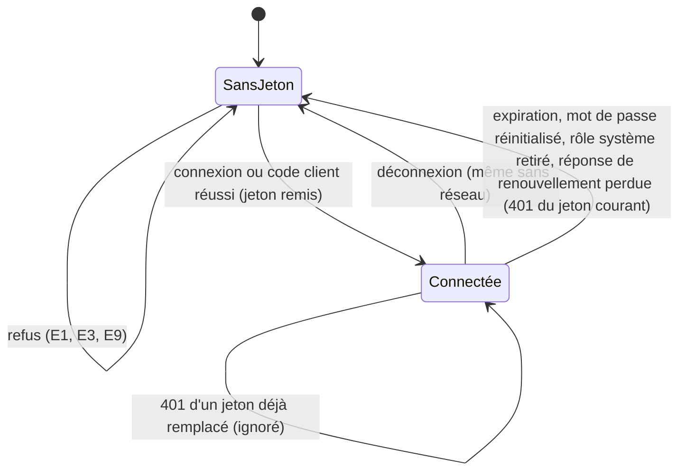

# UC-013 — Ouvrir une session depuis l'application mobile (jeton de session)

| Champ | Valeur |
|---|---|
| Statut | Prêt pour dev (D-061, D-062) |
| Priorité | Must pour le lot « application mobile » `[HYPOTHÈSE]` — lot à fixer (Q0, A-38) |
| Module | `shared` (session, jeton de sécurité, suivi en direct) + `identity` (connexion, espace client, déconnexion) + `organizations` (changement de salon) ; app mobile (Expo) |
| Auteur | use-case-writer |
| Date | 2026-11-20 |
| Use cases liés | UC-002 (connexion et déconnexion : variante de l'application), UC-009 (espace client par code SMS : variante de l'application), UC-005 (changer de salon : nouveau jeton), UC-004 / UC-010 / UC-007 (régénérations : nouveau jeton), UC-003 / UC-011 / UC-012 (fermetures de sessions), **UC-014 à rédiger** (inscription, mot de passe oublié, rejoindre un salon depuis l'application) |
| Exigences couvertes | EX-047, EX-006, EX-011, EX-013, EX-024, EX-025, EX-029, EX-036, D-004, D-019, D-025, D-026, D-027, D-028, D-031, D-037, D-039, D-054, D-055, D-058, D-061 |

## 0. Traçabilité

| Exigence | Source | Où elle est traitée dans ce UC |
|---|---|---|
| EX-047, D-061 | DECISIONS.md D-061 (décision du user du 20/11, inscrite par la session principale) | Tout le UC ; RG-013-01 à RG-013-03, scénario « Paul se connecte depuis l'application… » |
| D-004 | DECISIONS.md | RG-013-01, RG-013-02 (le navigateur garde cookie + jeton de sécurité), RG-013-03 (même session serveur, pas de JWT), plans « variante refusée au navigateur », « un canal par session » |
| D-019 | DECISIONS.md | RG-013-04, RG-013-05, plan « le refus de connexion est le même… » |
| D-025 | DECISIONS.md | RG-013-06, scénario « Un inconnu qui bloque le numéro… » |
| D-026, D-054 | DECISIONS.md | RG-013-09, plan « mêmes durées » |
| D-027 | DECISIONS.md | RG-013-04 (étape suivante dans la réponse) |
| D-028 | DECISIONS.md | RG-013-14 (sessions simultanées illimitées), RG-013-13 (pas de « déconnecter mes autres appareils »), RG-013-16 (audit) |
| D-031, D-058 | DECISIONS.md | RG-013-13, plan « Ce qui ferme les sessions… » |
| D-037, D-039 | DECISIONS.md | RG-013-10, RG-013-11, scénarios « Changer de salon… », « Deux changements… » |
| D-054, D-055, EX-013 | DECISIONS.md ; prd.md §4 | RG-013-05, RG-013-07, scénario « Un jeton de session client n'ouvre pas le back-office » |
| EX-006, EX-011, EX-024 | prd.md §3, §4, §12 Sécurité | RG-013-07 (droits relus à chaque demande, rôles séparés), scénarios `@securite` |
| EX-029 | prd.md §2.B, §11 | RG-013-04, RG-013-12 (ouvrir et fermer sa session depuis l'application) |
| EX-036 | prd.md §12 Fiabilité | RG-013-08 (relecture complète à chaque reconnexion) |
| EX-025 | prd.md §12 Données | RG-013-16, RG-013-18 |

## 1. Objectif

Permettre à l'**application mobile GoMeCoiffer** (une seule application, espace salon et espace client) d'ouvrir,
d'utiliser, de renouveler et de fermer une session **sans cookie**, avec un **jeton de session** gardé dans le coffre
sécurisé du téléphone. C'est **la même session serveur** que dans le navigateur (mêmes droits, mêmes durées, même
fermeture), mais sans jeton de sécurité (CSRF), inutile quand aucun navigateur n'envoie la preuve tout seul. Le web,
lui, ne change pas et ne peut jamais emprunter cette variante.

**Découpage** : ce use case porte le **cœur** (obtenir par la connexion du personnel ou le code client, utiliser,
renouveler, fermer). Les entrées qui passent par un code SMS et une preuve du numéro — **inscription (UC-001), mot de
passe oublié (UC-003), rejoindre un salon (UC-007)** — vont dans **UC-014**, à rédiger : elles remplacent en plus le
cookie de preuve du numéro (`gmc.join`) et se terminent par une connexion automatique. Les tenir ici aurait doublé le
use case (trois parcours SMS de plus) sans rien changer au jeton lui-même, que UC-014 réutilisera tel quel.

## 2. User story

> En tant que **membre du personnel d'un salon ou client de la marketplace**,
> je veux **me connecter une fois dans l'application GoMeCoiffer de mon téléphone et y rester connecté**,
> afin de **retrouver mon salon ou mes réservations sans retaper mes identifiants, avec la même sécurité que sur le site**.

## 3. Acteurs

- **Acteur principal** : l'utilisateur de l'application mobile : membre du personnel (Paul, Mireille), administrateur
  GoMeCoiffer (Henri), client (Aïcha). Réseau parfois lent ou coupé.
- **Acteurs secondaires** : l'application elle-même (garde le jeton, l'envoie, réagit aux refus) ; le navigateur web
  (ne doit jamais pouvoir utiliser la variante) ; un site tiers malveillant ; un voleur du téléphone ; un Super
  Administrateur ou un propriétaire qui retire un droit pendant que l'application est ouverte.

## 4. Déclencheur

- Connexion : « Se connecter » (personnel) ou « Recevoir un code » (client) dans l'application.
- Utilisation : toute demande de l'application, dont l'ouverture du suivi en direct.
- Renouvellement : toute action qui régénère la session web (ouvrir ou changer de salon, créer son organisation,
  ajouter un salon).
- Fermeture : « Se déconnecter », ou un événement du compte (mot de passe réinitialisé, rôle retiré, appartenance
  retirée), ou l'expiration.

## 5. Préconditions

- L'application GoMeCoiffer est installée sur le téléphone. Aucun jeton de sécurité (CSRF) n'est demandé.
- Pour la connexion du personnel : le compte a un mot de passe (UC-001, UC-007). Le use case se comporte pareil pour
  un numéro sans compte (D-019).

## 6. Postconditions

- **Succès (obtention)** : une session serveur **neuve** existe, avec son type (personnel ou client), son instant de
  connexion, la version des identifiants, aucun salon actif ; elle est marquée « ouverte par l'application » ;
  l'application a reçu **une fois** le jeton dans la réponse et l'a rangé dans le coffre sécurisé ; **aucun cookie**
  n'est posé ; seule l'empreinte du jeton est gardée par GoMeCoiffer ; l'audit est le même que sur le web.
- **Succès (renouvellement)** : nouveau jeton remis, ancien refusé à jamais, instant de connexion conservé.
- **Succès (fermeture)** : la session n'existe plus ; le jeton est refusé ; l'application l'a effacé.
- **Échec** : aucune session ouverte ni modifiée, aucun jeton remis ; les échecs de connexion restent comptés (D-025).

## 7. Règles métier

| ID | Règle | Exemple | Source |
|---|---|---|---|
| RG-013-01 | **Variante réservée à l'application.** L'application se déclare par une **marque** sur chaque demande, qu'un site tiers ne peut pas faire envoyer par un navigateur. La variante ne pose **jamais de cookie** : le jeton est remis dans la réponse, une seule fois. Elle est **refusée** à toute demande qui porte un **cookie de session** ou l'**origine d'une page web**. Le web garde cookie + jeton de sécurité, inchangés. | Une page piégée fait envoyer par le navigateur de Paul une connexion avec la marque → refusée, rien n'est ouvert. Paul se connecte sur le site sans jeton de sécurité → toujours refusé (RG-002-10). | D-004, D-061 ; `[HYPOTHÈSE]` forme de la marque — **Q2** |
| RG-013-02 | **Un canal par session.** Le canal (navigateur ou application) est fixé à l'ouverture. Une session du navigateur ne s'utilise jamais avec un jeton ; un jeton ne s'utilise jamais en cookie ; un jeton présenté **sans** la marque, ou **avec** un cookie, est refusé. | L'identifiant de session du navigateur de Paul présenté comme jeton → « Session absente ou expirée : reconnectez-vous. » | D-004 ; `[HYPOTHÈSE]` — **Q2** |
| RG-013-03 | **Forme du jeton** : chaîne **opaque** et aléatoire (256 bits), qui ne contient aucune information lisible ; GoMeCoiffer n'en garde que l'**empreinte**, qui désigne la **même session serveur** que le web (type, utilisateur, instant de connexion, version des identifiants, salon actif, dernière activité). Pas de jeton signé à durée fixe (JWT). | Une copie de la base ne permet pas de se faire passer pour Paul. | D-004 ; `[HYPOTHÈSE]` — **Q1** |
| RG-013-04 | **Obtenir — personnel** : la connexion depuis l'application suit **toutes** les règles de UC-002 (formats, refus identique, une vérification de mot de passe par refus, blocages, audit). En cas de réussite, la réponse contient le jeton et le **résumé de session** avec l'étape suivante. | Paul (2 salons) → jeton + « choisir son salon » ; numéro inconnu, client léger ou mot de passe faux → « Numéro ou mot de passe incorrect. », aucun jeton. | UC-002, D-019, D-027 |
| RG-013-05 | **Obtenir — client** : la demande et la vérification du code suivent **toutes** les règles de UC-009. En cas de réussite, la réponse contient un **jeton de session client**, limité à l'espace client. | Aïcha saisit 482913 → jeton client, « Vous êtes connecté avec le 6 55 •• •• 22 ». | UC-009, D-054, D-055 |
| RG-013-06 | **Appareil reconnu** : l'application d'un téléphone est un appareil au sens de D-025. Sa reconnaissance lui est remise à la connexion réussie, gardée dans le coffre sécurisé, présentée à chaque connexion, **conservée à la déconnexion** ; 90 jours, perdue au 5e échec. | Un inconnu bloque le 6 99 00 11 22 ; Paul se connecte quand même depuis l'application de son téléphone habituel. | D-025, RG-002-06 ; `[HYPOTHÈSE]` — Q7 |
| RG-013-07 | **Utiliser** : chaque demande de l'application présente son jeton ; les droits sont **relus à chaque demande** comme sur le web (appartenance, permissions du salon actif, rôles système). **Aucun jeton de sécurité n'est demandé.** Un jeton client n'ouvre que l'espace client (403 « Cet espace est réservé aux salons… »). | Paul, salon « Paul Barber Deïdo » ouvert, consulte l'équipe → accordé. Jeton client de Paul → planning refusé. | EX-006, EX-011, EX-024, D-055 |
| RG-013-08 | **Suivi en direct** : l'application l'ouvre avec le jeton (jamais dans l'adresse) ; mêmes destinataires choisis par le serveur, même fermeture au bout de 30 min, **relecture complète** de ce qui est affiché à chaque reconnexion. | Paul suit « Paul Barber Deïdo » ; après une coupure, l'application relit le planning en entier. | EX-036, D-002 |
| RG-013-09 | **Durées identiques au web** : personnel 24 h sans activité et 7 jours après la connexion ; rôle système 2 h et 12 h ; client 7 jours et 30 jours. L'application ne prolonge jamais la durée absolue ; seule l'activité repousse la limite d'inactivité. | Paul connecté le 16/11 à 10 h 00 : refusé le 17/11 à 10 h 01 sans activité, le 23/11 à 10 h 01 même actif. | D-026, D-054 ; `[HYPOTHÈSE]` — **Q3** |
| RG-013-10 | **Renouveler** : chaque action qui régénère la session web (ouvrir ou changer de salon, devenir propriétaire, ajouter un salon) remet à l'application un **nouveau jeton** ; l'ancien est refusé aussitôt et pour toujours, même par une demande déjà partie ; instant de connexion, version des identifiants et dernière activité sont conservés ; le suivi en direct de l'ancien jeton est fermé, les autres appareils ne sont pas touchés. Deux renouvellements simultanés : **un seul** réussit. Aucune autre rotation. | Paul ouvre « Élégance Bonamoussadi » : nouveau jeton ; l'ancien → refusé ; la session expire toujours le 27/11 à 10 h 00. | D-037, D-039 ; `[HYPOTHÈSE]` — **Q3** |
| RG-013-11 | **Côté application** : elle n'envoie qu'**un renouvellement à la fois** ; un refus « session expirée » reçu pour un jeton **déjà remplacé** n'efface pas le jeton courant. Si la réponse d'un renouvellement se perd, l'ancien jeton est refusé et l'application demande de se reconnecter (comme le web). | Le planning parti avec l'ancien jeton revient refusé après le changement de salon : Paul reste connecté. Réponse perdue dans un taxi sans réseau → « Votre session a expiré… ». | D-039 ; `[HYPOTHÈSE]` — Q6 |
| RG-013-12 | **Déconnexion** : la session est détruite, le jeton refusé ensuite ; idempotente. L'application **efface le jeton même sans réseau** (la session non fermée expirera seule). La reconnaissance de l'appareil est conservée. | Paul se déconnecte hors réseau : l'application affiche « Se connecter » ; le jeton n'existe plus que côté serveur, inutilisable faute de copie. | RG-002-15, D-028 |
| RG-013-13 | **Fermeture par le compte** : ce qui ferme les sessions web ferme les sessions de l'application : réinitialisation du mot de passe (D-031), retrait d'un rôle système (D-058). Un retrait d'appartenance (UC-011) retire le salon à la demande suivante et ferme le suivi en direct de ce salon. **Téléphone perdu ou volé** : « Mot de passe oublié » depuis un autre appareil ferme toutes les sessions ; pas de « déconnecter mes autres appareils » au MVP. | Paul réinitialise son mot de passe sur la tablette : le jeton de son téléphone est refusé. | D-028, D-031, D-058, UC-011 ; `[HYPOTHÈSE]` — **Q4** |
| RG-013-14 | **Une session par application, plusieurs appareils** : se connecter dans l'application **remplace** la session qu'elle portait (l'application présente son jeton courant, que le serveur ferme). Chaque téléphone a sa propre session ; leur nombre n'est pas limité. | Aïcha connectée sur l'application de la tablette ; Paul s'y connecte → l'ancien jeton d'Aïcha est refusé. | RG-002-11, RG-009-07, D-028 ; `[HYPOTHÈSE]` — Q7 |
| RG-013-15 | **Rejeu** : un jeton inventé, expiré, remplacé ou fermé reçoit **le même refus** (401 « Session absente ou expirée : reconnectez-vous. »). Les limites de connexion sont celles du web (par numéro, par appareil, par adresse) ; deviner un jeton n'est pas réaliste (256 bits). | Les quatre jetons reçoivent la même réponse. | EX-024, D-025 ; `[HYPOTHÈSE]` — Q9 |
| RG-013-16 | **Le jeton est un secret** : jamais dans une adresse, les journaux techniques, l'audit, le suivi en direct, un rapport d'erreur ni une capture de l'application. L'audit est celui du web (connexion, déconnexion, connexion client…), avec le **canal** (application ou navigateur), sans numéro ni adresse réseau. | Ligne d'audit « connexion — Paul — application — 10 h 00 », sans jeton. | D-028, EX-025 ; `[HYPOTHÈSE]` canal — Q8 |
| RG-013-17 | **Ce que voit l'utilisateur à l'expiration** : au refus « session absente ou expirée » du jeton courant, l'application efface le jeton et les données affichées puis ouvre « Se connecter » (personnel : « Votre session a expiré. Reconnectez-vous avec votre mot de passe. ») ou « Recevoir un code » (client : « Votre session a expiré. Recevez un nouveau code pour retrouver vos réservations. »). Une **coupure du réseau** ne déconnecte jamais : « Pas de connexion internet. Vos données s'afficheront dès le retour du réseau. » | Paul rouvre l'application 8 jours après : écran « Se connecter » avec le message. | EX-020, CLAUDE.md Guidage ; `[HYPOTHÈSE]` — Q10 |
| RG-013-18 | **Stockage sur l'appareil** : jeton et reconnaissance d'appareil vont dans le **coffre sécurisé du téléphone** (trousseau iOS, keystore Android), accessibles seulement téléphone déverrouillé, **liés à ce téléphone** (jamais restaurés par une sauvegarde sur un autre) ; jamais dans le stockage ordinaire de l'application. | Paul restaure la sauvegarde de son téléphone sur un neuf : l'application demande de se connecter. | EX-025 ; `[HYPOTHÈSE]` — Q5 |

## 8. Flux nominal (personnel)

1. Paul ouvre l'application et choisit « Se connecter » ; il saisit 6 99 00 11 22 et son mot de passe.
2. L'application envoie la connexion avec sa marque et sa reconnaissance d'appareil (RG-013-01, RG-013-06).
3. Le système refuse toute demande venue d'un navigateur (RG-013-01, RG-013-02), puis applique UC-002 (RG-013-04).
4. Le système ouvre une session neuve, marquée « application », sans salon actif, et en garde l'empreinte du jeton
   (RG-013-03) ; il trace la connexion (RG-013-16).
5. Le système renvoie le jeton et le résumé de session (« choisir son salon »), sans cookie.
6. L'application range le jeton dans le coffre sécurisé (RG-013-18).
7. Paul choisit « Paul Barber Deïdo » ; le système régénère la session et remet un nouveau jeton (RG-013-10).
8. L'application remplace son jeton, ouvre le suivi en direct avec lui et relit les données du salon (RG-013-08).
9. Paul travaille : chaque demande présente le jeton, sans jeton de sécurité (RG-013-07).
10. Paul choisit « Se déconnecter » : la session est détruite, l'application efface le jeton (RG-013-12).

## 9. Flux alternatifs

- **A1 — Client** (étapes 1-5) : Aïcha demande un code, saisit 482913 ; jeton de session client (RG-013-05) ; pas
  d'étape 7.
- **A2 — Appareil reconnu pendant un blocage** (étape 3) : la connexion est vérifiée malgré le blocage (RG-013-06).
- **A3 — Une seule appartenance** (étape 7) : l'application ouvre le salon d'office (D-027, D-040).
- **A4 — Application déjà connectée** (étape 2) : elle présente son jeton courant, fermé par le serveur (RG-013-14).
- **A5 — Réouverture de l'application** : jeton valide → résumé de session sans mot de passe ; sinon RG-013-17.
- **A6 — Demande partie avec l'ancien jeton** (après l'étape 7) : son refus n'efface pas le nouveau jeton (RG-013-11).
- **A7 — Déconnexion sans réseau** (étape 10) : jeton effacé quand même (RG-013-12).
- **A8 — Coupure du réseau** (étapes 8-9) : jeton gardé, message de coupure, relecture au retour (RG-013-08, -17).

## 10. Flux d'exception

- **E1 — Demande venue d'un navigateur avec la marque** (étape 3) : refus 400 « Demande non reconnue. », rien ouvert.
- **E2 — Cookie et jeton ensemble / jeton sans marque** : refus 401 identique à un jeton inconnu (RG-013-02).
- **E3 — Identifiants incorrects, blocage, saisie mal formée** (étape 3) : refus de UC-002, aucun jeton.
- **E4 — Jeton inventé, expiré, remplacé, fermé** : 401 « Session absente ou expirée : reconnectez-vous. »
  (RG-013-15) ; l'application applique RG-013-17.
- **E5 — Jeton client sur le back-office** : 403 `STAFF_SIGN_IN_REQUIRED` (RG-013-07).
- **E6 — Réponse de renouvellement perdue** : l'ancien jeton est refusé, reconnexion (RG-013-11).
- **E7 — Renouvellements simultanés** : un seul réussit, l'autre 401 (RG-013-10).
- **E8 — Jeton dans l'adresse** : refus 401, comme sans jeton (RG-013-16).
- **E9 — Service indisponible** (étapes 3-5) : « Connexion impossible pour le moment. Réessayez dans quelques
  minutes. », aucun jeton.

## 11. Workflow

```mermaid
sequenceDiagram
    participant App as Application mobile
    participant API as GoMeCoiffer
    App->>API: Connexion (marque, numéro, mot de passe, reconnaissance d'appareil)
    alt cookie ou origine de page web
        API-->>App: Refus (E1)
    else règles UC-002 non remplies
        API-->>App: Refus de UC-002, aucun jeton (E3)
    else succès
        API-->>App: Jeton + résumé de session (aucun cookie)
        App->>App: Range le jeton dans le coffre sécurisé
    end
    App->>API: Demande (marque + jeton)
    API-->>App: Réponse (droits relus) ou 401 / 403 (E4, E5)
    App->>API: Ouvrir un salon (jeton A)
    API-->>App: Nouveau jeton B ; A refusé à jamais ; suivi en direct de A fermé
    App->>API: Se déconnecter (jeton B)
    API-->>App: Confirmé ; B refusé ensuite
```



## 12. Scénarios d'acceptation (BDD)

Identiques à `features/identity/ouvrir-une-session-depuis-l-application-mobile.feature`. Les scénarios tagués
`@app-mobile` se jouent dans l'application (tests du front mobile) ; les autres, contre l'API.

```gherkin
# language: fr
@UC-013
Fonctionnalité: Ouvrir une session depuis l'application mobile (jeton de session)
  Pour travailler au salon ou retrouver ses réservations depuis l'application GoMeCoiffer,
  l'utilisateur ouvre une session dont la preuve est un jeton gardé par l'application,
  avec les mêmes droits, les mêmes durées et la même fermeture que dans le navigateur.
  Un navigateur ne peut jamais utiliser cette variante, qui se passe du jeton de sécurité.

  Contexte:
    Étant donné que nous sommes le 20/11/2026 à 10 h 00, heure de Douala
    Et que Paul Ebode a un compte du personnel avec le mot de passe "Bastos-Fade-2026" pour le 6 99 00 11 22
    Et que Paul est "Propriétaire" de "Paul Barber Deïdo" et "Coiffeur" chez "Élégance Bonamoussadi"
    Et qu'Aïcha Mbarga a un compte client léger pour le 6 55 44 33 22
    Et qu'aucun compte n'existe pour le 6 70 00 00 01

  # --- Obtenir le jeton ------------------------------------------------------------------------

  @nominal @RG-013-03 @RG-013-04 @EX-047 @D-004
  Scénario: Paul se connecte depuis l'application et reçoit un jeton de session
    Quand Paul se connecte depuis l'application avec le "6 99 00 11 22" et le mot de passe "Bastos-Fade-2026"
    Alors Paul est connecté sur l'application, sans salon ouvert
    Et la réponse contient un jeton de session et l'invitation à choisir son salon
    Et aucun cookie n'est posé
    Et aucun jeton de sécurité ne lui a été demandé

  @securite @RG-013-04 @D-019
  Plan du scénario: Depuis l'application, le refus de connexion est le même pour un numéro inconnu, un compte client ou un mot de passe faux
    Quand on se connecte depuis l'application avec le "<numéro>" et le mot de passe "<mot de passe>"
    Alors la connexion est refusée avec le motif "Numéro ou mot de passe incorrect."
    Et la réponse est la même que pour un numéro sans compte
    Et aucun jeton n'est remis

    Exemples:
      | numéro        | mot de passe     |
      | 6 70 00 00 01 | Bastos-Fade-2026 |
      | 6 55 44 33 22 | Bastos-Fade-2026 |
      | 6 99 00 11 22 | Akwa-Fade-2026   |

  @alternatif @RG-013-06 @D-025
  Scénario: Un inconnu qui bloque le numéro ne gêne pas Paul sur l'application de son téléphone habituel
    Étant donné que Paul s'est connecté depuis l'application de son téléphone le 10/11/2026
    Et que le 6 99 00 11 22 est bloqué jusqu'à 10 h 15 après 5 mots de passe faux saisis par un inconnu
    Quand Paul se connecte depuis l'application de son téléphone avec son mot de passe
    Alors Paul est connecté sur l'application

  @nominal @RG-013-05 @D-054
  Scénario: Aïcha ouvre son espace client dans l'application avec le code reçu par SMS
    Étant donné qu'Aïcha a reçu le code "482913" pour retrouver ses réservations
    Quand Aïcha saisit le code "482913" dans l'application
    Alors l'application reçoit un jeton de session client
    Et Aïcha voit "Vous êtes connecté avec le 6 55 •• •• 22"

  @alternatif @RG-013-14 @RG-002-11
  Scénario: Se connecter dans l'application remplace la session qu'elle portait
    Étant donné qu'Aïcha est connectée à son espace client dans l'application de la tablette du salon
    Quand Paul se connecte avec son mot de passe dans cette application
    Alors l'application est connectée au compte de Paul
    Et l'ancien jeton d'Aïcha ne donne plus accès à rien

  # --- Utiliser le jeton -----------------------------------------------------------------------

  @nominal @RG-013-07 @EX-006
  Scénario: Avec son jeton, Paul travaille dans son salon sans jeton de sécurité
    Étant donné que Paul est connecté sur l'application et a ouvert "Paul Barber Deïdo"
    Quand Paul consulte l'équipe de "Paul Barber Deïdo" depuis l'application
    Alors l'équipe de "Paul Barber Deïdo" s'affiche
    Et aucun jeton de sécurité ne lui a été demandé

  @securite @RG-013-07 @D-055 @EX-013
  Scénario: Un jeton de session client n'ouvre pas le back-office
    Étant donné que l'application de Paul porte un jeton de session client ouvert par code SMS
    Quand Paul ouvre le planning de "Paul Barber Deïdo" depuis l'application
    Alors l'accès est refusé avec le motif "Cet espace est réservé aux salons. Connectez-vous avec votre mot de passe, ou créez votre compte salon."

  @nominal @RG-013-08 @EX-036
  Scénario: Le suivi en direct de l'application s'ouvre avec le jeton
    Étant donné que Paul est connecté sur l'application et a ouvert "Paul Barber Deïdo"
    Quand l'application ouvre le suivi en direct avec son jeton
    Alors elle reçoit les changements de "Paul Barber Deïdo"

  @securite @RG-013-16
  Scénario: Un jeton placé dans l'adresse est refusé
    Étant donné que Paul est connecté sur l'application
    Quand l'application ouvre le suivi en direct en plaçant le jeton de Paul dans l'adresse
    Alors l'accès est refusé avec le motif "Session absente ou expirée : reconnectez-vous."

  # --- Le navigateur ne peut pas emprunter la variante ----------------------------------------

  @securite @RG-013-01 @RG-013-02 @D-004
  Plan du scénario: La variante sans jeton de sécurité est refusée à ce qui vient d'un navigateur
    Quand <demande>
    Alors la demande est refusée
    Et aucune session n'est ouverte ni modifiée

    Exemples:
      | demande                                                                                     |
      | une connexion de Paul portant la marque de l'application arrive avec un cookie de session   |
      | une connexion de Paul portant la marque de l'application arrive depuis la page d'un autre site |
      | une demande présente à la fois un cookie de session et le jeton de Paul                    |
      | une demande présente le jeton de Paul sans la marque de l'application                       |

  @securite @RG-013-02
  Plan du scénario: Une session ne s'utilise que par le canal qui l'a ouverte
    Étant donné que Paul est connecté <canal d'ouverture>
    Quand sa preuve de session est présentée <autre canal>
    Alors l'accès est refusé avec le motif "Session absente ou expirée : reconnectez-vous."

    Exemples:
      | canal d'ouverture    | autre canal                                    |
      | dans son navigateur  | comme jeton de l'application                   |
      | sur l'application    | comme cookie de session d'un navigateur        |

  @securite @RG-013-01 @RG-002-10
  Scénario: Dans le navigateur, une connexion sans jeton de sécurité reste refusée
    Quand Paul se connecte depuis son navigateur avec son mot de passe sans jeton de sécurité
    Alors la connexion est refusée avec le motif "Jeton de sécurité absent ou expiré : rechargez la page puis recommencez."

  # --- Renouveler le jeton ---------------------------------------------------------------------

  @nominal @RG-013-10 @D-039 @UC-005
  Scénario: Changer de salon dans l'application remplace le jeton
    Étant donné que Paul s'est connecté sur l'application à 10 h 00 et a ouvert "Paul Barber Deïdo"
    Quand Paul ouvre "Élégance Bonamoussadi" dans l'application
    Alors l'application reçoit un nouveau jeton, avec "Élégance Bonamoussadi" comme salon actif
    Et l'ancien jeton ne donne plus accès à rien
    Et la session expire toujours le 27/11/2026 à 10 h 00

  @securite @RG-013-10 @RG-013-08 @D-039
  Scénario: Après un changement de salon, seul le suivi en direct de l'ancien jeton est fermé
    Étant donné que Paul suit "Paul Barber Deïdo" en direct dans l'application de son téléphone et sur la tablette du salon
    Quand Paul ouvre "Élégance Bonamoussadi" dans l'application de son téléphone
    Alors le suivi en direct de son téléphone sur "Paul Barber Deïdo" est fermé
    Et la tablette du salon suit toujours "Paul Barber Deïdo"

  @securite @RG-013-10
  Scénario: Deux changements de salon simultanés ne laissent qu'un jeton valable
    Étant donné que Paul est connecté sur l'application
    Quand deux ouvertures de salon partent en même temps avec le même jeton
    Alors une seule réussit et remet un nouveau jeton
    Et l'autre est refusée avec le motif "Session absente ou expirée : reconnectez-vous."

  @alternatif @RG-013-11 @app-mobile
  Scénario: Le refus d'une demande partie avec l'ancien jeton ne déconnecte pas l'application
    Étant donné que Paul a ouvert "Élégance Bonamoussadi" dans l'application et reçu un nouveau jeton
    Quand le refus d'une consultation partie avec l'ancien jeton arrive
    Alors l'application reste connectée avec le nouveau jeton

  @erreur @RG-013-11 @app-mobile
  Scénario: Si la réponse d'un changement de salon se perd, l'application demande de se reconnecter
    Étant donné que Paul a demandé d'ouvrir "Élégance Bonamoussadi" et que la réponse s'est perdue faute de réseau
    Quand l'application envoie une demande avec son ancien jeton
    Alors l'application affiche « Se connecter » avec le message "Votre session a expiré. Reconnectez-vous avec votre mot de passe."

  # --- Durées ----------------------------------------------------------------------------------

  @erreur @RG-013-09 @D-026 @D-054
  Plan du scénario: Les sessions de l'application ont les mêmes durées que dans le navigateur
    Étant donné que <personne> s'est connecté sur l'application le 16/11/2026 à 10 h 00 et <activité>
    Quand l'application de <personne> fait une demande le <instant>
    Alors l'accès est <résultat>

    Exemples:
      | personne                         | activité                     | instant              | résultat                 |
      | Paul                             | n'a rien fait depuis         | 17/11/2026 à 09 h 59 | accordé                  |
      | Paul                             | n'a rien fait depuis         | 17/11/2026 à 10 h 01 | refusé : session expirée |
      | Paul                             | l'utilise toutes les heures  | 23/11/2026 à 10 h 01 | refusé : session expirée |
      | Henri, Administrateur Opérations | n'a rien fait depuis         | 16/11/2026 à 12 h 01 | refusé : session expirée |
      | Aïcha, avec un jeton client      | n'a rien fait depuis         | 23/11/2026 à 09 h 59 | accordé                  |
      | Aïcha, avec un jeton client      | l'utilise chaque jour        | 16/12/2026 à 10 h 01 | refusé : session expirée |

  # --- Fermer ----------------------------------------------------------------------------------

  @nominal @RG-013-12 @RG-013-06
  Scénario: Se déconnecter dans l'application rend le jeton inutilisable
    Étant donné que Paul est connecté sur l'application de son téléphone
    Quand Paul se déconnecte dans l'application
    Alors l'application n'a plus de jeton de session
    Et l'ancien jeton de Paul ne donne plus accès à rien
    Et l'application de son téléphone reste un appareil reconnu de Paul

  @alternatif @RG-013-12 @app-mobile
  Scénario: Sans réseau, la déconnexion efface quand même le jeton de l'application
    Étant donné que Paul est connecté sur l'application et que son téléphone n'a pas de réseau
    Quand Paul se déconnecte dans l'application
    Alors l'application n'a plus de jeton de session et affiche « Se connecter »

  @securite @RG-013-13 @D-031 @D-058
  Plan du scénario: Ce qui ferme les sessions d'un compte ferme aussi celle de son application
    Étant donné que <personne> est connecté sur l'application de son téléphone
    Quand <événement>
    Alors le jeton de l'application de son téléphone ne donne plus accès à rien

    Exemples:
      | personne                         | événement                                                              |
      | Paul                             | Paul réinitialise son mot de passe sur la tablette du salon            |
      | Henri, Administrateur Opérations | un Super Administrateur retire à Henri le rôle "Administrateur Opérations" |

  @securite @RG-013-13 @UC-011
  Scénario: Un collaborateur retiré de l'équipe perd ce salon dans l'application
    Étant donné que Paul travaille dans "Élégance Bonamoussadi" depuis l'application et le suit en direct
    Quand Clarisse retire Paul de l'équipe d'"Élégance Bonamoussadi"
    Alors le suivi en direct d'"Élégance Bonamoussadi" est fermé dans l'application
    Et la demande suivante de Paul n'a plus de salon actif

  @securite @RG-013-15
  Plan du scénario: Un jeton inutilisable reçoit toujours le même refus
    Quand l'application présente <jeton>
    Alors l'accès est refusé avec le motif "Session absente ou expirée : reconnectez-vous."
    Et la réponse est la même pour les quatre jetons

    Exemples:
      | jeton                                            |
      | un jeton inventé                                 |
      | le jeton de Paul, expiré                         |
      | le jeton de Paul remplacé par un changement de salon |
      | le jeton de Paul fermé par sa déconnexion        |

  # --- Ce que voit l'utilisateur, secret du jeton ----------------------------------------------

  @erreur @RG-013-17 @app-mobile
  Plan du scénario: À l'expiration, l'application dit quoi faire
    Étant donné que la session <type> de l'application de <personne> a expiré
    Quand <personne> rouvre l'application
    Alors l'application efface son jeton et les données affichées
    Et elle affiche <écran> avec le message "<message>"

    Exemples:
      | personne | type          | écran                | message                                                                         |
      | Paul     | du personnel  | « Se connecter »     | Votre session a expiré. Reconnectez-vous avec votre mot de passe.               |
      | Aïcha    | client        | « Recevoir un code » | Votre session a expiré. Recevez un nouveau code pour retrouver vos réservations. |

  @alternatif @RG-013-17 @app-mobile
  Scénario: Une coupure du réseau ne déconnecte pas l'application
    Étant donné que Paul est connecté sur l'application
    Quand l'application ne joint pas GoMeCoiffer faute de réseau
    Alors l'application garde son jeton
    Et elle affiche "Pas de connexion internet. Vos données s'afficheront dès le retour du réseau."

  @securite @RG-013-18 @app-mobile
  Scénario: Le jeton ne suit pas une sauvegarde restaurée sur un autre téléphone
    Étant donné que Paul est connecté sur l'application de son téléphone
    Quand Paul restaure la sauvegarde de son téléphone sur un nouveau téléphone
    Alors l'application du nouveau téléphone demande de se connecter

  @securite @RG-013-16 @EX-025
  Scénario: Le jeton n'apparaît ni dans les journaux ni dans l'audit
    Quand Paul se connecte depuis l'application, consulte son équipe puis se déconnecte
    Alors ni les journaux techniques ni le journal d'audit ne contiennent son jeton
    Et le journal d'audit contient "connexion" et "déconnexion" pour Paul, par l'application

  @erreur
  Scénario: Une panne du service ne remet aucun jeton
    Étant donné que le service GoMeCoiffer est momentanément indisponible
    Quand Paul se connecte depuis l'application avec son mot de passe
    Alors la connexion est refusée avec le motif "Connexion impossible pour le moment. Réessayez dans quelques minutes."
    Et aucun jeton n'est remis
```

## 13. Plan de tests TDD

Unitaire = fakes in-memory ; intégration = vraie base (Testcontainers) ; E2E = HTTP ; « Mobile » = tests du front
mobile avec gateways en mémoire (coffre sécurisé et réseau simulés).

| # | Niveau | Comportement testé | Étant donné | Quand | Alors | Règle |
|---|---|---|---|---|---|---|
| T1 | Unitaire | Résolution du canal : marque + jeton sans cookie ni origine → canal « application » ; cookie + jeton, jeton sans marque, marque + cookie, marque + origine → refus | en-têtes simulés | résolution | canal ou refus nommé | RG-013-01, -02 |
| T2 | Unitaire | Empreinte du jeton : 256 bits, empreinte HMAC avec séparation de domaine, jamais le jeton en clair | générateur déterministe | émission | empreinte ≠ jeton, stable | RG-013-03 |
| T3 | Unitaire | Garde : session « application » présentée par cookie → refus ; session « navigateur » présentée par jeton → refus | sessions des deux canaux | garde | 401 | RG-013-02 |
| T4 | Unitaire | Jeton de sécurité exigé si et seulement si la demande est authentifiée par cookie ou est une entrée publique sans marque | demandes variées | filtre CSRF | exigé / non | RG-013-01, -07 |
| T5 | Unitaire | Durées : personnel 24 h / 7 j, rôle système 2 h / 12 h, client 7 j / 30 j, mêmes bornes pour le canal « application » | horloge fixe | garde | refus aux bornes | RG-013-09 |
| T6 | Intégration | Ouverture d'une session « application » dans le magasin de sessions : clé = empreinte, canal enregistré, `credentialsVersion`, aucune colonne ne contient le jeton | vraie base | ouverture | ligne conforme | RG-013-03 |
| T7 | Intégration | Rotation : `consume` de l'ancienne empreinte puis nouvelle session ; une sauvegarde tardive de l'ancienne ne la recrée pas ; deux rotations simultanées → une seule réussit | vraie base | rotations parallèles | 1 session vivante | RG-013-10 |
| T8 | Intégration | `credentialsVersion` augmentée → session « application » refusée | vraie base | demande | 401 | RG-013-13 |
| T9 | E2E | Connexion du personnel en variante application : 200, `sessionToken` + résumé, **aucun `Set-Cookie`**, aucun jeton CSRF demandé ; audit « connexion » avec canal | Paul | POST | comme décrit | RG-013-04, -16 |
| T10 | E2E | Non-énumération en variante application : 3 situations → statut et corps identiques, aucun jeton | inconnu, client, faux | 3 POST | identiques | RG-013-04 |
| T11 | E2E | Variante refusée : marque + cookie, marque + `Origin` d'un autre site, cookie + jeton, jeton sans marque → refus, aucune session | — | 4 requêtes | refus | RG-013-01, -02 |
| T12 | E2E | Web inchangé : connexion navigateur sans jeton CSRF → 403 ; avec → cookie posé, aucun `sessionToken` dans le corps | Paul | POST | comme décrit | RG-013-01 |
| T13 | E2E | Utilisation : route à permission avec jeton, sans CSRF → 200 ; jeton client sur `/api/salon/*` → 403 `STAFF_SIGN_IN_REQUIRED` | Paul, jeton client | GET / POST | comme décrit | RG-013-07 |
| T14 | E2E | Code client en variante application → `sessionToken` client, `/api/client/session` accessible | Aïcha | POST | comme décrit | RG-013-05 |
| T15 | E2E | Appareil reconnu porté par en-tête : remis à la réussite, exempte du blocage, conservé à la déconnexion | Paul | parcours | comme décrit | RG-013-06 |
| T16 | E2E | Changement de salon : nouveau jeton dans le corps, ancien → 401, `authenticatedAt` conservé ; création d'organisation et ajout de salon idem | Paul, Mireille | POST | comme décrit | RG-013-10 |
| T17 | E2E | Suivi en direct avec jeton en en-tête (sans contrôle d'origine) ; jeton dans l'adresse → 401 ; flux de l'ancien jeton fermé au changement de salon, autre session intacte | Paul | SSE | comme décrit | RG-013-08, -10, -16 |
| T18 | E2E | Déconnexion : jeton → 401 ensuite ; idempotente ; reconnaissance d'appareil gardée | Paul | POST | comme décrit | RG-013-12 |
| T19 | E2E | Fermetures par le compte : réinitialisation (UC-003), retrait de rôle système (UC-012), retrait d'appartenance (UC-011) | Paul, Henri | parcours | 401 / plus de salon actif | RG-013-13 |
| T20 | E2E | Connexion avec un jeton courant présenté → ancienne session fermée | Aïcha puis Paul | POST | ancien jeton 401 | RG-013-14 |
| T21 | E2E | Rejeu : 4 jetons inutilisables → réponses identiques | — | GET | 401 identiques | RG-013-15 |
| T22 | E2E | Secret : capture des journaux pendant un parcours → aucune occurrence du jeton ni de l'en-tête d'appareil | Paul | parcours | 0 occurrence | RG-013-16 |
| T23 | Mobile | Coffre sécurisé : jeton rangé, relu au démarrage, effacé à la déconnexion même sans réseau, jamais en stockage ordinaire | gateway en mémoire | parcours | comme décrit | RG-013-12, -18 |
| T24 | Mobile | 401 du jeton courant → effacement + écran selon le type ; 401 d'un jeton remplacé → ignoré ; erreur réseau → jeton gardé + message ; un seul renouvellement à la fois | réseau simulé | réponses | comme décrit | RG-013-11, -17 |
| T25 | Mutation | Résolution du canal et filtre CSRF | — | Stryker | aucun mutant survivant | RG-013-01, -02 |

Doubles : horloge fixe, générateur de jetons déterministe, faux fournisseur SMS, coffre sécurisé et réseau simulés
côté mobile.

## 14. Données

- **Entrées** : marque de l'application (en-tête) ; jeton (en-tête d'autorisation, jamais dans l'adresse ni le
  corps) ; reconnaissance d'appareil (en-tête dédié) ; corps des entrées de UC-002 et UC-009 inchangés.
- **Sorties** : connexion → `{ sessionToken, deviceToken?, session }` ; code client → `{ sessionToken, session: { kind:
  'CLIENT', maskedPhone } }` ; renouvellement → `{ sessionToken, session }` ; refus : codes existants (`INVALID_CREDENTIALS`,
  `UNAUTHENTICATED`, `STAFF_SIGN_IN_REQUIRED`…) + `NATIVE_TRANSPORT_REFUSED` (400, E1) `[HYPOTHÈSE]`.
- **Stocké** : la session existante + son **canal** ; clé de session = empreinte du jeton ; aucun jeton en clair.
- **Jeux de données** : Paul Ebode (6 99 00 11 22, « Bastos-Fade-2026 », Propriétaire de Paul Barber Deïdo, Coiffeur
  chez Élégance Bonamoussadi) ; Aïcha Mbarga (client léger, 6 55 44 33 22) ; Henri (Administrateur Opérations) ;
  Clarisse (propriétaire d'Élégance Bonamoussadi) ; numéro sans compte 6 70 00 00 01 ; code 482913.

## 15. Exigences non fonctionnelles

- **Sécurité** (périmètre critique : session, CSRF, autorisation) : `security-reviewer` obligatoire ; CORS inchangé
  (la marque n'est autorisée pour aucune origine web) ; en-tête d'autorisation et en-tête d'appareil masqués dans les
  journaux ; corps des réponses d'authentification jamais journalisés ; `Cache-Control: no-store` sur les réponses
  qui portent un jeton.
- **Performance** : la résolution du jeton ajoute < 5 ms par demande (une empreinte + la lecture de session déjà faite
  pour le web).
- **Non-énumération** : mêmes mesures que UC-002 §15 et UC-009 §15, en variante application.
- **Guidage** : messages de RG-013-17 ; écran de connexion de l'application compatible avec le remplissage du
  gestionnaire de mots de passe et du code SMS ; textes dans toutes les langues du projet.

## 16. Hors périmètre

- **UC-014 (à rédiger)** : inscription (UC-001), mot de passe oublié (UC-003), rejoindre un salon (UC-007) depuis
  l'application (preuve du numéro sans cookie, connexion automatique par jeton).
- « Déconnecter mes autres appareils », liste des appareils connectés (D-028, voir Q4).
- Déverrouillage biométrique de l'application, code PIN local.
- Attestation de l'application (App Attest, Play Integrity), épinglage de certificat.
- Notifications push.
- Version web de l'application Expo (le web reste l'application React existante).

## 17. Questions ouvertes

| # | Question | Option recommandée (hypothèse retenue) | Alternative et coût |
|---|---|---|---|
| Q0 | **Bloquante (A-38).** Le PRD §14 met « Application mobile native » **hors du MVP**. D-061 l'ajoute. Dans quel lot ? | **Après le cycle central** (lots 1 à 6 sur le web), comme lot « application mobile » ; le PRD est mis à jour par le user (§14, §1 « Supports »). Raison : le web couvre déjà tout le parcours et F03 exige la réservation sans application ; l'app n'ajoute pas de fonction. | **Tout de suite, en parallèle du web** : chaque use case livre deux fronts, le rythme du cycle central ralentit. |
| Q1 | **Bloquante.** Forme du jeton ? | **Opaque, 256 bits, seule l'empreinte gardée, et cette empreinte est la clé de la session existante** (RG-013-03). Raison : une seule session, une seule fermeture (D-031, D-039, D-058 marchent sans rien ajouter) ; une copie de la base ne donne aucun jeton. | **JWT** : contraire à D-004, pas de fermeture immédiate sans liste noire. **Table de jetons à part reliée à la session** : deux objets à fermer ensemble, risque d'oubli à chaque nouvelle fermeture. |
| Q2 | **Bloquante.** Comment l'application se déclare-t-elle sans affaiblir le web ? | **Une marque (en-tête dédié) sur chaque demande + jeton en en-tête d'autorisation ; refus si la demande porte un cookie ou une origine de page web ; canal fixé dans la session** (RG-013-01, -02). Raison : un navigateur ne peut pas envoyer cet en-tête vers l'API depuis un autre site (CORS ne l'autorise pour aucune origine), ni joindre un cookie à une session « application » ; aucune route nouvelle, `RouteProtectionCheck` inchangé. | **Routes à part `/api/native/*`** : séparation visible, mais chaque entrée (connexion, code, changement de salon…) est dupliquée et un 6e espace à protéger. **Attestation de l'application** : plus forte, mais services Apple/Google à intégrer et à tester ; à garder pour plus tard. |
| Q3 | **Bloquante.** Durées et rotation ? | **Mêmes durées que le web, rotation seulement aux régénérations** (RG-013-09, -10). Raison : « même session » ; pas de rotation à chaque demande, qui casserait l'application sur un réseau lent. Coût : Paul retape son mot de passe au moins une fois par semaine. | **Session plus longue sur l'application** (ex. 30 jours pour le personnel) : plus confortable, mais un téléphone volé déverrouillé ouvre le salon plus longtemps, et l'écart avec D-026 est à justifier. **Rotation à chaque demande** : un jeton volé sert moins longtemps, mais les demandes parallèles et les réponses perdues déconnectent souvent. |
| Q4 | **Bloquante.** Téléphone perdu ou volé, révocation à distance ? | **D-028 inchangé** : « Mot de passe oublié » depuis un autre appareil ferme toutes les sessions (RG-013-13). Raison : rien à construire. Limite : un client léger n'a pas de mot de passe ; sa session (espace client seulement) expire seule en 30 jours au plus. | **Bouton « Déconnecter tous mes appareils »** : une commande qui augmente la version des identifiants (mécanisme D-031 existant) et ferme le suivi en direct ; petit coût, utile aussi au client léger ; remplace en partie D-028. |
| Q5 | Stockage sur l'appareil ? | Coffre sécurisé, téléphone déverrouillé, lié à ce téléphone, exclu des sauvegardes (RG-013-18). | Accessible après le premier déverrouillage : le suivi en direct en arrière-plan marche mieux, téléphone volé allumé plus exposé. |
| Q6 | Réponse de renouvellement perdue ? | Reconnexion, comme le web (RG-013-11). | Délai de grâce où l'ancien jeton rend le nouveau une fois : moins de reconnexions, mais une session remplacée revit (contraire à D-039). |
| Q7 | Plusieurs appareils, appareil reconnu ? | Une session par installation, remplacée à la connexion ; nombre d'appareils illimité (D-028) ; reconnaissance d'appareil par en-tête (RG-013-06, -14). | — |
| Q8 | Canal dans l'audit ? | Oui, « application » ou « navigateur », sans autre détail (RG-013-16). | Rien de plus : moins d'information en cas d'enquête sur un vol de compte. |
| Q9 | Limite sur les jetons invalides ? | Aucune nouvelle ; limites existantes par adresse (RG-013-15). | Limite de 401 par adresse : bruit d'exploitation, gain nul face à 256 bits. |
| Q10 | Numéro pré-rempli après expiration ? | Non : sur une tablette partagée, il montrerait le numéro du dernier utilisateur. | Pré-rempli : un geste de moins pour l'utilisateur seul de son téléphone. |

## 18. Notes pour le tech lead

### Découpage (aucune route nouvelle)

| Élément | Où | Effet |
|---|---|---|
| Résolution du canal | `shared/infrastructure/security` (intergiciel avant la session) | Marque + `Authorization: Bearer` sans cookie ni `Origin` → session chargée par `HMAC(poivre, "session-token:" + jeton)` dans `RotationSafePgStore` ; refus des mélanges (T1, T11). |
| Canal de session | `SessionData.transport: 'COOKIE' \| 'BEARER'` | Fixé à l'ouverture ; la garde refuse un canal différent (T3). |
| CSRF | filtre CSRF du socle | Non exigé pour une demande au canal « application » (T4) ; inchangé sinon. |
| Ouverture / rotation | `openAuthenticatedSession`, `openClientSession`, `regenerateSessionOnSalon` | Variante qui génère le jeton, enregistre la session sous son empreinte et rend le jeton au répondeur ; pas de cookie. Choisie par un port « transport de session » résolu par l'intergiciel, pour garder les répondeurs sans `if` (D-034). |
| Répondeurs | `authenticated-session.responder.ts`, `ClientSessionResponder`, répondeurs de UC-004/005/010 | Corps `{ sessionToken, … }` au canal « application » ; `Cache-Control: no-store`. |
| Appareil reconnu | trackers `@Throttle`, `SignIn` | Lire le jeton d'appareil depuis l'en-tête dédié au canal « application ». |
| SSE | contrôleur temps réel | Jeton en en-tête accepté ; contrôle d'origine conservé pour le canal cookie seulement. |
| Contrats | `packages/contracts` | Schémas de réponse « application » (avec `sessionToken`) à part des schémas web. |
| Journaux | `app.module.ts` `REDACTED` | Ajouter l'en-tête d'appareil ; `authorization` est déjà masqué. |
| Mobile | app Expo | `expo-secure-store` (`WHEN_UNLOCKED_THIS_DEVICE_ONLY`), `react-native-sse` avec en-têtes, intercepteur 401 qui compare le jeton envoyé au jeton courant. |

### Incréments

1. Socle : résolution du canal, canal en session, filtre CSRF, garde (T1-T6, T25).
2. Connexion et déconnexion du personnel en variante application (T9-T12, T15, T18, T20-T22).
3. Code client (T14) ; utilisation et refus d'espace (T13).
4. Rotations : changement de salon, création d'organisation, ajout de salon (T7, T16) ; SSE (T17).
5. Fermetures par le compte (T8, T19).
6. Application mobile : coffre, intercepteur, écrans d'expiration (T23, T24).
7. UC-014.

### Points de vigilance

- **Périmètre critique** : `security-reviewer` obligatoire ; `archi-reviewer` conseillé sur l'intergiciel (il touche
  toutes les routes).
- Le jeton ne doit jamais devenir l'identifiant de session en clair : la clé stockée est l'empreinte.
- Une demande en vol ne doit pas recréer une session remplacée : passer par `RotationSafePgStore` pour la variante
  aussi (T7).
- Tests E2E : ajouter au `Browser` de `test-support` un client « application » (marque + jeton, sans cookie).

### Definition of Ready

- [x] Chaque exigence de la section 0 est couverte par au moins un scénario
- [x] Toutes les règles métier ont au moins un exemple
- [x] Tous les flux d'exception ont un scénario Gherkin
- [ ] Aucune question ouverte bloquante (Q0 à Q4 à trancher)
- [x] Le plan TDD couvre chaque règle
- [x] Le `.feature` est synchronisé avec la section 12
