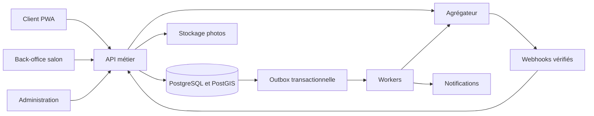

# 05 — Architecture technique recommandée

## 1. Choix proposés, à confirmer par l’équipe

Une application web PWA responsive pour clients et salons ; interface Next.js/TypeScript ; API NestJS/TypeScript ; PostgreSQL avec PostGIS ; Redis pour files de travaux et cache ; stockage objet compatible S3 pour les photos ; fournisseur d’identité ou service OTP ; agrégateur de paiement ; fournisseur de messages et de cartes.

Un monolithe modulaire est recommandé au lancement pour limiter le coût de maintenance. Modules : identité, catalogue, recherche, disponibilité, réservation, paiement, fidélité, abonnement, notifications, support et reporting. Les décisions critiques de réservation sont prises dans PostgreSQL ; Redis ne constitue pas la source de vérité de la disponibilité.

Les versions exactes seront figées sur des versions maintenues au moment de l’implémentation, dans les manifestes, fichiers de version et lockfiles. Aucun choix de framework n’est présenté comme déjà installé dans le dépôt.

## 2. Flux logique



## 3. Concurrence et intégrité

Créer une table d’occupations avec salon, collaborateur, intervalle et état actif. Utiliser une contrainte d’exclusion PostgreSQL sur collaborateur et intervalle pour empêcher les chevauchements des occupations actives. L’expiration des blocages met explicitement l’état à jour ; ne pas placer une condition dépendant de l’heure courante dans une contrainte supposée immuable.

À chaque acquisition, traiter transactionnellement les blocages expirés pertinents, puis insérer l’occupation. Les travailleurs d’expiration restent utiles mais leur retard ne doit pas provoquer de surbooking. En concurrence, une seule acquisition réussit et les autres reçoivent un conflit métier récupérable.

Un report verrouille le rendez-vous, acquiert le nouvel intervalle et libère l’ancien dans la même transaction. Les paiements, réservations et droits fidélité utilisent des références uniques pour éviter les doubles effets. Les événements sortants sont écrits dans une outbox avec la transaction métier, puis délivrés au moins une fois avec déduplication chez les consommateurs.

## 4. Disponibilité et recherche

PostGIS calcule la distance géographique à partir de coordonnées publiques de salon. Le tri par distance ne promet pas un temps de trajet. Conserver la position précise du client seulement le temps nécessaire à la recherche si elle n’est pas enregistrée volontairement.

Le calcul de créneaux croise horaires, habilitations, pauses, marges et occupations. Le cache de disponibilité doit être court et invalidé à chaque changement ; la réservation refait systématiquement le contrôle transactionnel. Les disponibilités affichées constituent une proposition jusqu’à confirmation.

## 5. Intégrations

L’agrégateur est encapsulé derrière une interface : créer paiement, consulter statut, rembourser, consulter remboursement, ordonner reversement, consulter reversement, rapprocher et vérifier webhook. Séparer sandbox et production, leurs clés et URLs. Ne pas supposer qu’un même identifiant est valide dans les deux environnements.

Les médias sont téléversés via URL signée et validés : taille, type réel, droits, suppression des métadonnées sensibles et génération de formats réduits. Bloquer les contenus exécutables déguisés en image.

Les notifications sont asynchrones, dédupliquées, réessayées de manière bornée et suivies. Un incident SMS ne doit pas annuler une réservation déjà confirmée. L’application conserve toujours la confirmation consultable.

## 6. Environnements et livraison

Développement local, staging et production distincts. Docker Compose proposé pour PostgreSQL/PostGIS, Redis et stockage objet local ; mocks contrôlés pour développement, vraie sandbox pour recette financière. Aucun secret dans le dépôt ni dans les images.

Pipeline recommandé : installation reproductible → lint/typecheck → tests unitaires → tests d’intégration sur PostgreSQL → tests API → parcours navigateur → build → analyse des dépendances → migration staging → smoke tests → déploiement contrôlé.

Les migrations suivent une stratégie compatible avec le retour à la version précédente : ajouts avant suppressions, sauvegarde et vérification des migrations de données. Les secrets viennent du gestionnaire de secrets de l’hébergeur. Les logs masquent les jetons, numéros complets et contenus privés.

## 7. Observabilité et reprise

Mesures : latence API, conflits de réservation, paiement en attente trop longtemps, retard de webhook, file de notifications, remboursement échoué, reversement en échec, divergence de rapprochement et erreurs d’isolation.

Identifiant de corrélation commun entre réservation, paiement et remboursement. Alertes distinctes pour panne générale et incident individuel. Sauvegardes chiffrées, restauration périodique sur environnement isolé, suivi du temps réel de reprise.

## 8. Organisation future du dépôt

```text
apps/web/                 interfaces client, salon et administration
apps/api/                 modules métier et API
apps/worker/              événements et tâches asynchrones
packages/contracts/      schémas de validation et types partagés
packages/ui/             composants accessibles
infra/                   conteneurs, déploiement, observabilité
tests/                   intégration, concurrence et parcours complets
dossier-projet/           spécifications et recette
```

Cette structure est une recommandation, pas une arborescence applicative déjà créée. L’environnement cloud étant isolé, utiliser le checkout existant ; ne créer un worktree supplémentaire que si cela est explicitement demandé.
