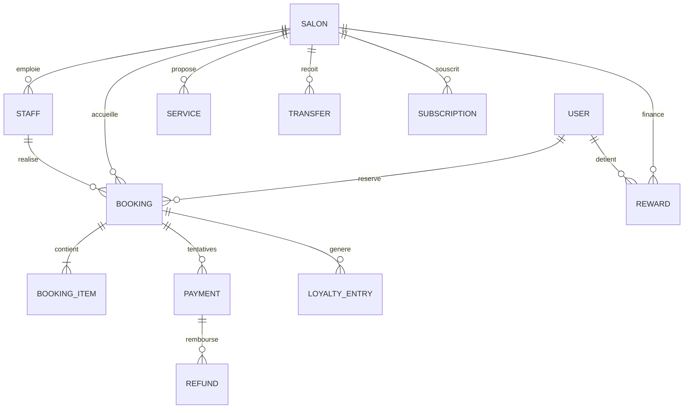

# 06 — Modèle de données et contrat fonctionnel API

## 1. Conventions

Identifiants UUID opaques, horodatages UTC avec fuseau, fuseau IANA porté par le salon, devise ISO explicite et montants en unités entières. Les tables liées aux salons portent un `salon_id`. Les relations garantissent aussi l’appartenance au même salon, pas uniquement l’existence d’un identifiant.

Les données de devis, prix, durée et politique sont figées à la réservation. Une modification ultérieure du catalogue ne modifie pas un rendez-vous existant. Les données personnelles supprimables sont séparées des pièces financières soumises à conservation.

## 2. Entités et données principales

| Entité | Champs principaux | Contraintes et finalité |
|---|---|---|
| User | id, téléphone vérifié, email, statut, langue | Téléphone normalisé unique selon politique de récupération |
| Salon | id, propriétaire, nom, adresse, coordonnées, fuseau, devise, catégorie, statut | Publication et habilitation paiement distinctes |
| Membership | user_id, salon_id, rôle, statut | Un lien unique utilisateur/salon ; permissions contrôlées serveur |
| Staff | id, salon_id, membership_id facultatif, nom public, actif | Un professionnel peut exister sans accès back-office |
| Service | id, salon_id, titre, durée, prix, actif | Durée positive ; prix non négatif ; version/snapshot |
| StaffService | staff_id, service_id, salon_id | Compétence explicite ; même salon |
| AvailabilityRule | staff/salon, jour, début, fin, dates d’effet | Aucun intervalle négatif ; congés prioritaires |
| TimeOff | staff_id, intervalle, motif limité | Bloque les créneaux sans exposer de données sensibles |
| Occupancy | salon, staff, intervalle, type, actif, expire_at, booking_id | Exclusion des chevauchements actifs |
| Booking | client, salon, staff, origine, statut, début/fin, politique figée | Machine à états et verrouillage concurrent |
| BookingItem | booking_id, service_id, titre/durée/prix figés, remise | Évite les changements rétroactifs |
| Quote | booking/hold, principal, frais, total, devise, version, expiration | Total égal à la somme des lignes |
| PolicyVersion | salon, règles, validité, hash/document accepté | Référencée par la réservation |
| Payment | booking, provider_ref, montant, devise, statut, idempotency_key | Référence prestataire et clé uniques |
| ProviderEvent | event_id, type, reçu/traité, empreinte, statut | Déduplication ; payload restreint et expurgé |
| Refund | payment, montant, ventilation, motif, statut, provider_ref | Somme confirmée limitée aux fonds encaissés |
| Transfer | salon, bénéficiaire vérifié, montant, statut, provider_ref | Reversement unique pour les fonds éligibles |
| LedgerEntry | transaction_id, compte, débit/crédit, devise, source | Journal immuable équilibré ; écritures compensatoires |
| Attendance | booking, arrivée, début, fin, validateur, preuve minimale | Historique des corrections et contestations |
| LoyaltyProgramVersion | salon, seuil, avantage, admissibilité, expiration | Conditions versionnées et droits acquis conservés |
| LoyaltyEntry | client, salon, booking, delta, type, motif, source unique | Crédits, débits et corrections non dupliqués |
| Reward | client, salon, version, statut, expiration, valeur/plafond | Une utilisation active à la fois |
| RewardRedemption | reward, booking, réservé/consommé/restitué | Verrouillage transactionnel |
| Review | booking, client, salon, note, texte, modération | Un avis par visite réalisée |
| Subscription | salon, offre versionnée, essai, échéance, état | Ne déclenche aucune facturation sans acceptation |
| SubscriptionInvoice | salon, période, prix, taxes, règlement, statut | Unicité période/facture ; reçu distinct du paiement client |
| Dispute | booking/payment, auteur, motif, statut, décision | Bloque les fonds pertinents ; droit de contestation |
| Notification | événement, canal, destinataire, état, tentatives | Idempotence et limite des réessais |
| Consent | user, type, version, date, retrait | Marketing distinct des conditions de réservation |
| AuditLog | acteur, salon, action, objet, date, justification | Accès restreint ; pas de secret enregistré |
| OutboxEvent | type, aggregate_id, version, payload minimal, livraison | Écrit avec l’état métier dans la même transaction |

## 3. Relations essentielles

## 4. Machines à états séparées

Réservation : demande → en_attente_paiement ou confirmée → arrivée → en_cours → réalisée. Branches : refusée, expirée, annulée_client, annulée_salon, absence_signalée. Une absence contestée passe par un dossier ; la correction est un événement audité, pas un écrasement silencieux.

Paiement : créé → en_attente → réussi ou échoué/expiré. Les remboursements sont des objets distincts ; le total remboursé permet de dériver partiellement_remboursé ou remboursé. Une notification tardive contradictoire ne doit pas écraser un succès confirmé sans vérification du prestataire.

Reversement : non_éligible → éligible → demandé → confirmé ; branches bloqué, échoué, annulé si le prestataire le permet. Une réservation réalisée n’implique pas que le reversement est déjà reçu.

Récompense : acquise → disponible → réservée → consommée ; branches expirée et restituée. Le journal fait foi en cas de correction rétroactive.

Abonnement : essai → actif → impayé_en_grâce → suspendu ; branche résiliation_programmée puis terminé. Les obligations de rendez-vous existantes survivent à la suspension.

## 5. Contrat API proposé

Base `/v1`. Authentification par session sécurisée ou jeton court ; les opérations salon vérifient l’appartenance et le rôle. Les routes publiques ne retournent que les données publiées. Pagination à curseur, filtres validés et erreurs structurées : `code`, `message`, `request_id`, `details` non sensibles.

| Méthode et route | Entrée/résultat principal | Droits |
|---|---|---|
| GET /salons | position ou zone, rayon, catégorie, service → résultats paginés | Public |
| GET /salons/{id} | fiche publique et conditions | Public |
| GET /salons/{id}/availability | service, date, staff facultatif → créneaux | Public, limité en fréquence |
| POST /auth/otp/request | téléphone → référence de vérification | Public, fortement limité |
| POST /auth/otp/verify | référence, code → session | Public |
| POST /booking-requests | salon, service, horaire, mode paiement → demande | Client |
| POST /booking-requests/{id}/accept | acquisition et confirmation/blocage | Salon autorisé |
| POST /holds | service, staff/horaire, reward facultatif → hold, expiration, devis | Client ; mode automatique |
| POST /bookings | hold et politique acceptée → réservation sans paiement | Client propriétaire du hold |
| POST /payments | hold/devis → intention de paiement existante ou nouvelle | Client ; idempotence obligatoire |
| GET /me/bookings/{id} | réservation, paiement et remboursement | Client concerné |
| POST /bookings/{id}/cancel-preview | motif → montant remboursable et indemnité | Client/salon selon contexte |
| POST /bookings/{id}/cancel | devis d’annulation accepté → état et remboursement | Acteur autorisé ; idempotent |
| POST /bookings/{id}/reschedule | nouveau créneau et version → report atomique | Client/salon autorisé |
| POST /salon/bookings/{id}/arrival | code/preuve minimale → arrivée | Réception/collaborateur autorisé |
| POST /salon/bookings/{id}/complete | réalisation → fin et crédit en attente éventuel | Collaborateur autorisé |
| POST /salon/bookings/{id}/no-show | motif → absence signalée et notification | Salon autorisé |
| GET /me/rewards | soldes, avantages et conditions par salon | Client |
| PUT /salon/loyalty-program | nouvelle version → effet prospectif | Propriétaire/responsable habilité |
| GET /salon/finance | principal, frais, remboursements et reversements | Finance salon |
| POST /disputes | réservation, motif → dossier | Partie concernée |
| POST /admin/refunds | ventilation et justification → demande prestataire | Finance plateforme |
| POST /webhooks/payments/{provider} | événement brut signé → accusé après persistance | Signature fournisseur, pas session client |
| GET /salon/subscription | offre, échéance et factures | Propriétaire |
| POST /salon/subscription/subscribe | offre et consentement → paiement/souscription | Propriétaire |

Les routes CRUD du catalogue, de l’équipe, des horaires et des médias suivent les mêmes droits et règles de validation. Une spécification OpenAPI exécutable sera produite avec l’implémentation, à partir des schémas réellement livrés ; cette table est un contrat fonctionnel de conception.

## 6. Idempotence et événements

Les créations de paiement, annulations, remboursements et reversements utilisent `Idempotency-Key`, stockée avec l’acteur, l’opération et l’empreinte de la requête. Même clé et même corps : même réponse. Même clé et corps différent : conflit. Une réutilisation ne crée jamais un nouveau débit.

Événements métier : BookingConfirmed, BookingCancelled, BookingRescheduled, AttendanceRecorded, ServiceCompleted, NoShowReported, PaymentSucceeded, RefundRequested, RefundSucceeded, TransferSucceeded, RewardEarned, RewardRedeemed, DisputeOpened et SubscriptionExpired.

Chaque événement contient identifiant unique, type, version de schéma, identifiant d’objet et date UTC. Les données personnelles superflues sont exclues. Les consommateurs doivent supporter les doublons, retards et interruptions.
